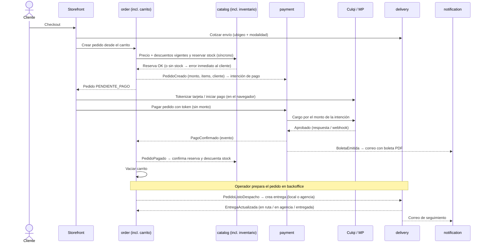
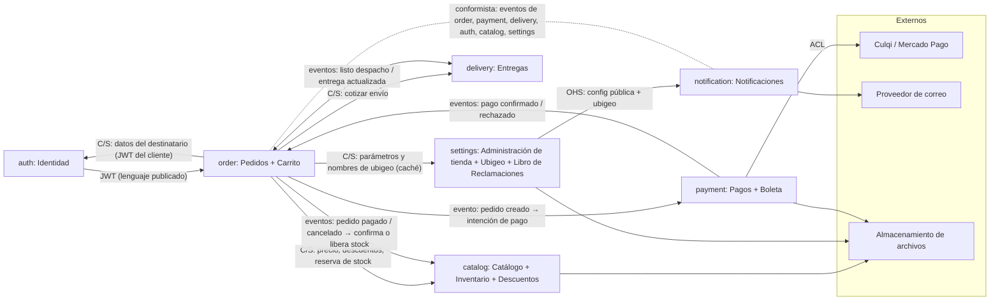

# FitStore — Análisis técnico macro

> Proyecto final DAW II (4697) + DSW II (4698) — Cibertec, 6.º ciclo.
> Autor: Carlos Azabache. Versión: **v24 (aprobado)** — 2026-10-19.
> Documento base: [`CONSOLIDADO-PROYECTO.md`](../../../CONSOLIDADO-PROYECTO.md).
> Siguiente etapa: análisis técnico micro (por servicio) → C4 → specs → contratos.

**Historial:**
- v24 (2026-10-19): por la etapa de diseño: el tema de la tienda configura solo los colores (CU-31, RF-SET-02); tipografía y bordes fijos.
- v23 (2026-10-19): revisión de coherencia: catálogo de eventos: `PedidoExpirado` separado de `PedidoCancelado` (notification no lo consume); RF-BO-03 marcado como alcance futuro.
- v22 (2026-10-19): por SPEC-8: ADR-013 actualizada (Garage en la VM también en Azure; adaptador Azure Blob diferido); los datos de demostración se cargan también en la nube (perfil `demo`).
- v21 (2026-10-19): por SPEC-6: **devolución a tienda** cuando un pedido no se puede entregar o nadie lo recoge: estado `DEVUELTA` en delivery y `DEVUELTO` (final) en order, reembolso sin plazo desde un pedido devuelto, nuevo correo al cliente (14): RF-ORD-03, RF-ORD-11, RF-DEL-02, RF-NOT-01.
- v20 (2026-10-18): por SPEC-5: **reembolso postventa** desde el pedido entregado (total o parcial, solo ADMIN, plazo configurable con 0 = ilimitado): RF-PAY-06, nuevo RF-ORD-11, RF-SET-05.
- v19 (2026-10-18): ADR-021 aprobada, sin políticas de rama forzadas.
- v18 (2026-10-18): ADR-021 propuesta (flujo de ramas dev → stage → main). Desde ahora todo entra por PR a `dev`.
- v17 (2026-10-18): por SPEC-2: imágenes por color (RF-CAT-04), carga masiva de productos (RF-CAT-09), ejemplos de categorías renombrados.
- v16 (2026-10-16): micro de `notification-service`: sin correo antes del pago (el primero es "pedido confirmado" con boleta); **editor de plantillas pasa a alcance actual** (RF-NOT-04, CU-33: C → M); nuevo parámetro de tienda "correos para alertas".
- v15 (2026-10-16): micro de `payment-service` aprobado: eventos `PagoReembolsado` y `ReembolsoFallido`; 3-D Secure se implementa solo si el sandbox lo exige.
- v14 (2026-10-16): Yape vía Culqi incluido (RF-PAY-09); 3-D Secure fuera del MVP; nuevo riesgo R16 (particularidades del sandbox).
- v13 (2026-10-16): ajustes del micro de `order-service`: estados `EXPIRADO` y `LISTO_RECOJO`; eventos `PedidoListoRecojo` y `PedidoRecogido`; relación síncrona order → settings (parámetros y nombres de ubigeo, con caché).
- v12 (2026-10-16): ajustes del micro de `catalog-service`: el stock mínimo por defecto pasa de settings a catalog (RF-SET-05 / RF-INV-05); nuevo evento `StockNoConfirmado`.
- v11 (2026-10-16): ajustes derivados del micro de `auth-service`: nueva relación síncrona order → auth (datos del destinatario en el checkout, con el JWT del cliente); `UsuarioRegistrado` pasa a `ClienteRegistrado`; nuevo evento `PasswordCambiado`; clientes y staff en tablas separadas.
- v10 (2026-10-14): sección 7 aprobada (R1–R15). Estrategia de entornos: **todo el desarrollo en local con Docker; la nube solo al final, para la demo**. Sección 8 sin pendientes → **análisis macro cerrado**.
- v9 (2026-10-14): ADR-014 (plantillas con Thymeleaf, SES solo transporte) aprobada → **sección 6 cerrada**. Sección 7 ampliada con riesgos nuevos derivados de las ADRs (en revisión).
- v8 (2026-10-14): revisión de ADRs (sección 6, parte 2): aprobadas 010 (OpenFeign + Resilience4j), 013 (puerto + adaptadores, **Garage** en local y VM; S3 real no es gratis para la cuenta, se deja como opción de configuración), 017 (Jaeger) y 018 (GitHub Actions). 014: se aclara que Thymeleaf genera el HTML de los correos y SES solo los envía (pendiente de confirmar).
- v7 (2026-10-13): revisión de ADRs (sección 6, parte 1): aprobadas 006, 007, 008, 009 (saga coreografiada detallada), 011, 016; 005-optimización pospuesta; 014 → Amazon SES; 013 reemplaza MinIO (sin imágenes Docker oficiales desde oct-2025) y agrega adaptador Azure Blob; 017 propone Jaeger; 018 GitHub Actions. Pendientes: 010, 013, 017, 018.
- v6 (2026-10-13): sección 5 revisada y aprobada. Boleta simulada pasa a `payment-service`; ubigeo como dato maestro en `settings-service`; descuentos en `catalog-service`; reserva de stock **síncrona**; `payment` crea una intención de pago a partir de `PedidoCreado` (el monto nunca viene del navegador).
- v5 (2026-10-13): sección 4 revisada y aprobada. **Redis se reincorpora** (ADR-020): rate limiting de login, carrito y caché de lecturas críticas. Producto en varias categorías. Pago anticipado obligatorio confirmado (se mantiene reserva de stock → pago).
- v4 (2026-10-13): sección 3 revisada y aprobada (DNI obligatorio, categorías por tipo de prenda hasta 2 niveles y sin género, descuentos globales con excepciones por producto contando surtido, boleta simulada, sin contra entrega, sin evidencia fotográfica, Libro de Reclamaciones en `settings-service`).
- v3 (2026-10-13): sección 2 revisada y aprobada (agencia elegible por el cliente con datos mock, compra solo con cuenta, CU-07/08/13/25 elevados a imprescindibles).
- v2 (2026-10-13): sección 1 revisada y aprobada (vertical ropa y moda, descuentos por volumen, envíos a nivel nacional); granularidad reducida de 12 a 10 servicios (ADR-019).
- v1 (2026-10-13): borrador inicial.

**Estado de revisión por sección:** 1 ✅ · 2 ✅ · 3 ✅ · 4 ✅ · 5 ✅ · 6 ✅ · 7 ✅ · 8 ✅

**Convención de estados:** ✅ decidido · 🟡 propuesto (pendiente de aprobación) · ❓ abierto.

---

## Índice

1. [Visión y alcance](#1-visión-y-alcance)
2. [Actores y casos de uso](#2-actores-y-casos-de-uso)
3. [Requisitos funcionales](#3-requisitos-funcionales)
4. [Requisitos no funcionales](#4-requisitos-no-funcionales)
5. [Bounded contexts y mapa de contextos](#5-bounded-contexts-y-mapa-de-contextos)
6. [Decisiones de arquitectura (ADRs)](#6-decisiones-de-arquitectura-adrs)
7. [Riesgos](#7-riesgos)
8. [Preguntas abiertas](#8-preguntas-abiertas)

---

## 1. Visión y alcance

### 1.1 Visión

**FitStore** es una plantilla de comercio electrónico *white-label* **especializada en ropa y moda** para MYPEs de confección. Se instala una vez por cliente y se adapta a su marca (logo, colores, textos, zonas de envío, medios de pago, descuentos) desde un backoffice, sin tocar código. Su modelo está pensado para el rubro: variantes por talla y color, guía de tallas, descuentos por volumen al estilo de la venta por mayor de Gamarra y envíos a todo el país. El primer caso de uso es una MYPE de Gamarra que fabrica ropa deportiva.

### 1.2 Problema

Las MYPEs de confección de Gamarra que producen ropa deportiva venden sobre todo de forma presencial o por redes sociales y WhatsApp, de forma manual: sin catálogo con stock real, sin pagos en línea integrados y sin seguimiento ordenado de pedidos y entregas. Al mismo tiempo crece la demanda de ropa deportiva por la tendencia de vida saludable, y aumenta la competencia de importaciones y plataformas extranjeras. (Sustento con fuentes en el SEPTE del informe.)

### 1.3 Propuesta de valor

| Para | FitStore ofrece |
|---|---|
| Cliente final | Comprar 24/7 desde el celular en cualquier parte del Perú, pagar en línea (tarjeta, billeteras), obtener descuentos por volumen, seguir el estado de su pedido y entrega |
| Dueño de la MYPE | Tienda propia con su marca, catálogo con stock por talla y color, panel tipo Shopify para pedidos y despachos, indicadores de ventas |
| Operador / almacén | Cola de pedidos por preparar y despachar, asignación de repartidores, registro de entregas |
| Quien comercializa FitStore | Un producto replicable: una instalación por cliente, branding configurable, despliegue con contenedores en cualquier nube |

### 1.4 Alcance

**Dentro del alcance:**

- Storefront público: landing, navegación por categorías de tipo de prenda (configurables desde el backoffice), catálogo con filtros, detalle con variantes, carrito, registro/login, checkout, pago, mis pedidos, seguimiento.
- **Descuentos por volumen** (estilo venta por mayor): al llevar 3, 6 o 12 unidades se aplica un descuento escalonado. Los tramos y porcentajes son configurables.
- **Envíos a nivel nacional** con tres modalidades:
  - *Delivery local* (Lima Metropolitana / Callao) con repartidores propios, tarifa por distrito.
  - *Envío a provincia por agencia de transporte*: el cliente **elige la agencia en un select** en el checkout; tarifa por departamento/provincia; el operador registra el código de seguimiento o clave de recojo. Por ahora las agencias son **datos mock** (lista semilla, sin integración).
  - *Recojo en tienda* (Gamarra).
- Backoffice: dashboard, catálogo, inventario, pedidos, pagos, entregas, repartidores y zonas, clientes, usuarios staff, **configuración de tienda** (branding y parámetros de negocio), plantillas de notificación.
- Pagos con **Culqi** y **Mercado Pago** en modo sandbox.
- Notificaciones por correo de los eventos del pedido.
- Despliegue en una VM en la nube con contenedores.
- Pruebas: capa de datos (`@DataJpaTest`), colecciones Postman, pruebas de carga k6.

**Fuera del alcance (explícito):**

- Multi-tenant (varias tiendas en una misma instalación).
- Facturación electrónica SUNAT (boletas/facturas reales). Se emite una **boleta simulada en PDF** sin validez tributaria.
- Pago contra entrega: todo pedido se paga en línea.
- App móvil nativa y app para repartidores (el repartidor no inicia sesión; el operador registra sus avances).
- Integración por API con agencias o couriers (el código de seguimiento se registra manualmente) y cálculo de rutas.
- Marketplace multi-vendedor, cupones y promociones distintas a los descuentos por volumen, reseñas de productos.
- Pagos en producción (solo sandbox).
- **Extensiones futuras de alcance** (no MVP): prefijo configurable del código de pedido (p. ej. `NIKE-000123`).
- Compra como invitado: **toda compra requiere cuenta**, para que el cliente pueda rastrear su pedido y ver su estado.
- Acceso del repartidor al sistema (existen herramientas dedicadas; fuera de alcance).

### 1.5 Restricciones

| Tipo | Restricción |
|---|---|
| Académica | Java + Spring Boot (Spring MVC, Spring Data JPA, Lombok, Spring Security, `BCryptPasswordEncoder`), Angular, CRUD REST GET/POST/PUT/DELETE persistido, publicación en la nube, pruebas de la capa de datos, Postman |
| Académica | Entregables: informe .docx, PPT, proyecto, video 3–5 min; sustentación en semana 14 |
| Equipo | Un solo desarrollador (apoyado por agentes de IA en la implementación) |
| Infraestructura | Una VM de ~8 GB de RAM; costo cercano a cero (créditos de estudiante) |
| Tecnológica | Spring Boot 4.0.x + Spring Cloud 2025.1.x (alineado con la clase), Java 21 |
| Cronograma | Lo controla el autor; el avance es progresivo por etapas (fuera de este documento) |

### 1.6 Supuestos

- La MYPE vende en soles (PEN) y envía **a todo el Perú**: delivery propio en Lima/Callao, agencia de transporte a provincias, o recojo en tienda. Las ubicaciones se modelan con **ubigeo** (departamento / provincia / distrito, INEI).
- Un pedido tiene una sola entrega (sin envíos parciales).
- En envíos por agencia, el cliente paga el envío en el checkout según la tarifa configurada (sin pago en destino).
- Los precios incluyen IGV; no se desglosa impuesto en esta versión.
- Las credenciales sandbox de Culqi y Mercado Pago están disponibles para cuentas de prueba.

---

## 2. Actores y casos de uso

### 2.1 Actores

| Actor | Tipo | Descripción |
|---|---|---|
| **Visitante** | Humano | Navega la tienda sin sesión |
| **Cliente** | Humano | Visitante registrado; compra y sigue sus pedidos |
| **Operador** | Humano (staff) — rol `OPERADOR` | Prepara pedidos, gestiona stock y despachos, registra entregas |
| **Administrador** | Humano (staff) — rol `ADMIN` | Todo lo del operador + catálogo, configuración de tienda, usuarios, reportes |
| **Repartidor** | Humano (sin acceso) | Entidad gestionada por el operador; no usa el sistema (decidido) |
| **Agencia de transporte** | Externo (mock, sin integración) | Traslada envíos a provincia; el cliente la elige en el checkout y el operador registra el código de seguimiento |
| **Culqi / Mercado Pago** | Sistema externo | Procesan pagos y notifican resultados (webhooks) |
| **Proveedor de correo** | Sistema externo | Envía correos transaccionales (SMTP) |
| **Almacenamiento de archivos** | Sistema externo | Guarda imágenes de productos y logos |
| **Planificador** | Sistema (tiempo) | Expira reservas de stock, pedidos sin pago y carritos abandonados |

### 2.2 Casos de uso

Prioridad: **M** = imprescindible, **S** = importante, **C** = deseable.

**Storefront (Visitante / Cliente)**

| ID | Caso de uso | Actor | Prioridad |
|---|---|---|---|
| CU-01 | Ver landing con la marca configurada | Visitante | M |
| CU-02 | Explorar catálogo por categorías y con filtros (categoría, talla, color, precio) y búsqueda | Visitante | M |
| CU-03 | Ver detalle de producto y elegir variante | Visitante | M |
| CU-04 | Gestionar carrito (agregar, cambiar cantidad, quitar) | Visitante/Cliente | M |
| CU-05 | Registrarse (incluye DNI obligatorio) | Visitante | M |
| CU-06 | Iniciar / cerrar sesión | Cliente, staff | M |
| CU-07 | Recuperar contraseña por correo | Cliente | M |
| CU-08 | Gestionar perfil y direcciones | Cliente | M |
| CU-09 | Realizar checkout con sesión iniciada (dirección con ubigeo, modalidad de entrega, agencia si aplica, costo de envío, descuentos por volumen) | Cliente | M |
| CU-10 | Pagar con Culqi o Mercado Pago | Cliente | M |
| CU-11 | Ver historial y detalle de pedidos | Cliente | M |
| CU-12 | Seguir el estado del pedido y la entrega (timeline) | Cliente | M |
| CU-13 | Cancelar pedido antes del despacho | Cliente | M |
| CU-14 | Registrar reclamo en Libro de Reclamaciones virtual | Visitante/Cliente | S |

**Backoffice (Operador / Administrador)**

| ID | Caso de uso | Actor | Prioridad |
|---|---|---|---|
| CU-20 | Ver dashboard (ventas, pedidos por estado, stock bajo, entregas del día) | Operador, Admin | M |
| CU-21 | Gestionar el árbol de categorías (hasta 2 niveles) y asignar productos; la navegación de la tienda se arma con él | Admin | M |
| CU-22 | Gestionar productos, variantes e imágenes | Admin | M |
| CU-23 | Gestionar stock (entradas, ajustes) y ver movimientos | Operador, Admin | M |
| CU-24 | Gestionar pedidos (listar, filtrar, ver, cambiar estado, cancelar) | Operador, Admin | M |
| CU-25 | Consultar pagos y registrar reembolsos | Admin | M |
| CU-26 | Gestionar entregas locales (asignar repartidor, programar, marcar en ruta / entregado / fallido) | Operador, Admin | M |
| CU-26b | Gestionar envíos por agencia (registrar código de seguimiento/clave, marcar enviado / disponible en agencia / entregado) | Operador, Admin | M |
| CU-27 | Gestionar repartidores | Operador, Admin | M |
| CU-28 | Gestionar tarifas de envío (por distrito en Lima/Callao, por departamento/provincia para agencia; costo y tiempo estimado) y agencias habilitadas | Admin | M |
| CU-29 | Consultar clientes y su historial | Operador, Admin | S |
| CU-30 | Gestionar usuarios staff y roles | Admin | M |
| CU-31 | **Configurar tienda**: marca, logo, colores, textos, contacto, redes, políticas | Admin | M |
| CU-32 | Configurar parámetros de negocio: moneda, métodos de pago y de entrega habilitados, stock mínimo | Admin | M |
| CU-33 | Gestionar plantillas de notificación y ver el registro de envíos | Admin | M |
| CU-34 | Atender reclamos del Libro de Reclamaciones | Admin | S |
| CU-35 | Configurar descuentos por volumen (tramos 3 / 6 / 12 unidades y porcentajes) | Admin | M |

**Sistema**

| ID | Caso de uso | Actor | Prioridad |
|---|---|---|---|
| CU-40 | Reservar stock al crear pedido y liberarlo si el pago falla o expira | Sistema | M |
| CU-41 | Procesar webhook de pago y confirmar pedido | Culqi / MP | M |
| CU-42 | Enviar notificación por cada cambio relevante de pedido/entrega | Sistema | M |
| CU-43 | Alertar stock bajo | Sistema | S |
| CU-44 | Expirar carritos abandonados y pedidos sin pago | Planificador | S |

### 2.3 Flujo principal: compra

Camino alternativo: si el pago falla o expira, `PagoRechazado` / `PedidoExpirado` → catalog libera la reserva y el pedido pasa a `CANCELADO` (compensación de la saga).

---

## 3. Requisitos funcionales

Formato: `RF-<CONTEXTO>-NN`. Prioridad MoSCoW.

### 3.1 Identidad (`auth-service`)

| ID | Requisito | P |
|---|---|---|
| RF-IAM-01 | Registro de clientes con nombres, apellidos, **DNI obligatorio** (8 dígitos, único), correo único, teléfono, contraseña y aceptación de términos y tratamiento de datos. El nombre y DNI del cliente se usan como destinatario en los envíos | M |
| RF-IAM-02 | Login con correo y contraseña contra BD; contraseña almacenada con `BCryptPasswordEncoder` | M |
| RF-IAM-03 | Emisión de token de acceso (JWT) y token de refresco; cierre de sesión | M |
| RF-IAM-04 | Roles `CLIENTE`, `OPERADOR`, `ADMIN`; autorización por rol en cada endpoint | M |
| RF-IAM-05 | CRUD de usuarios staff (solo ADMIN); activar/desactivar usuarios | M |
| RF-IAM-06 | Cambio y recuperación de contraseña (token por correo con expiración) | M |
| RF-IAM-07 | Perfil del cliente y libreta de direcciones (con ubigeo) | M |
| RF-IAM-08 | Validaciones: formato de correo, política mínima de contraseña, bloqueo temporal tras N intentos fallidos | S |

### 3.2 Catálogo (`catalog-service`)

| ID | Requisito | P |
|---|---|---|
| RF-CAT-01 | CRUD de categorías por **tipo de prenda**, hasta **2 niveles** (p. ej. Leggings y pantalones › Leggings, Joggers, Shorts, Faldas; Polos y tops › Polos, Tops; Vestidos), con orden y estado; **sin clasificación por género**. El menú y las secciones de la tienda se generan a partir de este árbol | M |
| RF-CAT-02 | CRUD de productos: nombre, slug, descripción, precio base, estado (borrador/activo/inactivo). Un producto puede pertenecer a **varias categorías** (p. ej. "Leggings" y "Nueva colección"); la asignación se hace desde el backoffice | M |
| RF-CAT-03 | Variantes por producto (SKU único, talla, color, precio opcional) | M |
| RF-CAT-04 | Imágenes por producto y **por color** (subida, orden, imagen principal); la tienda muestra solo las fotos del color elegido | M |
| RF-CAT-09 | **Carga masiva de productos y variantes** desde CSV o XLSX, con validación previa y creación todo-o-nada | M |
| RF-CAT-05 | Búsqueda y filtros con paginación y orden (precio, novedad) | M |
| RF-CAT-06 | Guía de tallas por categoría | S |
| RF-CAT-07 | Productos destacados para la landing | S |
| RF-CAT-08 | **Descuentos por volumen**: **política global** de tramos (por defecto 3, 6 y 12 unidades) con porcentaje por tramo, y **excepciones por producto** (otros porcentajes o sin descuento). El tramo se cuenta **por producto sumando sus variantes** (surtido de tallas y colores, como en Gamarra). Se muestra en el detalle del producto ("Lleva 6 y ahorra X %") | M |

### 3.3 Inventario (módulo de `catalog-service`)

| ID | Requisito | P |
|---|---|---|
| RF-INV-01 | Stock disponible y reservado por SKU | M |
| RF-INV-02 | Movimientos: entrada, ajuste, venta, liberación (con usuario, motivo y fecha) | M |
| RF-INV-03 | Reserva de stock **síncrona** al crear pedido (respuesta inmediata: hay o no hay stock), con expiración; confirmación al pagar y liberación al fallar (por eventos) | M |
| RF-INV-04 | Consulta de disponibilidad por SKU (para catálogo y carrito) | M |
| RF-INV-05 | Umbral de stock mínimo (por variante y por defecto, configurable por el admin) y alerta de stock bajo | S |

### 3.4 Carrito (módulo de `order-service`)

| ID | Requisito | P |
|---|---|---|
| RF-CRT-01 | Carrito por cliente autenticado: agregar, actualizar cantidad, quitar, vaciar | M |
| RF-CRT-02 | Validar disponibilidad y precio vigente al agregar y al iniciar checkout; mostrar el descuento por volumen alcanzado y cuánto falta para el siguiente tramo | M |
| RF-CRT-03 | Carrito anónimo (por identificador de sesión) y fusión al iniciar sesión | S |
| RF-CRT-04 | Expiración de carritos inactivos | C |

### 3.5 Pedidos (`order-service`)

| ID | Requisito | P |
|---|---|---|
| RF-ORD-01 | Crear pedido desde el carrito con snapshot de productos, precios y dirección; requiere cliente autenticado | M |
| RF-ORD-02 | Modalidad de entrega: delivery local (Lima/Callao, tarifa por distrito), agencia a provincia (tarifa por departamento/provincia, elección de agencia) o recojo en tienda | M |
| RF-ORD-10 | Aplicar descuentos por volumen en el pedido, guardando el detalle del descuento en el snapshot | M |
| RF-ORD-03 | Máquina de estados: `PENDIENTE_PAGO → PAGADO → EN_PREPARACION → LISTO_DESPACHO → ENVIADO → ENTREGADO`; recojo: `EN_PREPARACION → LISTO_RECOJO → ENTREGADO`; finales `CANCELADO`, `EXPIRADO` y `DEVUELTO` (la entrega no se concretó o nadie recogió el pedido y volvió a la tienda) | M |
| RF-ORD-04 | Historial de estados con fecha, usuario y comentario | M |
| RF-ORD-05 | Consulta de pedidos del cliente y seguimiento | M |
| RF-ORD-06 | Gestión de pedidos en backoffice: filtros por estado, fecha, cliente; cambio de estado validado | M |
| RF-ORD-07 | Cancelación por cliente (antes de despacho) o staff, con compensaciones (reembolso, liberar stock) | M |
| RF-ORD-11 | **Reembolso postventa** de un pedido entregado (prenda defectuosa, talla o modelo equivocado, no conforme) o **devuelto a la tienda** (no entregado): total o parcial por prendas, con motivo, solo ADMIN, dentro del plazo configurable de la tienda (0 = sin límite; un pedido devuelto no tiene plazo); la suma de reembolsos nunca supera lo cobrado y el stock no se reingresa automáticamente | M |
| RF-ORD-08 | Expiración de pedidos `PENDIENTE_PAGO` tras N minutos, configurable en la tienda (sugerido 30) | S |
| RF-ORD-09 | Código de pedido legible (p. ej. `FS-000123`) | M |

### 3.6 Pagos (`payment-service`)

| ID | Requisito | P |
|---|---|---|
| RF-PAY-00 | Crear una **intención de pago** al recibir `PedidoCreado` (monto, ítems y datos del cliente); el cargo usa siempre ese monto, **nunca un monto enviado por el navegador** | M |
| RF-PAY-01 | Pago con tarjeta vía Culqi (token generado en el navegador, cargo en backend) | M |
| RF-PAY-02 | Pago vía Mercado Pago (Checkout Pro o Bricks, sandbox) | M |
| RF-PAY-03 | Proveedores intercambiables (patrón Strategy); habilitación por configuración de tienda | M |
| RF-PAY-04 | Recepción y validación de webhooks; idempotencia | M |
| RF-PAY-05 | Registro de transacciones (intentos, estado, respuesta del proveedor) | M |
| RF-PAY-06 | Reembolso **siempre originado en el pedido**: total al cancelar un pedido pagado, total o parcial en la postventa (RF-ORD-11); varios reembolsos por pago, sin superar lo cobrado | M |
| RF-PAY-09 | **Pago con Yape** vía Culqi (celular + código de aprobación → token → cargo); deshabilitado si el total supera el tope diario de Yape | M |
| RF-PAY-08 | **Boleta simulada en PDF** (sin validez tributaria) emitida al confirmarse el pago, con ítems, descuentos, envío y datos del cliente (nombre, DNI); descargable desde "Mis pedidos" y adjunta al correo de confirmación | S |

### 3.7 Entregas (`delivery-service`)

| ID | Requisito | P |
|---|---|---|
| RF-DEL-01 | Crear entrega automáticamente cuando el pedido pasa a `LISTO_DESPACHO`, según la modalidad (local o agencia) | M |
| RF-DEL-02 | Estados locales: `PENDIENTE_ASIGNACION → ASIGNADA → EN_RUTA → ENTREGADA`, `FALLIDA` (reprogramable o **devuelta a tienda**). Estados agencia: `PENDIENTE_ENVIO → ENVIADO_AGENCIA → DISPONIBLE_EN_AGENCIA → ENTREGADA`, o `DEVUELTA` si nadie lo recoge. `DEVUELTA` es final y exige motivo | M |
| RF-DEL-03 | CRUD de repartidores (nombre, teléfono, vehículo/placa, activo) | M |
| RF-DEL-04 | CRUD de tarifas de envío por **código de ubigeo** (se guardan solo los códigos): distrito (local) y departamento/provincia (agencia); costo, tiempo estimado, activa. Como el código es jerárquico (`DDPPdd`), la cotización busca la tarifa del distrito y, si no existe, la de la provincia o el departamento | M |
| RF-DEL-08 | Agencias de transporte (datos mock semilla, editables por admin): listado para el select del checkout; registro de código de seguimiento / clave de recojo por envío | M |
| RF-DEL-05 | Cotizar costo y plazo de envío según ubigeo y modalidad (consumido en checkout) | M |
| RF-DEL-06 | Eventos de seguimiento con fecha, usuario y observación (sin evidencia fotográfica) | S |
| RF-DEL-07 | Vista de entregas del día y por repartidor | S |

### 3.8 Notificaciones (`notification-service`)

| ID | Requisito | P |
|---|---|---|
| RF-NOT-01 | Correos al cliente (14): bienvenida, recuperación de contraseña, invitación de staff, contraseña cambiada, pedido confirmado (tras el pago, con boleta), cancelado, reembolso realizado, en camino (con agencia y código de seguimiento si aplica), entrega fallida, listo para recoger, entregado, pedido devuelto a la tienda, copia y respuesta de reclamo. Ningún correo antes del pago | M |
| RF-NOT-02 | Plantillas con la marca de la tienda (logo, colores, nombre) | M |
| RF-NOT-03 | Registro de envíos con estado y reintentos | S |
| RF-NOT-04 | Edición de los textos de las plantillas desde backoffice (asunto, título, mensaje, botón; activar/desactivar opcionales), con vista previa | M |
| RF-NOT-05 | Alertas a la tienda (a los "correos para alertas"): stock bajo, pedido pagado sin stock, reembolso fallido, reclamo nuevo | S |

### 3.9 Configuración de tienda (`settings-service`)

| ID | Requisito | P |
|---|---|---|
| RF-SET-01 | Identidad: nombre, eslogan, logo (claro/oscuro), favicon, imágenes de la landing | M |
| RF-SET-02 | Tema: colores (primario, secundario, acento, fondo, texto); la tipografía y los bordes son fijos del sistema de diseño | M |
| RF-SET-03 | Contenido: textos de la landing, contacto, redes, horario, dirección de tienda física | M |
| RF-SET-04 | Políticas: términos, privacidad, cambios y devoluciones, envíos | M |
| RF-SET-05 | Parámetros de negocio: moneda, métodos de pago y entrega habilitados, minutos de expiración de pedido, correos para alertas, días para reembolso postventa (0 = sin límite) (el stock mínimo por defecto lo guarda catalog, RF-INV-05) | M |
| RF-SET-06 | Endpoint público de configuración (sin datos sensibles) consumido por ambos frontends al iniciar | M |
| RF-SET-07 | Vista previa del tema antes de publicar | C |
| RF-SET-08 | **Datos maestros de ubigeo** (INEI): departamentos, provincias y distritos, servidos a los frontends (selects en registro, direcciones, checkout y tarifas) y cacheados en Redis | M |

### 3.10 Legal / cumplimiento

| ID | Requisito | P |
|---|---|---|
| RF-LEG-01 | **Libro de Reclamaciones virtual** (obligatorio para e-commerce en Perú, Código de Protección y Defensa del Consumidor): registro de reclamo o queja con número correlativo, referencia opcional a un pedido, copia por correo, atención y respuesta desde backoffice | S |
| RF-LEG-02 | Consentimiento de tratamiento de datos personales (Ley 29733) en registro y checkout | M |

Dueño del Libro de Reclamaciones: **`settings-service`**, cuyo dominio se amplía a *administración de tienda* (ver 5.1).

### 3.11 Backoffice transversal

| ID | Requisito | P |
|---|---|---|
| RF-BO-01 | Dashboard: ventas del día/semana/mes, pedidos por estado, top productos, stock bajo, entregas del día | M |
| RF-BO-02 | Tablas con paginación, filtros, orden y búsqueda | M |
| RF-BO-03 | Exportar pedidos a CSV (alcance futuro: no entra en ninguna spec, ver SPEC-4) | C |

---

## 4. Requisitos no funcionales

| ID | Categoría | Requisito | Métrica / criterio |
|---|---|---|---|
| RNF-01 | Rendimiento | Endpoints de lectura del catálogo responden rápido | p95 < 500 ms con 50 usuarios virtuales (k6) |
| RNF-02 | Rendimiento | Checkout completo (sin contar la pasarela) | p95 < 2 s |
| RNF-03 | Capacidad | Todo el sistema corre en una VM de 8 GB | Suma de `mem_limit` de contenedores ≤ 6,5 GB |
| RNF-04 | Seguridad | Contraseñas con BCrypt; JWT firmado asimétricamente; HTTPS en la nube | Sin secretos en el repositorio |
| RNF-05 | Seguridad | Autorización por rol en gateway y en cada servicio | Pruebas de acceso denegado por rol |
| RNF-06 | Seguridad | Datos de tarjeta nunca pasan por el backend (tokenización en el navegador) | Alcance PCI mínimo (SAQ A) |
| RNF-07 | Seguridad | Validación de entradas, CORS restringido, **rate limiting en login y endpoints sensibles con Redis** (en el gateway) | OWASP Top 10 como checklist; N intentos/min por IP y por usuario |
| RNF-08 | Disponibilidad | Reinicio automático de contenedores; health checks | `restart: unless-stopped` + Actuator health |
| RNF-09 | Resiliencia | Fallo de un servicio no tumba el resto; reintentos e idempotencia en eventos | Circuit breaker en llamadas síncronas |
| RNF-10 | Consistencia | Consistencia eventual entre servicios mediante eventos; sin transacciones distribuidas | Saga con compensaciones |
| RNF-11 | Mantenibilidad | Arquitectura en capas por servicio; convenciones del repo de clase; DTOs; manejo global de errores | Revisión en specs |
| RNF-12 | Pruebas | Pruebas de capa de datos (insertar, actualizar, eliminar, listar) en todos los servicios con BD | 100 % de repositorios principales |
| RNF-13 | Pruebas | Colección Postman por servicio; pruebas de carga k6 del catálogo y checkout | Colecciones versionadas en repo |
| RNF-14 | Documentación | OpenAPI/Swagger por servicio, agregado en el gateway | `/swagger-ui` disponible |
| RNF-15 | Observabilidad | Logs con id de correlación entre servicios; métricas Actuator | Trazabilidad de un pedido de punta a punta |
| RNF-16 | Portabilidad | Sin dependencias de un proveedor de nube; todo en contenedores y configurable por entorno | Desplegable en Azure, AWS o local con el mismo `docker-compose` |
| RNF-17 | White-label | Cambiar marca, colores y textos sin recompilar ni redeplegar | Cambio visible tras recargar la página |
| RNF-18 | Usabilidad | Storefront responsive (mobile-first); backoffice usable en escritorio y tablet | Lighthouse ≥ 85 en móvil (performance y accesibilidad) |
| RNF-19 | Accesibilidad | Contraste suficiente en la paleta configurada | Al guardar el tema se valida contraste WCAG AA y se **advierte** (no bloquea) |
| RNF-20 | Idioma | Interfaz en español (Perú); fechas y moneda en formato local | `es-PE`, PEN |
| RNF-21 | Costo | Operación académica a costo ~0; costo por cliente comercial bajo | Ver ADR-005 |

---

## 5. Bounded contexts y mapa de contextos

### 5.1 Contextos y servicios

El análisis parte de **9 bounded contexts**. En v1 cada uno era un microservicio (12 servicios con la infraestructura). En v2 se **agrupan contextos muy acoplados** para equilibrar costo y beneficio (ver ADR-019): el contexto sigue existiendo como **módulo interno** con sus propios paquetes, tablas y endpoints, pero comparte proceso y base de datos con su vecino.

| Contexto | Servicio | Tipo | Responsabilidad | Datos |
|---|---|---|---|---|
| Identidad y acceso | `auth-service` | Genérico | Clientes y staff (tablas separadas), roles, credenciales, tokens, perfil y direcciones | `auth_db` |
| Catálogo | `catalog-service` | **Núcleo** | Productos, variantes, categorías, imágenes, precios, **descuentos por volumen** (política global + excepciones) | `catalog_db` |
| Inventario | `catalog-service` (módulo) | **Núcleo** | Stock por SKU, reservas, movimientos | `catalog_db` |
| Carrito | `order-service` (módulo) | Soporte | Carritos (autenticados y anónimos) | **Redis** |
| Pedidos | `order-service` | **Núcleo** | Checkout, pedidos, estados, orquestación con pagos y entregas | `order_db` |
| Pagos | `payment-service` | Soporte | Intenciones de pago, transacciones, integración con pasarelas, reembolsos, **boleta simulada** | `payment_db` |
| Entregas | `delivery-service` | **Núcleo** | Entregas locales, envíos por agencia, repartidores, tarifas por código de ubigeo | `delivery_db` |
| Notificaciones | `notification-service` | Genérico | Plantillas, envío y registro de correos | `notification_db` |
| Administración de tienda | `settings-service` | Soporte | Branding, contenido, políticas, parámetros de negocio, **datos maestros (ubigeo)** y **Libro de Reclamaciones** | `settings_db` |

**Infraestructura (no son contextos de negocio):** `config-server`, `discovery-server` (Eureka), `api-gateway`.

**Total: 10 servicios** (3 de infraestructura + 7 de negocio).

**Por qué `settings-service` es su propio servicio (y por qué absorbe el Libro de Reclamaciones):** su ciclo de vida (lo edita solo el admin, cambia poco, lo leen todos), su modelo (documento de configuración más que entidades transaccionales) y sus consumidores (ambos frontends y notification) no encajan en ningún otro servicio. El Libro de Reclamaciones es una obligación de la tienda como negocio (no de un pedido), con poco volumen; incluirlo aquí evita un servicio mínimo adicional y amplía el dominio a *administración de tienda*. Separa además la configuración **de negocio editable** (settings-service) de la configuración **técnica y secretos** (config-server).

### 5.2 Mapa de contextos

**Relaciones clave:**

- **Lenguaje publicado (eventos):** los contextos núcleo publican eventos de dominio versionados; los demás se suscriben (`notification` es conformista: consume tal cual).
- **Cliente/Proveedor síncrono (C/S):** order → catalog (precio y descuentos vigentes, y **reserva de stock al crear el pedido**: el cliente recibe respuesta inmediata); order → delivery (cotización de envío); order → auth (nombre, DNI, teléfono y dirección del destinatario en el checkout, usando el JWT del propio cliente). Criterio: lo que el usuario espera en pantalla es síncrono; lo demás, por eventos.
- **Capa anticorrupción (ACL):** `payment-service` aísla el modelo de Culqi y Mercado Pago detrás de una interfaz `PaymentProvider`.
- **Open Host Service (OHS):** `settings-service` expone una configuración pública de solo lectura y los **datos maestros de ubigeo**, que consumen los frontends y notification. Los demás servicios guardan solo códigos de ubigeo.
- **Transferencia de estado por evento:** `PedidoCreado` lleva el monto, los ítems y los datos del cliente; `payment` los guarda como intención de pago (para cobrar el monto correcto y emitir la boleta) sin consultar a `order`.
- **JWT como lenguaje publicado de identidad:** los servicios no consultan a `auth-service` en cada petición; validan el token localmente.

### 5.3 Eventos de dominio (primer inventario)

| Evento | Publica | Consumen |
|---|---|---|
| `ClienteRegistrado` | auth | notification |
| `PasswordCambiado` | auth | notification (aviso de seguridad) |
| `PasswordResetSolicitado` | auth | notification |
| `PedidoCreado` (monto, ítems, cliente) | order | payment (crear intención de pago), notification |
| `PagoConfirmado` / `PagoRechazado` | payment | order |
| `PagoNoAplicable` (pago llegó con el pedido ya expirado/cancelado) | order | payment (reembolso automático) |
| `BoletaEmitida` (URL del PDF) | payment | notification (adjuntar al correo), order (enlace en "Mis pedidos") |
| `ReembolsoSolicitado` (reembolso postventa, total o parcial) | order | payment (ejecutar el reembolso) |
| `PagoReembolsado` | payment | notification (aviso al cliente), order (registrar lo reembolsado) |
| `ReembolsoFallido` | payment | notification (alerta al admin) |
| `PedidoPagado` | order | catalog (confirmar reserva), notification |
| `PedidoCancelado` | order | catalog (liberar o reingresar), payment (reembolsar si fue pagado), notification |
| `PedidoExpirado` | order | catalog (liberar), payment (anular la intención) |
| `PedidoListoDespacho` | order | delivery |
| `PedidoListoRecojo` / `PedidoRecogido` | order | notification |
| `EntregaActualizada` (en ruta / en agencia / entregada / fallida / devuelta) | delivery | order, notification |
| `StockBajo` | catalog | notification |
| `StockNoConfirmado` (pago confirmado con la reserva vencida y sin stock) | catalog | notification (alerta al admin) |
| `ConfiguracionActualizada` | settings | notification (refresca caché de marca) |
| `ReclamoRegistrado` / `ReclamoRespondido` | settings | notification |

Al agruparse, `VarianteCreada` (catalog → inventory) y el vaciado del carrito pasan a ser operaciones internas. Al volverse síncrona la reserva, `StockReservado` / `StockInsuficiente` dejan de ser eventos (son la respuesta de la llamada). Se refinará (payload, versión, idempotencia) en el análisis micro y en los contratos.

---

## 6. Decisiones de arquitectura (ADRs)

Formato breve: contexto → decisión → alternativas → consecuencias. Desde la etapa C4, cada ADR tiene además su propio archivo en `docs/adr/` (formato adr-tools), visible en el modelo Structurizr (`docs/arquitectura/workspace.dsl`).

### ADR-001 — Microservicios con Spring Cloud ✅

- **Contexto:** requisito académico de Spring + deseo explícito de una arquitectura de microservicios completa.
- **Decisión:** 10 servicios: `config-server`, `discovery-server` (Eureka), `api-gateway` (Spring Cloud Gateway) + 7 servicios de negocio (ver ADR-019). Spring Boot 4.0.x + Spring Cloud 2025.1.x, Java 21.
- **Alternativas:** monolito modular (más simple y barato, descartado por objetivo de aprendizaje y exposición).
- **Consecuencias:** más consumo de memoria y complejidad operativa; se compensa con docker-compose, convenciones comunes y un módulo `common`.

### ADR-002 — Despliegue en una VM con docker-compose, sin serverless ✅

- **Decisión:** una VM de ~8 GB (Azure for Students; AWS como alternativa) con docker-compose y Caddy como proxy inverso con HTTPS automático.
- **Alternativas:** Lambda (rompe Eureka/Gateway, cold starts), ECS Fargate (sin escalar a cero, más caro con 12 tareas), App Runner (cerrado a nuevos clientes), Kubernetes (excesivo).
- **Consecuencias:** un solo punto de fallo (aceptable en contexto académico/MYPE); despliegue simple y reproducible.

### ADR-003 — White-label single-tenant ✅

- **Decisión:** una instalación (VM + BDs) por cliente. La marca se configura en datos, no en código.
- **Alternativas:** multi-tenant (una instalación para muchas tiendas; abarata por cliente pero complica todo el modelo de datos y la seguridad).
- **Consecuencias:** aislamiento total entre clientes; costo por cliente = costo de una instalación (ver ADR-005).

### ADR-004 — `settings-service` para la configuración de tienda ✅

- **Decisión:** servicio dedicado que guarda branding, contenido, políticas y parámetros de negocio; expone `GET /api/v1/settings/public` (sin auth, cacheable) y endpoints de administración (ADMIN). Publica `ConfiguracionActualizada`.
- **Frontend:** los frontends cargan la configuración al iniciar (`APP_INITIALIZER`) y escriben los colores como **CSS custom properties** (`--fs-color-primary`, ...). Tailwind (storefront) y Angular Material 3 (backoffice) se configuran para leer esas variables → cambio de tema en caliente.
- **Separación:** config-server = configuración técnica y secretos por entorno/cliente; settings-service = configuración de negocio editable por el cliente.

### ADR-005 — Portabilidad entre nubes y costo por cliente ✅ (principio) / ⏸️ (optimización pospuesta)

- **Contexto:** FitStore se quiere comercializar; el costo de infraestructura por cliente debe ser bajo y no atarse a un proveedor.
- **Decisión (principio):** todo es **cloud-agnostic**: contenedores OCI, PostgreSQL estándar, SMTP estándar, almacenamiento de archivos detrás de una interfaz compatible con S3, configuración por variables de entorno vía config-server. Migrar de Azure a AWS (EC2 / Lightsail) es copiar el `docker-compose` y los datos.
- **Optimización de costo por cliente (pospuesta — no se aborda en esta versión):**
  - Imágenes multi-arquitectura (amd64 + arm64) para usar instancias ARM (Graviton en AWS, Ampere en Azure), más baratas.
  - **Imágenes nativas con GraalVM** (Spring Boot AOT): cada servicio baja de ~300 MB a ~60–100 MB de RAM y arranca en < 1 s → la instalación completa cabe en ~2 GB → instancia de 2–4 GB en lugar de 8 GB. A evaluar como mejora posterior (compilación lenta, ajustes de reflexión).
  - Perfil de despliegue "compacto" para clientes pequeños (límites de memoria más ajustados, Eureka/config con recursos mínimos).
- **Nota honesta:** para una MYPE, 10 microservicios por cliente son más caros que un monolito o un SaaS multi-tenant. La arquitectura se justifica por objetivos académicos y de escalabilidad; si FitStore se comercializa a escala, el siguiente paso natural sería multi-tenant (fuera de alcance).

### ADR-006 — PostgreSQL con base por servicio ✅

- **Decisión:** PostgreSQL 17 (una instancia, una base lógica por servicio, usuario por servicio sin acceso cruzado).
- **Alternativas:** SQL Server (lo usa la clase; ~2 GB de RAM en contenedor, licencia en nube), MySQL (lo menciona la ficha DSW; viable).
- **Consecuencias:** liviano, estándar, gratuito en cualquier nube; JPA mantiene portabilidad. Se justifica en el informe frente a la ficha.

### ADR-007 — Migraciones con Flyway ✅

- **Decisión:** esquema versionado con Flyway por servicio (`ddl-auto=validate`); datos semilla (catálogo gym wear de ejemplo) como migraciones separadas por perfil.
- **Alternativa:** `ddl-auto=update` como en la clase (rápido pero no reproducible).

### ADR-008 — RabbitMQ como broker de eventos ✅

- **Decisión:** RabbitMQ con exchanges *topic* por contexto, colas por consumidor, *dead-letter queues* y reintentos. Integración con Spring AMQP.
- **Alternativas:** Kafka (descartado: sobredimensionado para el volumen, más pesado en memoria), solo llamadas síncronas (acopla y no permite sagas limpias).
- **Consecuencias:** ~150–250 MB de RAM; consola de administración útil para la demo.

### ADR-009 — Saga coreografiada para checkout y pagos + outbox ✅

- **Decisión:** arquitectura orientada a eventos con **coreografía** (sin orquestador central): cada servicio reacciona a eventos y publica los suyos. El checkout y el pago forman una **saga**: una secuencia de transacciones locales en distintos servicios, donde cada paso tiene su **compensación** si algo falla más adelante. La reserva de stock es síncrona (respuesta inmediata al cliente, ADR-010); el resto, por eventos.
- **Publicación confiable:** **patrón Outbox** (el evento se guarda en una tabla `outbox` en la misma transacción que el cambio de estado y un publicador lo envía a RabbitMQ) en order, catalog y payment. Consumidores **idempotentes** (tabla de eventos procesados).
- **Estado de la saga:** lo lleva la máquina de estados del pedido (`order-service`) y la intención de pago (`payment-service`); no hay tabla de saga aparte.

**Pasos y compensaciones de la saga de checkout/pago:**

| # | Servicio | Transacción local | Si falla después → compensación |
|---|---|---|---|
| T1 | order + catalog | Crear pedido `PENDIENTE_PAGO` y reservar stock (síncrono). Si no hay stock, no se crea el pedido | Liberar reserva (`PedidoCancelado` / `PedidoExpirado`) |
| T2 | payment | Al recibir `PedidoCreado`, crear intención de pago `PENDIENTE` con monto e ítems | Anular intención |
| T3 | payment | Cargo con el token (**paso pivote**: si se cobra, ya no se "deshace", solo se reembolsa) → `PagoConfirmado` / `PagoRechazado` | Reembolso |
| T4 | order | Pedido → `PAGADO`, publica `PedidoPagado` | — |
| T5 | catalog | Confirmar reserva (descontar stock definitivo) | Reingresar stock (si luego se cancela) |
| T6 | payment | Emitir boleta simulada → `BoletaEmitida` | — |

**Casos de falla contemplados:**

- **Pago rechazado:** la intención sigue abierta; el cliente puede reintentar (con otra tarjeta o proveedor) hasta que el pedido expire. Al expirar: `PedidoExpirado` → catalog libera la reserva, payment anula la intención.
- **Pago aprobado después de que el pedido expiró** (carrera entre webhook y expiración): order rechaza la transición y publica `PagoNoAplicable` → payment **reembolsa automáticamente**.
- **Cancelación de un pedido pagado** (antes del despacho): `PedidoCancelado` → payment reembolsa, catalog reingresa el stock, notification avisa.
- **Reembolso fallido:** payment reintenta con espera creciente; si persiste, marca `REEMBOLSO_FALLIDO` y alerta al admin (intervención manual en backoffice).
- **Mensajes duplicados** (webhook + respuesta síncrona del proveedor, reintentos de RabbitMQ): idempotencia por id de intención y por id de evento.
- **Tiempos:** la reserva de stock expira **después** que el pedido (p. ej. 35 vs 30 min), para que el stock no se libere mientras hay un pago en curso.

- **Alternativa descartada:** saga orquestada (un orquestador central que dirige cada paso). Más explícita, pero con la reserva síncrona y pocos pasos la coreografía queda simple y desacoplada.

### ADR-010 — Comunicación síncrona con OpenFeign + Resilience4j ✅

- **Decisión:** llamadas síncronas solo para lo que el usuario espera en pantalla (precio/stock/descuentos en carrito, **reserva de stock al crear pedido**, cotización de envío, datos del destinatario desde auth). Se implementan con **OpenFeign** (cliente HTTP declarativo: se define una interfaz Java con anotaciones y Spring genera la implementación; resuelve el destino por nombre vía Eureka y balancea entre instancias) y se protegen con **Resilience4j** (timeout, reintentos limitados y *circuit breaker*: si un servicio falla repetidamente, se deja de llamarlo por un tiempo y se responde de inmediato con un error controlado o un *fallback*, evitando que el fallo se propague en cascada).

### ADR-011 — Seguridad: JWT RS256, solo auth firma ✅

- **Decisión:** **solo `auth-service` firma** JWT con su clave privada RS256 y publica un JWKS; gateway y servicios validan con la clave pública (Spring Security OAuth2 Resource Server). Access token corto (15 min) + refresh token. Roles en claims; `@PreAuthorize` en servicios. Comunicación interna servicio-a-servicio con token propagado.
- **Alternativa:** HS256 con secreto compartido (más simple, pero cualquier servicio podría firmar tokens).

### ADR-012 — Carrito en Redis dentro de `order-service`, con carrito anónimo ✅

- **Contexto:** v1 proponía `cart-service` con Redis; v2 (al agrupar el carrito en `order-service`, ADR-019) lo movía a PostgreSQL y eliminaba Redis. En la revisión de RNF se decidió **reincorporar Redis** por su valor en puntos críticos (ADR-020).
- **Decisión:** el carrito vive en **Redis** (estructura hash por carrito, con TTL) dentro del módulo carrito de `order-service`. Carrito anónimo con id de sesión en el navegador y fusión al iniciar sesión. Al confirmar el checkout, el carrito se convierte en pedido persistido en PostgreSQL (`order_db`).
- **Alternativas:** PostgreSQL (más simple, pero expiración manual y más carga en lecturas frecuentes), carrito solo en el navegador (no persiste entre dispositivos).
- **Consecuencias:** expiración nativa por TTL, lecturas/escrituras muy rápidas. Las pruebas de capa de datos del carrito usan Spring Data Redis con Testcontainers (el resto, `@DataJpaTest`).

### ADR-013 — Almacenamiento de archivos con puerto y adaptadores (S3 y Azure Blob) ✅

- **Contexto:** se guardan imágenes de productos, logos y boletas PDF. v1 proponía MinIO, pero **MinIO dejó de publicar imágenes Docker de su edición comunitaria en octubre de 2025 y la pasó a modo mantenimiento** → ya no es una base sana para un producto.
- **Decisión:**
  - Interfaz (puerto) `FileStorage` en el módulo `common` con dos adaptadores intercambiables por configuración:
    - `S3FileStorage` (AWS SDK v2): funciona con **AWS S3** y con cualquier servidor compatible con S3.
    - `AzureBlobFileStorage` (Azure SDK): para **Azure Blob Storage**, que no habla el protocolo S3.
  - En local y en la VM: **Garage** (servidor S3 open source, liviano, imágenes oficiales; ~64 MB de RAM). SeaweedFS queda como alternativa.
- **¿Por qué no AWS S3 directamente?** No es gratis para esta cuenta: el saldo gratuito de S3 (5 GB) era de 12 meses desde la creación de la cuenta, y la cuenta del autor es antigua. El costo sería de centavos (~US$0.023 por GB al mes + solicitudes), pero suma una segunda nube, credenciales y latencia entre Azure y AWS. Garage en la VM cuesta US$0 (usa el disco que ya existe). Pasar a S3 al vender en AWS es solo configuración.
- **Portabilidad:** en **AWS** se apunta el adaptador S3 a S3 real; en **Azure** se puede (a) seguir con Garage en la VM (cero cambios) o (b) activar el adaptador Blob para usar el almacenamiento administrado de Azure. Ambos casos son solo configuración, así que la migración es igual de fácil en las dos nubes.
- **Alternativas:** disco de la VM (no portable), Cloudinary (externo; transforma imágenes), compilar MinIO desde el código fuente (mantenimiento propio).
- **Actualización (2026-10-19, SPEC-8 I6):** la demo en Azure usa la opción (a), **Garage en la VM**. El adaptador `AzureBlobFileStorage` queda **diferido** (no se implementa en el MVP); el puerto `FileStorage` permite agregarlo sin tocar los servicios.

### ADR-014 — Correo: Mailpit en desarrollo, Amazon SES en la nube ✅

- **Decisión:** **Mailpit** (bandeja falsa) en local; **Amazon SES** en la nube, usado desde la VM (funciona igual en Azure o AWS) vía SMTP o API.
- **Costo:** la cuenta AWS es antigua, así que no aplica el saldo gratuito inicial de SES; el costo es de centavos (~US$0.10 por 1 000 correos en tarifa por uso; verificar el plan vigente).
- **Sandbox de SES:** al inicio solo envía a direcciones verificadas (máx. 200/día), suficiente para la demo verificando los correos de prueba. Para clientes reales se solicita salida del sandbox.
- **Plantillas** ✅: **Thymeleaf genera el HTML completo de cada correo** en `notification-service` (con logo, colores y textos de `settings-service`) y SES solo lo **envía** (no se usan plantillas de SES). El envío pasa por un puerto `EmailSender` con dos adaptadores: SMTP (Mailpit en local) y SES (en la nube); la plantilla es la misma en ambos. Así los correos son white-label, editables desde backoffice y portables. Se descartan las plantillas nativas de SES (más acopladas a AWS y más difíciles de adaptar por cliente).

### ADR-015 — Convenciones de API alineadas con la clase ✅

- **Decisión:** `/api/v1/<recurso>`, envoltorio `ApiResponse<T>` (`success`, `mensaje`, `data`), `201 Created` con `Location`, `GlobalExceptionHandler`, borrado lógico con `activo`, paquetes `controller/service(+impl)/repository/model/dto/exception`. Paginación estándar `page/size/sort`. OpenAPI por servicio agregado en el gateway.

### ADR-016 — Pagos: Strategy + tokenización en el navegador, dentro de la saga ✅

- **Decisión:** interfaz `PaymentProvider` (`crearCargo`, `reembolsar`, `verificarWebhook`, `consultarEstado`) con `CulqiProvider`, `MercadoPagoProvider` y un `SimuladoProvider` de respaldo para la demo. El proveedor se elige según lo habilitado en `settings-service` y lo que escoja el cliente.
- La tarjeta se tokeniza en el frontend (Culqi Checkout / Mercado Pago Bricks); el backend solo recibe tokens. Webhooks validados (firma) e idempotentes.
- **Relación con la saga (ADR-009):** cada estrategia implementa tanto la acción (cargo) como su compensación (reembolso), de modo que la saga trata a todos los proveedores igual. El cargo es el **paso pivote**: antes de él, compensar es anular la intención; después, es reembolsar. El resultado del proveedor (respuesta síncrona o webhook, lo que llegue primero) se normaliza a `PagoConfirmado` / `PagoRechazado`.

### ADR-017 — Observabilidad: Actuator + OpenTelemetry + Jaeger ✅

- **Decisión:** Spring Boot Actuator (health, info, metrics) + **Micrometer Tracing con el puente de OpenTelemetry**, exportando trazas por OTLP a **Jaeger** (all-in-one, almacenamiento en memoria, ~150–250 MB). `traceId` en todos los logs.
- **Zipkin vs Jaeger:** cumplen la misma función (visualizar el recorrido de una petición entre servicios); se usa **uno solo**. Se prefiere Jaeger porque se integra de forma nativa con OpenTelemetry (estándar de la industria) y el mismo exportador OTLP sirve después para Azure Monitor o AWS X-Ray sin cambiar código.

### ADR-018 — Monorepo, build y CI con GitHub Actions ✅

- **Decisión:** monorepo `fitstore` en GitHub (privado, `cazabacheg`): Maven multi-módulo para backend (con módulo `common`), workspace Angular con `storefront`, `backoffice` y librería `shared`, carpeta `infra` con docker-compose por entorno.
- **CI con GitHub Actions:** build + pruebas en cada push/PR, con filtros por ruta (solo se compila lo que cambió) y caché de Maven/npm. Plan gratuito: 2 000 min/mes en repos privados (más con GitHub Pro del Student Pack); suficiente para este proyecto. CD opcional: despliegue por SSH a la VM.
- **Alternativa:** Azure Pipelines (1 800 min/mes gratis en proyectos privados, pero requiere Azure DevOps aparte y solicitar la concesión gratuita; agrega una plataforma más sin beneficio, ya que el código vive en GitHub).

### ADR-019 — Reducción de granularidad: de 12 a 10 servicios ✅

- **Contexto:** la primera versión (v1) asignaba un microservicio a cada bounded context: 3 de infraestructura + 9 de negocio (auth, catalog, inventory, cart, order, payment, delivery, notification, settings). Se revisó el balance costo/beneficio: cada servicio adicional suma ~300 MB de RAM, un contenedor, configuración, contratos y puntos de fallo, en una VM de 8 GB y con un solo desarrollador.
- **Criterio:** agrupar contextos que **casi siempre cambian juntos** o que **necesitan consistencia inmediata** entre sí; mantener separados los que tienen actores, ciclo de vida o fronteras externas propios.
- **Decisión:**
  - `catalog` + `inventory` → **`catalog-service`**: una variante (SKU) no existe sin su stock y el catálogo muestra disponibilidad en todo momento; separados obligaban a sincronizar por eventos sin beneficio real.
  - `cart` + `order` → **`order-service`**: el carrito es un pedido en borrador (mismo cliente, ítems y validaciones); juntos, el checkout es una operación local. (En v2 esto también eliminaba Redis; en v5 se reincorporó por otras razones, ver ADR-020.)
  - Se **mantienen separados**: `payment` (frontera con pasarelas externas, aislamiento PCI, patrón Strategy), `delivery` (actores, estados y módulo de backoffice propios; diferenciador "estilo Shopify"), `notification` y `settings` (sin cohesión con otros), `auth` (identidad siempre aparte).
- **Resultado:** 10 servicios (3 de infraestructura + 7 de negocio).
- **Alternativa descartada:** ir a 9 integrando `payment` en `order` (pierde el aislamiento de pasarelas y la saga entre servicios).
- **Consecuencias:** ~600 MB menos de RAM (dos procesos Spring menos); menos contratos; saga más simple (order ↔ catalog ↔ payment ↔ delivery). Inventario y carrito siguen siendo módulos con fronteras claras dentro de su servicio, por lo que podrían extraerse en el futuro si el volumen lo justifica.

### ADR-020 — Redis para rate limiting, carrito y caché ✅

- **Contexto:** hay puntos de entrada críticos (login, carrito, lecturas que hacen todos los visitantes) donde conviene responder rápido y protegerse de abuso.
- **Decisión:** una instancia de **Redis** compartida, con prefijos de clave por servicio:
  - **Gateway:** rate limiting de login y endpoints sensibles (`RequestRateLimiter` de Spring Cloud Gateway, por IP y por usuario).
  - **auth-service:** contador de intentos fallidos para bloqueo temporal (RF-IAM-08) y registro de refresh tokens revocados.
  - **order-service:** carrito (ADR-012).
  - **Caché de lecturas críticas** (Spring Cache): configuración pública de la tienda (`settings`), árbol de categorías, listados y detalle de productos (`catalog`), con invalidación por evento o TTL corto.
- **Alternativas:** rate limiting en memoria con Bucket4j (sin contenedor extra, pero no se comparte entre servicios ni sobrevive reinicios); sin caché.
- **Consecuencias:** +~64 MB de RAM y un contenedor; una tecnología más en la exposición (útil para mostrar rendimiento con k6 antes/después de la caché). Redis no es fuente de verdad salvo para el carrito; si se cae, el resto del sistema sigue funcionando (degradación sin caché).

### ADR-021 — Flujo de ramas dev → stage → main con CI/CD por etapa ✅

- **Decisión:** ramas de trabajo → PR → `dev` (squash) → PR → `stage` (integración completa en el runner) → PR → `main` (despliegue a la VM). Sin push directo a `main` ni `stage`, **por convención** (no se configuran reglas de GitHub). Detalle en [`docs/adr/0021-flujo-de-ramas-dev-stage-main.md`](../adr/0021-flujo-de-ramas-dev-stage-main.md).
- Las reglas de rama de GitHub requerirían GitHub Pro en repo privado; se omiten por decisión del autor.

### Presupuesto de memoria estimado (ADR-002 / RNF-03)

| Componente | RAM aprox. |
|---|---|
| 10 servicios Spring (`-Xmx` 192–256 MB, ~300 MB por proceso) | ~3 GB |
| PostgreSQL | 512 MB |
| Redis | 64 MB |
| RabbitMQ | 256 MB |
| Almacenamiento S3 (Garage) | 64 MB |
| Caddy + frontends estáticos | 64 MB |
| Jaeger | 256 MB |
| **Total** | **~4,5 GB** (margen amplio en VM de 8 GB) |

---

## 7. Riesgos

Prob./Impacto: Alta · Media · Baja. R1–R8 vienen de v1; R9–R15 se agregaron en v9. Todos aprobados.

**Estrategia de entornos (decidida):** todo el desarrollo y las pruebas se hacen **en local con Docker** (docker-compose en Lyanna); el despliegue en la nube se hace **al final, para la demo y la sustentación**. Esto mitiga R10 y no cambia la arquitectura (ADR-002, ADR-005).

| # | Riesgo | Prob. | Impacto | Mitigación |
|---|---|---|---|---|
| R1 | Alcance grande para un solo desarrollador | Alta | Alto | Proceso spec/contract-first, agentes en paralelo, priorización MoSCoW (las imprescindibles primero) |
| R2 | Spring Boot 4 / Spring Cloud 2025.1 recientes: poca documentación y ejemplos | Media | Medio | Fijar versiones exactas al iniciar; prueba de concepto temprana de gateway + Eureka + config |
| R3 | Integraciones sandbox (Culqi / MP) con cambios o caídas | Media | Medio | Patrón Strategy + proveedor `Simulado` como respaldo para la demo |
| R4 | Elegibilidad de Azure for Students con correo de Cibertec | Media | Medio | Verificar pronto; AWS de pago (~US$5–15) como respaldo |
| R5 | Consumo de memoria mayor al estimado (~4,5 GB) | Media | Medio | `mem_limit` por contenedor, `-Xmx` ajustado, perfil compacto, VM más grande temporalmente |
| R6 | Consistencia eventual difícil de depurar | Media | Medio | Outbox, idempotencia, `traceId` en logs, Jaeger, consola de RabbitMQ |
| R7 | Demo en vivo falla (red, VM apagada) | Baja | Alto | Video demo de respaldo, VM encendida con anticipación, datos semilla |
| R8 | Desalineación con la ficha DSW (MySQL) | Baja | Bajo | Justificar PostgreSQL en el informe; JPA permite cambiar el driver |
| R9 | **AP1 (semana 11) llega antes de tener la arquitectura completa** | Media | Alto | Construir primero el “camino AP1”: config + Eureka + gateway + `auth-service` (login BCrypt) + `catalog-service` con pruebas `@DataJpaTest` (insertar, actualizar, eliminar, listar). El resto se suma después |
| R10 | **El crédito de Azure se agota**: una VM de 8 GB (B2ms) cuesta ~US$60/mes encendida 24/7; US$100 duran ~1,5 meses | Alta | Alto | Desarrollar en local (Docker en Lyanna); desplegar en la nube recién cerca de la evaluación; apagado automático diario; alerta de presupuesto; detener (*deallocate*) la VM cuando no se use |
| R11 | Spring Cloud OpenFeign está en modo “feature complete” (solo correcciones, sin funciones nuevas) | Baja | Bajo | Sigue soportado en 2025.1. Si falla, migrar a los *HTTP Interface clients* de Spring (`@HttpExchange`) + Spring Cloud LoadBalancer; los clientes están aislados en una capa |
| R12 | Secretos expuestos (claves de Culqi/MP/SES, clave privada JWT) en el repo | Media | Alto | `.env` fuera de git, GitHub Secrets en CI, escaneo de secretos con gitleaks en CI, claves solo sandbox |
| R13 | Datos personales (DNI, direcciones) sujetos a la Ley 29733 de Protección de Datos Personales | Baja | Medio | Solo datos ficticios en demo y semillas; aviso de privacidad y consentimiento al registrarse; HTTPS; mínimo de datos |
| R14 | SES en sandbox: correos a direcciones no verificadas se rechazan | Alta | Bajo | Verificar los correos de prueba antes de la demo; Mailpit como respaldo |
| R15 | Garage es menos conocido que MinIO (menos ejemplos) | Media | Bajo | Solo se usa la API S3 estándar (AWS SDK v2); puede cambiarse por SeaweedFS o S3 sin tocar código |
| R16 | Particularidades del sandbox de pagos no verificadas: datos de prueba de Yape, activación del token Yape por Culqi, exigencia de 3-D Secure | Media | Medio | Prueba de concepto temprana de Culqi (tarjeta y Yape) y Mercado Pago; respaldo con el proveedor simulado en la demo; si se exige 3-D Secure, se implementa |

---

## 8. Preguntas abiertas

_(Sin pendientes de las secciones 1–6.)_
