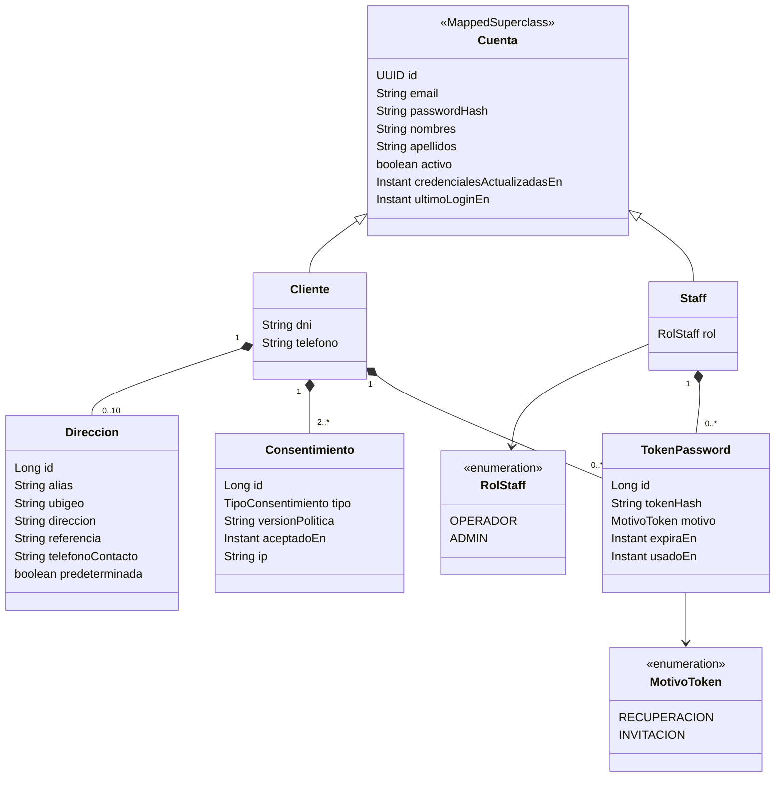
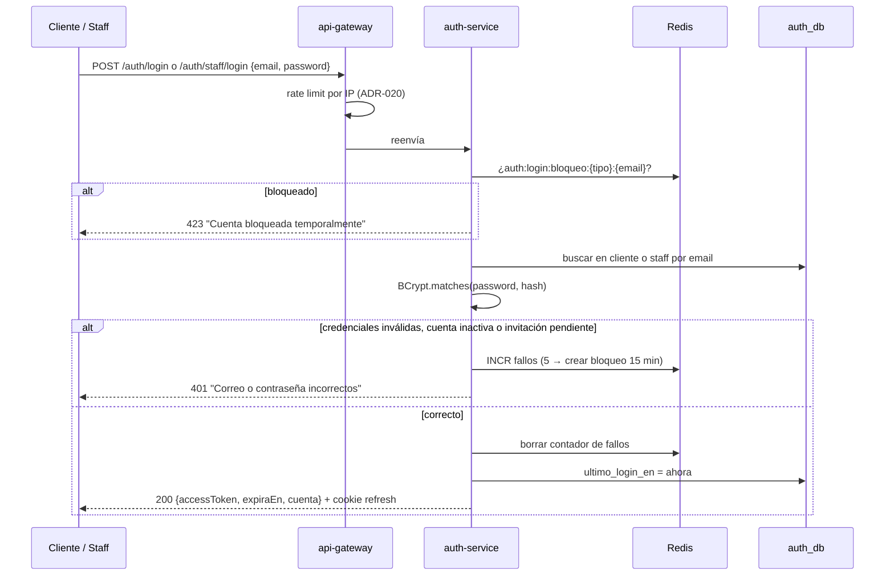
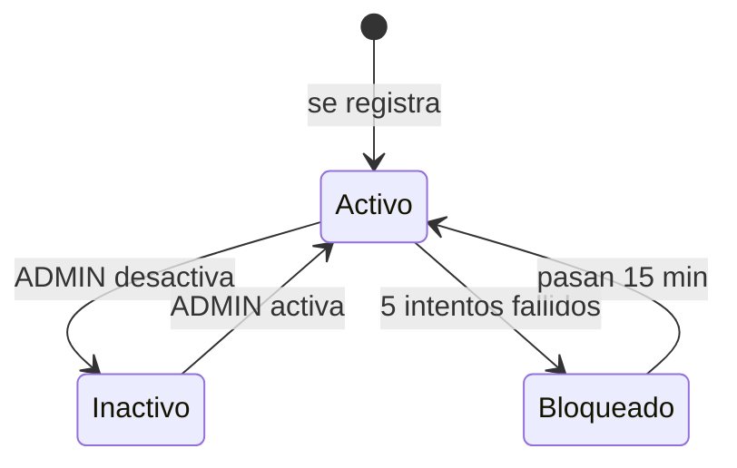
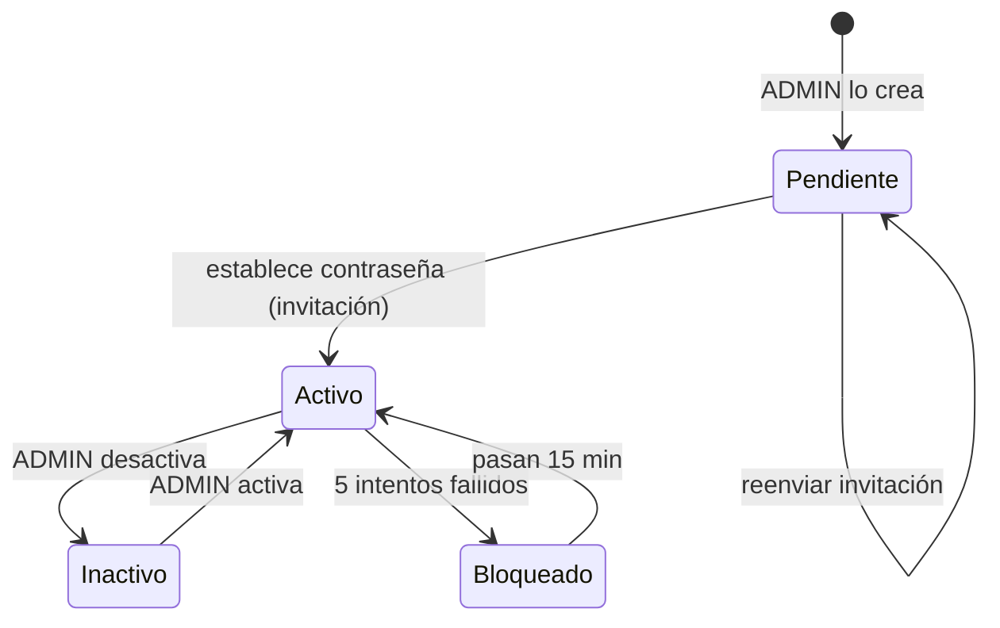
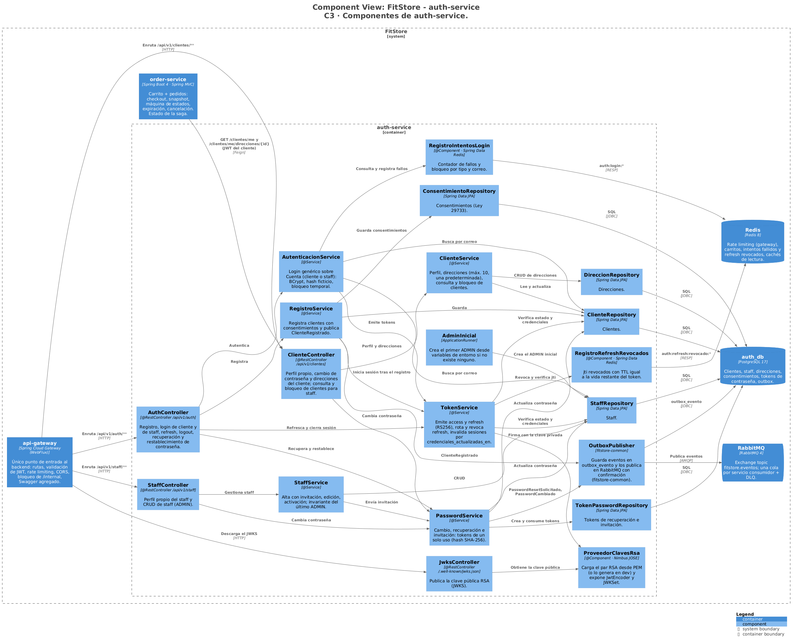
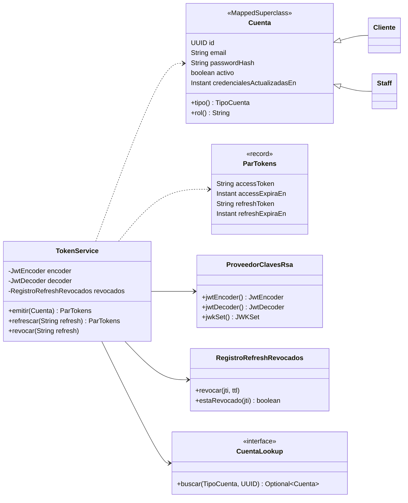

# FitStore — Análisis micro: `auth-service`

> Versión: **v6 (aprobado)** — 2026-10-19. Fuente: [`01-analisis-macro.md`](../01-analisis-macro.md) v11.
> Estados: ✅ decidido · 🟡 propuesto · ❓ abierto · 🕓 diferido

**Historial:**
- v6 (2026-10-20): por la implementación de 0a.2: tamaños no definidos: `consentimiento.version_politica varchar(20)`, `ip varchar(45)`, `tipo` y `token_password.motivo varchar(20)` con `CHECK` de sus valores; FK sin `ON DELETE CASCADE`.
- v5 (2026-10-19): ajustes de la etapa de contratos: nombre de la cookie de refresh: `fs_refresh` (contracts K8).
- v4 (2026-10-18): sección 10 aprobada → **documento completo aprobado**.
- v3 (2026-10-18): sección 10 (diseño técnico) redactada: C3, código de tokens, paquetes, dependencias, configuración e infraestructura.
- v2 (2026-10-16): revisión aprobada. **Clientes y staff en tablas separadas** (`cliente`, `staff`) con login separado; resto del modelo aprobado (D1, D3–D6). Dependencia order → auth por Feign con el JWT del cliente aprobada (opción a; se refleja en macro v11). Verificación de correo → mejora; eliminación de cuenta → extensión futura.
- v1 (2026-10-16): borrador inicial.

**Estado de revisión por sección:** 1 ✅ · 2 ✅ · 3 ✅ · 4 ✅ · 5 ✅ · 6 ✅ · 7 ✅ · 8 ✅ · 9 ✅ · 10 ✅

---

## 1. Responsabilidad y límites

**Contexto:** Identidad y acceso (genérico). **Base de datos:** `auth_db` (PostgreSQL) + Redis (prefijo `auth:`).

**Hace:**
- Registro de clientes (con DNI obligatorio y consentimientos de la Ley 29733).
- Login de **clientes** (storefront) y de **staff** (backoffice), cada uno con su propio endpoint, contraseñas con BCrypt.
- Emisión de **access token** y **refresh token** (JWT RS256), refresco y cierre de sesión.
- Publica la clave pública (**JWKS**) para que gateway y servicios validen tokens sin llamarlo.
- Cambio y recuperación de contraseña.
- Gestión de usuarios staff (`OPERADOR`, `ADMIN`) y consulta de clientes para el backoffice.
- Perfil del cliente y libreta de direcciones (con código de ubigeo).
- Bloqueo temporal tras intentos fallidos.

**No hace:**
- No autoriza peticiones de otros servicios: cada servicio valida el JWT y aplica `@PreAuthorize` (ADR-011).
- No envía correos: publica eventos y `notification-service` los envía.
- No guarda el maestro de ubigeo: solo códigos de 6 dígitos (el maestro está en `settings-service`).
- No guarda el historial de pedidos del cliente (lo da `order-service`).

**Cubre:** CU-05, CU-06, CU-07, CU-08, CU-29 (parte de datos del cliente), CU-30 · RF-IAM-01 a 08 · RF-LEG-02 · RNF-04, 05, 07.

**Peso en la AP1:** este servicio es el **login (6 pts)** y aporta repositorios para las **pruebas de capa de datos (6 pts)**.

---

## 2. Modelo de dominio



### 2.1 Decisiones del modelo ✅

| # | Decisión | Por qué |
|---|---|---|
| D1 | **Un solo rol por cuenta.** El cliente siempre es `CLIENTE`; el staff tiene `OPERADOR` o `ADMIN`, con jerarquía `ADMIN > OPERADOR` (`RoleHierarchy` de Spring Security) | Los roles son excluyentes en la práctica; más simple de probar y explicar |
| D2 | **Tablas separadas `cliente` y `staff`.** Comparten los campos de credenciales mediante una clase base JPA `@MappedSuperclass` (`Cuenta`), sin tabla común | Separa por completo a los compradores del personal: login propio para cada uno, datos distintos (el cliente tiene DNI, teléfono, direcciones y consentimientos; el staff no), y un cliente nunca puede terminar con permisos de staff por error |
| D3 | `id` de cliente y staff es **UUID** | Va en el JWT (`sub`) y en URLs; no permite adivinar ids ni contar usuarios. Tablas internas (`direccion`, etc.) usan `BIGINT` |
| D4 | El **staff se crea sin contraseña** y recibe un enlace por correo para establecerla (token `INVITACION`, 24 h) | El admin nunca conoce ni transmite contraseñas ajenas |
| D5 | **Consentimientos** como registros con versión de la política, fecha e IP | Prueba del consentimiento exigida por la Ley 29733 |
| D6 | **El primer ADMIN se crea al arrancar** desde variables de entorno (`FITSTORE_ADMIN_EMAIL`, `FITSTORE_ADMIN_PASSWORD`) si no existe ningún admin | Sin contraseñas ni hashes en las migraciones ni en el repo (R12) |

**Consecuencias de D2:**
- Hay **dos logins**: `/auth/login` (storefront, clientes) y `/auth/staff/login` (backoffice). Cada frontend usa el suyo.
- El correo es único **dentro de cada tabla**. Una persona del staff puede tener además una cuenta de cliente con el mismo correo; son cuentas independientes, con contraseñas y sesiones distintas.
- La lógica de credenciales (BCrypt, bloqueo, tokens, recuperación) se escribe una sola vez sobre `Cuenta` y se reutiliza para ambos tipos.
- El JWT incluye el claim `tipo` (`CLIENTE` o `STAFF`) para saber en qué tabla buscar al refrescar.

### 2.2 Invariantes

1. El correo es único por tipo de cuenta, sin importar mayúsculas (se normaliza: `trim` + minúsculas).
2. El DNI del cliente es único y tiene exactamente 8 dígitos.
3. Un cliente siempre tiene DNI, teléfono, contraseña y consentimientos de términos y privacidad.
4. Máximo **10 direcciones** por cliente y **a lo más una predeterminada**; la primera que se registra queda como predeterminada.
5. Una cuenta inactiva no puede iniciar sesión ni refrescar tokens.
6. Siempre existe al menos **un ADMIN activo**: no se puede desactivar ni degradar al último, y un admin no puede desactivarse a sí mismo.
7. Un token de contraseña se usa una sola vez; al generar uno nuevo se invalidan los anteriores de la misma cuenta.
8. Al cambiar o restablecer la contraseña se invalidan todas las sesiones abiertas de esa cuenta (ver 4.4).

---

## 3. Modelo de datos

### 3.1 PostgreSQL (`auth_db`) — migración `V1__esquema_inicial.sql`

**`cliente`**

| Columna | Tipo | Restricciones |
|---|---|---|
| `id` | `uuid` | PK |
| `email` | `varchar(254)` | NOT NULL; índice único sobre `lower(email)` |
| `password_hash` | `varchar(60)` | NOT NULL |
| `nombres` / `apellidos` | `varchar(80)` | NOT NULL |
| `dni` | `char(8)` | NOT NULL, único, `CHECK (dni ~ '^[0-9]{8}$')` |
| `telefono` | `varchar(15)` | NOT NULL |
| `activo` | `boolean` | NOT NULL DEFAULT `true` (borrado lógico, ADR-015) |
| `credenciales_actualizadas_en` | `timestamptz` | NOT NULL; ver 4.4 |
| `ultimo_login_en` | `timestamptz` | |
| `creado_en` / `actualizado_en` | `timestamptz` | NOT NULL (auditoría JPA) |
| `version` | `integer` | Bloqueo optimista |

**`staff`**

| Columna | Tipo | Restricciones |
|---|---|---|
| `id` | `uuid` | PK |
| `email` | `varchar(254)` | NOT NULL; índice único sobre `lower(email)` |
| `password_hash` | `varchar(60)` | NULL mientras no establezca su contraseña (invitación pendiente) |
| `nombres` / `apellidos` | `varchar(80)` | NOT NULL |
| `rol` | `varchar(20)` | NOT NULL, `CHECK (rol IN ('OPERADOR','ADMIN'))` |
| `activo`, `credenciales_actualizadas_en`, `ultimo_login_en`, `creado_en`, `actualizado_en`, `version` | | Igual que en `cliente` |
| `creado_por` | `uuid` | FK → `staff` (quién lo dio de alta); NULL para el admin inicial |

**`direccion`**

| Columna | Tipo | Restricciones |
|---|---|---|
| `id` | `bigint` identity | PK |
| `cliente_id` | `uuid` | FK → `cliente`, índice |
| `alias` | `varchar(40)` | NOT NULL (ej. "Casa", "Trabajo") |
| `ubigeo` | `char(6)` | NOT NULL, `CHECK (ubigeo ~ '^[0-9]{6}$')` |
| `direccion` | `varchar(200)` | NOT NULL |
| `referencia` | `varchar(200)` | |
| `telefono_contacto` | `varchar(15)` | Si es NULL se usa el del cliente |
| `predeterminada` | `boolean` | NOT NULL; índice único parcial `(cliente_id) WHERE predeterminada` |
| `creado_en` / `actualizado_en` | `timestamptz` | |

Las direcciones **se eliminan físicamente** (`DELETE`): los pedidos guardan una copia de la dirección al momento de la compra, así que no se pierde historial. Si se elimina la predeterminada, pasa a serlo la creada más recientemente entre las que quedan (SPEC-1, A2).

**`consentimiento`**: `id`, `cliente_id` (FK), `tipo` (`TERMINOS`, `PRIVACIDAD`), `version_politica`, `aceptado_en`, `ip`.

**`token_password`**: `id`, `cliente_id` (FK, NULL), `staff_id` (FK, NULL), `token_hash` (`char(64)`, SHA-256, único), `motivo`, `expira_en`, `usado_en`, `creado_en`. `CHECK` de que exactamente uno de `cliente_id` / `staff_id` tiene valor. Solo se guarda el **hash**: si alguien lee la BD no puede usar los tokens.

**`outbox_evento`** (ADR-009): `id` (uuid), `tipo`, `agregado_id`, `payload` (jsonb), `creado_en`, `publicado_en`. Índice parcial sobre los no publicados. Las filas publicadas se purgan tras 7 días.

### 3.2 Redis (prefijo `auth:`)

| Clave | Valor | TTL | Uso |
|---|---|---|---|
| `auth:login:fallos:{tipo}:{email}` | contador | 15 min | Intentos fallidos consecutivos (`tipo` = `cliente` o `staff`) |
| `auth:login:bloqueo:{tipo}:{email}` | marca | 15 min | Cuenta bloqueada temporalmente |
| `auth:refresh:revocado:{jti}` | marca | vida restante del token | Refresh tokens revocados (logout y rotación) |

Si Redis no está disponible, el login sigue funcionando sin bloqueo temporal (se registra una advertencia); el gateway mantiene su propio rate limiting.

---

## 4. Casos de uso internos

Todas las respuestas usan `ApiResponse<T>` y los errores pasan por `GlobalExceptionHandler` (ADR-015).

### 4.1 Endpoints

**Autenticación**

| Método | Ruta | Descripción | Acceso |
|---|---|---|---|
| POST | `/api/v1/auth/registro` | Registro de cliente | Público |
| POST | `/api/v1/auth/login` | Login de cliente (storefront) | Público |
| POST | `/api/v1/auth/staff/login` | Login de staff (backoffice) | Público |
| POST | `/api/v1/auth/refresh` | Nuevo access token (rota el refresh) | Cookie de refresh |
| POST | `/api/v1/auth/logout` | Cierra la sesión actual | Cookie de refresh |
| POST | `/api/v1/auth/password/olvido` | Recuperación para clientes | Público |
| POST | `/api/v1/auth/staff/password/olvido` | Recuperación para staff | Público |
| POST | `/api/v1/auth/password/restablecer` | Establece contraseña con token (recuperación o invitación, cliente o staff) | Público + token |
| GET | `/.well-known/jwks.json` | Clave pública para validar JWT | Público |

**Cliente (cuenta propia)**

| Método | Ruta | Descripción | Acceso |
|---|---|---|---|
| GET / PUT | `/api/v1/clientes/me` | Ver / editar perfil propio | CLIENTE |
| PUT | `/api/v1/clientes/me/password` | Cambiar contraseña (pide la actual) | CLIENTE |
| GET / POST | `/api/v1/clientes/me/direcciones` | Listar / crear direcciones | CLIENTE |
| GET / PUT / DELETE | `/api/v1/clientes/me/direcciones/{id}` | Ver / editar / eliminar una dirección | CLIENTE (propia) |
| PATCH | `/api/v1/clientes/me/direcciones/{id}/predeterminada` | Marcar como predeterminada | CLIENTE (propia) |

**Backoffice**

| Método | Ruta | Descripción | Acceso |
|---|---|---|---|
| GET / PUT | `/api/v1/staff/me` | Ver / editar perfil propio | Staff |
| PUT | `/api/v1/staff/me/password` | Cambiar contraseña | Staff |
| GET / POST | `/api/v1/staff` | Listar (paginado, filtros) / crear staff | ADMIN |
| GET / PUT | `/api/v1/staff/{id}` | Ver / editar staff (nombre, rol) | ADMIN |
| PATCH | `/api/v1/staff/{id}/desactivar` · `/activar` | Borrado lógico / reactivación | ADMIN |
| POST | `/api/v1/staff/{id}/reenviar-invitacion` | Nuevo enlace de invitación | ADMIN |
| GET | `/api/v1/clientes` · `/api/v1/clientes/{id}` | Consultar clientes (paginado, búsqueda por nombre, correo o DNI) | OPERADOR, ADMIN |
| PATCH | `/api/v1/clientes/{id}/desactivar` · `/activar` | Bloquear / desbloquear un cliente | ADMIN |

### 4.2 Registro (RF-IAM-01, RF-LEG-02)

1. Valida el cuerpo: correo (formato), nombres y apellidos (2–80), **DNI** (`^[0-9]{8}$`), teléfono (9 dígitos, empieza con 9), contraseña (política 4.7), `aceptaTerminos = true` y `aceptaPrivacidad = true`. → `400` con la lista de campos inválidos.
2. Normaliza el correo. Si ya existe un cliente con ese correo → `409 "El correo ya está registrado"`. Si el DNI ya existe → `409 "El DNI ya está registrado"`.
3. Guarda el cliente con `password_hash = BCrypt(password)`, los dos consentimientos (versión de cada política que el storefront mostró y envía en el registro —la obtiene de `settings-service`—, fecha e IP) y el evento `ClienteRegistrado` en el outbox, **en la misma transacción**.
4. Responde `201 Created` con `Location: /api/v1/clientes/me` y **ya con sesión iniciada** (mismos datos que el login).

### 4.3 Login (RF-IAM-02, 03, 08)

El flujo es el mismo para clientes y staff; solo cambia la tabla donde se busca la cuenta.



- **Mensaje genérico** para correo inexistente, contraseña errada, cuenta inactiva o invitación pendiente: no revela qué cuentas existen. Si el correo no existe se ejecuta igual un `BCrypt.matches` contra un hash ficticio, para que el tiempo de respuesta no lo delate.

### 4.4 Tokens

| | Access token | Refresh token |
|---|---|---|
| Formato | JWT RS256 | JWT RS256 con `typ = refresh` |
| Vida | 15 min | 7 días |
| Claims | `sub` (id), `tipo` (`CLIENTE`/`STAFF`), `rol`, `email`, `nombre`, `iss`, `iat`, `exp`, `jti` | `sub`, `tipo`, `jti`, `iat`, `exp` |
| Dónde vive en el navegador | **En memoria** (variable del frontend) | **Cookie `fs_refresh`, `HttpOnly`, `Secure`, `SameSite=Strict`**, ruta `/api/v1/auth` |

- **No se incluye el DNI ni datos sensibles** en los tokens (se pueden decodificar).
- Guardar el refresh en una cookie `HttpOnly` evita que un script malicioso (XSS) lo robe; el access token en memoria dura poco. Al recargar la página, el frontend llama a `/refresh` y recupera la sesión. Storefront y backoffice se sirven en subdominios distintos, así que cada uno tiene su propia cookie.
- **Rotación:** cada `/refresh` revoca el `jti` usado (Redis) y entrega un refresh nuevo. Si llega un refresh ya revocado → `401` y se registra como posible robo.
- **Invalidar todas las sesiones** (cambio o restablecimiento de contraseña, desactivación): se actualiza `credenciales_actualizadas_en`; todo refresh emitido antes de esa fecha se rechaza. Los access tokens ya emitidos caducan solos en ≤ 15 min.
- **Claves:** el par RSA se carga desde archivos PEM montados por variables de entorno (nunca en el repo). En el perfil `dev` se genera uno al arrancar si no existe. El JWKS publica `kid` para poder rotar claves en el futuro.

### 4.5 Recuperación de contraseña (RF-IAM-06, CU-07)

1. `POST /password/olvido {email}` (o `/staff/password/olvido`) responde **siempre `200`** con "Si el correo está registrado, te enviaremos un enlace" (no revela cuentas).
2. Si la cuenta existe y está activa: invalida tokens anteriores, genera un token aleatorio de 32 bytes, guarda su hash con expiración de **30 min** y publica `PasswordResetSolicitado` (incluye el enlace al frontend que corresponda).
3. `POST /password/restablecer {token, nuevaPassword}`: busca por hash; si no existe, está usado o expiró → `400 "Enlace inválido o expirado"`. Si es válido: guarda el nuevo hash en la cuenta dueña del token, marca el token como usado, actualiza `credenciales_actualizadas_en` y publica `PasswordCambiado`.
4. El mismo endpoint sirve para la **invitación de staff** (motivo `INVITACION`, 24 h).

### 4.6 Staff y clientes (RF-IAM-05, CU-29, CU-30)

- **Crear staff:** `POST /staff {email, nombres, apellidos, rol}`; `rol` ∈ {`OPERADOR`, `ADMIN`}. Crea la cuenta sin contraseña y publica `PasswordResetSolicitado` con motivo `INVITACION`.
- **Editar staff:** nombres, apellidos y rol. El correo no se edita (se desactiva y se crea otro).
- **Desactivar / activar staff:** aplica las invariantes 5, 6 y 8.
- **Clientes:** solo lectura para OPERADOR; el ADMIN además puede desactivar un cliente (por fraude o abuso).

### 4.7 Validaciones comunes (RF-IAM-08)

- **Contraseña:** 8 a 64 caracteres, al menos una letra y un número. Límite superior porque BCrypt solo usa los primeros 72 bytes.
- **BCrypt:** `BCryptPasswordEncoder` con fuerza **10** (por defecto; ~100 ms por hash en la VM). Fuerza 12 cuadruplica el costo y satura la VM pequeña en las pruebas de carga.
- **Bloqueo:** 5 intentos fallidos consecutivos → bloqueo de 15 min por correo y tipo de cuenta. El gateway limita además por IP (ADR-020).
- **Códigos de error:** `400` validación · `401` credenciales o token inválidos · `403` rol insuficiente · `404` recurso no existe o no es propio · `409` duplicado o invariante · `423` cuenta bloqueada.
- **Ubigeo:** solo se valida el formato (6 dígitos). El frontend lo elige de los selects de `settings-service`; un código inexistente fallará al cotizar el envío en el checkout. Así `auth-service` no depende de `settings-service`.

---

## 5. Estados

**Cliente:**



**Staff:**



- `Pendiente` = `activo = true` y `password_hash IS NULL` (no es una columna aparte).
- `Bloqueado` vive solo en Redis; es temporal y no se guarda en la BD.

**Token de contraseña:** `Vigente → Usado` o `Vigente → Expirado` / `Invalidado` (por un token más nuevo). No se reactiva.

---

## 6. Eventos

Exchange `fitstore.eventos` (topic). Todos los eventos llevan sobre común: `eventoId` (uuid, para idempotencia), `tipo`, `version` (`1`), `ocurridoEn`. Se publican con **outbox** (ADR-009).

| Evento | Routing key | Payload | Consume |
|---|---|---|---|
| `ClienteRegistrado` | `auth.cliente.registrado` | `clienteId`, `email`, `nombres` | notification (bienvenida) |
| `PasswordResetSolicitado` | `auth.password.reset-solicitado` | `cuentaId`, `tipoCuenta`, `email`, `nombres`, `motivo`, `enlace`, `expiraEn` | notification (recuperación o invitación) |
| `PasswordCambiado` | `auth.password.cambiado` | `cuentaId`, `tipoCuenta`, `email`, `nombres` | notification (aviso de seguridad: "tu contraseña cambió") |

- `ClienteRegistrado` reemplaza al `UsuarioRegistrado` del macro (5.3) por la separación de tablas.
- El enlace de recuperación viaja en el evento porque notification debe incluirlo en el correo. El broker es interno; la fila del outbox se purga tras publicarse.
- **No consume eventos.**

---

## 7. Dependencias síncronas

**Salientes:** ninguna. `auth-service` no llama a otros servicios (solo usa PostgreSQL, Redis y RabbitMQ).

**Entrantes:**

| Quién | Qué | Para qué |
|---|---|---|
| api-gateway y todos los servicios | `GET /.well-known/jwks.json` | Validar JWT. Se cachea; solo se vuelve a pedir si llega un `kid` desconocido |
| `order-service` ✅ | `GET /api/v1/clientes/me` y `GET /api/v1/clientes/me/direcciones/{id}` (Feign, con el JWT del cliente propagado) | En el checkout, tomar **nombre, DNI, teléfono y dirección** del destinatario y guardarlos como copia en el pedido |

- Para order es una llamada más protegida con Resilience4j (ADR-010): si auth no responde, el checkout devuelve "inténtalo en un momento" sin crear el pedido.
- Al usar el token del propio cliente, auth aplica la misma verificación de propiedad que con el navegador: order no puede leer datos de otro cliente.

---

## 8. Seguridad

- Endpoints públicos: registro, ambos logins, refresh, logout, olvido (ambos), restablecer y JWKS. Todo lo demás exige JWT válido.
- Autorización con `@PreAuthorize` por rol (tablas 4.1) y **verificación de propiedad**: en `/clientes/me/**` y `/staff/me/**` el id sale siempre del token, nunca de la URL ni del cuerpo; una dirección ajena responde `404` (no `403`, para no revelar que existe).
- Un token de cliente nunca accede a endpoints de staff: además del rol, se verifica el claim `tipo`.
- `ADMIN` hereda los permisos de `OPERADOR` (D1).
- Datos sensibles: `password_hash` y `token_hash` nunca salen en respuestas ni logs; el DNI se muestra completo solo al dueño y al staff.
- El rate limiting por IP de login, registro y olvido de contraseña se aplica en el gateway (ADR-020); el login de staff puede tener un límite más estricto.
- CORS: solo los orígenes de storefront y backoffice.
- Las cookies de refresh requieren HTTPS en la nube (`Secure`); en local se relaja por perfil.

---

## 9. Pruebas

**Capa de datos (AP1)** — `@DataJpaTest` con **PostgreSQL en Testcontainers** (no H2, porque las migraciones de Flyway usan funciones de PostgreSQL):

| Repositorio | Insertar | Actualizar | Eliminar | Listar | Extra |
|---|---|---|---|---|---|
| `ClienteRepository` | ✔ | perfil | lógico (`activo = false`) | paginado, búsqueda por nombre/correo/DNI | correo duplicado sin importar mayúsculas, DNI duplicado |
| `StaffRepository` | ✔ (sin contraseña) | nombre, rol | lógico | paginado por rol | conteo de ADMIN activos (invariante 6) |
| `DireccionRepository` | ✔ | ✔ | **físico** | por cliente | una sola predeterminada |
| `TokenPasswordRepository` | ✔ (cliente y staff) | marcar usado | — | vigentes por cuenta | búsqueda por hash; `CHECK` de dueño único |

**Servicio (unitarias con Mockito):** registro (ok, correo duplicado, DNI duplicado), login de cliente y de staff (ok, contraseña errada, inactivo, bloqueado, invitación pendiente), rotación y reutilización de refresh, recuperación (token expirado y usado), invariante del último ADMIN.

**Redis:** contador de fallos y revocación con Testcontainers.

**API (MockMvc):** respuestas `401`/`403` por rol y por tipo de cuenta en cada endpoint protegido (RNF-05), formato `ApiResponse`, cookie de refresh.

**Postman:** colección `auth-service` con el flujo de cliente (registro → login → perfil → direcciones → refresh → logout) y el de staff (login admin → crear staff → invitación → login staff).

---

## 10. Diseño técnico ✅

Stack y versiones comunes: [`docs/arquitectura/stack-versiones.md`](../../arquitectura/stack-versiones.md). Modelo C4: [`docs/arquitectura/workspace.dsl`](../../arquitectura/workspace.dsl).

### 10.1 Componentes (C4 nivel 3)



| Capa | Componentes |
|---|---|
| Controladores | `AuthController`, `JwksController`, `ClienteController`, `StaffController` |
| Servicios | `RegistroService`, `AutenticacionService`, `TokenService`, `PasswordService`, `ClienteService`, `StaffService` |
| Seguridad | `ProveedorClavesRsa`, `RegistroIntentosLogin` (Redis), `RegistroRefreshRevocados` (Redis), `AdminInicial` |
| Repositorios | `ClienteRepository`, `StaffRepository`, `DireccionRepository`, `ConsentimientoRepository`, `TokenPasswordRepository` |
| Común | `OutboxPublisher` (`fitstore-common`) |

### 10.2 Código (C4 nivel 4): emisión y validación de tokens



**Refresco (`refrescar`):**
1. Decodifica y verifica firma y expiración; exige `typ = refresh`.
2. Si el `jti` está revocado → `401` y se registra como posible robo.
3. Busca la cuenta por `tipo` + `sub` (`CuentaLookup` decide la tabla); si no existe, está inactiva o `iat < credencialesActualizadasEn` → `401`.
4. Revoca el `jti` usado (TTL = vida restante) y emite un par nuevo (rotación).

**Validación en los demás servicios:** no usan `TokenService`; `fitstore-common` configura el *resource server* con el JWKS de auth (`spring.security.oauth2.resourceserver.jwt.jwk-set-uri`) y convierte el claim `rol` en autoridad `ROLE_*` con la jerarquía `ADMIN > OPERADOR`.

### 10.3 Paquetes y capas

```
com.fitstore.auth
├── AuthServiceApplication
├── config          SecurityConfig, RedisConfig, OpenApiConfig, PropiedadesAuth (@ConfigurationProperties)
├── controller      AuthController, JwksController, ClienteController, StaffController
├── dto
│   ├── request     RegistroRequest, LoginRequest, OlvidoRequest, RestablecerRequest, CambioPasswordRequest,
│   │               PerfilRequest, DireccionRequest, StaffRequest
│   └── response    SesionResponse, ClienteResponse, StaffResponse, DireccionResponse
├── mapper          ClienteMapper, StaffMapper, DireccionMapper (MapStruct)
├── model           Cuenta (@MappedSuperclass), Cliente, Staff, Direccion, Consentimiento, TokenPassword, enums
├── repository      ClienteRepository, StaffRepository, DireccionRepository, ConsentimientoRepository, TokenPasswordRepository
├── service         interfaz + impl por servicio (RegistroService / RegistroServiceImpl, …)
├── security        ProveedorClavesRsa, TokenService, CuentaLookup, RegistroIntentosLogin,
│                   RegistroRefreshRevocados, AdminInicial, CookieRefresh
├── event           ClienteRegistrado, PasswordResetSolicitado, PasswordCambiado (payloads)
└── exception       CredencialesInvalidasException, CuentaBloqueadaException, … (el handler base viene de fitstore-common)
```

Convenciones (ADR-015): interfaz + `Impl` en servicios, DTOs como `record`, mapeo con MapStruct, sin lógica en controladores.

### 10.4 Dependencias

Versiones en `stack-versiones.md`.

| Grupo | Artefactos |
|---|---|
| Web y validación | `spring-boot-starter-webmvc`, `spring-boot-starter-validation` |
| Datos | `spring-boot-starter-data-jpa`, `postgresql`, `spring-boot-starter-flyway`, `flyway-database-postgresql`, `spring-boot-starter-data-redis` |
| Seguridad | `spring-boot-starter-security`, `spring-boot-starter-oauth2-resource-server` (incluye Nimbus para firmar) |
| Mensajería | `spring-boot-starter-amqp` |
| Nube | `spring-cloud-starter-config`, `spring-cloud-starter-netflix-eureka-client` |
| Observabilidad | `spring-boot-starter-actuator`, `spring-boot-starter-opentelemetry` |
| Documentación | `springdoc-openapi-starter-webmvc-ui` |
| Propias | `fitstore-common` |
| Utilidades | `lombok`, `mapstruct` (+ `mapstruct-processor`, `lombok-mapstruct-binding`) |
| Pruebas | `spring-boot-starter-test`, `spring-boot-starter-data-jpa-test`, `spring-security-test`, `testcontainers-postgresql`, `testcontainers-junit-jupiter` |

No usa: Feign (no llama a nadie), Resilience4j, S3.

### 10.5 Configuración

**Puerto:** 8081. **Perfiles:** `dev`, `cloud`. Archivos en `infra/config-repo/`: `auth-service.yml`, `auth-service-dev.yml`, `auth-service-cloud.yml`.

```yaml
# auth-service.yml (extracto)
server.port: 8081
spring:
  datasource:
    url: jdbc:postgresql://${DB_HOST:postgres}:5432/auth_db
    username: ${AUTH_DB_USER}
    password: ${AUTH_DB_PASSWORD}
  jpa.hibernate.ddl-auto: validate        # el esquema lo maneja Flyway
fitstore:
  auth:
    issuer: ${FITSTORE_PUBLIC_URL}        # p. ej. https://tienda.<sub>.duckdns.org
    access-ttl: 15m
    refresh-ttl: 7d
    bcrypt-strength: 10
    bloqueo: { intentos: 5, duracion: 15m }
    token-recuperacion-ttl: 30m
    token-invitacion-ttl: 24h
    claves: { privada: ${JWT_PRIVATE_KEY_PATH}, publica: ${JWT_PUBLIC_KEY_PATH}, kid: ${JWT_KID:fs-1} }
    cookie: { nombre: fs_refresh, secure: true, same-site: Strict, path: /api/v1/auth }
    enlaces:
      storefront: ${STOREFRONT_URL}       # para los enlaces de recuperación
      backoffice: ${BACKOFFICE_URL}       # para invitación y recuperación de staff
```

| Variable de entorno | Uso |
|---|---|
| `AUTH_DB_USER`, `AUTH_DB_PASSWORD` | Usuario propio de `auth_db` |
| `JWT_PRIVATE_KEY_PATH`, `JWT_PUBLIC_KEY_PATH`, `JWT_KID` | Par RSA montado como secreto (en `dev` se genera si falta) |
| `FITSTORE_ADMIN_EMAIL`, `FITSTORE_ADMIN_PASSWORD` | Admin inicial (D6) |
| `FITSTORE_PUBLIC_URL`, `STOREFRONT_URL`, `BACKOFFICE_URL` | Emisor del JWT y enlaces de los correos |

En `dev`: `cookie.secure=false`, claves autogeneradas, logs SQL. En `cloud`: todo lo anterior obligatorio (falla al arrancar si falta).

### 10.6 Infraestructura

| Componente | Uso |
|---|---|
| PostgreSQL `auth_db` | Tablas de 3.1; migraciones Flyway en `src/main/resources/db/migration` |
| Redis (prefijo `auth:`) | Intentos fallidos, bloqueos, refresh revocados (3.2) |
| RabbitMQ | Publica en `fitstore.eventos`: `auth.cliente.registrado`, `auth.password.reset-solicitado`, `auth.password.cambiado`. No tiene cola propia (no consume) |
| config-server / Eureka / Jaeger | Como todos los servicios |

---

## Mejoras y extensiones futuras

| # | Tema | Tipo | Nota |
|---|---|---|---|
| M1 | **Verificación de correo al registrarse** (enlace de confirmación antes de comprar) | Mejora | No es necesaria por ahora; el correo se valida de hecho al recibir la boleta |
| M2 | **Eliminación de cuenta a pedido del cliente** (derecho de cancelación, Ley 29733) | Extensión futura | Anonimizar datos personales y desactivar la cuenta, sin borrar pedidos |
