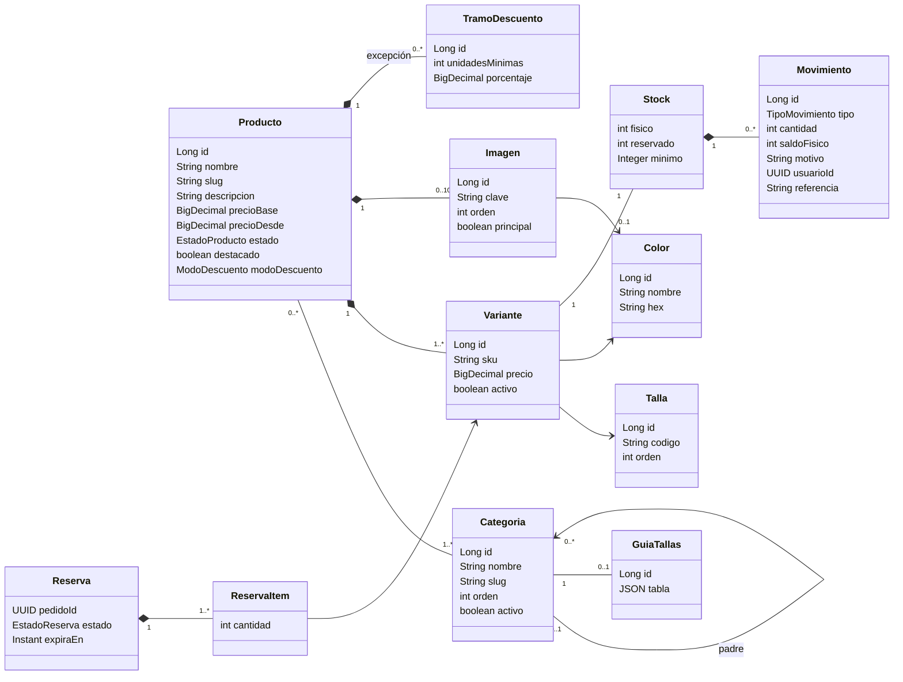
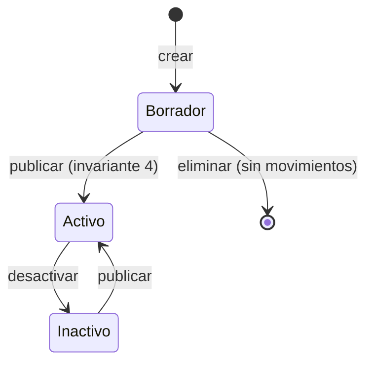
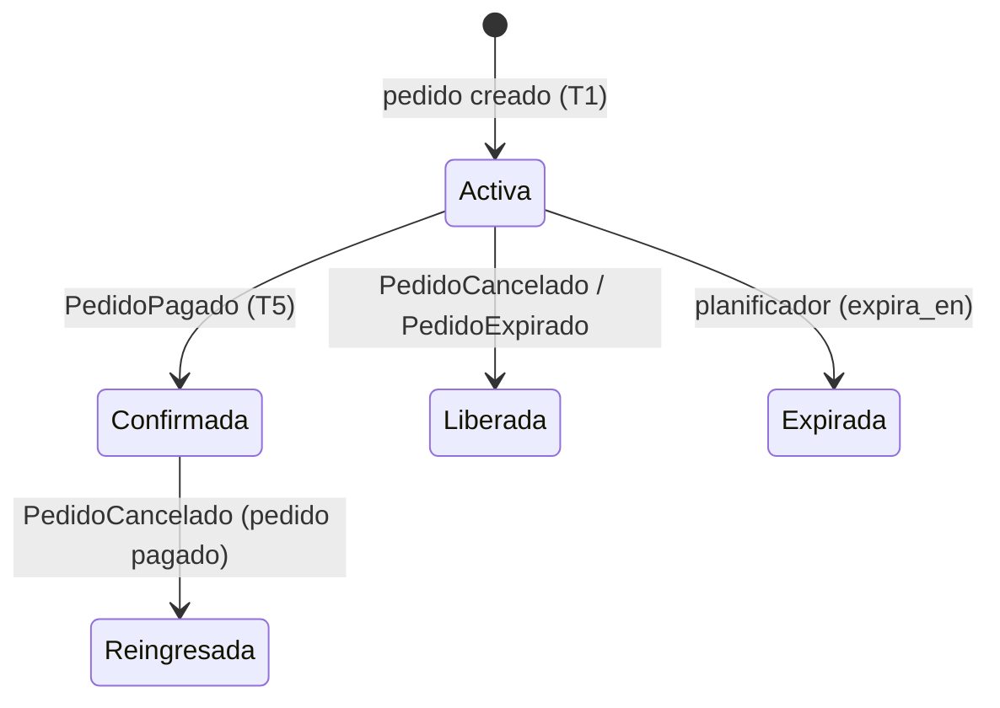
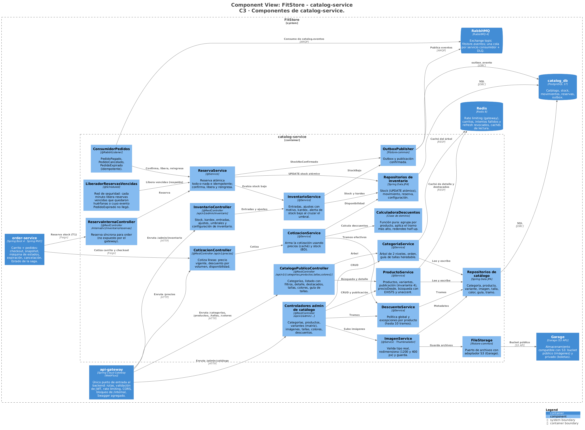
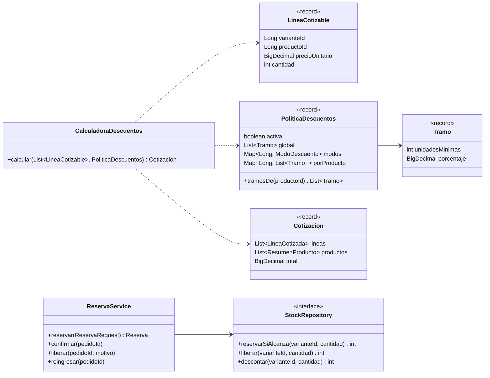

# FitStore — Análisis micro: `catalog-service`

> Versión: **v8 (aprobado)** — 2026-10-19. Fuente: [`01-analisis-macro.md`](../01-analisis-macro.md) v11.
> Estados: ✅ decidido · 🟡 propuesto · ❓ abierto · 🕓 diferido

**Historial:**
- v8 (2026-10-19): ajustes de la etapa de contratos: la cotización pública no expone el stock exacto (estado por línea; `disponible` solo si no alcanza); el kardex devuelve también el stock actual.
- v7 (2026-10-19): revisión de coherencia: rangos de la configuración de inventario (stock mínimo por defecto 0–999, margen de reserva 0–30 min, como valida la SPEC-3 CA-3-38); se edita en la pestaña Parámetros de la configuración de tienda (SPEC-3 S2). Las dos entradas sin número de versión del 2026-10-18 corresponden a cambios de la SPEC-2 sobre la v6.
- (2026-10-18, por SPEC-2) Cada imagen pertenece a un color (D3) y publicar exige una imagen por color activo (invariante 4); color maestro "Variado"; carga masiva de productos por CSV/XLSX (4.4.1); ejemplo de categorías renombrado.
- v6 (2026-10-18): sección 10 aprobada → **documento completo aprobado**.
- (2026-10-18) `ExpiradorReservas` pasa a llamarse **`LiberadorReservasVencidas`** y se documenta como red de seguridad del evento `PedidoExpirado` (4.7, 10.1, 10.3).
- v5 (2026-10-18): sección 10 (diseño técnico) redactada: C3, código de las partes críticas, paquetes, dependencias, configuración e infraestructura.
- v4 (2026-10-16): aclaraciones de 4.5 (cotización en tiempo real; fallback solo si catalog no responde) y 4.6 (el cliente tiene todo el tiempo del pedido; la reserva suma un margen configurable, 5 min por defecto) confirmadas → **documento aprobado**.
- v3 (2026-10-16): D5 y D6 confirmadas. **Stock mínimo por defecto pasa a catalog** (KISS: sin copia ni evento; se ajusta RF-SET-05/RF-INV-05 en el macro). `StockNoConfirmado` aprobado, con su correo de alerta definido. Aprobados 4.7, 4.8, reglas de productos, búsqueda y seguridad. Aclaraciones pendientes: margen de la reserva (4.6) y comportamiento de la cotización cuando catalog no responde (4.5).
- v2 (2026-10-16): sección 2 aprobada (D1–D4, D7, D8; D5 y D6 aclaradas). Aprobados: redimensionado de imágenes, stock no exacto para el cliente, caché sin stock, valores y semillas por defecto. Tramos de descuento: el admin puede agregar, editar y quitar tramos (hasta 10). Pendiente: dueño del "stock mínimo por defecto".
- v1 (2026-10-16): borrador inicial.

**Estado de revisión por sección:** 1 ✅ · 2 ✅ · 3 ✅ · 4 ✅ · 5 ✅ · 6 ✅ · 7 ✅ · 8 ✅ · 9 ✅ · 10 ✅

---

## 1. Responsabilidad y límites

**Contextos:** Catálogo (núcleo) + Inventario (núcleo, módulo interno). Cada módulo tiene sus paquetes y tablas; comparten proceso y base (ADR-019). **Base de datos:** `catalog_db` (PostgreSQL) + Redis (caché, prefijo `catalog:`) + Garage (imágenes, ADR-013).

**Hace:**
- **Módulo catálogo:** categorías (árbol de 2 niveles), productos, variantes (talla × color), imágenes, tallas y colores maestros, guía de tallas, destacados, búsqueda y filtros, **descuentos por volumen** (política global + excepciones por producto) y **cotización de precios** (precio vigente + descuento + disponibilidad).
- **Módulo inventario:** stock físico y reservado por variante, movimientos (kardex), **reserva síncrona** al crear el pedido, confirmación al pagar, liberación al cancelar o expirar, reingreso al cancelar un pedido pagado, alerta de stock bajo.

**No hace:**
- No guarda carritos ni pedidos (`order-service`): solo cotiza y reserva por encargo de order.
- No calcula envío (`delivery-service`).
- No decide la expiración del pedido: la reserva usa la fecha que le envía order (ver 4.6).

**Cubre:** CU-02, CU-03, CU-21, CU-22, CU-23, CU-35, CU-40, CU-43 · RF-CAT-01 a 08 · RF-INV-01 a 05 · RNF-01, 12.

**Peso en la AP1:** es el CRUD principal para las **pruebas de capa de datos (6 pts)**: insertar, actualizar, eliminar y listar sobre categorías, productos y variantes.

---

## 2. Modelo de dominio



`TramoDescuento` sin producto = política global. `Stock`, `Movimiento`, `Reserva` y `ReservaItem` pertenecen al **módulo inventario**; el resto al módulo catálogo.

### 2.1 Decisiones del modelo

| # | Propuesta | Por qué | Alternativa |
|---|---|---|---|
| D1 | **Tallas y colores como tablas maestras** administradas por el ADMIN (talla: código y orden; color: nombre y código hex para la muestra) | Los filtros de la tienda (CU-02) necesitan valores consistentes: "Negro" y "negro" no deben ser dos colores; las tallas se ordenan XS < S < M < L < XL | Texto libre en cada variante (rápido de cargar, pero rompe los filtros) |
| D2 | **Variante = producto × talla × color**, con SKU único. El SKU se genera solo (`{codigoProducto}-{COLOR}-{TALLA}`, editable) y el backoffice ofrece un **generador de matriz**: eliges tallas y colores y crea todas las combinaciones | En Gamarra un modelo sale en 4–6 tallas y 3–5 colores: cargarlas una por una es tedioso | Crear variantes una a una |
| D3 | **Cada imagen pertenece a un color** del producto. Al elegir "Rojo" en la tienda se muestran **solo** las fotos rojas; nunca fotos de otro color. Para estampados o surtidos existe el color maestro **"Variado"**. Si el producto tiene un solo color, sus imágenes se asignan a ese color automáticamente (SPEC-2) | En ropa, el cliente quiere ver exactamente el color que va a comprar | Galería única por producto |
| D4 | **Precio base en el producto y precio opcional por variante** (p. ej. tallas XXL más caras). `precioDesde` se recalcula al guardar (el menor precio de las variantes activas) y se usa para filtrar y ordenar por precio | Filtrar por precio sin recalcular en cada consulta | Precio solo en la variante |
| D5 | **Un producto puede estar en categorías de cualquier nivel.** Al listar una categoría padre se incluyen los productos de sus hijas. **Cada producto aparece una sola vez** aunque esté asignado al padre y a una hija: la consulta pregunta "¿el producto pertenece a alguna de estas categorías?" (`EXISTS`), no une filas por cada asignación. El backoffice además avisa que asignar padre e hija a la vez es redundante | "Partes de abajo" muestra leggings y shorts sin asignarlos dos veces | Asignar solo a hojas |
| D6 | **Guía de tallas por categoría** como tabla estructurada (filas = tallas, columnas = medidas en cm), editable en el backoffice como una hoja de cálculo pequeña y mostrada en el detalle del producto con el botón "Guía de tallas". Una subcategoría sin guía usa la de su padre (ejemplo en 2.3) | Se muestra como tabla accesible y responsive, no como imagen | Subir una imagen de la guía |
| D7 | **El stock vive en el módulo inventario** (`stock` 1:1 con la variante), separado de la ficha del producto: `fisico` (lo que hay en almacén) y `reservado` (apartado por pedidos sin pagar). **Disponible = físico − reservado** | Separa "cuánto hay" de "cuánto se puede vender"; deja el módulo listo para extraerse (ADR-019) | Una sola columna `stock` en la variante |
| D8 | **Montos en `NUMERIC(10,2)` / `BigDecimal`**, soles con IGV incluido, redondeo *half-up* a 2 decimales | Nunca `double` para dinero | — |

Estado: D1–D8 ✅.

### 2.2 Invariantes

1. El árbol de categorías tiene **como máximo 2 niveles**: una categoría con padre no puede tener hijas. Nombre único entre hermanas; slug único global.
2. Slug de producto único; se genera del nombre (sin tildes, minúsculas, guiones) y puede editarse.
3. Combinación (producto, talla, color) única; SKU único global.
4. **Un producto solo puede pasar a `ACTIVO`** si tiene: precio > 0, al menos una categoría, al menos una variante activa y **al menos una imagen por cada color que tenga variantes activas** (SPEC-2).
5. Máximo **10 imágenes** por producto y **exactamente una principal** si hay imágenes.
6. `fisico ≥ 0`, `reservado ≥ 0` y `reservado ≤ fisico` (restricciones `CHECK` en BD). Nunca hay sobreventa.
7. Tramos de descuento: el admin puede **agregar, editar y quitar** tramos libremente (global y por producto), hasta **10**; sin tramos no hay descuento. Unidades mínimas **estrictamente crecientes**, porcentajes **crecientes**, entre 0 % y 50 %.
8. Una reserva por pedido (`pedidoId` único): repetir la llamada no reserva dos veces.
9. Todo cambio de `fisico` deja un `Movimiento` con usuario, motivo y saldo resultante.

### 2.3 Ejemplo de guía de tallas (D6)

Categoría "Leggings y pantalones" (la heredan "Leggings" y "Joggers" si no tienen la suya):

| Talla | Cintura (cm) | Cadera (cm) | Largo (cm) |
|---|---|---|---|
| S | 62–66 | 88–92 | 88 |
| M | 67–71 | 93–97 | 90 |
| L | 72–76 | 98–102 | 92 |

Se guarda como datos (`jsonb`): columnas `["Cintura (cm)", "Cadera (cm)", "Largo (cm)"]` y una fila por talla. El admin agrega o quita columnas y filas.

---

## 3. Modelo de datos

### 3.1 PostgreSQL (`catalog_db`) — migración `V1__esquema_inicial.sql`

Extensiones: `unaccent` y `pg_trgm` (búsqueda sin tildes y por similitud).

**Módulo catálogo**

| Tabla | Columnas principales | Restricciones / índices |
|---|---|---|
| `categoria` | `id`, `padre_id` (FK self, NULL), `nombre`, `slug`, `orden`, `activo`, auditoría | Único `slug`; único `(padre_id, lower(nombre))` |
| `talla` | `id`, `codigo` (`varchar(10)`), `orden`, `activo` | Único `codigo` |
| `color` | `id`, `nombre` (`varchar(40)`), `hex` (`char(7)`), `activo` | Único `lower(nombre)`; `CHECK hex ~ '^#[0-9A-Fa-f]{6}$'` |
| `producto` | `id`, `codigo` (`varchar(20)`, base del SKU), `nombre`, `slug`, `descripcion` (`text`), `precio_base`, `precio_desde`, `estado`, `destacado`, `orden_destacado`, `modo_descuento`, auditoría, `version` | Único `slug`, único `codigo`; índice trigram sobre `unaccent(nombre)`; índices por `estado`, `precio_desde`, `creado_en` |
| `producto_categoria` | `producto_id`, `categoria_id` | PK compuesta |
| `variante` | `id`, `producto_id`, `talla_id`, `color_id`, `sku`, `precio` (NULL = usa base), `activo`, auditoría | Único `sku`; único `(producto_id, talla_id, color_id)` |
| `imagen` | `id`, `producto_id`, `color_id` (NULL), `clave` (ruta en el almacenamiento), `orden`, `principal`, `ancho`, `alto` | Único parcial `(producto_id) WHERE principal` |
| `guia_tallas` | `id`, `categoria_id`, `tabla` (`jsonb`), `nota` | Único `categoria_id` |
| `tramo_descuento` | `id`, `producto_id` (NULL = global), `unidades_minimas`, `porcentaje` (`numeric(5,2)`) | Único `(producto_id, unidades_minimas)`; `CHECK porcentaje BETWEEN 0 AND 50` |
| `configuracion_descuento` | `id` (fila única), `activo` | Interruptor global de descuentos |

`producto.estado` ∈ `BORRADOR`, `ACTIVO`, `INACTIVO`. `producto.modo_descuento` ∈ `GLOBAL` (usa la política global), `PERSONALIZADO` (usa sus propios tramos), `SIN_DESCUENTO`.

**Módulo inventario**

| Tabla | Columnas principales | Restricciones / índices |
|---|---|---|
| `stock` | `variante_id` (PK, FK), `fisico`, `reservado`, `minimo` (NULL = usa `configuracion_inventario.stock_minimo_por_defecto`), `actualizado_en`, `version` | `CHECK (fisico >= 0 AND reservado >= 0 AND reservado <= fisico)` |
| `movimiento_stock` | `id`, `variante_id`, `tipo`, `cantidad` (con signo), `saldo_fisico`, `motivo`, `usuario_id` (NULL = sistema), `referencia` (código de pedido, etc.), `creado_en` | Índice `(variante_id, creado_en DESC)` |
| `reserva` | `pedido_id` (PK, uuid), `estado`, `expira_en`, `creado_en`, `actualizado_en` | Índice parcial `(expira_en) WHERE estado = 'ACTIVA'` |
| `reserva_item` | `pedido_id`, `variante_id`, `cantidad` | PK compuesta; `CHECK cantidad > 0` |

`movimiento_stock.tipo` ∈ `ENTRADA`, `AJUSTE` (+/−), `VENTA` (al confirmar el pago), `REINGRESO` (cancelación de un pedido pagado). Reservar y liberar no cambian `fisico`, por eso no generan movimiento (quedan en `reserva`).

**Comunes:** `outbox_evento` (igual que auth) y `evento_procesado` (`evento_id` PK, `procesado_en`) para consumidores idempotentes (ADR-009). `configuracion_inventario` (fila única): `stock_minimo_por_defecto` (semilla 5, de 0 a 999) y `margen_reserva_minutos` (semilla 5, de 0 a 30; ver 4.6). Se edita desde el backoffice en la pestaña Parámetros de la configuración de la tienda (P-3-04, SPEC-3), pero el dato lo guarda catalog, que es quien lo usa.

### 3.2 Redis (prefijo `catalog:`)

| Clave | Contenido | TTL | Invalidación |
|---|---|---|---|
| `catalog:categorias:arbol` | Árbol de categorías activas | 10 min | Al crear, editar u ordenar categorías |
| `catalog:producto:{slug}` | Detalle público del producto (sin stock) | 10 min | Al editar el producto, sus variantes, imágenes o descuentos |
| `catalog:destacados` | Lista de destacados | 10 min | Al cambiar destacados o el estado de un producto |
| `catalog:descuentos:global` | Política global de tramos | 10 min | Al editar la política |

- **El stock nunca se cachea:** cambia con cada reserva y se lee de la BD (consulta por clave primaria, muy rápida).
- **Los listados con filtros no se cachean:** hay demasiadas combinaciones. Se apoyan en los índices de 3.1.
- Si Redis no está disponible, todo se lee de la BD (degradación sin caché, ADR-020).

### 3.3 Almacenamiento de imágenes (Garage)

Bucket `fitstore-media`, clave `productos/{productoId}/{uuid}-{tamaño}.jpg`. Se sirven públicamente por Caddy en `/media/...`.

---

## 4. Casos de uso internos

### 4.1 Endpoints

**Tienda (públicos)**

| Método | Ruta | Descripción |
|---|---|---|
| GET | `/api/v1/categorias` | Árbol de categorías activas (para el menú) |
| GET | `/api/v1/categorias/{slug}/guia-tallas` | Guía de tallas (o la del padre) |
| GET | `/api/v1/productos` | Listado con búsqueda, filtros, orden y paginación (4.3) |
| GET | `/api/v1/productos/destacados` | Destacados de la landing |
| GET | `/api/v1/productos/{slug}` | Detalle: variantes, disponibilidad por variante, imágenes, tramos de descuento, categorías |
| GET | `/api/v1/tallas` · `/api/v1/colores` | Valores para los filtros |
| POST | `/api/v1/precios/cotizar` | Cotiza líneas `{varianteId, cantidad}`: precio vigente, descuento, subtotal, tramo alcanzado, siguiente tramo y disponibilidad (4.5) |

**Backoffice**

| Método | Ruta | Descripción | Rol |
|---|---|---|---|
| GET / POST | `/api/v1/admin/categorias` | Listar todas / crear | ADMIN |
| PUT / DELETE | `/api/v1/admin/categorias/{id}` | Editar / eliminar (solo si no tiene hijas ni productos; si no → `409`) | ADMIN |
| PATCH | `/api/v1/admin/categorias/{id}/desactivar` · `/activar` · `/orden` | Estado y orden | ADMIN |
| PUT | `/api/v1/admin/categorias/{id}/guia-tallas` | Guardar guía de tallas | ADMIN |
| GET / POST | `/api/v1/admin/productos` | Listar (todos los estados, filtros) / crear en `BORRADOR` | ADMIN, OPERADOR (solo lectura) |
| GET / PUT / DELETE | `/api/v1/admin/productos/{id}` | Ver / editar / eliminar (solo `BORRADOR` sin movimientos; si no → `409`, se usa `desactivar`) | ADMIN |
| PATCH | `/api/v1/admin/productos/{id}/publicar` · `/desactivar` | `ACTIVO` (valida invariante 4) / `INACTIVO` | ADMIN |
| PUT | `/api/v1/admin/productos/{id}/categorias` | Reemplazar categorías asignadas | ADMIN |
| PATCH | `/api/v1/admin/productos/{id}/destacado` | Marcar/desmarcar y orden | ADMIN |
| POST | `/api/v1/admin/productos/{id}/variantes` | Crear una variante | ADMIN |
| POST | `/api/v1/admin/productos/{id}/variantes/matriz` | Generar variantes `{tallaIds[], colorIds[]}` (omite las que ya existen) | ADMIN |
| GET | `/api/v1/admin/productos/carga-masiva/plantilla?formato=xlsx\|csv` | Descargar la plantilla de carga masiva | ADMIN |
| POST | `/api/v1/admin/productos/carga-masiva/validar` | Subir el archivo y obtener el informe de validación (no crea nada) | ADMIN |
| POST | `/api/v1/admin/productos/carga-masiva/{validacionId}/confirmar` | Crear todo lo validado | ADMIN |
| PUT / DELETE | `/api/v1/admin/variantes/{id}` | Editar / eliminar (solo sin movimientos ni reservas; si no → `409`) | ADMIN |
| PATCH | `/api/v1/admin/variantes/{id}/desactivar` · `/activar` | Borrado lógico | ADMIN |
| POST | `/api/v1/admin/productos/{id}/imagenes` | Subir imagen (multipart) | ADMIN |
| PUT / DELETE | `/api/v1/admin/imagenes/{id}` | Orden, principal, color / eliminar | ADMIN |
| CRUD | `/api/v1/admin/tallas` · `/api/v1/admin/colores` | Maestros (eliminar solo si no están en uso) | ADMIN |
| GET / PUT | `/api/v1/admin/descuentos` | Política global (tramos + activo) | ADMIN |
| PUT | `/api/v1/admin/productos/{id}/descuento` | Modo y tramos propios | ADMIN |
| GET | `/api/v1/admin/inventario` | Stock por variante (filtros: producto, stock bajo, agotado) | OPERADOR, ADMIN |
| GET | `/api/v1/admin/inventario/{varianteId}/movimientos` | Kardex: stock actual de la variante y movimientos paginados | OPERADOR, ADMIN |
| POST | `/api/v1/admin/inventario/entradas` | Ingreso de mercadería (varias líneas, motivo) | OPERADOR, ADMIN |
| POST | `/api/v1/admin/inventario/ajustes` | Ajuste +/− con motivo obligatorio | OPERADOR, ADMIN |
| PATCH | `/api/v1/admin/inventario/{varianteId}/minimo` | Umbral de stock bajo propio | OPERADOR, ADMIN |
| GET / PUT | `/api/v1/admin/inventario/configuracion` | Stock mínimo por defecto y margen de reserva | ADMIN |

**Internos (no expuestos por el gateway)**

| Método | Ruta | Descripción | Quién |
|---|---|---|---|
| POST | `/internal/v1/inventario/reservas` | Reservar stock para un pedido (4.6) | order-service |

### 4.2 Productos y variantes (CU-22)

1. **Crear producto:** nombre, código, descripción, precio base, categorías opcionales → queda en `BORRADOR`, slug generado.
2. **Variantes:** una a una o por matriz. Cada variante nueva crea su fila en `stock` con `fisico = 0`.
3. **Imágenes:** se suben y procesan (4.4).
4. **Publicar:** valida la invariante 4; si falla → `409` con la lista de lo que falta ("Agrega al menos una imagen").
5. Al guardar se recalcula `precio_desde` y se invalida la caché del producto.

### 4.3 Búsqueda y filtros (CU-02, RF-CAT-05)

`GET /api/v1/productos?q=&categoria=&talla=&color=&precioMin=&precioMax=&disponible=&page=&size=&sort=`

- **Solo productos `ACTIVO`** con al menos una variante activa.
- `q`: busca en nombre y descripción, **sin importar tildes ni mayúsculas** (`unaccent` + `ILIKE`, con índice trigram).
- `categoria` (slug): incluye la categoría y sus hijas. `talla` y `color`: uno o varios valores; el producto aparece si **alguna variante** coincide.
- `precioMin` / `precioMax`: sobre `precio_desde`. `disponible=true`: solo con stock disponible > 0.
- `sort`: `novedad` (por defecto), `precio,asc`, `precio,desc`, `nombre`. `size` máximo 48.
- Cada tarjeta trae: nombre, slug, imagen principal, `precioDesde`, colores disponibles (muestras), etiqueta de descuento por volumen ("Desde 3 un. −5 %") y si está agotado.

### 4.4 Imágenes (RF-CAT-04)

- Formatos: JPG, PNG o WebP; máximo **5 MB**; se valida el tipo real del archivo (no solo la extensión).
- ✅ **Se redimensionan al subir** con Thumbnailator: `1200 px` (detalle) y `400 px` (tarjetas), en JPG. Así la tienda no descarga fotos de 4 MB tomadas con el celular (RNF-18, Lighthouse).
- Se guardan con el puerto `FileStorage` (ADR-013). Al eliminar una imagen se borran sus archivos; si era la principal, pasa a serlo la siguiente.
- **Cada imagen tiene color obligatorio** (D3). La galería de la tienda muestra solo las del color elegido.

### 4.4.1 Carga masiva de productos (RF-CAT-09, SPEC-2)

- Plantilla única para **CSV y XLSX**: **una fila por variante**, con las columnas del producto repetidas (`codigo`, `nombre`, `descripcion`, `precio_base`, `categorias` separadas por `|`) y las de la variante (`talla`, `color`, `precio_variante` opcional, `stock_inicial` opcional). El XLSX trae además una hoja de instrucciones.
- **Dos pasos:** *validar* (informe por fila, sin crear nada; el resultado se guarda 30 min en Redis) y *confirmar* (crea **todo o nada** en una transacción).
- Crea productos en `BORRADOR` y sus variantes; `stock_inicial` > 0 genera un movimiento `ENTRADA` con motivo "Carga masiva". Las imágenes se suben después (o como mejora futura, en un ZIP).
- Reglas: máximo 2 000 filas y 5 MB; solo crea (un `codigo` existente es error); tallas, colores y categorías deben existir; los datos de producto repetidos deben coincidir en todas sus filas.
- Librerías: Apache POI (XLSX) y Commons CSV.

### 4.5 Descuentos por volumen y cotización (CU-35, RF-CAT-08, RF-CRT-02)

**Regla:**
1. Se agrupan las líneas **por producto** y se suman sus unidades (surtido de tallas y colores).
2. Se toman los tramos del producto según su modo: `GLOBAL` → política global; `PERSONALIZADO` → los suyos; `SIN_DESCUENTO` → ninguno. Si el interruptor global está apagado, no hay descuento.
3. Se aplica el **tramo más alto alcanzado**: el porcentaje se aplica al precio de cada línea de ese producto.
4. Redondeo *half-up* a 2 decimales por línea. El descuento **no aplica al envío**.

**Ejemplo** (política global semilla 3 → 5 %, 6 → 10 %, 12 → 15 % ✅; el admin puede cambiarla):

| Línea | Precio | Cant. | Subtotal | Descuento | Total |
|---|---|---|---|---|---|
| Legging Pro · Negro · M | 59.90 | 2 | 119.80 | | |
| Legging Pro · Azul · S | 59.90 | 2 | 119.80 | | |
| Legging Pro · Negro · L | 64.90 | 2 | 129.80 | | |
| **Legging Pro (6 un. → 10 %)** | | **6** | **369.40** | **−36.94** | **332.46** |
| Top Flex · Rojo · S | 39.90 | 1 | 39.90 | sin tramo | 39.90 |

**Cotización** (`POST /precios/cotizar`): recibe hasta 50 líneas y devuelve por línea el precio vigente, el descuento y la disponibilidad; por producto, el tramo alcanzado y **cuánto falta para el siguiente** ("Agrega 2 más y ahorra 15 %"); y el total. Si una variante está inactiva o el producto no está `ACTIVO`, la línea vuelve marcada como `NO_DISPONIBLE`. La usa order para el carrito y para el checkout; **es la única fuente de precios y descuentos** (order guarda el resultado como copia en el pedido).

**Privacidad del stock en la cotización** (contrato de catalog): como la cotización es pública, cada línea devuelve un `estado` (`OK`, `STOCK_INSUFICIENTE`, `NO_DISPONIBLE`) y solo informa `disponible` cuando lo pedido no alcanza (lo necesita el mensaje "Solo quedan N unidades"); nunca el stock exacto de todas las variantes.

### 4.6 Reserva de stock (CU-40, RF-INV-03) — paso T1 de la saga

`POST /internal/v1/inventario/reservas {pedidoId, expiraEnPedido, items[{varianteId, cantidad}]}`

1. **Idempotencia:** si ya existe una reserva para ese `pedidoId`, se devuelve tal cual (`200`). Así los reintentos de Resilience4j no reservan dos veces.
2. En **una transacción**, ordenando las líneas por `varianteId` (para evitar bloqueos cruzados), por cada línea:
   ```sql
   UPDATE stock SET reservado = reservado + :cantidad
   WHERE variante_id = :id AND fisico - reservado >= :cantidad
   ```
   Si alguna actualiza 0 filas → **rollback completo** y `409` con la lista de faltantes `{varianteId, solicitado, disponible}`. No hay reservas parciales.
3. Si todas pasan: guarda la reserva `ACTIVA` con `expira_en = expiraEnPedido + margen_reserva_minutos` (5 por defecto, configurable) y responde `201`.

Por qué este diseño: la verificación y el descuento ocurren en **una sola sentencia atómica** de PostgreSQL. Si dos clientes compran la última unidad al mismo tiempo, solo uno logra la actualización; el otro recibe "sin stock". No hace falta bloquear la tabla ni usar Redis.

La reserva expira **5 min después** que el pedido (35 vs 30 min por defecto, ADR-009). catalog no lee la configuración de expiración: la recibe de order en cada reserva.

### 4.7 Confirmación, liberación y reingreso (pasos T5 y compensaciones)

| Disparador | Condición | Efecto | Movimiento |
|---|---|---|---|
| `PedidoPagado` | Reserva `ACTIVA` | `fisico −= q`, `reservado −= q`; reserva → `CONFIRMADA` | `VENTA` |
| `PedidoPagado` | Reserva ya `EXPIRADA` (evento muy tardío) | Intenta tomar el stock como en 4.6; si no alcanza, registra la incidencia y publica `StockNoConfirmado` para alertar al admin | `VENTA` si alcanza |
| `PedidoCancelado` / `PedidoExpirado` | Reserva `ACTIVA` | `reservado −= q`; reserva → `LIBERADA` | — |
| `PedidoCancelado` | Reserva `CONFIRMADA` (pedido ya pagado) | `fisico += q`; reserva → `REINGRESADA` | `REINGRESO` |
| Planificador (cada minuto) | `ACTIVA` y `expira_en < ahora` | `reservado −= q`; reserva → `EXPIRADA` | — |

**Dos mecanismos, un solo objetivo:** el camino normal es el evento `PedidoExpirado` / `PedidoCancelado`, que libera la reserva apenas order vence o cancela el pedido. El planificador (`LiberadorReservasVencidas`) es solo una **red de seguridad** para dos casos en que ese evento nunca llega: (1) **reserva huérfana**, cuando order reservó pero se cayó antes de guardar el pedido; (2) **evento perdido o demorado** (RabbitMQ caído, mensaje en la DLQ). Por eso actúa con 5 minutos de margen: si el flujo normal funcionó, no encuentra nada que liberar.

Todos los consumidores son idempotentes (`evento_procesado`). Tras cada cambio se evalúa el stock bajo (4.8).

### 4.8 Entradas, ajustes y stock bajo (CU-23, CU-43, RF-INV-02, RF-INV-05)

- **Entrada:** `fisico += q` (q > 0), motivo opcional ("Lote de producción 15/10").
- **Ajuste:** `fisico ± q` con **motivo obligatorio** ("Merma", "Conteo físico"). No puede dejar `fisico < reservado` → `409`.
- **Stock bajo:** cuando el disponible **cruza** el umbral hacia abajo (`minimo` de la variante o, si es NULL, `stock_minimo_por_defecto`) se publica `StockBajo`. Solo al cruzar, no en cada venta, para no repetir alertas.

### 4.9 Visibilidad del stock en la tienda ✅

Al cliente no se le muestra el número exacto: **"Agotado"** (0), **"¡Últimas N unidades!"** (1 a 5) o **"Disponible"** (más de 5). El staff ve los números exactos. Evita que la competencia vea el inventario y genera urgencia de compra.

---

## 5. Estados

**Producto:**



**Reserva:**



Categorías, variantes, tallas y colores solo tienen `activo` (borrado lógico, ADR-015).

---

## 6. Eventos

Exchange `fitstore.eventos` (topic), sobre común (`eventoId`, `tipo`, `version`, `ocurridoEn`), outbox e idempotencia (ADR-009).

**Publica:**

| Evento | Routing key | Payload | Consume |
|---|---|---|---|
| `StockBajo` | `catalog.stock.bajo` | `varianteId`, `sku`, `producto`, `talla`, `color`, `disponible`, `minimo` | notification (alerta a admins) |
| `StockNoConfirmado` ✅ **nuevo** | `catalog.stock.no-confirmado` | `pedidoId`, `faltantes[]` | notification (alerta a admins) |

**Consume:**

| Evento | Publica | Acción |
|---|---|---|
| `PedidoPagado` | order | Confirmar reserva (T5) |
| `PedidoCancelado` | order | Liberar reserva o reingresar stock |
| `PedidoExpirado` | order | Liberar reserva |

catalog **no consume eventos de settings**: el stock mínimo por defecto es suyo (decisión KISS).

**Correo de alerta de `StockNoConfirmado`** (lo envía notification a los administradores; los destinatarios se definen en el micro de notification):

- **Asunto:** `⚠ Pedido {codigoPedido} pagado sin stock disponible`
- **Cuerpo:** el pago del pedido se confirmó cuando su reserva ya había vencido y no hay stock para algunas prendas. Tabla con `SKU · producto · talla · color · solicitado · disponible`. Datos del cliente (nombre, correo, teléfono) y monto pagado.
- **Acciones sugeridas:** reponer el stock y continuar el pedido, o cancelarlo desde el backoffice (se reembolsa automáticamente).
- **Botón:** "Ver pedido en el backoffice".
- Para armarlo, el payload del evento se amplía a: `pedidoId`, `codigoPedido`, `faltantes[{sku, producto, talla, color, solicitado, disponible}]`. Los datos del cliente y el monto los toma notification del `PedidoCreado` que ya recibió.

---

## 7. Dependencias síncronas

**Salientes:** ninguna. catalog no llama a otros servicios.

**Entrantes:**

| Quién | Endpoint | Protección en el cliente (Resilience4j) |
|---|---|---|
| order-service | `POST /api/v1/precios/cotizar` (carrito y checkout) | Timeout 2 s, 1 reintento, circuit breaker. Fallback en el carrito: mostrar los precios guardados con aviso "precios por confirmar"; en el checkout: no se crea el pedido |
| order-service | `POST /internal/v1/inventario/reservas` | Timeout 3 s, **reintento seguro gracias a la idempotencia por `pedidoId`**, circuit breaker. Sin fallback: si falla, el checkout responde "inténtalo en un momento" |
| storefront / backoffice | Endpoints públicos y de admin | Vía gateway |

---

## 8. Seguridad

- Endpoints de tienda: **públicos**, de solo lectura (incluida la cotización, que no modifica nada).
- `/api/v1/admin/**`: JWT de staff. Catálogo, descuentos y maestros → `ADMIN`; inventario → `OPERADOR` y `ADMIN`; el OPERADOR puede ver productos pero no editarlos.
- `/internal/**`: **el gateway no los enruta**, así que el navegador no puede reservar stock directamente (evita que alguien bloquee el inventario). Igual exigen un JWT válido.
- Subida de imágenes: validación del tipo real, tamaño máximo y nombres generados por el servidor (nunca el nombre original del archivo en la ruta).
- Los movimientos guardan el `usuarioId` del staff que los hizo (auditoría).
- Las descripciones de producto se guardan como texto plano o Markdown simple; el frontend nunca inserta HTML sin sanitizar.

---

## 9. Pruebas

**Capa de datos (AP1)** — `@DataJpaTest` con PostgreSQL en Testcontainers:

| Repositorio | Insertar | Actualizar | Eliminar | Listar | Extra |
|---|---|---|---|---|---|
| `CategoriaRepository` | raíz e hija | nombre, orden | **físico** (sin hijas ni productos) | árbol ordenado | nombre duplicado entre hermanas |
| `ProductoRepository` | ✔ | precio, estado | físico (borrador) / lógico | filtros por categoría (con hijas), talla, color, precio, texto sin tildes | slug duplicado |
| `VarianteRepository` | ✔ y matriz | precio | físico / lógico | por producto | combinación duplicada, SKU duplicado |
| `StockRepository` | ✔ | **reserva atómica** | — | stock bajo | la reserva falla si no alcanza; `CHECK reservado <= fisico` |
| `MovimientoStockRepository` | ✔ | — | — | kardex paginado | |
| `TramoDescuentoRepository` | global y por producto | ✔ | ✔ | por producto | |

**Prueba de concurrencia:** 20 hilos intentan reservar 1 unidad de una variante con 5 disponibles → exactamente 5 éxitos y 15 rechazos, y `reservado = 5`.

**Servicio (unitarias):**
- `CalculadoraDescuentos`: es una función pura, ideal para muchos casos (sin tramo, justo en el borde, surtido de variantes, modo personalizado, sin descuento, interruptor apagado, redondeo).
- Reserva idempotente, todo o nada, publicación con invariante 4, estados de la reserva y alerta de stock bajo solo al cruzar el umbral.

**Consumidores:** eventos duplicados no confirman dos veces.

**API (MockMvc):** permisos por rol en `/admin/**`; `/internal/**` sin JWT → `401`.

**Carga (k6, RNF-01):** listado y detalle con 50 usuarios virtuales, p95 < 500 ms, con y sin caché (para la exposición).

**Postman:** colección con el flujo admin (categorías → producto → matriz de variantes → imágenes → entrada de stock → publicar) y el flujo de tienda (listar → filtrar → detalle → cotizar).

---

## 10. Diseño técnico ✅

Stack y versiones comunes: [`docs/arquitectura/stack-versiones.md`](../../arquitectura/stack-versiones.md). Modelo C4: [`docs/arquitectura/workspace.dsl`](../../arquitectura/workspace.dsl). Convenciones comunes a todos los servicios (ADR-015): interfaz + `Impl` en servicios, DTOs como `record`, mapeo con MapStruct, sin lógica en controladores, `ApiResponse` y manejo de errores de `fitstore-common`.

### 10.1 Componentes (C4 nivel 3)



| Capa | Módulo catálogo | Módulo inventario |
|---|---|---|
| Controladores | `CatalogoPublicoController`, `CotizacionController`, controladores admin (categorías, productos, variantes, imágenes, tallas, colores, descuentos) | `InventarioController`, `ReservaInternaController` (`/internal`) |
| Servicios | `CategoriaService`, `ProductoService`, `ImagenService`, `DescuentoService`, `CalculadoraDescuentos` (pura), `CotizacionService` | `InventarioService`, `ReservaService`, `LiberadorReservasVencidas` (`@Scheduled`, red de seguridad), `ConsumidorPedidos` (`@RabbitListener`) |
| Repositorios | categoría, producto, variante, imagen, talla, color, guía, tramo | stock, movimiento, reserva, configuración de inventario |
| Común | `FileStorage` (S3/Garage), `OutboxPublisher`, consumidor idempotente | |

**Frontera entre módulos:** inventario no importa entidades de catálogo; se relacionan por `varianteId`. `CotizacionService` (catálogo) consulta disponibilidad a través de una interfaz `DisponibilidadPort` que implementa inventario. Así el módulo podría extraerse a su propio servicio (ADR-019).

### 10.2 Código (C4 nivel 4): descuentos y reserva



- `CalculadoraDescuentos` no tiene dependencias (ni Spring ni BD): recibe datos y devuelve la cotización. Es la clase con más pruebas unitarias.
- `StockRepository.reservarSiAlcanza` es un `@Modifying @Query` con el `UPDATE … WHERE fisico - reservado >= :cantidad` de 4.6; devuelve las filas afectadas (0 = sin stock). `ReservaService.reservar` es `@Transactional`, recorre las líneas ordenadas por `varianteId` y lanza `StockInsuficienteException` (rollback) con la lista de faltantes.

### 10.3 Paquetes y capas

```
com.fitstore.catalog
├── CatalogServiceApplication
├── config            SecurityConfig, CacheConfig (Redis), StorageConfig, OpenApiConfig, PropiedadesCatalogo
├── catalogo
│   ├── controller    CatalogoPublicoController, CotizacionController, admin/…
│   ├── dto           request/…, response/…
│   ├── mapper        CategoriaMapper, ProductoMapper, VarianteMapper, ImagenMapper
│   ├── model         Categoria, Producto, Variante, Imagen, Talla, Color, GuiaTallas, TramoDescuento, enums
│   ├── repository    …Repository, ProductoSpecifications (filtros)
│   └── service       CategoriaService, ProductoService, ImagenService, DescuentoService, CotizacionService
│       └── dominio   CalculadoraDescuentos, PoliticaDescuentos, Tramo, LineaCotizable, Cotizacion
├── inventario
│   ├── controller    InventarioController, ReservaInternaController
│   ├── dto, mapper
│   ├── model         Stock, MovimientoStock, Reserva, ReservaItem, ConfiguracionInventario
│   ├── repository    StockRepository, MovimientoStockRepository, ReservaRepository
│   ├── service       InventarioService, ReservaService, DisponibilidadAdapter (implementa DisponibilidadPort)
│   └── messaging     ConsumidorPedidos, LiberadorReservasVencidas
└── event             StockBajo, StockNoConfirmado
```

### 10.4 Dependencias

| Grupo | Artefactos |
|---|---|
| Web y validación | `spring-boot-starter-webmvc`, `spring-boot-starter-validation` |
| Datos | `spring-boot-starter-data-jpa`, `postgresql`, `spring-boot-starter-flyway`, `flyway-database-postgresql` |
| Seguridad | `spring-boot-starter-security`, `spring-boot-starter-oauth2-resource-server` (validación de JWT, vía `fitstore-common`) |
| Mensajería | `spring-boot-starter-amqp` |
| Nube | `spring-cloud-starter-config`, `spring-cloud-starter-netflix-eureka-client` |
| Observabilidad | `spring-boot-starter-actuator`, `spring-boot-starter-opentelemetry` |
| Documentación | `springdoc-openapi-starter-webmvc-ui` |
| Propias y utilidades | `fitstore-common`, `lombok`, `mapstruct` (+ procesadores) |
| Pruebas | `spring-boot-starter-test`, `spring-boot-starter-data-jpa-test`, `spring-security-test`, `testcontainers-postgresql`, `testcontainers-junit-jupiter` |
| Caché | `spring-boot-starter-data-redis`, `spring-boot-starter-cache` |
| Archivos | `software.amazon.awssdk:s3` (vía `fitstore-common`), `thumbnailator` |
| Pruebas extra | `testcontainers-rabbitmq` (consumidores), contenedor `redis:8` |

### 10.5 Configuración

**Puerto:** 8082. Archivos: `catalog-service.yml`, `-dev.yml`, `-cloud.yml`.

```yaml
server.port: 8082
spring:
  datasource:
    url: jdbc:postgresql://${DB_HOST:postgres}:5432/catalog_db
    username: ${CATALOG_DB_USER}
    password: ${CATALOG_DB_PASSWORD}
  jpa.hibernate.ddl-auto: validate        # el esquema lo maneja Flyway
  servlet.multipart: { max-file-size: 5MB, max-request-size: 6MB }
  cache.redis.time-to-live: 10m
fitstore:
  storage: { endpoint: ${S3_ENDPOINT}, bucket-publico: ${S3_BUCKET_PUBLICO:fitstore-media}, media-base-url: ${MEDIA_BASE_URL} }
  catalogo:
    imagenes: { max-por-producto: 10, tamanos: [1200, 400] }
    descuentos: { max-tramos: 10, porcentaje-max: 50 }
    cotizacion: { max-lineas: 50 }
  inventario:
    liberador-reservas-cron: "0 * * * * *"   # cada minuto (respaldo)
    umbral-ultimas-unidades: 5            # "¡Últimas N unidades!"
```

| Variable de entorno | Uso |
|---|---|
| `CATALOG_DB_USER`, `CATALOG_DB_PASSWORD` | Usuario propio de `catalog_db` |
| `S3_ENDPOINT`, `S3_ACCESS_KEY`, `S3_SECRET_KEY`, `S3_BUCKET_PUBLICO` | Garage (o S3) |
| `MEDIA_BASE_URL` | Base pública de las imágenes (`https://tienda.…/media`) |

### 10.6 Infraestructura

| Componente | Uso |
|---|---|
| PostgreSQL `catalog_db` | Tablas de 3.1 (extensiones `unaccent`, `pg_trgm` en `V1`) |
| Redis (prefijo `catalog:`) | Cachés de 3.2; nunca stock |
| RabbitMQ | Publica `catalog.stock.bajo`, `catalog.stock.no-confirmado`. Cola `catalog.eventos` enlazada a `order.pedido.pagado`, `order.pedido.cancelado`, `order.pedido.expirado`; DLQ `catalog.eventos.dlq` |
| Garage | Bucket público `fitstore-media`, prefijo `productos/` |

---

## Datos semilla ✅

- **Política global de descuentos:** 3 un. → 5 %, 6 un. → 10 %, 12 un. → 15 % (editable: agregar, cambiar o quitar tramos).
- **Tallas:** `XS, S, M, L, XL, XXL`.
- **Colores:** negro, blanco, gris, azul marino, azul, rojo, rosado, verde, morado, beige.
