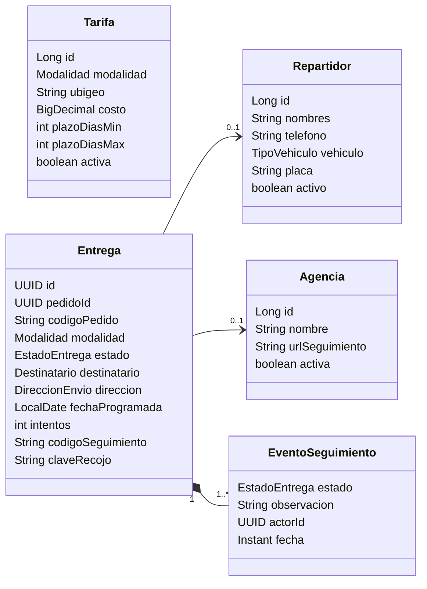
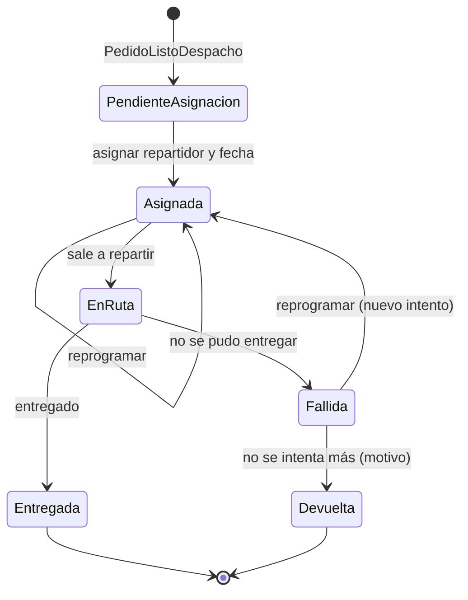
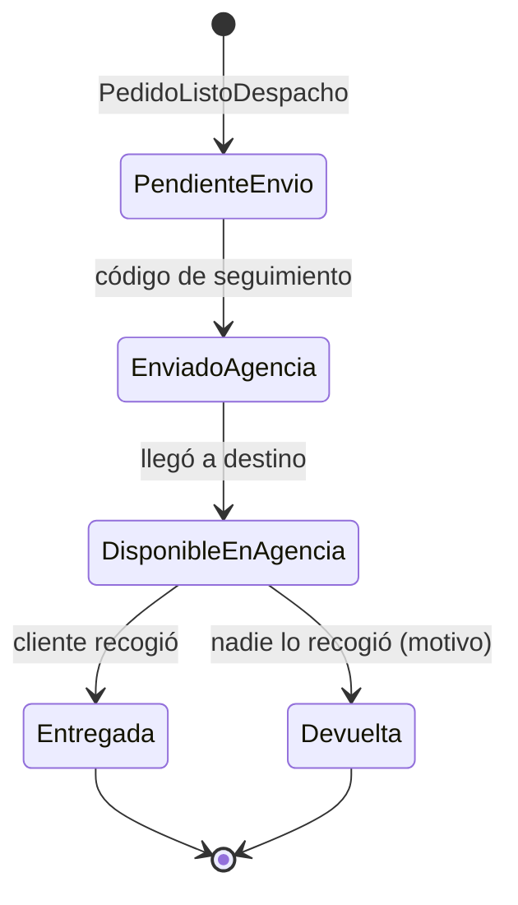
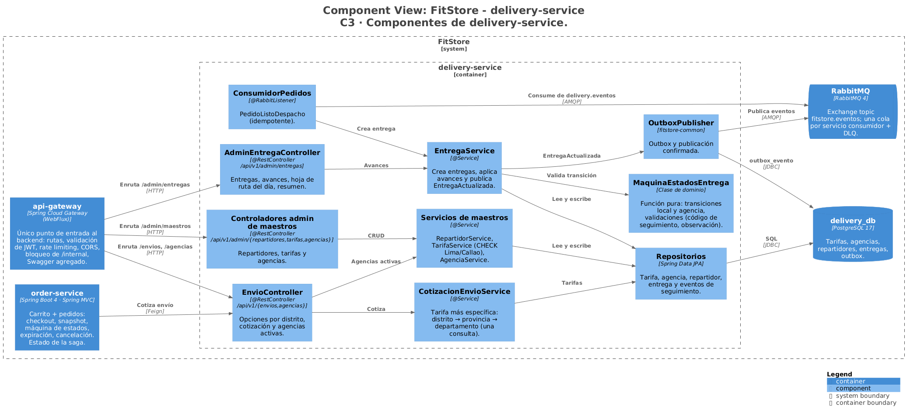
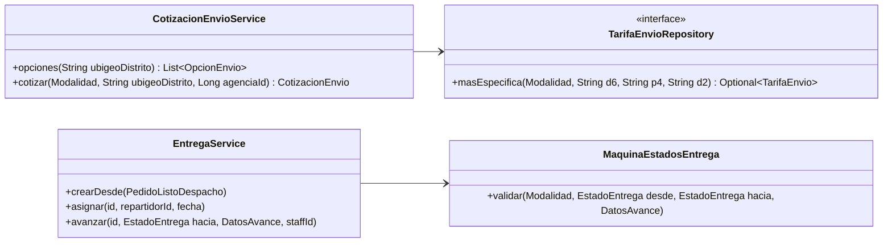

# FitStore — Análisis micro: `delivery-service`

> Versión: **v8 (aprobado)** — 2026-10-19. Fuente: [`01-analisis-macro.md`](../01-analisis-macro.md) v15.
> Estados: ✅ decidido · 🟡 propuesto · ❓ abierto · 🕓 diferido

**Historial:**
- v8 (2026-10-20): por la implementación de 0a.2: `entrega.dest_email` (el contrato lo exige en `EntregaActualizada`); la semilla de `V2` usa valores de demostración (S/ 15 / 18 / 25 por zona, Arequipa S/ 18 en 2–3 días, agencias con URL de rastreo de ejemplo).
- v7 (2026-10-19): ajustes de la etapa de contratos: `PATCH /admin/agencias/{id}/orden` (orden arrastrable del checkout, SPEC-6 CA-6-14); la entrega guarda los `bultos` que llegan en `PedidoListoDespacho`.
- v6 (2026-10-19): por SPEC-6: **devolución a tienda** (estado final `DEVUELTA` desde `FALLIDA` o `DISPONIBLE_EN_AGENCIA`, motivo obligatorio; D5 actualizada); la cotización informa el nivel de la tarifa aplicada (`nivelTarifa`, `ubigeoTarifa`) para la prueba de tarifas.
- v5 (2026-10-18): sección 10 aprobada → **documento completo aprobado**.
- v4 (2026-10-18): sección 10 (diseño técnico) redactada: C3, código de las partes críticas, paquetes, dependencias, configuración e infraestructura.
- v3 (2026-10-16): resto del documento aprobado → **documento aprobado**.
- v2 (2026-10-16): se aclara que la cotización **exige el distrito** (código de 6 dígitos); la jerarquía solo aplica a cómo el admin configura las tarifas. Agencias y tarifas semilla aprobadas.
- v1 (2026-10-16): borrador inicial.

**Estado de revisión por sección:** 1 ✅ · 2 ✅ · 3 ✅ · 4 ✅ · 5 ✅ · 6 ✅ · 7 ✅ · 8 ✅ · 9 ✅ · 10 ✅

---

## 1. Responsabilidad y límites

**Contexto:** Entregas (núcleo). **Base de datos:** `delivery_db` (PostgreSQL).

**Hace:**
- **Tarifas de envío** por código de ubigeo y modalidad, con búsqueda jerárquica distrito → provincia → departamento (RF-DEL-04).
- **Cotización** de costo y plazo para el checkout (RF-DEL-05).
- **Agencias de transporte** (datos semilla editables) para el select del checkout (RF-DEL-08).
- **Repartidores** propios (RF-DEL-03).
- **Entregas:** se crean solas cuando el pedido está listo para despacho; el operador asigna repartidor y fecha, registra avances, intentos fallidos, códigos de seguimiento y la **devolución a tienda** cuando no se puede entregar (RF-DEL-01, 02, 06).
- **Vista del día y hoja de ruta** por repartidor (RF-DEL-07).

**No hace:**
- **Recojo en tienda:** lo gestiona order (aprobado en order D7).
- No cambia el estado del pedido: publica `EntregaActualizada` y order decide.
- No se integra con APIs de agencias ni calcula rutas (fuera de alcance, macro 1.4).
- El repartidor **no usa el sistema**; el operador registra todo por él.

**Cubre:** CU-26, CU-26b, CU-27, CU-28 · RF-DEL-01 a 08.

---

## 2. Modelo de dominio



### 2.1 Decisiones del modelo ✅

| # | Propuesta | Por qué | Alternativa |
|---|---|---|---|
| D1 | **Una tarifa = modalidad + código de ubigeo de 2, 4 o 6 dígitos.** El largo del código define el nivel: `15` (todo Lima departamento), `1501` (Lima provincia), `150122` (Miraflores) | Una sola tabla para los tres niveles; la búsqueda jerárquica es probar el código de 6, luego sus primeros 4 y luego sus primeros 2 | Tres tablas (tarifa por distrito, por provincia, por departamento) |
| D2 | **La tarifa de agencia es común a todas las agencias:** el cliente elige la agencia por preferencia, pero el precio depende solo del destino | Menos configuración para el admin (una tabla, no una por agencia). Las agencias son datos mock (macro 1.4) | Tarifa por agencia y destino |
| D3 | **La entrega guarda copia** del destinatario y la dirección (vienen en `PedidoListoDespacho`) | delivery no llama a nadie para armar la hoja de ruta; si el cliente edita su dirección, la entrega no cambia | Consultar a order o auth |
| D4 | **Agencias con plantilla de URL de seguimiento** opcional (`https://…/rastreo?codigo={codigo}`) | El cliente recibe un enlace directo para rastrear su envío | Solo el código en texto |
| D5 | **Sin límite de intentos fallidos, con devolución a tienda:** una entrega fallida vuelve a programarse las veces que el operador decida (se muestra el número de intento); si el operador decide no intentarlo más, o un paquete en agencia nunca se recoge, la marca **`DEVUELTA`** con motivo (estado final). order pasa el pedido a `DEVUELTO` y el admin puede reembolsar | El operador decide; un pedido nunca queda trabado en `ENVIADO` | Máximo N intentos y devolución automática |
| D6 | **El cliente ve el nombre del repartidor y la fecha programada, no su teléfono** | Privacidad del repartidor; es él (o la tienda) quien contacta al cliente | Mostrar el teléfono |

### 2.2 Invariantes

1. `(modalidad, ubigeo)` es único en tarifas.
2. Las tarifas de **delivery local** solo pueden tener códigos de Lima Metropolitana (`1501…`) o Callao (`07…`).
3. Costo ≥ 0; `plazoDiasMin ≤ plazoDiasMax`.
4. Una entrega por pedido (`pedidoId` único).
5. Solo se asignan repartidores activos; solo se ofrecen agencias activas.
6. Para pasar a `ENVIADO_AGENCIA` es obligatorio el **código de seguimiento** (la clave de recojo es opcional, depende de la agencia).
7. Toda transición deja un `EventoSeguimiento` con fecha, actor y observación.
8. Un repartidor con entregas asignadas no se elimina (solo se desactiva).
9. Solo se pasa a `DEVUELTA` desde `FALLIDA` (local) o `DISPONIBLE_EN_AGENCIA` (agencia), y el **motivo** es obligatorio ("Cliente no ubicable tras 3 intentos", "No recogido en la agencia").

---

## 3. Modelo de datos

### 3.1 PostgreSQL (`delivery_db`) — migraciones `V1__esquema_inicial.sql`, `V2__semilla.sql`

| Tabla | Columnas principales | Restricciones / índices |
|---|---|---|
| `tarifa_envio` | `id`, `modalidad` (`DELIVERY_LOCAL`, `AGENCIA`), `ubigeo` (`varchar(6)`), `costo`, `plazo_dias_min`, `plazo_dias_max`, `activa`, auditoría | Único `(modalidad, ubigeo)`; `CHECK ubigeo ~ '^([0-9]{2}|[0-9]{4}|[0-9]{6})$'`; `CHECK` de invariantes 2 y 3 |
| `agencia` | `id`, `nombre`, `url_seguimiento`, `activa`, `orden` | Único `lower(nombre)` |
| `repartidor` | `id`, `nombres`, `telefono`, `vehiculo` (`MOTO`, `AUTO`, `BICICLETA`), `placa`, `activo`, auditoría | |
| `entrega` | `id`, `pedido_id`, `codigo_pedido`, `modalidad`, `estado`; destinatario: `dest_nombres`, `dest_apellidos`, `dest_dni`, `dest_telefono`, `dest_email` (lo exige `EntregaActualizada.destinatario.email` del contrato); dirección: `dir_ubigeo`, `dir_departamento`, `dir_provincia`, `dir_distrito`, `dir_direccion`, `dir_referencia`; `repartidor_id`, `fecha_programada`, `intentos`, `agencia_id`, `codigo_seguimiento`, `clave_recojo`, `resumen_items`, `bultos`, `creado_en`, `actualizado_en`, `version` | Único `pedido_id`; índices `(estado)`, `(fecha_programada, repartidor_id)` |
| `entrega_evento` | `id`, `entrega_id`, `estado`, `observacion`, `actor_id`, `creado_en` | Índice `(entrega_id, creado_en)` |

**Comunes:** `outbox_evento` y `evento_procesado` (ADR-009).

**Semilla** (`V2`):
- Agencias mock: Shalom, Olva Courier, Marvisur, Cruz del Sur Cargo.
- Delivery local: tarifa base para `1501` (Lima) y `07` (Callao), más algunas por distrito (Cercado `150101`, La Victoria `150115` — donde está Gamarra — más barata).
- Agencia: tarifa base por departamento para los 23 departamentos distintos de Lima y Callao, y por provincia para las provincias del departamento de Lima fuera de Lima Metropolitana (Cañete, Huaral, Huaura, etc.). No se siembra una tarifa de agencia `15` porque cubriría también a Lima Metropolitana, que se atiende con delivery local.

---

## 4. Casos de uso internos

### 4.1 Endpoints

**Checkout**

| Método | Ruta | Descripción | Acceso |
|---|---|---|---|
| GET | `/api/v1/envios/opciones?ubigeo=` (distrito, 6 dígitos, obligatorio) | Modalidades disponibles para ese distrito con costo y plazo (local y/o agencia) | Público |
| POST | `/api/v1/envios/cotizar` | `{modalidad, ubigeo (distrito, obligatorio), agenciaId?}` → `{costo, plazoDiasMin, plazoDiasMax, agenciaNombre, nivelTarifa, ubigeoTarifa}` | Público (lo usa order) |
| GET | `/api/v1/agencias` | Agencias activas para el select | Público |

**Backoffice**

| Método | Ruta | Descripción | Rol |
|---|---|---|---|
| GET | `/api/v1/admin/entregas` | Listar (filtros: estado, modalidad, fecha, repartidor, código de pedido) | OPERADOR, ADMIN |
| GET | `/api/v1/admin/entregas/{id}` | Detalle con seguimiento | OPERADOR, ADMIN |
| PATCH | `/api/v1/admin/entregas/{id}/asignar` | `{repartidorId, fechaProgramada}` (también para reprogramar) | OPERADOR, ADMIN |
| PATCH | `/api/v1/admin/entregas/{id}/en-ruta` · `/entregada` · `/fallida` | Avances del delivery local (`fallida` exige observación) | OPERADOR, ADMIN |
| PATCH | `/api/v1/admin/entregas/{id}/enviada-agencia` | `{agenciaId?, codigoSeguimiento, claveRecojo?}` | OPERADOR, ADMIN |
| PATCH | `/api/v1/admin/entregas/{id}/disponible-agencia` · `/entregada` | Avances del envío por agencia | OPERADOR, ADMIN |
| PATCH | `/api/v1/admin/entregas/{id}/devuelta` | `{motivo}` (obligatorio): devolución a tienda desde `FALLIDA` o `DISPONIBLE_EN_AGENCIA` (D5) | OPERADOR, ADMIN |
| GET | `/api/v1/admin/entregas/dia?fecha=&repartidorId=` | Entregas del día y **hoja de ruta** (imprimible desde el frontend) | OPERADOR, ADMIN |
| GET | `/api/v1/admin/entregas/resumen?fecha=` | Datos del dashboard: entregas del día por estado | OPERADOR, ADMIN |
| CRUD | `/api/v1/admin/repartidores` (+ `PATCH /{id}/desactivar` · `/activar`) | Repartidores (DELETE solo sin entregas) | OPERADOR, ADMIN |
| CRUD | `/api/v1/admin/tarifas` | Tarifas (DELETE físico permitido: los pedidos guardan su costo) | ADMIN |
| CRUD | `/api/v1/admin/agencias` (+ `desactivar` · `activar` · `orden`) | Agencias (DELETE solo sin entregas; `orden` = posición en el checkout, arrastrable) | ADMIN |

### 4.2 Cotización (RF-DEL-05) — búsqueda jerárquica

**El distrito es obligatorio.** `ubigeo` debe ser un código de distrito de 6 dígitos (el cliente siempre elige departamento, provincia **y distrito** en su dirección); si falta o tiene 2 o 4 dígitos → `400`. La jerarquía no está en lo que se cotiza, sino en **cómo se configuran las tarifas**: el admin puede poner una tarifa a todo un departamento o provincia en lugar de cargar uno por uno sus distritos.

Entrada: `modalidad = AGENCIA`, `ubigeo = 040101` (Arequipa, Arequipa, Arequipa).

1. ¿Hay tarifa activa para `040101`? No.
2. ¿Para `0401` (provincia de Arequipa)? No.
3. ¿Para `04` (departamento de Arequipa)? **Sí: S/ 18.00, 2–3 días.** → se usa esa.

Si ninguna coincide → `422 "No realizamos envíos por esta modalidad a este distrito"`.

Validaciones: delivery local solo para Lima/Callao; si viene `agenciaId`, debe existir y estar activa. La consulta es una sola sentencia (`WHERE ubigeo IN ('040101','0401','04') ORDER BY length(ubigeo) DESC LIMIT 1`).

**Opciones** (`/envios/opciones`): devuelve las modalidades que tienen tarifa para ese distrito. Así el checkout solo ofrece lo posible. (El recojo en tienda lo agrega el frontend si settings lo tiene habilitado.)

### 4.3 Creación de la entrega (RF-DEL-01)

Al recibir `PedidoListoDespacho`:
- Crea la entrega con la copia del destinatario, la dirección y el resumen de ítems (D3), idempotente por `pedidoId`.
- Estado inicial: `PENDIENTE_ASIGNACION` (local) o `PENDIENTE_ENVIO` (agencia, con la agencia que eligió el cliente).
- Publica `EntregaActualizada` (estado inicial).

### 4.4 Delivery local (CU-26)

| Acción del operador | Transición | El cliente ve |
|---|---|---|
| Asignar repartidor y fecha | `PENDIENTE_ASIGNACION → ASIGNADA` | "Tu pedido llegará el jueves 22/10 con Juan" |
| Sale a repartir | `ASIGNADA → EN_RUTA` | "Tu pedido está en camino" (order → `ENVIADO`) |
| Entregado | `EN_RUTA → ENTREGADA` | "Entregado" (order → `ENTREGADO`) |
| No se pudo entregar (observación obligatoria: "No había nadie", "Dirección incorrecta") | `EN_RUTA → FALLIDA` | "No pudimos entregar tu pedido: …" |
| Reprogramar | `FALLIDA → ASIGNADA` (nuevo intento, misma u otra fecha o repartidor) | Nueva fecha |
| No intentar más (motivo obligatorio) | `FALLIDA → DEVUELTA` | "Tu pedido regresó a la tienda: …" (order → `DEVUELTO`) |

**Hoja de ruta** (RF-DEL-07): por repartidor y fecha, ordenada por distrito: código de pedido, destinatario, teléfono, dirección, referencia y bultos. El backoffice la imprime.

### 4.5 Envío por agencia (CU-26b)

| Acción del operador | Transición | El cliente ve |
|---|---|---|
| Entrega el paquete en la agencia y registra **código de seguimiento** (y clave de recojo si aplica). Puede cambiar la agencia si la elegida no estaba disponible | `PENDIENTE_ENVIO → ENVIADO_AGENCIA` | "Enviado por Shalom, código 12345" + enlace de rastreo (order → `ENVIADO`) |
| La agencia avisa que llegó al destino | `ENVIADO_AGENCIA → DISPONIBLE_EN_AGENCIA` | "Tu pedido ya está en la agencia: lleva tu DNI y la clave 4821" |
| El cliente lo recoge | `DISPONIBLE_EN_AGENCIA → ENTREGADA` | "Entregado" (order → `ENTREGADO`) |
| Nadie lo recoge y la agencia lo devuelve (motivo obligatorio) | `DISPONIBLE_EN_AGENCIA → DEVUELTA` | "Tu pedido regresó a la tienda: …" (order → `DEVUELTO`) |

---

## 5. Estados

**Delivery local:**



**Agencia:**



Son los estados del macro (RF-DEL-02), con `DEVUELTA` como final de ambos flujos (v6).

---

## 6. Eventos

Exchange `fitstore.eventos` (topic), sobre común, outbox e idempotencia (ADR-009).

**Publica:**

| Evento | Routing key | Payload | Consume |
|---|---|---|---|
| `EntregaActualizada` | `delivery.entrega.actualizada` | `entregaId`, `pedidoId`, `codigoPedido`, `modalidad`, `estado`, `intento`, `fechaProgramada`, `repartidorNombre`, `agenciaNombre`, `codigoSeguimiento`, `claveRecojo`, `urlSeguimiento`, `observacion`, `destinatario` (nombre, email), `ocurridoEn` | order (estado del pedido e historial), notification (correos) |

Un solo evento para todos los cambios (como en el macro); cada consumidor reacciona a los estados que le importan.

**Consume:** `PedidoListoDespacho` (order).

---

## 7. Dependencias síncronas

**Salientes:** ninguna. Los nombres del ubigeo y los datos del destinatario llegan en el evento (D3); el admin ve los nombres de los distritos en la pantalla de tarifas porque el **frontend** los pide a settings.

**Entrantes:**

| Quién | Qué |
|---|---|
| order-service | `POST /envios/cotizar` en el resumen y la confirmación del checkout (timeout 2 s, 1 reintento; si falla, el checkout responde `503`) |
| storefront | `/envios/opciones` y `/agencias` en el checkout |
| backoffice | Pantallas de entregas, repartidores, tarifas y agencias; dashboard |

---

## 8. Seguridad

- Cotización, opciones y agencias: **públicos** y de solo lectura.
- Entregas y repartidores: `OPERADOR` y `ADMIN` (CU-26, CU-27).
- Tarifas y agencias: solo `ADMIN` (CU-28).
- Datos del destinatario (DNI, teléfono, dirección): solo staff; nunca en logs.
- El cliente no consulta delivery directamente: ve su seguimiento a través de order ("Mis pedidos").

---

## 9. Pruebas

**Capa de datos (AP1)** — `@DataJpaTest` con PostgreSQL en Testcontainers:

| Repositorio | Insertar | Actualizar | Eliminar | Listar | Extra |
|---|---|---|---|---|---|
| `RepartidorRepository` | ✔ | datos, activo | **físico** (sin entregas) | activos | no se elimina con entregas |
| `TarifaEnvioRepository` | 3 niveles | costo, plazo | **físico** | por modalidad | **búsqueda jerárquica** (distrito, provincia, departamento, sin tarifa); `(modalidad, ubigeo)` único; `CHECK` Lima/Callao en local |
| `AgenciaRepository` | ✔ | ✔ | físico (sin entregas) | activas | nombre único |
| `EntregaRepository` | desde evento | estado, asignación | — | filtros, del día por repartidor | `pedidoId` único |

**Unitarias:** máquinas de estado local y agencia (transiciones permitidas y prohibidas, incluida `DEVUELTA` solo desde `FALLIDA` o `DISPONIBLE_EN_AGENCIA`), validaciones (código de seguimiento obligatorio, observación en fallida, motivo en devuelta), cotización con todos los niveles.

**Consumidor:** `PedidoListoDespacho` duplicado crea una sola entrega.

**API (MockMvc):** permisos por rol (OPERADOR no edita tarifas).

**Postman:** cotizar (Lima distrito con tarifa propia, Lima sin tarifa propia → provincia, Arequipa → departamento, destino sin tarifa); flujo local completo con un intento fallido; flujo por agencia.

---

## 10. Diseño técnico ✅

Stack y versiones comunes: [`docs/arquitectura/stack-versiones.md`](../../arquitectura/stack-versiones.md). Modelo C4: [`docs/arquitectura/workspace.dsl`](../../arquitectura/workspace.dsl). Convenciones comunes a todos los servicios (ADR-015): interfaz + `Impl` en servicios, DTOs como `record`, mapeo con MapStruct, sin lógica en controladores, `ApiResponse` y manejo de errores de `fitstore-common`.

### 10.1 Componentes (C4 nivel 3)



| Capa | Componentes |
|---|---|
| Controladores | `EnvioController`, `AdminEntregaController`, controladores admin de repartidores, tarifas y agencias |
| Servicios | `CotizacionEnvioService`, `EntregaService`, `MaquinaEstadosEntrega` (pura), servicios de maestros (repartidor, tarifa, agencia) |
| Procesos | `ConsumidorPedidos` (`PedidoListoDespacho`) |
| Repositorios | tarifa, agencia, repartidor, entrega (+ eventos de seguimiento) |
| Común | `OutboxPublisher`, consumidor idempotente |

### 10.2 Código (C4 nivel 4): cotización jerárquica y estados



- `masEspecifica`: `SELECT … WHERE modalidad = ? AND activa AND ubigeo IN (:d6, :p4, :d2) ORDER BY length(ubigeo) DESC LIMIT 1`. El servicio valida antes que el código tenga 6 dígitos (`400`) y que delivery local sea Lima/Callao.
- `MaquinaEstadosEntrega` tiene dos tablas de transiciones (local y agencia) y valida los datos obligatorios de cada avance (código de seguimiento al enviar a agencia, observación en fallida, motivo en devuelta).

### 10.3 Paquetes y capas

```
com.fitstore.delivery
├── DeliveryServiceApplication
├── config            SecurityConfig, OpenApiConfig, PropiedadesDelivery
├── controller        EnvioController, AdminEntregaController, admin/ (Repartidor, Tarifa, Agencia)
├── dto, mapper
├── model             TarifaEnvio, Agencia, Repartidor, Entrega (+ @Embeddable Destinatario, DireccionEnvio), EntregaEvento, enums
├── repository        …Repository
├── service           CotizacionEnvioService, EntregaService, RepartidorService, TarifaService, AgenciaService
│   └── dominio       MaquinaEstadosEntrega
├── messaging         ConsumidorPedidos
└── event             EntregaActualizada
```

### 10.4 Dependencias

| Grupo | Artefactos |
|---|---|
| Web y validación | `spring-boot-starter-webmvc`, `spring-boot-starter-validation` |
| Datos | `spring-boot-starter-data-jpa`, `postgresql`, `spring-boot-starter-flyway`, `flyway-database-postgresql` |
| Seguridad | `spring-boot-starter-security`, `spring-boot-starter-oauth2-resource-server` (validación de JWT, vía `fitstore-common`) |
| Mensajería | `spring-boot-starter-amqp` |
| Nube | `spring-cloud-starter-config`, `spring-cloud-starter-netflix-eureka-client` |
| Observabilidad | `spring-boot-starter-actuator`, `spring-boot-starter-opentelemetry` |
| Documentación | `springdoc-openapi-starter-webmvc-ui` |
| Propias y utilidades | `fitstore-common`, `lombok`, `mapstruct` (+ procesadores) |
| Pruebas | `spring-boot-starter-test`, `spring-boot-starter-data-jpa-test`, `spring-security-test`, `testcontainers-postgresql`, `testcontainers-junit-jupiter` |
| Pruebas extra | `testcontainers-rabbitmq` |

No usa: Redis, Feign, S3.

### 10.5 Configuración

**Puerto:** 8085. Archivos: `delivery-service.yml`, `-dev.yml`, `-cloud.yml`.

```yaml
server.port: 8085
spring:
  datasource:
    url: jdbc:postgresql://${DB_HOST:postgres}:5432/delivery_db
    username: ${DELIVERY_DB_USER}
    password: ${DELIVERY_DB_PASSWORD}
  jpa.hibernate.ddl-auto: validate        # el esquema lo maneja Flyway
fitstore:
  delivery:
    local.prefijos-ubigeo: ["1501", "07"]   # Lima Metropolitana y Callao
```

| Variable de entorno | Uso |
|---|---|
| `DELIVERY_DB_USER`, `DELIVERY_DB_PASSWORD` | Usuario propio de `delivery_db` |

### 10.6 Infraestructura

| Componente | Uso |
|---|---|
| PostgreSQL `delivery_db` | Tablas de 3.1; semilla de agencias y tarifas en `V2__semilla.sql` |
| RabbitMQ | Publica `delivery.entrega.actualizada`. Cola `delivery.eventos` enlazada a `order.pedido.listo-despacho`; DLQ |

---

## Datos semilla ✅

- **Agencias mock:** Shalom, Olva Courier, Marvisur, Cruz del Sur Cargo (solo opciones del select, sin integración).
- **Delivery local:** S/ 10 Lima Metropolitana, S/ 12 Callao, S/ 7 La Victoria y Cercado; 1–2 días.
- **Agencia:** S/ 15–25 según departamento (y provincias de Lima fuera de Lima Metropolitana); 2–5 días.

Todos editables desde el backoffice.
