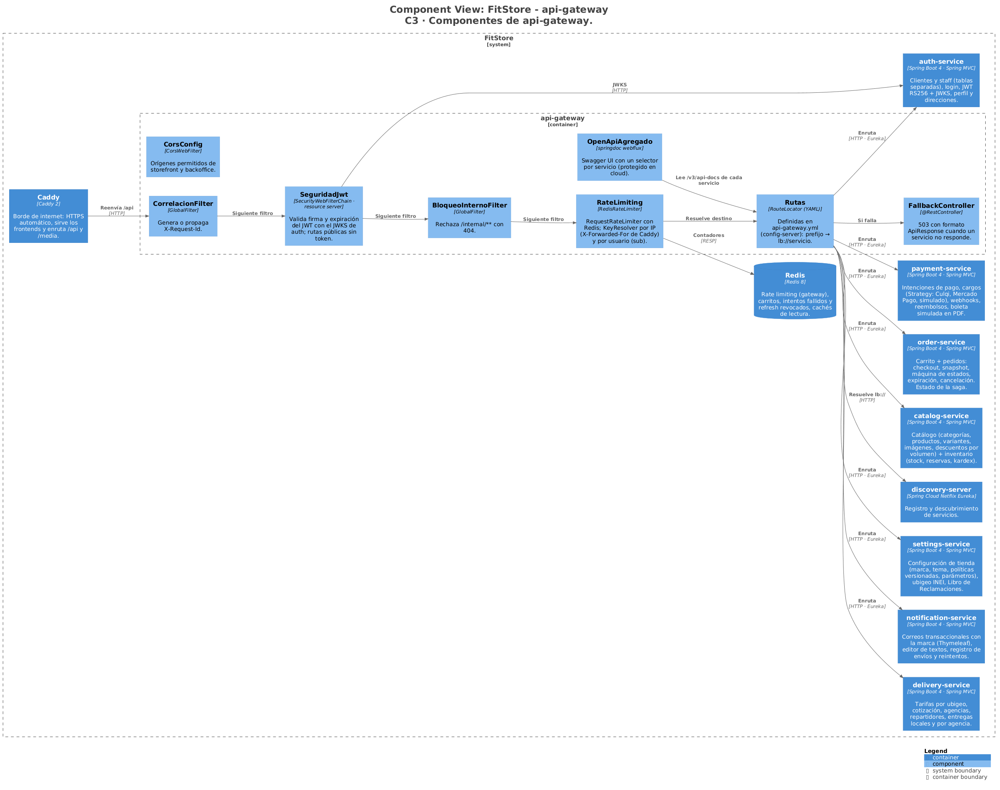

# FitStore — Análisis micro: infraestructura (`config-server`, `discovery-server`, `api-gateway`) y piezas comunes

> Versión: **v5 (aprobado)** — 2026-10-19. Fuente: [`01-analisis-macro.md`](../01-analisis-macro.md) v16.
> Estados: ✅ decidido · propuesto · ❓ abierto · 🕓 diferido
> Ficha corta: estos servicios no tienen dominio de negocio, así que la estructura difiere de la plantilla.

**Historial:**
- v5 (2026-10-19): se quita la ruta `/api/v1/admin/clientes/*/pedidos` del gateway (los pedidos de un cliente usan `GET /admin/pedidos?clienteId=`, SPEC-4 O3); detectado al redactar la SPEC-8.
- v4 (2026-10-18): sección 10 aprobada → **documento completo aprobado**.
- v3 (2026-10-18): sección 10 (diseño técnico) redactada: C3, código de las partes críticas, paquetes, dependencias, configuración e infraestructura.
- v2 (2026-10-16): documento aprobado. Dominio de la demo: subdominio gratuito de **DuckDNS** (`tienda.` y `admin.` debajo). Swagger publicado en la nube **con contraseña**.
- v1 (2026-10-16): borrador inicial.

**Estado de revisión por sección:** 1 ✅ · 2 ✅ · 3 ✅ · 4 ✅ · 5 ✅ · 6 ✅ · 7 ✅ · 8 ✅ · 9 ✅ · 10 ✅

---

## 1. Responsabilidad

| Pieza | Responsabilidad | Puerto |
|---|---|---|
| `config-server` | Configuración técnica de todos los servicios por entorno (`dev`, `cloud`) | 8888 |
| `discovery-server` | Registro y descubrimiento de servicios (Eureka) | 8761 |
| `api-gateway` | Único punto de entrada al backend: enrutamiento, validación de JWT, rate limiting, CORS, bloqueo de rutas internas, documentación OpenAPI agregada | 8080 |
| Caddy (borde) | HTTPS automático, sirve los dos frontends, envía `/api` al gateway y `/media` a Garage | 80 / 443 |
| `fitstore-common` | Librería Maven compartida (no es un servicio) | — |

Puertos de los servicios de negocio: auth 8081 · catalog 8082 · order 8083 · payment 8084 · delivery 8085 · notification 8086 · settings 8087. Solo Caddy se publica hacia afuera; todo lo demás vive en la red interna de Docker.

---

## 2. `config-server`

- **Spring Cloud Config Server** con backend **nativo**: lee archivos YAML de la carpeta `infra/config-repo/` del monorepo, montada en el contenedor. (Alternativa: un repositorio Git aparte; más ceremonia sin beneficio para una sola instalación.)
- Estructura: `application.yml` (común a todos: Eureka, RabbitMQ, Redis, tracing, logs), `{servicio}.yml` y `{servicio}-{perfil}.yml` (`dev` / `cloud`).
- **Sin secretos en los archivos:** los valores sensibles se escriben como `${CULQI_SECRET_KEY}` y se resuelven desde variables de entorno de cada contenedor (archivo `.env` fuera de Git, R12).
- Cada servicio arranca con `spring.config.import=configserver:http://config-server:8888`, con **reintentos** (si el config-server aún no está listo, espera en lugar de fallar).
- Protegido con usuario y contraseña (HTTP Basic); solo accesible en la red interna.

---

## 3. `discovery-server`

- **Eureka Server** en modo standalone (una sola instancia; no se registra a sí mismo).
- Los servicios se registran con su nombre (`catalog-service`, …); Feign y el gateway los resuelven con `lb://catalog-service` (ADR-010).
- En `dev`, *self-preservation* desactivado y renovaciones cortas, para que un servicio caído desaparezca rápido del registro.
- El panel de Eureka no se publica: se consulta en local o por túnel SSH en la VM (sección 5).

---

## 4. `api-gateway`

### 4.1 Tecnología

**Spring Cloud Gateway (variante WebFlux, reactiva).** Es la variante que trae el `RequestRateLimiter` con Redis que eligió la ADR-020. Los servicios de negocio siguen siendo Spring MVC; solo el gateway es reactivo (es lo habitual, y está aislado: no tiene lógica de negocio).

### 4.2 Rutas

| Prefijo | Destino |
|---|---|
| `/api/v1/auth/**`, `/api/v1/clientes/**`, `/api/v1/staff/**`, `/.well-known/jwks.json` | `lb://auth-service` |
| `/api/v1/categorias/**`, `/api/v1/productos/**`, `/api/v1/tallas`, `/api/v1/colores`, `/api/v1/precios/**`, `/api/v1/admin/{categorias,productos,variantes,imagenes,tallas,colores,descuentos,inventario}/**` | `lb://catalog-service` |
| `/api/v1/carrito/**`, `/api/v1/checkout/**`, `/api/v1/pedidos/**`, `/api/v1/admin/pedidos/**` | `lb://order-service` |
| `/api/v1/pagos/**` (incluye webhooks), `/api/v1/admin/{pagos,reembolsos}/**` | `lb://payment-service` |
| `/api/v1/envios/**`, `/api/v1/agencias`, `/api/v1/admin/{entregas,repartidores,tarifas,agencias}/**` | `lb://delivery-service` |
| `/api/v1/admin/notificaciones/**` | `lb://notification-service` |
| `/api/v1/settings/**`, `/api/v1/ubigeo/**`, `/api/v1/reclamos`, `/api/v1/admin/{settings,reclamos}/**` | `lb://settings-service` |
| `/internal/**` | **Sin ruta: `404`** (y además se rechaza explícitamente) |

Las rutas viven en `api-gateway.yml` del config-server.

### 4.3 Seguridad

- **Valida el JWT** (firma con el JWKS de auth, expiración) cuando la petición trae `Authorization`; si es inválido → `401` sin llegar al servicio. Las rutas públicas pasan sin token.
- La **autorización por rol** la hace cada servicio (`@PreAuthorize`), no el gateway (ADR-011): el gateway no necesita conocer las reglas de negocio.
- Reenvía el token tal cual al servicio y agrega `X-Request-Id` (id de correlación, también en la respuesta).
- **CORS:** solo los orígenes del storefront y del backoffice (por configuración de entorno).
- Cabeceras de seguridad básicas en Caddy (HSTS, `X-Content-Type-Options`, `Referrer-Policy`).

### 4.4 Rate limiting (Redis, ADR-020)

| Ruta | Límite | Clave |
|---|---|---|
| `POST /auth/login`, `/auth/staff/login` | 5 por minuto | IP |
| `POST /auth/registro` | 3 por minuto | IP |
| `POST /auth/password/olvido` (ambos) | 3 por minuto | IP |
| `POST /reclamos` | 3 por minuto | IP |
| `POST /pedidos` (checkout) | 10 por minuto | usuario (`sub` del JWT) |
| `POST /pagos/*/cargos` | 10 por minuto | usuario |
| Resto | 50 por segundo (ráfaga 100) | IP |

Al superarlo → `429 "Demasiados intentos, espera un momento"` con `Retry-After`. La IP real se toma de `X-Forwarded-For` puesto por Caddy (solo se confía en Caddy). Si Redis no está disponible, el gateway **deja pasar** (no bloquea la tienda) y lo registra.

### 4.5 Tiempos y errores

- Timeout de conexión 2 s y de respuesta 10 s (los cobros pueden tardar).
- Si el servicio destino no está registrado o no responde → `503` con el formato `ApiResponse` (`success: false`, `mensaje: "Servicio no disponible, inténtalo en un momento"`).

### 4.6 Documentación (RNF-14)

Swagger UI en `/swagger-ui` con un selector por servicio (cada servicio expone su `/v3/api-docs` con springdoc y el gateway los agrega). En `cloud` se protege con usuario y contraseña.

---

## 5. Borde: Caddy y dominios

| Host | Contenido |
|---|---|
| `tienda.<dominio>` | Storefront (estático) + `/api/**` → gateway + `/media/**` → Garage (bucket público, solo lectura) |
| `admin.<dominio>` | Backoffice (estático) + `/api/**` → gateway + `/media/**` → Garage |

- Cada frontend llama a `/api` en **su mismo dominio**: no hay CORS entre dominios en la práctica y la cookie de refresh (`SameSite=Strict`) funciona sin trucos (auth 4.4).
- **HTTPS automático** con Let's Encrypt (Caddy lo gestiona solo).
- **No se publican** Eureka, RabbitMQ, Jaeger, Mailpit ni Garage-admin: en la VM se usan por túnel SSH (`ssh -L 16686:localhost:16686 …`).
- En local: `http://localhost:4200` (storefront) y `http://localhost:4300` (backoffice) en desarrollo, o Caddy con `tienda.localhost` / `admin.localhost`.

---

## 6. `docker-compose`

### 6.1 Contenedores y memoria (RNF-03, ≤ 6,5 GB)

| Contenedor | Imagen | `mem_limit` |
|---|---|---|
| postgres | `postgres:17` (una instancia, **7 bases y 7 usuarios**, uno por servicio, ADR-006) | 512 MB |
| redis | `redis:8` | 96 MB |
| rabbitmq | `rabbitmq:4-management` | 384 MB |
| garage | `dxflrs/garage` | 96 MB |
| jaeger | `jaegertracing/jaeger` (all-in-one, en memoria) | 256 MB |
| mailpit | `axllent/mailpit` (solo `dev`) | 64 MB |
| caddy | `caddy:2` | 64 MB |
| config, discovery, gateway | imágenes propias (Java 21) | 256 MB c/u |
| 7 servicios de negocio | imágenes propias (Java 21, `-Xmx192m`) | 320 MB c/u |
| **Total** | | **≈ 4,6 GB** |

Las versiones exactas de las imágenes se fijan al crear el repositorio (no `latest`).

### 6.2 Orden de arranque

`postgres, redis, rabbitmq, garage` (con *healthcheck*) → `config-server` → `discovery-server` → servicios de negocio → `api-gateway` → `caddy`. Se usa `depends_on: condition: service_healthy` y los *healthchecks* de Actuator (`/actuator/health`); `restart: unless-stopped` (RNF-08).

### 6.3 Archivos

- `infra/docker-compose.yml`: base común.
- `infra/docker-compose.dev.yml`: Mailpit, puertos publicados en `localhost` para depurar, perfil `dev`.
- `infra/docker-compose.cloud.yml`: Caddy con dominios reales, SES, perfil `cloud`, sin puertos internos publicados.
- `infra/.env.example`: todas las variables necesarias, sin valores reales.
- `infra/postgres/init.sql`: crea las 7 bases y sus usuarios.

En local también se puede levantar solo la infraestructura (`postgres`, `redis`, `rabbitmq`, …) y correr los servicios desde el IDE.

---

## 7. Librería común `fitstore-common`

Para no repetir código entre los 7 servicios de negocio (ADR-018), un módulo Maven con:

| Pieza | Contenido |
|---|---|
| API | `ApiResponse<T>`, `GlobalExceptionHandler` base, excepciones comunes (`RecursoNoEncontrado`, `ConflictoNegocio`, …), paginación (ADR-015) |
| Seguridad | Configuración de *resource server* JWT (JWKS de auth), `RoleHierarchy` (`ADMIN > OPERADOR`), lectura del `clienteId`/`tipo` del token |
| Eventos | Sobre común (`eventoId`, `tipo`, `version`, `ocurridoEn`), **outbox** (entidad + publicador programado) y **consumidor idempotente** (`evento_procesado`) (ADR-009) |
| Archivos | Puerto `FileStorage` + adaptadores `S3FileStorage` y `AzureBlobFileStorage` (ADR-013) |
| Feign | Propagación del JWT del usuario y del `X-Request-Id`; configuración base de Resilience4j |
| Dinero | Utilidades de `BigDecimal` (escala 2, *half-up*) |

Regla: `fitstore-common` **no contiene lógica de negocio** ni entidades de un dominio; solo piezas técnicas.

---

## 8. Convenciones de mensajería (RabbitMQ)

- Un exchange **`fitstore.eventos`** (topic, durable). Routing key `{servicio}.{entidad}.{acción}` (ej. `order.pedido.pagado`), como en los micros.
- Cada servicio consumidor tiene **su propia cola** (`{servicio}.eventos`), enlazada solo a las routing keys que le interesan.
- **Reintentos:** 3 con espera creciente; luego el mensaje va a la **cola de mensajes muertos** `{servicio}.eventos.dlq` para revisión manual (consola de RabbitMQ).
- Mensajes persistentes y confirmación del publicador (*publisher confirms*) en el outbox: una fila se marca como publicada solo cuando RabbitMQ confirma.
- JSON con versión en el sobre; un consumidor ignora campos que no conoce (compatibilidad hacia adelante).

---

## 9. Pruebas

- **Gateway:** pruebas de rutas con `WebTestClient` y servicios simulados (WireMock): cada prefijo llega a su servicio; `/internal/**` → `404`; JWT inválido → `401`; CORS; `429` al superar el límite (Redis en Testcontainers).
- **Config-server:** cada servicio carga su configuración en `dev` y `cloud` sin propiedades faltantes.
- **Compose:** script de humo (`infra/smoke.sh`) que levanta todo y espera a que todos los *healthchecks* estén en verde; se usa también en GitHub Actions.
- **Common:** outbox (se publica solo tras la confirmación), consumidor idempotente (duplicado ignorado), `ApiResponse` y manejo de errores.

---

## 10. Diseño técnico ✅

Stack y versiones: [`docs/arquitectura/stack-versiones.md`](../../arquitectura/stack-versiones.md). Diagramas: [`docs/arquitectura/c4-sistema.md`](../../arquitectura/c4-sistema.md) (C2 y despliegue) y `C3-gateway`.

### 10.1 Componentes del gateway (C4 nivel 3)



Cadena de una petición: **SeguridadJwt → BloqueoInternoFilter → RateLimiting → CorrelacionFilter → Rutas** (→ servicio vía Eureka, o `FallbackController` con `503`). `CorsConfig` y `OpenApiAgregado` completan el gateway. Config-server y Eureka no tienen componentes propios relevantes (son la aplicación Spring Cloud estándar con su configuración).

### 10.2 Repositorio: estructura del monorepo

```
fitstore/
├── pom.xml                       POM padre: Spring Boot 4.0.8 + BOM Spring Cloud 2025.1.3, versiones de stack-versiones.md
├── backend/
│   ├── fitstore-common/          librería común (sección 7)
│   ├── config-server/  discovery-server/  api-gateway/
│   └── auth-service/  catalog-service/  order-service/  payment-service/
│       delivery-service/  notification-service/  settings-service/
├── frontend/                     workspace Angular 22: projects/storefront, projects/backoffice, projects/shared
├── infra/
│   ├── config-repo/              application.yml + {servicio}.yml + {servicio}-{dev,cloud}.yml
│   ├── docker-compose.yml  docker-compose.dev.yml  docker-compose.cloud.yml  .env.example
│   ├── postgres/init.sql   garage/garage.toml   caddy/Caddyfile   smoke.sh
├── docs/                         analisis/, arquitectura/, adr/
├── postman/                      una colección por servicio + entorno local/cloud
├── k6/                           catálogo y checkout
└── .github/workflows/            ci.yml (filtros por ruta, caché Maven/npm), deploy.yml (opcional, SSH a la VM)
```

### 10.3 Paquetes de `fitstore-common`

```
com.fitstore.common
├── api           ApiResponse, PaginaResponse, GlobalExceptionHandlerBase, excepciones (RecursoNoEncontrado, ConflictoNegocio, …)
├── security      FitstoreSecurityAutoConfiguration (resource server + RoleHierarchy), UsuarioActual (lee sub, tipo, rol)
├── event         SobreEvento, OutboxEvento (entidad), OutboxPublisher (@Scheduled + publisher confirms),
│                 EventoProcesado, ConsumidorIdempotente, TopologiaRabbit (exchange, colas, DLQ)
├── storage       FileStorage, S3FileStorage, AzureBlobFileStorage, StorageProperties
├── feign         PropagacionJwtInterceptor, PropagacionRequestIdInterceptor
├── money         Dinero (escala 2, half-up)
└── autoconfigure registro de las autoconfiguraciones (cada servicio las activa con propiedades)
```

Cada servicio que usa outbox incluye la tabla `outbox_evento` y `evento_procesado` en su propia migración Flyway (la librería no crea tablas).

### 10.4 Dependencias de las piezas de infraestructura

| Pieza | Artefactos |
|---|---|
| config-server | `spring-cloud-config-server`, `spring-boot-starter-security` (Basic), `spring-boot-starter-actuator` |
| discovery-server | `spring-cloud-starter-netflix-eureka-server`, `spring-boot-starter-actuator` |
| api-gateway | `spring-cloud-starter-gateway-server-webflux`, `spring-boot-starter-data-redis-reactive`, `spring-boot-starter-oauth2-resource-server`, `spring-cloud-starter-netflix-eureka-client`, `spring-cloud-starter-config`, `springdoc-openapi-starter-webflux-ui`, `spring-boot-starter-actuator`, `spring-boot-starter-opentelemetry` |
| fitstore-common | `spring-boot-autoconfigure`, `spring-boot-starter-webmvc`, `-security`, `-oauth2-resource-server`, `-amqp`, `-data-jpa`, `spring-cloud-starter-openfeign` (todas `optional`), `software.amazon.awssdk:s3`, `azure-storage-blob` (`optional`) |

### 10.5 Configuración

| Pieza | Puerto | Configuración clave |
|---|---|---|
| config-server | 8888 | `spring.profiles.active=native`, `spring.cloud.config.server.native.search-locations=file:/config-repo`, usuario `CONFIG_USER` / `CONFIG_PASSWORD` |
| discovery-server | 8761 | `eureka.client.register-with-eureka=false`, `fetch-registry=false`; en dev `enable-self-preservation=false` |
| api-gateway | 8080 | Rutas, rate limits, CORS y timeouts en `api-gateway.yml` (sección 4); `SWAGGER_USER` / `SWAGGER_PASSWORD` en cloud |

**`application.yml` común (config-repo):** Eureka (`http://discovery-server:8761/eureka`), RabbitMQ (`RABBITMQ_USER`/`RABBITMQ_PASSWORD`), Redis (`REDIS_HOST`), OTLP (`management.otlp.tracing.endpoint=http://jaeger:4318/v1/traces`), muestreo de trazas 100 % en dev y 20 % en cloud, logs estructurados en consola, `management.endpoints.web.exposure.include=health,info,metrics`.

**`.env.example` (agrupado):** base de datos (usuario y contraseña por servicio), RabbitMQ, Redis, S3/Garage, JWT (rutas de las claves), admin inicial, pasarelas (Culqi, Mercado Pago, simulado), SMTP, URLs públicas (`FITSTORE_PUBLIC_URL`, `STOREFRONT_URL`, `BACKOFFICE_URL`, `MEDIA_BASE_URL`), dominio DuckDNS y token, credenciales de config-server y Swagger.

### 10.6 Imágenes de los servicios

- Un `Dockerfile` común por servicio en dos etapas: compilación con Maven (JDK 21) y ejecución sobre `eclipse-temurin:21-jre`, con el jar en capas (`java -Djarmode=tools … extract`) para acelerar reconstrucciones.
- Usuario no root, `HEALTHCHECK` contra `/actuator/health`, `JAVA_TOOL_OPTIONS="-Xmx192m -XX:+UseSerialGC"` (gateway, config y discovery: `-Xmx160m`).
- Los frontends se compilan con `ng build` y los copia la imagen de Caddy (cloud) o se sirven con `ng serve` (dev).

---

## Decisiones de alcance ✅

1. **Dominio:** subdominio gratuito de DuckDNS, con `tienda.<sub>.duckdns.org` y `admin.<sub>.duckdns.org`; HTTPS automático con Caddy.
2. **Swagger en la nube:** publicado y protegido con usuario y contraseña.
