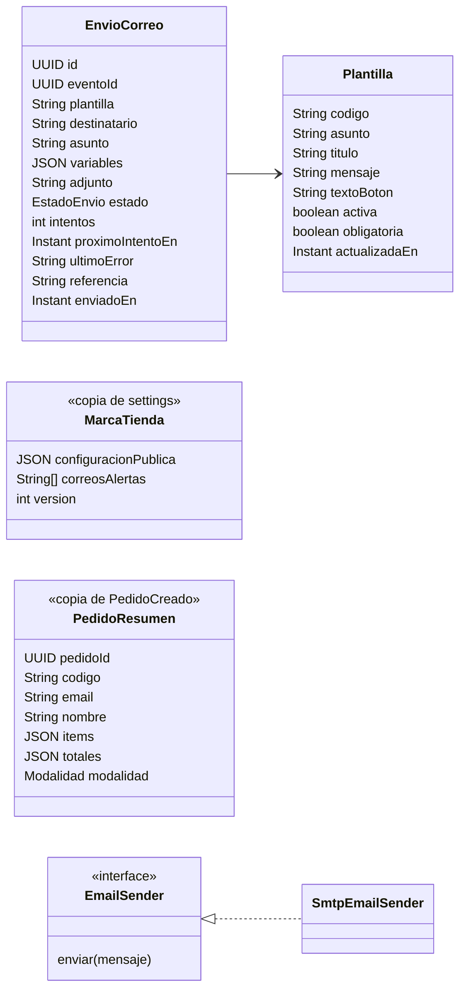
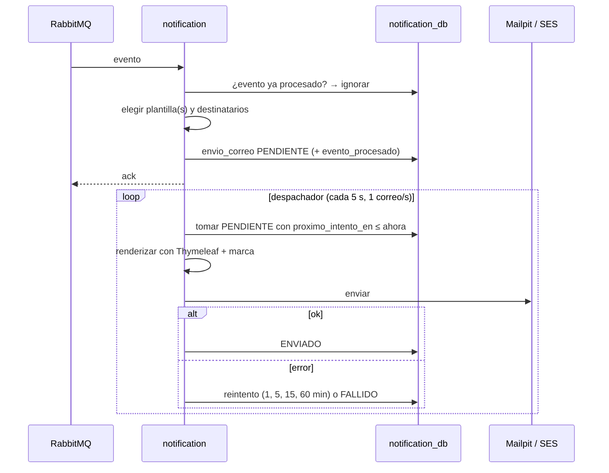
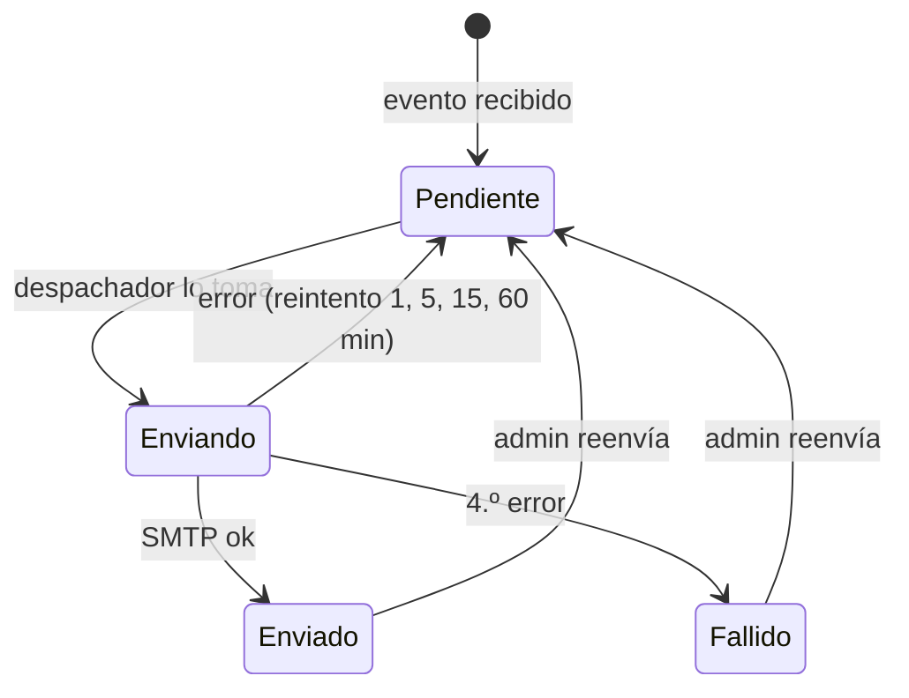
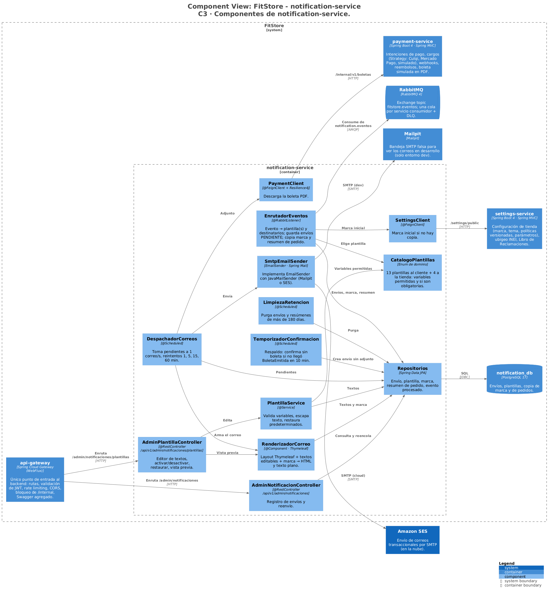
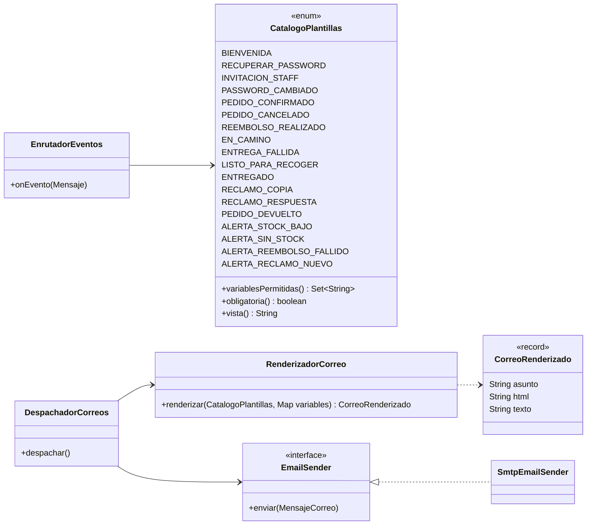

# FitStore — Análisis micro: `notification-service`

> Versión: **v7 (aprobado)** — 2026-10-19. Fuente: [`01-analisis-macro.md`](../01-analisis-macro.md) v15.
> Estados: ✅ decidido · 🟡 propuesto · ❓ abierto · 🕓 diferido

**Historial:**
- v7 (2026-10-19): nuevo correo **C14 "Tu pedido regresó a la tienda"** (`EntregaActualizada` → `DEVUELTA`), decidido en la SPEC-6: 14 al cliente + 4 a la tienda.
- v6 (2026-10-18): el correo C7 (reembolso realizado) distingue el reembolso parcial postventa (SPEC-5).
- v5 (2026-10-18): sección 10 aprobada → **documento completo aprobado**.
- v4 (2026-10-18): sección 10 (diseño técnico) redactada: C3, código de las partes críticas, paquetes, dependencias, configuración e infraestructura.
- v3 (2026-10-16): catálogo reducido a **13 correos al cliente + 4 alertas a la tienda** (se quitan vencido y fecha asignada; se unen "en camino" y "listo para recoger"; se mantiene "entregado" como confirmación) → **documento aprobado**.
- v2 (2026-10-16): D1, D3–D7 aprobadas. Se elimina el correo "Recibimos tu pedido" (antes del pago no se envía nada; el primer correo del pedido es la confirmación con la boleta). **Editor de plantillas incluido en el alcance** (D2 rediseñada). Campo "Correos para alertas" en settings aprobado. En revisión: reducción del catálogo de correos.
- v1 (2026-10-16): borrador inicial.

**Estado de revisión por sección:** 1 ✅ · 2 ✅ · 3 ✅ · 4 ✅ · 5 ✅ · 6 ✅ · 7 ✅ · 8 ✅ · 9 ✅ · 10 ✅

---

## 1. Responsabilidad y límites

**Contexto:** Notificaciones (genérico, **conformista**: consume los eventos tal como los publican los demás). **Base de datos:** `notification_db` (PostgreSQL).

**Hace:**
- Escucha los eventos de todos los servicios y decide **qué correo enviar y a quién**.
- Arma cada correo con **Thymeleaf** usando la marca de la tienda (logo, colores, nombre, contacto, redes) (ADR-014, RF-NOT-02).
- Lo envía por **SMTP**: Mailpit en local, Amazon SES en la nube.
- Adjunta la **boleta** al correo de pago confirmado (RF-PAY-08).
- Envía **alertas a la tienda** (stock bajo, pedido sin stock, reembolso fallido, reclamo nuevo) (RF-NOT-05).
- Guarda un **registro de envíos** con estado y reintentos, visible en el backoffice (RF-NOT-03, CU-33).

**No hace:**
- No publica eventos ni cambia datos de otros servicios.
- No envía SMS, WhatsApp ni notificaciones push (fuera de alcance).
- No envía correos de marketing (solo transaccionales).

**Cubre:** CU-33 (registro), CU-42 · RF-NOT-01 a 05 · ADR-014.

---

## 2. Modelo de dominio



### 2.1 Decisiones del modelo ✅

| # | Propuesta | Por qué | Alternativa |
|---|---|---|---|
| D1 | **Un solo adaptador SMTP** (`JavaMailSender`) para local y nube: Mailpit en local y la **interfaz SMTP de Amazon SES** en la nube. El puerto `EmailSender` se mantiene para las pruebas | SES acepta SMTP; cambiar de entorno es solo cambiar host, puerto y credenciales. Un adaptador menos (KISS) | Adaptador SES con el SDK de AWS (más código, mismo resultado) |
| D2 | **Plantillas en dos capas.** El **diseño** (layout con logo y colores, tabla de productos, bloque de seguimiento, pie) vive en el código con Thymeleaf. Los **textos** de cada correo (asunto, título, mensaje y texto del botón) viven en la BD y el **ADMIN los edita desde el backoffice** (4.6), con variables simples como `{{nombre}}` o `{{codigoPedido}}`. Valores iniciales sembrados y botón "Restaurar predeterminado" | La tienda adapta el tono de sus correos sin romper el diseño. **No se permite editar el HTML/Thymeleaf crudo**: ejecutaría expresiones en el servidor (riesgo de inyección de plantillas, SSTI) | Editor de HTML completo (inseguro y fácil de romper) |
| D3 | **Copia local de la marca:** al recibir `ConfiguracionActualizada` se guarda la configuración pública. Si al arrancar no hay copia, se pide una vez `GET /settings/public`; si falla, se usa la marca FitStore por defecto | Ya aprobado en settings (6): el evento lleva la configuración completa; no se llama a settings por cada correo | Llamar a settings en cada envío |
| D4 | **Copia local del resumen de cada pedido** a partir de `PedidoCreado` (código, cliente, ítems, totales, modalidad) | Los eventos posteriores (`PedidoPagado`, `EntregaActualizada`, `StockNoConfirmado`…) traen poco; con la copia, cada correo muestra el detalle sin consultar a order. Ya previsto en catalog (correo de `StockNoConfirmado`) | Ampliar todos los eventos con el detalle del pedido |
| D5 | **Destinatarios de las alertas: un campo "Correos para alertas"** en la configuración de la tienda (uno o varios correos; por defecto, el correo de contacto). Viaja en `ConfiguracionActualizada` | El admin decide quién recibe las alertas (puede ser el dueño, el almacén, etc.) sin depender de los usuarios staff de auth | Enviar a todos los ADMIN activos (exige consultar a auth) |
| D6 | **Un correo por envío, con reintentos:** cada correo es una fila en `envio_correo`; si el SMTP falla, se reintenta a los **1, 5, 15 y 60 min** y luego queda `FALLIDO` (el admin puede reenviarlo) | El fallo de un correo no bloquea a los demás; queda registro (RF-NOT-03) | Enviar dentro del consumidor y reintentar el mensaje de RabbitMQ (sin registro visible) |
| D7 | **Envío a ritmo controlado:** máximo 1 correo por segundo (configurable) | SES en sandbox permite 1 por segundo y 200 al día | Sin límite |

### 2.2 Invariantes

1. Un evento genera sus correos **una sola vez** (`evento_procesado`); un reenvío manual crea un intento nuevo sobre la misma fila.
2. Ningún correo lleva el DNI en el cuerpo (sí la boleta adjunta, que es del propio cliente).
3. Un envío `ENVIADO` no se vuelve a enviar automáticamente.

---

## 3. Modelo de datos

### 3.1 PostgreSQL (`notification_db`) — migración `V1__esquema_inicial.sql`

| Tabla | Columnas principales | Restricciones / índices |
|---|---|---|
| `envio_correo` | `id`, `evento_id`, `plantilla`, `destinatario`, `asunto`, `variables` (`jsonb`), `adjunto` (número de boleta o NULL), `estado` (`PENDIENTE`, `ENVIANDO`, `ENVIADO`, `FALLIDO`), `intentos`, `proximo_intento_en`, `ultimo_error`, `referencia` (código de pedido o reclamo), `creado_en`, `enviado_en` | Índice parcial `(proximo_intento_en) WHERE estado = 'PENDIENTE'`; índices `(referencia)`, `(creado_en DESC)` |
| `plantilla` | `codigo` (PK), `asunto`, `titulo`, `mensaje` (`text`), `texto_boton`, `activa`, `obligatoria`, `actualizada_en`, `actualizada_por` | Sembrada con los valores por defecto (`V2__plantillas.sql`) |
| `marca_tienda` | `id` (siempre 1), `configuracion` (`jsonb`), `correos_alertas` (`text[]`), `version`, `actualizado_en` | `CHECK (id = 1)` |
| `pedido_resumen` | `pedido_id` (PK), `codigo`, `email`, `nombre`, `items` (`jsonb`), `totales` (`jsonb`), `modalidad`, `creado_en` | |
| `evento_procesado` | `evento_id` (PK), `procesado_en` | |

**Limpieza programada** (diaria): `envio_correo` y `pedido_resumen` con más de **180 días** se eliminan (minimiza datos personales guardados, Ley 29733).

---

## 4. Casos de uso internos

### 4.1 Catálogo de correos ✅ (14 al cliente + 4 a la tienda)

**Al cliente**

| # | Evento | Correo | Contenido principal | Obligatorio |
|---|---|---|---|---|
| C1 | `ClienteRegistrado` | Bienvenida | Saludo, enlace a la tienda | |
| C2 | `PasswordResetSolicitado` (recuperación) | Recupera tu contraseña | Botón con el enlace, vence en 30 min | ✔ |
| C3 | `PasswordResetSolicitado` (invitación, staff) | Te invitaron al backoffice | Botón para crear contraseña, vence en 24 h | ✔ |
| C4 | `PasswordCambiado` | Tu contraseña cambió | Aviso de seguridad, "si no fuiste tú…" | |
| C5 | `BoletaEmitida` | ¡Pedido confirmado! | Resumen, modalidad de entrega, **boleta PDF adjunta** (4.3). **Primer correo del pedido**: antes del pago no se envía nada | ✔ |
| C6 | `PedidoCancelado` | Pedido cancelado | Motivo; si estaba pagado: "procesaremos tu reembolso" | |
| C7 | `PagoReembolsado` | Reembolso realizado | Monto, medio de pago y, si es parcial (postventa), "reembolso parcial de tu pedido" con el motivo | |
| C8 | `EntregaActualizada` → `EN_RUTA` o `ENVIADO_AGENCIA` | Tu pedido va en camino | Delivery local: fecha y repartidor. Agencia: agencia, código de seguimiento y enlace de rastreo | |
| C9 | `EntregaActualizada` → `FALLIDA` | No pudimos entregar tu pedido | Observación, "te contactaremos para reprogramar" | |
| C10 | `EntregaActualizada` → `DISPONIBLE_EN_AGENCIA` o `PedidoListoRecojo` | Tu pedido está listo para recoger | Agencia y clave de recojo, o dirección y horario de la tienda; "lleva tu DNI" | |
| C11 | `EntregaActualizada` → `ENTREGADA` o `PedidoRecogido` | ¡Pedido entregado! | Confirmación de entrega y agradecimiento | |
| C12 | `ReclamoRegistrado` | Copia de tu reclamo | Todos los datos de la hoja de reclamación, número y fecha límite (obligatorio por ley) | ✔ |
| C13 | `ReclamoRespondido` | Respuesta a tu reclamo | Número y respuesta | ✔ |
| C14 | `EntregaActualizada` → `DEVUELTA` | Tu pedido regresó a la tienda | Motivo; "nos comunicaremos contigo para coordinar la devolución de tu dinero"; datos de contacto de la tienda. Solo para entregas (local o agencia); en un recojo no recogido la tienda contacta al cliente | |

**A la tienda** (a los "correos para alertas", D5)

| # | Evento | Correo |
|---|---|---|
| T1 | `StockBajo` | Stock bajo: SKU, producto, talla, color, disponible y mínimo |
| T2 | `StockNoConfirmado` | ⚠ Pedido pagado sin stock disponible (definido en catalog 6) |
| T3 | `ReembolsoFallido` | ⚠ Reembolso fallido: pedido, monto, error, "reintenta desde el backoffice" |
| T4 | `ReclamoRegistrado` | Nuevo reclamo: número, tipo y fecha límite |

**No generan correo:** `PedidoCreado` (solo alimenta la copia del resumen, D4), `PedidoPagado` (solo el temporizador de 4.3), `PedidoExpirado`, `PagoRechazado` y `EntregaActualizada` en `PENDIENTE_*` y `ASIGNADA` (la fecha se ve en "Mis pedidos").

### 4.2 Flujo de un envío



Separar **recibir** (rápido, en la transacción del consumidor) de **enviar** (despachador) hace que un SMTP lento o caído no frene la cola de RabbitMQ.

### 4.3 Correo de pedido confirmado con boleta ✅

- Se dispara con `BoletaEmitida` (no con `PedidoPagado`), para poder **adjuntar el PDF**.
- El PDF se descarga de payment (`/internal/v1/boletas/{numero}`) al momento de enviar; si no responde, el envío se reintenta.
- **Respaldo:** si 10 minutos después de `PedidoPagado` todavía no llegó `BoletaEmitida`, se envía el correo **sin adjunto** ("tu boleta estará disponible en Mis pedidos"). Así el cliente siempre recibe la confirmación.

### 4.4 Marca en los correos (RF-NOT-02)

- Layout común: logo (URL pública `/media/...`), color primario en botones y cabecera, nombre de la tienda, pie con dirección, horario, redes y enlaces a las políticas.
- HTML compatible con clientes de correo (tablas y estilos en línea); cada correo tiene además su **versión en texto plano**.
- Fechas y montos en formato `es-PE` (`jueves 22 de octubre`, `S/ 332.46`).
- **Vista previa** en el backoffice: cada plantilla se puede ver renderizada con datos de ejemplo y la marca actual (útil para la exposición).

### 4.5 Endpoints (backoffice, ADMIN)

| Método | Ruta | Descripción |
|---|---|---|
| GET | `/api/v1/admin/notificaciones` | Registro de envíos (filtros: estado, plantilla, destinatario, referencia, fechas) |
| GET | `/api/v1/admin/notificaciones/{id}` | Detalle: asunto, destinatario, intentos, último error |
| POST | `/api/v1/admin/notificaciones/{id}/reenviar` | Reenviar (vuelve a `PENDIENTE`) |
| GET | `/api/v1/admin/notificaciones/plantillas` | Catálogo de plantillas con estado (activa, obligatoria) |
| GET / PUT | `/api/v1/admin/notificaciones/plantillas/{codigo}` | Ver / editar textos y activar o desactivar |
| POST | `/api/v1/admin/notificaciones/plantillas/{codigo}/restaurar` | Volver a los textos predeterminados |
| POST | `/api/v1/admin/notificaciones/plantillas/{codigo}/vista-previa` | HTML renderizado con los textos enviados (aunque no se hayan guardado) y datos de ejemplo |

### 4.6 Editor de plantillas (RF-NOT-04, CU-33) ✅

- **Qué se edita:** asunto, título, mensaje (texto con saltos de línea y **negrita** simple) y texto del botón de cada correo.
- **Variables:** el editor muestra las disponibles para cada plantilla (por ejemplo, en "Pedido confirmado": `{{nombre}}`, `{{codigoPedido}}`, `{{total}}`, `{{modalidad}}`). Se reemplazan por sustitución simple y con el texto escapado; una variable desconocida se rechaza al guardar (`400 "La variable {{xyz}} no existe en esta plantilla"`).
- **Lo que no se edita:** el diseño y los bloques dinámicos (tabla de productos, datos de seguimiento, boleta adjunta), que siguen en el código.
- **Vista previa en vivo:** antes de guardar, el admin ve el correo con sus cambios, la marca actual y datos de ejemplo.
- **Activar o desactivar:** el admin puede apagar los correos opcionales (por ejemplo, la bienvenida). Los **obligatorios** no se pueden desactivar: recuperación de contraseña, invitación de staff, pedido confirmado y los del Libro de Reclamaciones.
- **Restaurar predeterminado:** devuelve los textos sembrados.

---

## 5. Estados

**Envío de correo:**



---

## 6. Eventos

**Publica:** ninguno.

**Consume** (todos los de la tabla 4.1):

| Origen | Eventos |
|---|---|
| auth | `ClienteRegistrado`, `PasswordResetSolicitado`, `PasswordCambiado` |
| order | `PedidoCreado` (copia del resumen), `PedidoPagado` (temporizador de 4.3), `PedidoCancelado`, `PedidoListoRecojo`, `PedidoRecogido` |
| payment | `BoletaEmitida`, `PagoReembolsado`, `ReembolsoFallido` |
| delivery | `EntregaActualizada` |
| catalog | `StockBajo`, `StockNoConfirmado` |
| settings | `ConfiguracionActualizada`, `ReclamoRegistrado`, `ReclamoRespondido` |

Una cola propia (`notification.eventos`) enlazada al exchange `fitstore.eventos` con las routing keys de arriba; mensajes que fallan repetidamente van a una **cola de mensajes muertos** (DLQ) para revisarlos.

---

## 7. Dependencias síncronas

**Salientes:**

| Destino | Llamada | Si falla |
|---|---|---|
| payment | `GET /internal/v1/boletas/{numero}` (timeout 5 s) | El envío se reintenta (D6); respaldo sin adjunto (4.3) |
| settings | `GET /settings/public`, solo al arrancar sin copia (D3) | Marca FitStore por defecto |
| Servidor SMTP | Mailpit / SES | Reintentos (D6) |

**Entrantes:** solo el backoffice (registro, reenvío, vista previa).

---

## 8. Seguridad

- Endpoints solo `ADMIN`.
- Credenciales SMTP (SES) en variables de entorno / config-server, nunca en el repo.
- Sin DNI en el cuerpo de los correos; las variables guardadas en `envio_correo` excluyen datos sensibles y se purgan a los 180 días.
- Los enlaces de los correos (pago, recuperación, rastreo) apuntan solo a dominios conocidos (la tienda y las URLs de agencias configuradas).
- Las variables se escapan en Thymeleaf (`th:text`); nunca se inserta HTML recibido en un evento.
- **SES en sandbox** (R14): solo envía a correos verificados; en la demo se usan correos de prueba verificados. Mailpit como respaldo.

---

## 9. Pruebas

**Capa de datos (AP1)** — `@DataJpaTest` con PostgreSQL en Testcontainers:

| Repositorio | Insertar | Actualizar | Eliminar | Listar | Extra |
|---|---|---|---|---|---|
| `EnvioCorreoRepository` | ✔ | estado, intentos | **purga > 180 días** | pendientes por `proximo_intento_en`, filtros | |
| `PedidoResumenRepository` | desde `PedidoCreado` | — | **purga** | por pedido | |
| `MarcaTiendaRepository` | (semilla) | desde evento | — | — | fila única |
| `PlantillaRepository` | (semilla) | textos, activa | — | todas | restaurar predeterminado |

**Plantillas:** cada una se renderiza con datos de ejemplo sin errores, contiene el logo, el color primario y no contiene el DNI.

**Envío:** con **GreenMail** (servidor SMTP de prueba embebido): el correo llega con asunto, HTML, texto plano y adjunto PDF.

**Editor:** variables válidas e inválidas, escape de HTML en los textos del admin, plantilla obligatoria no se puede desactivar, plantilla desactivada no genera envío.

**Servicio:** evento duplicado → un solo correo; reintentos hasta `FALLIDO`; respaldo de 10 min sin boleta; ritmo de 1 correo/s.

**Manual / demo:** comprar en la tienda y ver todos los correos del flujo en **Mailpit** (`http://localhost:8025`).

---

## 10. Diseño técnico ✅

Stack y versiones comunes: [`docs/arquitectura/stack-versiones.md`](../../arquitectura/stack-versiones.md). Modelo C4: [`docs/arquitectura/workspace.dsl`](../../arquitectura/workspace.dsl). Convenciones comunes a todos los servicios (ADR-015): interfaz + `Impl` en servicios, DTOs como `record`, mapeo con MapStruct, sin lógica en controladores, `ApiResponse` y manejo de errores de `fitstore-common`.

### 10.1 Componentes (C4 nivel 3)



| Capa | Componentes |
|---|---|
| Controladores | `AdminNotificacionController`, `AdminPlantillaController` |
| Recepción | `EnrutadorEventos` (`@RabbitListener`): evento → plantillas y destinatarios; guarda la copia de marca y de pedidos |
| Plantillas | `CatalogoPlantillas` (definición de las 17), `PlantillaService` (editor), `RenderizadorCorreo` (Thymeleaf) |
| Envío | `DespachadorCorreos` (`@Scheduled`), `SmtpEmailSender` (implementa `EmailSender`), `PaymentClient` (boleta) |
| Procesos | `TemporizadorConfirmacion` (respaldo de 10 min), `LimpiezaRetencion` (180 días) |
| Clientes | `PaymentClient`, `SettingsClient` (solo al arrancar sin copia) |
| Repositorios | envío, plantilla, marca, resumen de pedido, evento procesado |

### 10.2 Código (C4 nivel 4): enrutamiento, plantillas y despacho



- **Dos capas de plantilla:** `vista()` apunta al HTML Thymeleaf del código (layout y bloques dinámicos); los textos editables (asunto, título, mensaje, botón) vienen de la tabla `plantilla` y se insertan con sustitución simple de `{{variable}}` sobre texto ya escapado. El admin nunca toca Thymeleaf (sin SSTI).
- `despachar()` toma lotes con `SELECT … FOR UPDATE SKIP LOCKED` (seguro si algún día hay dos instancias), envía a 1 correo/s y reprograma los fallidos.

### 10.3 Paquetes y capas

```
com.fitstore.notification
├── NotificationServiceApplication
├── config            SecurityConfig, MailConfig, ThymeleafConfig, FeignConfig, PropiedadesNotificacion
├── controller        AdminNotificacionController, AdminPlantillaController
├── dto, mapper
├── model             EnvioCorreo, Plantilla, MarcaTienda, PedidoResumen, enums
├── repository        …Repository
├── plantillas        CatalogoPlantillas, PlantillaService, RenderizadorCorreo, SustitucionVariables
├── envio             EmailSender, SmtpEmailSender, DespachadorCorreos, TemporizadorConfirmacion, LimpiezaRetencion
├── messaging         EnrutadorEventos (+ un manejador por tipo de evento)
├── client            PaymentClient, SettingsClient
└── resources/templates/email/   layout.html + una vista por plantilla (+ versión .txt)
```

### 10.4 Dependencias

| Grupo | Artefactos |
|---|---|
| Web y validación | `spring-boot-starter-webmvc`, `spring-boot-starter-validation` |
| Datos | `spring-boot-starter-data-jpa`, `postgresql`, `spring-boot-starter-flyway`, `flyway-database-postgresql` |
| Seguridad | `spring-boot-starter-security`, `spring-boot-starter-oauth2-resource-server` (validación de JWT, vía `fitstore-common`) |
| Mensajería | `spring-boot-starter-amqp` |
| Nube | `spring-cloud-starter-config`, `spring-cloud-starter-netflix-eureka-client` |
| Observabilidad | `spring-boot-starter-actuator`, `spring-boot-starter-opentelemetry` |
| Documentación | `springdoc-openapi-starter-webmvc-ui` |
| Propias y utilidades | `fitstore-common`, `lombok`, `mapstruct` (+ procesadores) |
| Pruebas | `spring-boot-starter-test`, `spring-boot-starter-data-jpa-test`, `spring-security-test`, `testcontainers-postgresql`, `testcontainers-junit-jupiter` |
| Correo | `spring-boot-starter-mail`, `spring-boot-starter-thymeleaf` |
| Llamadas síncronas | `spring-cloud-starter-openfeign`, `spring-cloud-starter-circuitbreaker-resilience4j` |
| Pruebas extra | `greenmail-junit5`, `testcontainers-rabbitmq` |

No usa: Redis, S3.

### 10.5 Configuración

**Puerto:** 8086. Archivos: `notification-service.yml`, `-dev.yml`, `-cloud.yml`.

```yaml
server.port: 8086
spring:
  datasource:
    url: jdbc:postgresql://${DB_HOST:postgres}:5432/notification_db
    username: ${NOTIFICATION_DB_USER}
    password: ${NOTIFICATION_DB_PASSWORD}
  jpa.hibernate.ddl-auto: validate        # el esquema lo maneja Flyway
  mail:
    host: ${SMTP_HOST}                    # dev: mailpit · cloud: email-smtp.<region>.amazonaws.com
    port: ${SMTP_PORT:1025}               # cloud: 587 con STARTTLS
    username: ${SMTP_USER:}
    password: ${SMTP_PASSWORD:}
    properties.mail.smtp.starttls.enable: ${SMTP_STARTTLS:false}
fitstore:
  notificacion:
    remitente: ${MAIL_FROM}               # dirección verificada en SES
    ritmo-por-segundo: 1
    reintentos: [1m, 5m, 15m, 60m]
    confirmacion-sin-boleta-tras: 10m
    retencion: 180d
    enlaces: { storefront: ${STOREFRONT_URL}, backoffice: ${BACKOFFICE_URL} }
```

| Variable de entorno | Uso |
|---|---|
| `NOTIFICATION_DB_USER`, `NOTIFICATION_DB_PASSWORD` | Usuario propio de `notification_db` |
| `SMTP_HOST`, `SMTP_PORT`, `SMTP_USER`, `SMTP_PASSWORD`, `SMTP_STARTTLS` | Mailpit (dev) o SES SMTP (cloud) |
| `MAIL_FROM` | Remitente verificado |
| `STOREFRONT_URL`, `BACKOFFICE_URL` | Enlaces de los correos |

### 10.6 Infraestructura

| Componente | Uso |
|---|---|
| PostgreSQL `notification_db` | Tablas de 3.1; plantillas sembradas en `V2__plantillas.sql` |
| RabbitMQ | Cola `notification.eventos` enlazada a las 17 routing keys de la sección 6; DLQ |
| SMTP | Mailpit en dev (`http://localhost:8025`), Amazon SES en cloud |
| Servicios | payment (`/internal/v1/boletas`), settings (marca inicial) |

---

## Decisiones de alcance ✅

1. **Un solo correo de pedido confirmado**, con la boleta adjunta, y sin correo antes del pago.
2. **Editor de plantillas incluido en el alcance actual** (4.6).
3. **"Correos para alertas"** se agrega a la configuración de la tienda (settings) y viaja en `ConfiguracionActualizada`.
