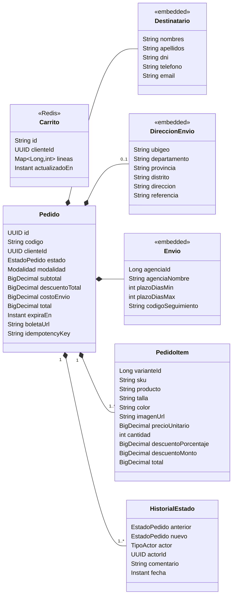
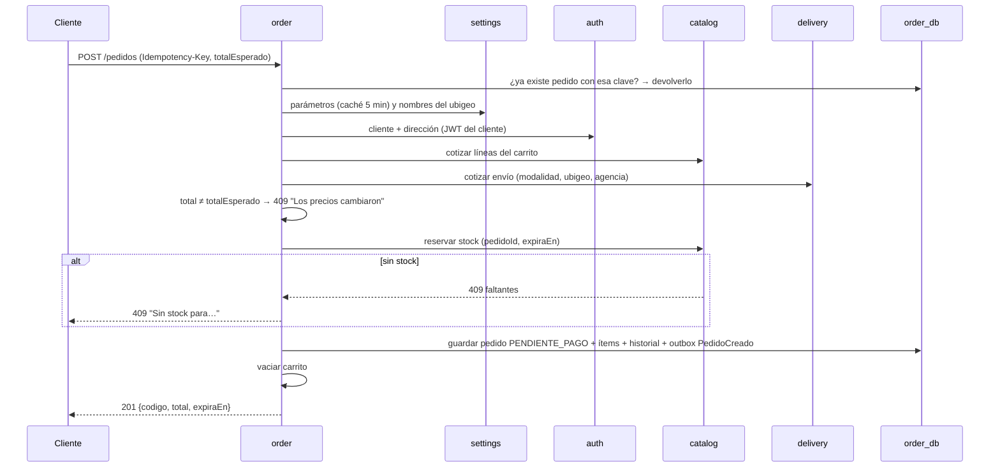
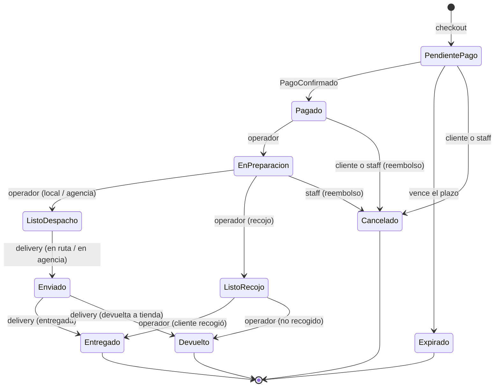
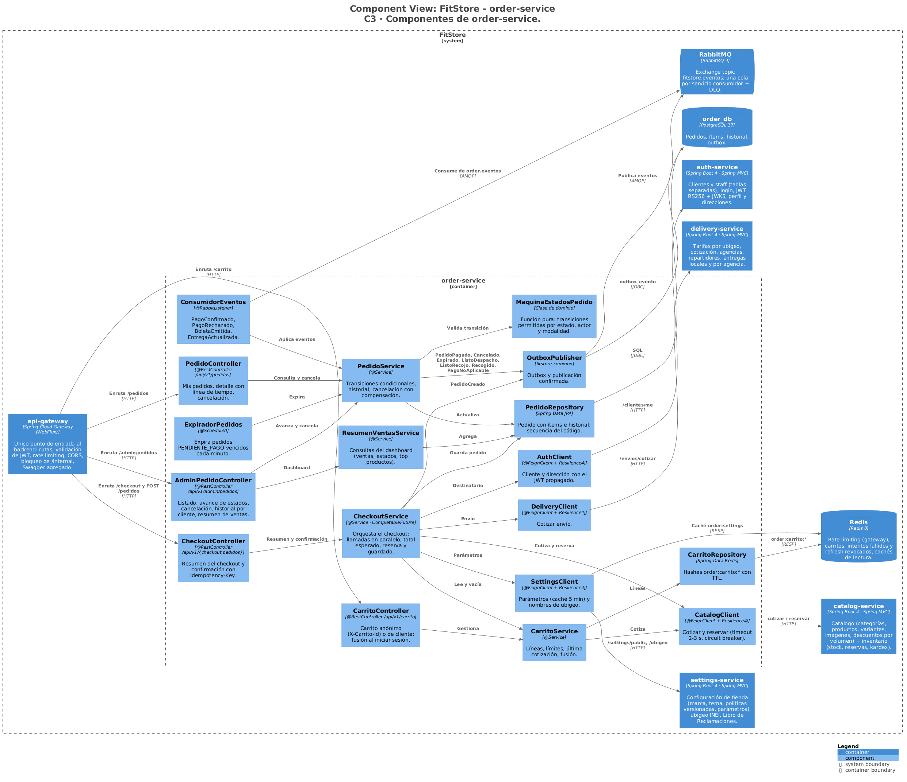
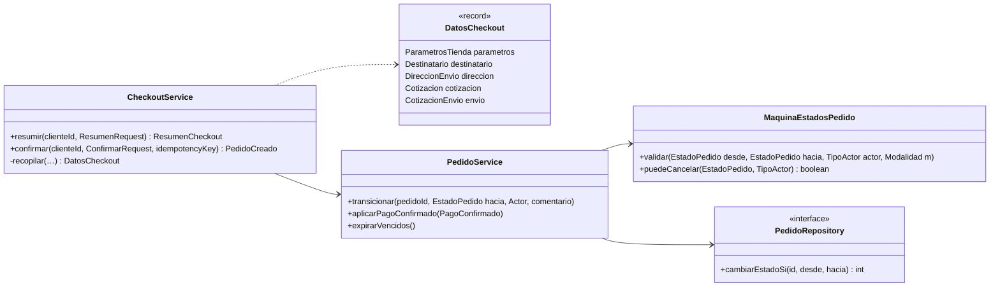

# FitStore — Análisis micro: `order-service`

> Versión: **v7 (aprobado)** — 2026-10-19. Fuente: [`01-analisis-macro.md`](../01-analisis-macro.md) v12.
> Estados: ✅ decidido · 🟡 propuesto · ❓ abierto · 🕓 diferido

**Historial:**
- v7 (2026-10-19): por SPEC-6: estado final **`DEVUELTO`** (desde `ENVIADO` con `EntregaActualizada` devuelta, o desde `LISTO_RECOJO` cuando el operador marca "No recogido"); el reembolso postventa también se permite en `DEVUELTO`, sin plazo, con motivo `NO_ENTREGADO`.
- v6 (2026-10-18): **reembolso postventa** (4.8): el ADMIN registra un reembolso total o parcial de un pedido `ENTREGADO` dentro del plazo de settings; tabla `pedido_reembolso`, campo `monto_reembolsado`, evento `ReembolsoSolicitado`, consume `PagoReembolsado`. Decidido en la SPEC-5.
- v5 (2026-10-18): desde la SPEC-4: los pedidos de un cliente usan `GET /admin/pedidos?clienteId=` (se quita `/admin/clientes/{clienteId}/pedidos`, O3); las ventas del resumen se cuentan por la fecha del paso a `PAGADO` y sin los cancelados, con índice `pedido_historial (estado_nuevo, creado_en)` (O6).
- v4 (2026-10-18): sección 10 aprobada → **documento completo aprobado**.
- v3 (2026-10-18): sección 10 (diseño técnico) redactada: C3, código de las partes críticas, paquetes, dependencias, configuración e infraestructura.
- v2 (2026-10-16): todas las secciones aprobadas sin cambios (D1–D8, límites del carrito, cancelación del cliente solo en `PENDIENTE_PAGO`/`PAGADO`, caché de 5 min para settings). Cambios propagados al macro v13.
- v1 (2026-10-16): borrador inicial.

**Estado de revisión por sección:** 1 ✅ · 2 ✅ · 3 ✅ · 4 ✅ · 5 ✅ · 6 ✅ · 7 ✅ · 8 ✅ · 9 ✅ · 10 ✅

---

## 1. Responsabilidad y límites

**Contextos:** Pedidos (núcleo) + Carrito (soporte, módulo interno). **Datos:** `order_db` (PostgreSQL) para pedidos y **Redis** para carritos (ADR-012).

**Hace:**
- **Módulo carrito:** carrito anónimo y de cliente, fusión al iniciar sesión, precios y descuentos siempre actualizados (consultando a catalog).
- **Módulo pedidos:** checkout (resumen y confirmación), creación del pedido con **copia** (snapshot) de productos, precios, descuentos, destinatario, dirección y envío; máquina de estados; historial; expiración de pedidos sin pago; cancelación; **reembolso postventa** de pedidos entregados (4.8); consulta para el cliente (mis pedidos, seguimiento) y gestión en el backoffice.
- **Estado de la saga** de checkout y pago (ADR-009): el estado del pedido es el estado de la saga.

**No hace:**
- No calcula precios ni descuentos (catalog), ni costos de envío (delivery): los pide y guarda el resultado.
- No cobra ni emite la boleta (payment): solo guarda el enlace a la boleta.
- No gestiona repartidores ni agencias (delivery): recibe sus avances por eventos.
- No guarda datos del cliente: los toma de auth al confirmar y los copia en el pedido.

**Cubre:** CU-04, CU-09, CU-11, CU-12, CU-13, CU-24, CU-29 (historial), CU-44 · RF-CRT-01 a 04 · RF-ORD-01 a 10 · RF-BO-01 (datos de ventas) · RNF-02, 10.

---

## 2. Modelo de dominio



### 2.1 Decisiones del modelo ✅

| # | Propuesta | Por qué | Alternativa |
|---|---|---|---|
| D1 | **El carrito guarda solo `varianteId → cantidad`**; precios, nombres e imágenes se piden a catalog cada vez que se muestra | El carrito nunca muestra un precio desactualizado (catalog es la única fuente, aprobado en catalog 4.5) | Guardar precios en el carrito y revalidarlos al final |
| D2 | **Además se guarda la última cotización** junto al carrito (Redis) | Es lo que se muestra con "precios por confirmar" si catalog no responde (aprobado en catalog 4.5) | Mostrar un error |
| D3 | **El pedido es una copia congelada** (snapshot) de todo lo que importa: productos con nombre, talla, color, imagen y precio; descuento aplicado; destinatario (nombre, DNI, teléfono, correo); dirección **con los nombres** del departamento, provincia y distrito; agencia y costo de envío | Si mañana cambia el precio, el nombre del producto o la dirección del cliente, el pedido sigue mostrando lo que se compró. Es lo que exige RF-ORD-01 | Guardar solo ids y consultarlos (el pedido "cambiaría" con el tiempo) |
| D4 | **Id interno UUID y código legible `FS-000123`** generado con una secuencia de PostgreSQL | El UUID se usa entre servicios; el código, con el cliente y el staff (RF-ORD-09). El prefijo configurable queda como extensión futura (macro 1.4) | Solo el código |
| D5 | **Clave de idempotencia en el checkout** (cabecera `Idempotency-Key`, única por cliente) | Si el cliente hace doble clic en "Confirmar" o se corta la red y reintenta, se devuelve **el mismo pedido** en lugar de crear dos | Deshabilitar el botón en el frontend (ayuda, pero no basta) |
| D6 | **Estado `EXPIRADO` separado de `CANCELADO`** | No es lo mismo que el cliente cancele a que no pague a tiempo; sirve para reportes y para los correos | Usar `CANCELADO` con un motivo |
| D7 | **Recojo en tienda con estados propios:** `EN_PREPARACION → LISTO_RECOJO → ENTREGADO`, gestionados por el operador en order (sin delivery) | En el recojo no hay repartidor ni agencia; delivery-service no participa (macro RF-DEL-01: solo local y agencia) | Crear una "entrega" en delivery también para el recojo |
| D8 | **Montos** como en catalog: `NUMERIC(10,2)`, PEN con IGV, *half-up* | — | — |

### 2.2 Invariantes

1. Un pedido tiene **al menos un ítem**; `total = subtotal − descuentoTotal + costoEnvio`, y cada ítem cuadra igual.
2. `DireccionEnvio` es obligatoria para **delivery local** y **agencia**; no existe en **recojo**. `agenciaId` es obligatorio solo en agencia.
3. Delivery local solo para ubigeos de **Lima Metropolitana y Callao** (códigos que empiezan con `1501` o `07`).
4. Solo se permiten las transiciones de estado de la sección 5; toda transición deja una fila en el historial.
5. `(clienteId, idempotencyKey)` es único.
6. El carrito tiene como máximo **50 líneas** y **100 unidades por línea** (permite compras al por mayor).
7. Los pedidos **nunca se eliminan** (son registros comerciales).

---

## 3. Modelo de datos

### 3.1 PostgreSQL (`order_db`) — migración `V1__esquema_inicial.sql`

| Tabla | Columnas principales | Restricciones / índices |
|---|---|---|
| `pedido` | `id` (uuid), `codigo`, `cliente_id`, `estado`, `modalidad` (`DELIVERY_LOCAL`, `AGENCIA`, `RECOJO`); destinatario: `dest_nombres`, `dest_apellidos`, `dest_dni`, `dest_telefono`, `dest_email`; dirección: `dir_ubigeo`, `dir_departamento`, `dir_provincia`, `dir_distrito`, `dir_direccion`, `dir_referencia`; envío: `agencia_id`, `agencia_nombre`, `plazo_dias_min`, `plazo_dias_max`, `codigo_seguimiento`; montos: `subtotal`, `descuento_total`, `costo_envio`, `total`; `expira_en`, `boleta_url`, `monto_reembolsado` (por defecto 0), `idempotency_key`, `notas`, `creado_en`, `actualizado_en`, `version` | Único `codigo`; único `(cliente_id, idempotency_key)`; índices `(cliente_id, creado_en DESC)`, `(estado, creado_en)`, parcial `(expira_en) WHERE estado = 'PENDIENTE_PAGO'`; `CHECK` de montos ≥ 0 |
| `pedido_item` | `id`, `pedido_id`, `variante_id`, `producto_id`, `sku`, `producto_nombre`, `talla`, `color`, `imagen_url`, `precio_unitario`, `cantidad`, `descuento_porcentaje`, `descuento_monto`, `total` | `CHECK cantidad > 0`; índice `producto_id` (top de productos) |
| `pedido_historial` | `id`, `pedido_id`, `estado_anterior`, `estado_nuevo`, `actor_tipo` (`CLIENTE`, `STAFF`, `SISTEMA`), `actor_id`, `comentario`, `creado_en` | Índices `(pedido_id, creado_en)` y `(estado_nuevo, creado_en)` (ventas por fecha de pago) |
| `pedido_reembolso` | `id` (uuid), `pedido_id`, `monto`, `motivo` (`DEFECTUOSO`, `TALLA_MODELO_EQUIVOCADO`, `NO_CONFORME`, `NO_ENTREGADO`, `OTRO`), `nota`, `items` (`jsonb`: `{varianteId, sku, cantidad}`), `estado` (`SOLICITADO`, `COMPLETADO`), `solicitado_por`, `creado_en`, `completado_en` | Índice `pedido_id`; `CHECK monto > 0` |
| `pedido_codigo_seq` | secuencia | Genera el número de `FS-000123` |

**Comunes:** `outbox_evento` y `evento_procesado` (ADR-009).

### 3.2 Redis (prefijo `order:`)

| Clave | Tipo | TTL | Uso |
|---|---|---|---|
| `order:carrito:cli:{clienteId}` | hash `varianteId → cantidad` | 30 días (se renueva con cada cambio) | Carrito de cliente |
| `order:carrito:anon:{carritoId}` | hash | 7 días | Carrito anónimo (`carritoId` = UUID generado por el navegador) |
| `order:carrito:{...}:cotizacion` | JSON | igual que su carrito | Última cotización (D2) |
| `order:settings:public` | JSON | 5 min | Caché de los parámetros de settings (sección 7) |

El TTL de Redis resuelve la expiración de carritos abandonados (RF-CRT-04) sin ningún proceso adicional.

---

## 4. Casos de uso internos

### 4.1 Endpoints

**Carrito** (anónimo con cabecera `X-Carrito-Id`, o de cliente con JWT)

| Método | Ruta | Descripción |
|---|---|---|
| GET | `/api/v1/carrito` | Carrito con la cotización actual: líneas, descuentos por producto, "agrega N más y ahorra X %", total |
| POST | `/api/v1/carrito/items` | Agregar `{varianteId, cantidad}` (si ya existe, suma) |
| PUT / DELETE | `/api/v1/carrito/items/{varianteId}` | Cambiar cantidad / quitar |
| DELETE | `/api/v1/carrito` | Vaciar |
| POST | `/api/v1/carrito/fusionar` | Fusionar el carrito anónimo con el del cliente al iniciar sesión (CLIENTE) |

**Checkout y pedidos del cliente** (CLIENTE)

| Método | Ruta | Descripción |
|---|---|---|
| POST | `/api/v1/checkout/resumen` | `{modalidad, direccionId?, agenciaId?}` → ítems, descuentos, costo y plazo de envío, total. No crea nada |
| POST | `/api/v1/pedidos` | Confirmar: `{modalidad, direccionId?, agenciaId?, notas?, totalEsperado}` + cabecera `Idempotency-Key` → crea el pedido (4.3) |
| GET | `/api/v1/pedidos` | Mis pedidos (paginado) |
| GET | `/api/v1/pedidos/{codigo}` | Detalle con línea de tiempo (historial + seguimiento) |
| PATCH | `/api/v1/pedidos/{codigo}/cancelar` | Cancelar (4.6) |

**Backoffice** (OPERADOR, ADMIN)

| Método | Ruta | Descripción |
|---|---|---|
| GET | `/api/v1/admin/pedidos` | Listar con filtros: estado, modalidad, fechas, código, cliente (nombre, correo o DNI) o `clienteId` (historial de un cliente, CU-29); incluye contadores por estado |
| GET | `/api/v1/admin/pedidos/{id}` | Detalle completo con historial |
| PATCH | `/api/v1/admin/pedidos/{id}/estado` | Avanzar estado `{nuevoEstado, comentario?}`: `EN_PREPARACION`, `LISTO_DESPACHO`, `LISTO_RECOJO`, `ENTREGADO` o `DEVUELTO` (solo recojo; `DEVUELTO` exige el motivo en `comentario`) |
| PATCH | `/api/v1/admin/pedidos/{id}/cancelar` | Cancelar con motivo obligatorio |
| POST | `/api/v1/admin/pedidos/{id}/reembolsos` | Reembolso postventa `{items[{varianteId, cantidad}], monto, motivo, nota?}` (ADMIN, 4.8) |
| GET | `/api/v1/admin/pedidos/resumen?desde=&hasta=` | Datos del dashboard: ventas (día, semana, mes, por fecha de pago y sin cancelados), pedidos por estado, top 5 productos |

El dashboard (RF-BO-01) lo arma el backoffice llamando a order (ventas y pedidos), catalog (stock bajo) y delivery (entregas del día); no hay un servicio agregador (KISS).

### 4.2 Carrito (CU-04, RF-CRT-01 a 03)

- **Agregar o cambiar cantidad:** valida límites (invariante 6) y consulta a catalog la disponibilidad de esa variante; si no hay suficiente → `409 "Solo quedan N unidades"`.
- **Ver:** cotiza todas las líneas en una sola llamada a catalog y guarda el resultado como "última cotización".
- **Anónimo:** el navegador genera un `carritoId` (UUID) y lo guarda en `localStorage`.
- **Fusión al iniciar sesión:** se suman las cantidades por variante (respetando los límites), se borra el carrito anónimo y se devuelve el carrito resultante. Si el cliente no tenía carrito, el anónimo pasa a ser suyo.

### 4.3 Checkout (CU-09, RF-ORD-01, 02, 10) — paso T1 de la saga

**Resumen** (`POST /checkout/resumen`): ejecuta los pasos 2 a 5 de abajo sin reservar ni guardar. Es lo que ve el cliente antes de pulsar "Confirmar pedido".

**Confirmación** (`POST /pedidos`):



1. **Idempotencia:** si ya existe un pedido del cliente con esa `Idempotency-Key`, se devuelve tal cual (`200`).
2. **Parámetros de settings:** la modalidad debe estar habilitada; `expiraEn = ahora + expiracionPedidoMinutos`.
3. **Datos del cliente** (auth): nombre, DNI, teléfono, correo y la dirección elegida (salvo recojo). La dirección se valida contra la invariante 3.
4. **Cotización** (catalog): si alguna línea está `NO_DISPONIBLE` → `409` y el carrito se actualiza.
5. **Envío** (delivery): costo y plazo según modalidad, ubigeo y agencia. Recojo: costo 0.
6. **Precio confirmado:** si el total calculado difiere del `totalEsperado` que el cliente vio en el resumen → `409 "Los precios cambiaron, revisa tu pedido"`. Nunca se crea un pedido con un monto que el cliente no vio.
7. **Reserva** (catalog, síncrona e idempotente por `pedidoId`).
8. **Guardar** en una transacción local: pedido, ítems, historial (`→ PENDIENTE_PAGO`) y `PedidoCreado` en el outbox.
9. **Vaciar el carrito** y responder `201`. El frontend lleva al cliente a la página de pago.

**Si algo falla después de reservar** (por ejemplo, la BD de order no responde en el paso 8): la reserva queda huérfana y **expira sola** (35 min). No se necesita una compensación extra.

**Rendimiento (RNF-02, p95 < 2 s):** los pasos 2, 3 y 4 son independientes y se ejecutan **en paralelo**; el 5 depende del ubigeo (paso 3) y el 7 de los anteriores.

### 4.4 Pago y expiración (pasos T3–T4 de la saga)

| Llega | Estado del pedido | Acción |
|---|---|---|
| `PagoConfirmado` | `PENDIENTE_PAGO` | → `PAGADO`; publica `PedidoPagado` |
| `PagoConfirmado` | `EXPIRADO` o `CANCELADO` | Sin cambio; publica `PagoNoAplicable` → payment reembolsa |
| `PagoRechazado` | `PENDIENTE_PAGO` | Sin cambio de estado; se anota en el historial ("pago rechazado"). El cliente puede reintentar hasta que expire |
| `BoletaEmitida` | cualquiera | Guarda `boleta_url` |
| Planificador (cada minuto) | `PENDIENTE_PAGO` y `expira_en < ahora` | → `EXPIRADO`; publica `PedidoExpirado` |

**Carrera entre el pago y la expiración:** ambas transiciones usan una actualización condicional (`UPDATE pedido SET estado = … WHERE id = ? AND estado = 'PENDIENTE_PAGO'`). Solo una gana; la otra encuentra el estado ya cambiado y actúa según la tabla (por ejemplo, `PagoNoAplicable`). Los consumidores son idempotentes (`evento_procesado`).

### 4.5 Preparación, despacho y entrega (CU-24, RF-ORD-03, 06)

| Paso | Quién | Transición | Efecto |
|---|---|---|---|
| Empezar a preparar | Operador | `PAGADO → EN_PREPARACION` | — |
| Listo (local o agencia) | Operador | `EN_PREPARACION → LISTO_DESPACHO` | Publica `PedidoListoDespacho` → delivery crea la entrega |
| En camino | delivery (`EntregaActualizada`: en ruta / enviado a agencia) | `LISTO_DESPACHO → ENVIADO` | Guarda agencia y `codigo_seguimiento` si vienen |
| Entregado | delivery (`EntregaActualizada`: entregada) | `ENVIADO → ENTREGADO` | — |
| Intento fallido | delivery (`EntregaActualizada`: fallida) | Sin cambio (sigue `ENVIADO`) | Se anota en el historial; delivery la reprograma |
| Devuelto a tienda | delivery (`EntregaActualizada`: devuelta, con motivo) | `ENVIADO → DEVUELTO` | Se anota el motivo; el admin puede reembolsar (4.8) |
| Listo para recoger | Operador | `EN_PREPARACION → LISTO_RECOJO` | Publica `PedidoListoRecojo` → notification avisa al cliente |
| Recogido | Operador (verifica el DNI) | `LISTO_RECOJO → ENTREGADO` | Publica `PedidoRecogido` |
| No recogido | Operador (motivo obligatorio, p. ej. "No lo recogió en 15 días") | `LISTO_RECOJO → DEVUELTO` | Se anota el motivo; el admin puede reembolsar (4.8) |

### 4.6 Cancelación (CU-13, RF-ORD-07)

| Quién | Puede cancelar en | Compensación |
|---|---|---|
| Cliente | `PENDIENTE_PAGO`, `PAGADO` | Si estaba pagado: payment reembolsa y catalog reingresa el stock |
| Staff | `PENDIENTE_PAGO`, `PAGADO`, `EN_PREPARACION` (motivo obligatorio) | Igual |

- Publica `PedidoCancelado {fuePagado, motivo, actor}`.
- **Después de `LISTO_DESPACHO` ya no se cancela**: el pedido ya salió o está por salir. Así delivery no necesita escuchar cancelaciones (KISS). Si una vez entregado hay un problema, o si el pedido no se pudo entregar y volvió a la tienda (`DEVUELTO`), se usa el **reembolso postventa** (4.8).

### 4.8 Reembolso postventa (CU-25, RF-ORD-11)

Para un pedido **entregado** con un problema (prenda defectuosa, talla o modelo equivocado, no conforme), sin cancelarlo, o para un pedido **devuelto** a la tienda porque no se pudo entregar.

- **Quién y cuándo:** solo `ADMIN`; el pedido debe estar `ENTREGADO` y dentro de `diasReembolsoPostventa` días desde la entrega (fecha del historial `→ ENTREGADO`; `0` = sin límite), o `DEVUELTO` (**sin plazo**; el motivo propuesto es `NO_ENTREGADO` y el monto propuesto, el total).
- **Monto:** el admin elige prendas y cantidades; order **propone** el monto con el precio pagado de cada unidad (precio unitario menos su descuento). El admin puede cambiarlo (por ejemplo, sumar el envío), pero la suma de **todos** los reembolsos del pedido (solicitados y completados) nunca supera el `total` cobrado → `409`.
- **Efecto:** guarda `pedido_reembolso` (`SOLICITADO`), anota el historial ("Reembolso postventa solicitado: S/ X, motivo") **sin cambiar el estado** y publica `ReembolsoSolicitado`. payment lo ejecuta con su proceso de reembolsos (reintentos y alerta incluidos).
- **Al llegar `PagoReembolsado`:** la solicitud pasa a `COMPLETADO`, suma `monto_reembolsado` y anota el historial. El pedido se muestra como "Reembolso parcial" o "Reembolsado" (cuando `monto_reembolsado = total`).
- **Stock:** no se reingresa automáticamente (una prenda defectuosa no vuelve a la venta); si regresa en buen estado, como en un pedido devuelto, el operador hace un ajuste de inventario (catalog).
- **Fuera de alcance:** logística de la devolución física, cambios de prenda (se manejan como reembolso + pedido nuevo) y nota de crédito.

### 4.7 Mis pedidos y seguimiento (CU-11, CU-12)

- Lista con código, fecha, estado, total y miniatura del primer producto.
- **Línea de tiempo** construida con el historial: "Pedido creado → Pago confirmado → En preparación → Enviado (Shalom, código 12345) → Entregado", con fecha y hora de cada paso. Los intentos fallidos aparecen como avisos; un pedido devuelto termina en "Devuelto a la tienda" con el motivo.
- Botón **Descargar boleta** cuando `boleta_url` existe.
- Un cliente solo ve sus pedidos; uno ajeno responde `404`.

---

## 5. Estados



Cambios frente al macro (RF-ORD-03) ✅: se agregan `EXPIRADO` (D6), `LISTO_RECOJO` (D7) y `DEVUELTO` (v7).

---

## 6. Eventos

Exchange `fitstore.eventos` (topic), sobre común, outbox e idempotencia (ADR-009).

**Publica:**

| Evento | Routing key | Payload | Consume |
|---|---|---|---|
| `PedidoCreado` | `order.pedido.creado` | `pedidoId`, `codigo`, `clienteId`, destinatario, modalidad, dirección, `items[]`, `subtotal`, `descuentoTotal`, `costoEnvio`, `total`, `expiraEn` | payment (intención de pago), notification |
| `PedidoPagado` | `order.pedido.pagado` | `pedidoId`, `codigo`, `items[{varianteId, cantidad}]` | catalog (confirmar reserva), notification |
| `PedidoCancelado` | `order.pedido.cancelado` | `pedidoId`, `codigo`, `fuePagado`, `motivo`, `actor`, `items[]` | catalog, payment (reembolso si fue pagado), notification |
| `PedidoExpirado` | `order.pedido.expirado` | `pedidoId`, `codigo` | catalog, payment (anular intención), notification |
| `PagoNoAplicable` | `order.pago.no-aplicable` | `pedidoId`, `pagoId`, `motivo` | payment (reembolso automático) |
| `PedidoListoDespacho` | `order.pedido.listo-despacho` | `pedidoId`, `codigo`, modalidad, destinatario, dirección, agencia, resumen de ítems | delivery (crear entrega) |
| `ReembolsoSolicitado` ✅ **nuevo** | `order.reembolso.solicitado` | `pedidoId`, `codigo`, `solicitudId` (id de `pedido_reembolso`, clave de idempotencia), `monto`, `motivo` | payment (ejecuta el reembolso) |
| `PedidoListoRecojo` ✅ **nuevo** | `order.pedido.listo-recojo` | `pedidoId`, `codigo`, destinatario | notification ("ya puedes recoger tu pedido") |
| `PedidoRecogido` ✅ **nuevo** | `order.pedido.recogido` | `pedidoId`, `codigo`, destinatario | notification (confirmación de entrega) |

**Consume:** `PagoConfirmado`, `PagoRechazado`, `BoletaEmitida`, `PagoReembolsado` (payment; este último actualiza `monto_reembolsado` si trae `solicitudId`), `EntregaActualizada` (delivery).

---

## 7. Dependencias síncronas

Todas con OpenFeign + Resilience4j (ADR-010).

| Destino | Llamada | Cuándo | Timeout / reintentos | Si falla |
|---|---|---|---|---|
| catalog | `POST /precios/cotizar` | Carrito, resumen, checkout | 2 s / 1 | Carrito: última cotización con aviso. Checkout: `503 "Inténtalo en un momento"` |
| catalog | `POST /internal/v1/inventario/reservas` | Checkout | 3 s / 1 (idempotente) | `503`, no se crea el pedido |
| auth | `GET /clientes/me` y `/clientes/me/direcciones/{id}` (JWT del cliente) | Resumen y checkout | 2 s / 1 | `503` |
| delivery | `POST /envios/cotizar` | Resumen y checkout | 2 s / 1 | `503` |
| settings | `GET /settings/public` | Checkout (con caché de 5 min en Redis) | 2 s / 1 | Usa la última copia en caché; si no hay ninguna, valores por defecto (30 min, todas las modalidades) |
| settings | `GET /ubigeo/{codigo}` | Checkout (para guardar los nombres en el pedido) | 2 s / 1 | `503` |

**Decisión sobre settings ✅:** llamada con caché de 5 minutos (KISS), en lugar de escuchar `ConfiguracionActualizada`. Si el admin cambia el tiempo de expiración, el cambio se aplica en a lo más 5 minutos.

**Entrantes:** solo los frontends (vía gateway). Nadie llama a order de forma síncrona.

---

## 8. Seguridad

- Carrito: público con `X-Carrito-Id` (anónimo) o JWT de cliente; la fusión exige JWT.
- Checkout y "mis pedidos": `CLIENTE`. El `clienteId` sale **siempre del token**; un pedido ajeno responde `404`.
- Backoffice: `OPERADOR` y `ADMIN` (ver, avanzar estados, cancelar). El resumen de ventas y el reembolso postventa: solo `ADMIN` (dinero e información de negocio).
- El monto **nunca** viene del navegador: `totalEsperado` solo se compara, no se usa para cobrar (RF-PAY-00).
- El DNI y el teléfono del destinatario se muestran completos solo al dueño y al staff; nunca en logs.
- Rate limiting del checkout en el gateway (ADR-020) para evitar reservas masivas.

---

## 9. Pruebas

**Capa de datos (AP1):**

| Repositorio | Insertar | Actualizar | Eliminar | Listar | Extra |
|---|---|---|---|---|---|
| `PedidoRepository` (`@DataJpaTest` + PostgreSQL Testcontainers) | pedido con ítems e historial (cascada) | transición condicional de estado | — (invariante 7) | por cliente, filtros del backoffice, vencidos | `(cliente, idempotencyKey)` único; secuencia del código |
| `CarritoRepository` (Redis Testcontainers) | línea | cantidad | **línea y carrito** | líneas del carrito | TTL, fusión |

**Servicio (unitarias con clientes Feign simulados):**
- Checkout: camino feliz; cada dependencia caída; sin stock; precio cambiado (`409`); idempotencia (dos llamadas = un pedido); modalidad deshabilitada; delivery local fuera de Lima/Callao.
- Máquina de estados: tabla de todas las transiciones permitidas y prohibidas.
- Reembolso postventa: plazo (dentro, fuera, 0 = sin límite; `DEVUELTO` sin plazo), suma de reembolsos ≤ total, monto propuesto por prendas, solo ADMIN.
- Devolución: `EntregaActualizada` devuelta pasa `ENVIADO → DEVUELTO`; "No recogido" pasa `LISTO_RECOJO → DEVUELTO` con motivo obligatorio.
- Carrera pago vs. expiración: gana una sola, la otra publica `PagoNoAplicable`.
- Fusión de carritos con límites.

**Integración de la saga:** con RabbitMQ en Testcontainers: `PedidoCreado → PagoConfirmado → PedidoPagado` y el caso de expiración.

**API (MockMvc):** un cliente no ve pedidos ajenos; permisos del backoffice.

**Carga (k6, RNF-02):** checkout completo p95 < 2 s.

**Postman:** carrito anónimo → login y fusión → resumen → confirmar → (pago simulado) → seguimiento; flujo del operador hasta entregado y recojo.

---

## 10. Diseño técnico ✅

Stack y versiones comunes: [`docs/arquitectura/stack-versiones.md`](../../arquitectura/stack-versiones.md). Modelo C4: [`docs/arquitectura/workspace.dsl`](../../arquitectura/workspace.dsl). Convenciones comunes a todos los servicios (ADR-015): interfaz + `Impl` en servicios, DTOs como `record`, mapeo con MapStruct, sin lógica en controladores, `ApiResponse` y manejo de errores de `fitstore-common`.

### 10.1 Componentes (C4 nivel 3)



| Capa | Componentes |
|---|---|
| Controladores | `CarritoController`, `CheckoutController`, `PedidoController`, `AdminPedidoController` |
| Servicios | `CarritoService`, `CheckoutService`, `PedidoService`, `MaquinaEstadosPedido` (pura), `ResumenVentasService`, `ReembolsoPostventaService` |
| Procesos | `ExpiradorPedidos` (`@Scheduled`), `ConsumidorEventos` (`@RabbitListener`) |
| Clientes Feign | `CatalogClient`, `AuthClient`, `DeliveryClient`, `SettingsClient` (todos con Resilience4j) |
| Repositorios | `PedidoRepository` (JPA), `CarritoRepository` (Redis) |
| Común | `OutboxPublisher`, consumidor idempotente, propagación del JWT en Feign |

### 10.2 Código (C4 nivel 4): checkout y máquina de estados



- `recopilar` lanza en paralelo (`CompletableFuture` con un `Executor` propio y propagación del contexto de seguridad y de trazas) settings, auth y la cotización de catalog; luego delivery (necesita el ubigeo) y la reserva. Cualquier excepción de un cliente Feign con el circuito abierto se traduce a `503 ServicioNoDisponible`.
- `cambiarEstadoSi` es el `UPDATE … WHERE id = ? AND estado = ?` de 4.4; si devuelve 0, otra transición ganó la carrera y se aplica la regla de la tabla (p. ej. `PagoNoAplicable`).
- `MaquinaEstadosPedido` es una tabla en memoria `(desde, hacia) → actores/modalidades permitidos`; la misma tabla alimenta la prueba parametrizada de transiciones.

### 10.3 Paquetes y capas

```
com.fitstore.order
├── OrderServiceApplication
├── config            SecurityConfig, FeignConfig (JWT + X-Request-Id), Resilience4jConfig, RedisConfig, AsyncConfig, PropiedadesOrder
├── carrito           controller, dto, model (Carrito como hash), repository (CarritoRepository · Redis), service
├── pedidos
│   ├── controller    CheckoutController, PedidoController, AdminPedidoController
│   ├── dto, mapper   PedidoMapper, PedidoItemMapper
│   ├── model         Pedido (+ @Embeddable Destinatario, DireccionEnvio, Envio), PedidoItem, HistorialEstado, enums
│   ├── repository    PedidoRepository, PedidoSpecifications, ResumenVentasQueries
│   ├── service       CheckoutService, PedidoService, ResumenVentasService, ReembolsoPostventaService
│   │   └── dominio   MaquinaEstadosPedido
│   └── messaging     ConsumidorEventos, ExpiradorPedidos
├── client            CatalogClient, AuthClient, DeliveryClient, SettingsClient (+ DTOs de cada API)
└── event             PedidoCreado, PedidoPagado, PedidoCancelado, PedidoExpirado, PagoNoAplicable,
                      PedidoListoDespacho, PedidoListoRecojo, PedidoRecogido, ReembolsoSolicitado
```

### 10.4 Dependencias

| Grupo | Artefactos |
|---|---|
| Web y validación | `spring-boot-starter-webmvc`, `spring-boot-starter-validation` |
| Datos | `spring-boot-starter-data-jpa`, `postgresql`, `spring-boot-starter-flyway`, `flyway-database-postgresql` |
| Seguridad | `spring-boot-starter-security`, `spring-boot-starter-oauth2-resource-server` (validación de JWT, vía `fitstore-common`) |
| Mensajería | `spring-boot-starter-amqp` |
| Nube | `spring-cloud-starter-config`, `spring-cloud-starter-netflix-eureka-client` |
| Observabilidad | `spring-boot-starter-actuator`, `spring-boot-starter-opentelemetry` |
| Documentación | `springdoc-openapi-starter-webmvc-ui` |
| Propias y utilidades | `fitstore-common`, `lombok`, `mapstruct` (+ procesadores) |
| Pruebas | `spring-boot-starter-test`, `spring-boot-starter-data-jpa-test`, `spring-security-test`, `testcontainers-postgresql`, `testcontainers-junit-jupiter` |
| Redis | `spring-boot-starter-data-redis`, `spring-boot-starter-cache` |
| Llamadas síncronas | `spring-cloud-starter-openfeign`, `spring-cloud-starter-circuitbreaker-resilience4j` |
| Pruebas extra | `wiremock-standalone` (clientes Feign), `testcontainers-rabbitmq` (saga), contenedor `redis:8` |

### 10.5 Configuración

**Puerto:** 8083. Archivos: `order-service.yml`, `-dev.yml`, `-cloud.yml`.

```yaml
server.port: 8083
spring:
  datasource:
    url: jdbc:postgresql://${DB_HOST:postgres}:5432/order_db
    username: ${ORDER_DB_USER}
    password: ${ORDER_DB_PASSWORD}
  jpa.hibernate.ddl-auto: validate        # el esquema lo maneja Flyway
spring.cloud.openfeign:
  circuitbreaker.enabled: true
  client.config:
    catalog-service: { connect-timeout: 1000, read-timeout: 3000 }
    auth-service:    { connect-timeout: 1000, read-timeout: 2000 }
    delivery-service:{ connect-timeout: 1000, read-timeout: 2000 }
    settings-service:{ connect-timeout: 1000, read-timeout: 2000 }
resilience4j:
  circuitbreaker.configs.default: { sliding-window-size: 10, failure-rate-threshold: 50, wait-duration-in-open-state: 20s }
  retry.configs.default: { max-attempts: 2, wait-duration: 200ms }   # 1 reintento
fitstore:
  order:
    carrito: { max-lineas: 50, max-unidades-linea: 100, ttl-anonimo: 7d, ttl-cliente: 30d }
    codigo-prefijo: FS
    settings-cache-ttl: 5m
    expirador-cron: "0 * * * * *"
    defaults: { expiracion-pedido-minutos: 30 }   # si settings no responde y no hay caché
```

| Variable de entorno | Uso |
|---|---|
| `ORDER_DB_USER`, `ORDER_DB_PASSWORD` | Usuario propio de `order_db` |

### 10.6 Infraestructura

| Componente | Uso |
|---|---|
| PostgreSQL `order_db` | Tablas de 3.1 y secuencia `pedido_codigo_seq` |
| Redis (prefijo `order:`) | Carritos, última cotización, caché de settings |
| RabbitMQ | Publica `order.*` (9 eventos). Cola `order.eventos` enlazada a `payment.pago.confirmado`, `payment.pago.rechazado`, `payment.boleta.emitida`, `payment.reembolso.completado`, `delivery.entrega.actualizada`; DLQ |
| Servicios | catalog, auth, delivery, settings vía Feign + Eureka |

---

## Decisiones de alcance ✅

1. **Límites del carrito:** 50 líneas, 100 unidades por línea; el carrito anónimo dura 7 días y el de cliente 30 días sin cambios.
2. **Cancelación por el cliente:** solo en `PENDIENTE_PAGO` y `PAGADO`.
