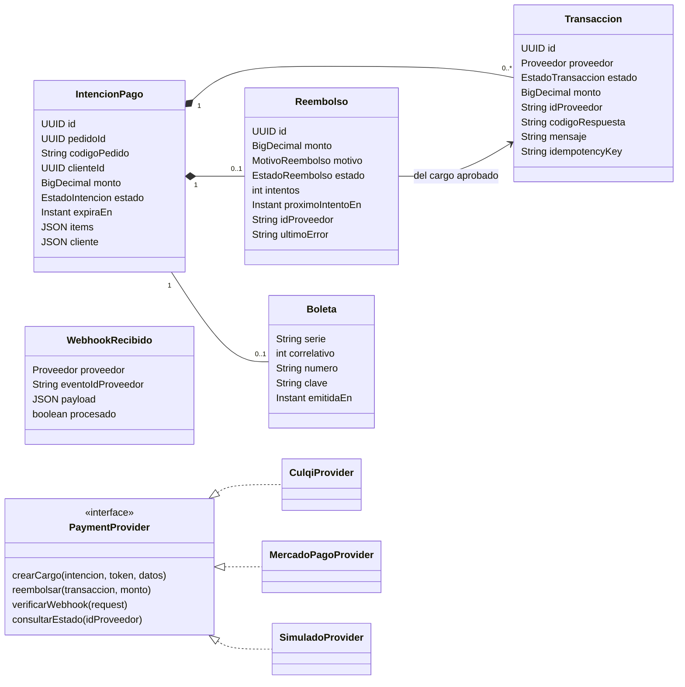
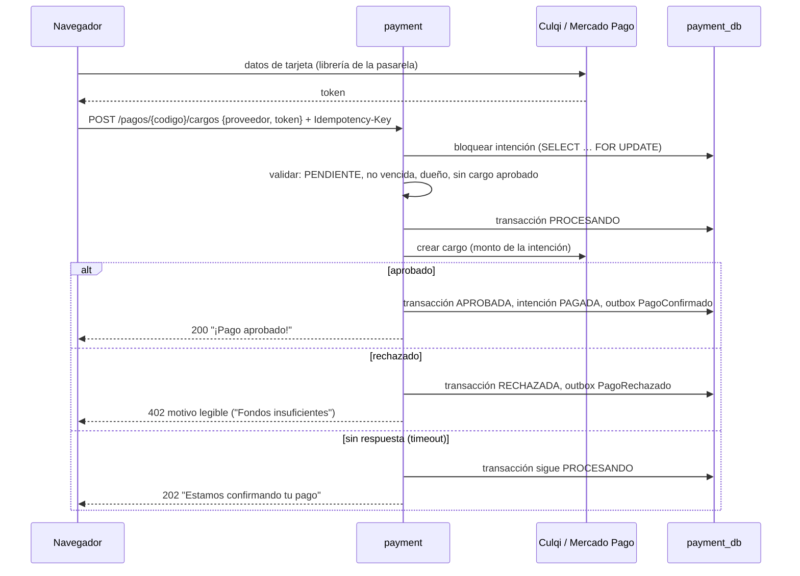
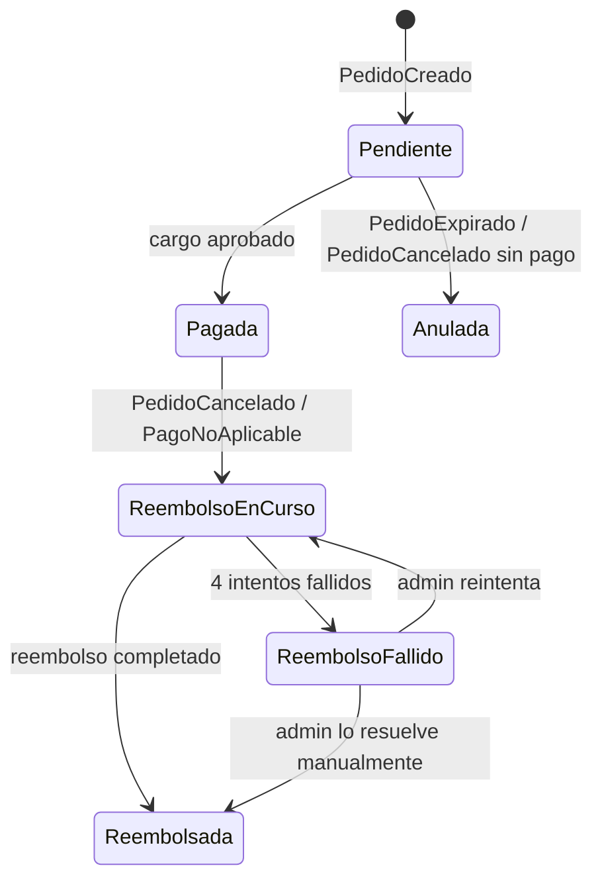
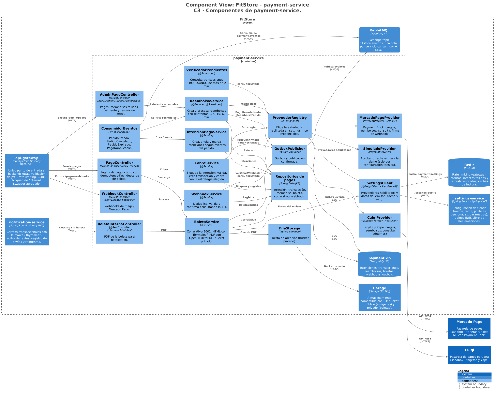
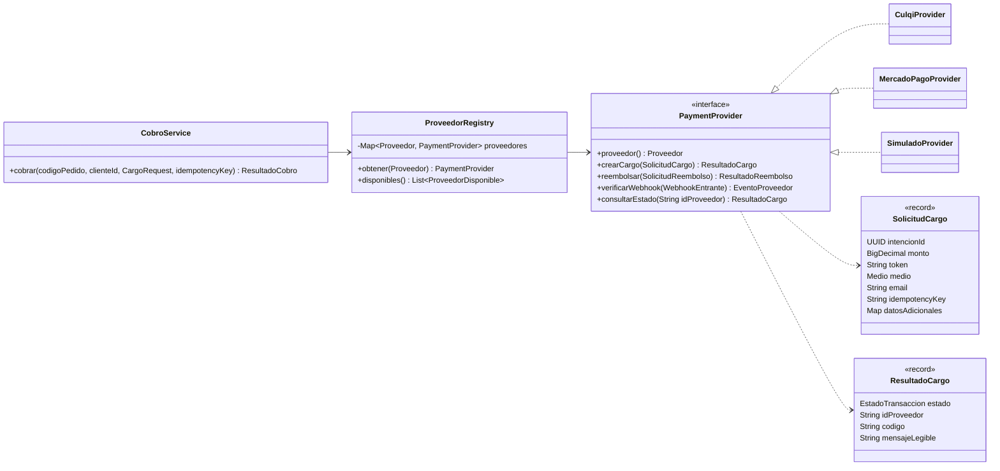

# FitStore — Análisis micro: `payment-service`

> Versión: **v5 (aprobado)** — 2026-10-16. Fuente: [`01-analisis-macro.md`](../01-analisis-macro.md) v13.
> Estados: ✅ decidido · 🟡 propuesto · ❓ abierto · 🕓 diferido

**Historial:**
- v5 (2026-10-18): sección 10 aprobada → **documento completo aprobado**.
- v4 (2026-10-18): sección 10 (diseño técnico) redactada: C3, código de las partes críticas, paquetes, dependencias, configuración e infraestructura.
- v3 (2026-10-16): resto del documento aprobado (D1–D7, protección contra doble cobro, reembolsos, eventos nuevos). Si el sandbox exige 3-D Secure, se implementa (es el fix previsto).
- v2 (2026-10-16): **Yape incluido** (vía Culqi, mismo flujo de token → cargo). 3-D Secure fuera del MVP mientras el sandbox lo permita.
- v1 (2026-10-16): borrador inicial.

**Estado de revisión por sección:** 1 ✅ · 2 ✅ · 3 ✅ · 4 ✅ · 5 ✅ · 6 ✅ · 7 ✅ · 8 ✅ · 9 ✅ · 10 ✅

---

## 1. Responsabilidad y límites

**Contexto:** Pagos (soporte). **Base de datos:** `payment_db` (PostgreSQL) + Garage (boletas en PDF, privadas).

**Hace:**
- Crea una **intención de pago** por pedido al recibir `PedidoCreado`, con el monto, los ítems y los datos del cliente (RF-PAY-00).
- Procesa **cargos** con Culqi (**tarjeta y Yape**), Mercado Pago o el proveedor simulado, detrás de la interfaz `PaymentProvider` (Strategy + capa anticorrupción, ADR-016).
- Recibe y verifica **webhooks** de las pasarelas, de forma idempotente.
- Ejecuta **reembolsos** automáticos (cancelación de un pedido pagado, `PagoNoAplicable`) con reintentos y alerta si fallan.
- Emite la **boleta simulada** en PDF (RF-PAY-08) y la sirve solo al dueño y al staff.
- Muestra pagos, transacciones y reembolsos en el backoffice (CU-25).

**No hace:**
- **Nunca recibe datos de tarjeta:** el navegador los convierte en un token con la librería de la pasarela (alcance PCI SAQ A, RNF-06).
- **Nunca acepta un monto del navegador:** cobra siempre el de la intención.
- No cambia el estado del pedido: publica eventos y order decide.
- No emite comprobantes reales ante SUNAT (fuera de alcance).

**Cubre:** CU-10, CU-25, CU-41 · RF-PAY-00 a 08 · RNF-06 · pasos T2, T3 y T6 de la saga (ADR-009).

---

## 2. Modelo de dominio



### 2.1 Decisiones del modelo ✅

| # | Propuesta | Por qué | Alternativa |
|---|---|---|---|
| D1 | **Una intención por pedido y varias transacciones (intentos)**: cada intento de cobro es una transacción; como máximo **una aprobada** por intención | El cliente puede fallar con una tarjeta y reintentar con otra o con otro proveedor (ADR-009); queda registro de cada intento (RF-PAY-05) | Un solo registro de pago que se sobrescribe |
| D2 | **Mercado Pago con Payment Brick** (formulario embebido que tokeniza en el navegador), no Checkout Pro (redirección al sitio de MP) | Mismo flujo que Culqi: el navegador da un token y el backend cobra. La Strategy queda uniforme y el cliente no sale de la tienda | Checkout Pro: menos código en el frontend, pero otro flujo (redirección y retorno) |
| D3 | **El estado real del pago siempre se confirma consultando la API de la pasarela** (`consultarEstado`), aunque llegue un webhook | No se confía en el contenido de un mensaje que llega de internet; la consulta con la clave secreta es la fuente de verdad. Mercado Pago además firma sus webhooks (`x-signature`) y se valida la firma | Confiar en el cuerpo del webhook |
| D4 | **Los reembolsos solo nacen de una cancelación** (o de `PagoNoAplicable`). Para devolver un pago, el admin **cancela el pedido** en el backoffice y el reembolso es automático. En la pantalla de pagos el admin puede **reintentar** un reembolso fallido o **marcarlo como resuelto manualmente** | Pedido y pago nunca quedan desalineados (un pedido "pagado" con el dinero devuelto) | Botón "Reembolsar" independiente en la pantalla de pagos |
| D5 | **Boleta generada con Thymeleaf + OpenHTMLtoPDF** (HTML → PDF) | Misma tecnología de plantillas que los correos (ADR-014); el diseño se hace en HTML/CSS con la marca de la tienda | OpenPDF / iText (se dibuja el PDF por código) |
| D6 | **La boleta es privada:** se guarda en Garage sin acceso público y se descarga por un endpoint autenticado | Contiene nombre y DNI del cliente | URL pública |
| D7 | **`SimuladoProvider` solo se habilita por configuración técnica** (config-server), nunca desde el backoffice | Es para la demo; en una tienda real no debe poder activarse por error | Siempre disponible |

### 2.2 Invariantes

1. Una intención por pedido (`pedidoId` único).
2. Como máximo **una transacción aprobada** por intención (índice único parcial). Nunca se cobra dos veces un pedido.
3. Solo se puede cobrar una intención `PENDIENTE` y no vencida, del cliente dueño del pedido.
4. El monto cobrado y el reembolsado son **exactamente** el monto de la intención (reembolso total, RF-PAY-06).
5. Una boleta por intención pagada; numeración `B001-00000001` correlativa, sin huecos.
6. Pagos, transacciones, reembolsos y boletas **nunca se eliminan**.

---

## 3. Modelo de datos

### 3.1 PostgreSQL (`payment_db`) — migración `V1__esquema_inicial.sql`

| Tabla | Columnas principales | Restricciones / índices |
|---|---|---|
| `intencion_pago` | `id`, `pedido_id`, `codigo_pedido`, `cliente_id`, `monto`, `estado`, `expira_en`, `items` (`jsonb`: snapshot para la boleta), `cliente` (`jsonb`: nombre, DNI, email), `subtotal`, `descuento_total`, `costo_envio`, `creado_en`, `actualizado_en`, `version` | Único `pedido_id`; índice `(cliente_id)`; `CHECK monto > 0` |
| `transaccion` | `id`, `intencion_id`, `proveedor` (`CULQI`, `MERCADO_PAGO`, `SIMULADO`), `medio` (`TARJETA`, `YAPE`, `SALDO_MP`), `estado`, `monto`, `id_proveedor`, `codigo_respuesta`, `mensaje`, `respuesta` (`jsonb`, sin datos sensibles), `idempotency_key`, `creado_en`, `actualizado_en` | Único parcial `(intencion_id) WHERE estado = 'APROBADA'`; único `(intencion_id, idempotency_key)`; índice parcial `(actualizado_en) WHERE estado = 'PROCESANDO'` |
| `reembolso` | `id`, `intencion_id`, `transaccion_id`, `monto`, `motivo` (`CANCELACION`, `PAGO_NO_APLICABLE`), `estado`, `intentos`, `proximo_intento_en`, `id_proveedor`, `ultimo_error`, `resuelto_por`, `nota`, `creado_en`, `actualizado_en` | Único `intencion_id` |
| `boleta` | `id`, `intencion_id`, `serie`, `correlativo`, `numero`, `clave` (ruta en Garage), `emitida_en` | Único `intencion_id`; único `(serie, correlativo)` |
| `correlativo_boleta` | `serie` (PK), `ultimo` | `UPDATE … RETURNING` atómico |
| `webhook_recibido` | `id`, `proveedor`, `evento_id_proveedor`, `payload`, `recibido_en`, `procesado_en` | Único `(proveedor, evento_id_proveedor)` |

**Comunes:** `outbox_evento` y `evento_procesado` (ADR-009).

### 3.2 Almacenamiento (Garage)

Bucket privado `fitstore-privado`, clave `boletas/{anio}/{numero}.pdf`. Solo payment-service tiene credenciales de ese bucket.

### 3.3 Configuración técnica (config-server / variables de entorno, nunca en BD)

`CULQI_PUBLIC_KEY`, `CULQI_SECRET_KEY`, `MP_PUBLIC_KEY`, `MP_ACCESS_TOKEN`, `MP_WEBHOOK_SECRET`, `PAGOS_SIMULADO_HABILITADO`. Las claves públicas se entregan al frontend; las secretas nunca salen del servicio. Qué proveedores ve el cliente = los habilitados en settings (negocio) ∩ los que tienen credenciales (técnico).

---

## 4. Casos de uso internos

### 4.1 Endpoints

**Cliente** (CLIENTE, dueño del pedido)

| Método | Ruta | Descripción |
|---|---|---|
| GET | `/api/v1/pagos/{codigoPedido}` | Datos para la página de pago: monto, estado, vencimiento, proveedores disponibles con su clave pública, intentos rechazados |
| POST | `/api/v1/pagos/{codigoPedido}/cargos` | Cobrar `{proveedor, token, datosAdicionales}` + cabecera `Idempotency-Key` |
| GET | `/api/v1/pagos/{codigoPedido}/boleta` | Descargar la boleta en PDF |

**Webhooks** (públicos, verificados)

| Método | Ruta |
|---|---|
| POST | `/api/v1/pagos/webhooks/culqi` |
| POST | `/api/v1/pagos/webhooks/mercadopago` |

**Backoffice** (ADMIN)

| Método | Ruta | Descripción |
|---|---|---|
| GET | `/api/v1/admin/pagos` | Listar intenciones (filtros: estado, proveedor, fechas, código de pedido) |
| GET | `/api/v1/admin/pagos/{id}` | Detalle con transacciones, reembolso y boleta |
| GET | `/api/v1/admin/reembolsos?estado=FALLIDO` | Reembolsos fallidos o pendientes |
| POST | `/api/v1/admin/reembolsos/{id}/reintentar` | Reintentar un reembolso fallido |
| PATCH | `/api/v1/admin/reembolsos/{id}/resuelto-manual` | Marcar como resuelto fuera del sistema (nota obligatoria) |
| GET | `/api/v1/admin/pagos/{id}/boleta` | Descargar boleta |

**Interno** (no expuesto por el gateway)

| Método | Ruta | Quién |
|---|---|---|
| GET | `/internal/v1/boletas/{numero}` | notification (adjuntar el PDF al correo) |

### 4.2 Intención de pago (T2)

Al recibir `PedidoCreado`: crea la intención `PENDIENTE` con el monto, los ítems, los datos del cliente y la fecha de vencimiento del pedido. Idempotente por `pedidoId`.

**Caso de borde:** el cliente llega a la página de pago antes de que el evento se procese (milisegundos, pero posible). `GET /pagos/{codigo}` responde `404 "Preparando tu pago"` y el frontend reintenta cada segundo, hasta 10 veces.

### 4.3 Cobro (T3, paso pivote)



- **Bloqueo de la intención:** si el cliente envía dos cobros a la vez (dos pestañas), el segundo espera al primero y luego encuentra la intención ya pagada → `409`. Junto con el índice único (invariante 2), **nunca hay doble cobro**.
- **Idempotency-Key:** un reintento con la misma clave devuelve el resultado del intento original. A Mercado Pago se le envía la misma clave (`X-Idempotency-Key`).
- **Timeout:** el cobro **no se reintenta automáticamente** (podría cobrarse dos veces). La transacción queda `PROCESANDO` y se resuelve por webhook o por el verificador (4.4). El frontend consulta el estado hasta tenerlo.
- **Motivos legibles:** los códigos de cada pasarela se traducen a mensajes en español ("Tarjeta vencida", "Fondos insuficientes", "Tarjeta rechazada por el banco") dentro del adaptador.
- **Montos:** Culqi recibe céntimos enteros (`5990`) y Mercado Pago decimales (`59.90`); la conversión vive en cada adaptador.

### 4.3.1 Yape (vía Culqi) ✅

- **Flujo para el cliente:** en la página de pago elige "Yape", escribe su número de celular, abre la app de Yape, genera un **código de aprobación** (vence en ~2 min), lo pega y confirma.
- **Flujo técnico:** el formulario de Culqi en el navegador convierte celular + código en un **token**, igual que con una tarjeta; el backend crea el cargo con ese token. Lo maneja el mismo `CulqiProvider` (campo `medio = YAPE`), así que **la Strategy no cambia**.
- **Límite de Yape:** las compras en línea tienen un tope diario por persona (S/ 500 según los manuales de Culqi). Si el total del pedido lo supera, la opción Yape se muestra deshabilitada con el aviso "Yape permite hasta S/ 500 por día".
- **Habilitación:** "Yape" es un medio de pago más en la configuración de la tienda (settings `metodos_pago` admite `CULQI`, `YAPE`, `MERCADO_PAGO`).
- **Por verificar en la prueba de concepto (R16):** los datos de prueba de Yape en el sandbox de Culqi y si la creación del token requiere activación previa por parte de Culqi. Si el sandbox no lo permite, Yape se demuestra con el proveedor simulado y se documenta.

### 4.3.2 3-D Secure ✅

Fuera del MVP. Se usan las tarjetas de prueba del sandbox que no exigen autenticación adicional. Si el sandbox de Culqi exigiera 3-D Secure, **se implementa** (flujo de autenticación de Culqi en el frontend y reenvío del cargo con los datos de autenticación); es el fix previsto para R16.

### 4.4 Webhooks y verificador

1. Llega el webhook → se guarda en `webhook_recibido` (si el id ya existe, se ignora) y se responde `200` de inmediato.
2. Mercado Pago: se valida la firma `x-signature` con el secreto; si no coincide → `401`.
3. En ambos casos se llama a `consultarEstado(idProveedor)` y se aplica el resultado (aprobar o rechazar la transacción), de forma idempotente.
4. **Verificador programado** (cada 2 min): las transacciones `PROCESANDO` con más de 2 min se consultan a la pasarela. Cubre webhooks perdidos (por ejemplo, en local, donde la pasarela no puede llegar al servidor).

### 4.5 Reembolsos (compensación de T3)

| Disparador | Acción |
|---|---|
| `PedidoCancelado` con `fuePagado = true` | Crear reembolso `PENDIENTE` (motivo `CANCELACION`) |
| `PagoNoAplicable` | Crear reembolso `PENDIENTE` (motivo `PAGO_NO_APLICABLE`) |
| `PedidoCancelado` sin pago / `PedidoExpirado` | Intención → `ANULADA` (no hay dinero que devolver) |

- Un proceso toma los reembolsos `PENDIENTE` y llama a `reembolsar()`. Éxito → `COMPLETADO`, intención `REEMBOLSADA`, publica `PagoReembolsado`.
- Error → reintentos con espera creciente: **1, 5, 15 y 60 min**. Tras el 4.º fallo → `FALLIDO`, intención `REEMBOLSO_FALLIDO`, publica `ReembolsoFallido` (alerta al admin).
- El admin puede **reintentar** (vuelve a `PENDIENTE`) o **marcar como resuelto manualmente** (por ejemplo, devolvió el dinero por transferencia), con nota obligatoria.

### 4.6 Boleta simulada (T6, RF-PAY-08)

1. Tras `PagoConfirmado` (en la misma transacción se registra la tarea), un proceso genera la boleta de forma asíncrona: si falla, se reintenta sin afectar al pago.
2. Toma el siguiente correlativo de la serie `B001` (atómico).
3. Arma el HTML con Thymeleaf:
   - **Emisor:** razón social, RUC, dirección fiscal y logo (de `settings/public`, con caché de 5 min).
   - **Cliente:** nombre y DNI.
   - **Detalle:** ítems con talla y color, cantidad, precio, descuento por volumen; envío; **total (IGV incluido)**.
   - Número, fecha, medio de pago y código del pedido.
   - Leyenda visible: **"Documento simulado sin validez tributaria"**.
4. Lo convierte a PDF, lo sube a Garage (privado) y publica `BoletaEmitida`.

---

## 5. Estados

**Intención de pago:**



**Transacción:** `PROCESANDO → APROBADA | RECHAZADA | ERROR`.

**Reembolso:** `PENDIENTE → COMPLETADO`, o `PENDIENTE → FALLIDO → PENDIENTE` (reintento) / `RESUELTO_MANUAL`.

---

## 6. Eventos

Exchange `fitstore.eventos` (topic), sobre común, outbox e idempotencia (ADR-009).

**Publica:**

| Evento | Routing key | Payload | Consume |
|---|---|---|---|
| `PagoConfirmado` | `payment.pago.confirmado` | `pedidoId`, `intencionId`, `transaccionId`, `proveedor`, `monto`, `confirmadoEn` | order |
| `PagoRechazado` | `payment.pago.rechazado` | `pedidoId`, `proveedor`, `motivo` | order (historial) |
| `BoletaEmitida` | `payment.boleta.emitida` | `pedidoId`, `numero`, `url` (endpoint autenticado de descarga) | order, notification (adjunto) |
| `PagoReembolsado` ✅ **nuevo** | `payment.reembolso.completado` | `pedidoId`, `codigoPedido`, `monto`, `cliente` (nombre, email) | notification (avisa al cliente) |
| `ReembolsoFallido` ✅ **nuevo** | `payment.reembolso.fallido` | `pedidoId`, `codigoPedido`, `monto`, `ultimoError`, `intentos` | notification (alerta al admin) |

**Consume:** `PedidoCreado`, `PedidoCancelado`, `PedidoExpirado`, `PagoNoAplicable` (order).

---

## 7. Dependencias síncronas

**Salientes:**

| Destino | Llamada | Protección |
|---|---|---|
| Culqi API | cargo, reembolso, consulta | Timeout 10 s. **Cargo sin reintento automático** (4.3); reembolso y consulta con reintento. Circuit breaker por proveedor: si Culqi falla repetidamente, se deja de ofrecer en la página de pago por un rato y se sugiere otro medio |
| Mercado Pago API | igual | Igual, más `X-Idempotency-Key` |
| settings | `GET /settings/public` (proveedores habilitados, datos del emisor) | Caché de 5 min en Redis, como en order. Si falla: proveedores = los que tienen credenciales; la boleta se reintenta |

**Entrantes:** frontends (vía gateway), pasarelas (webhooks vía gateway), notification (`/internal/v1/boletas/{numero}`).

---

## 8. Seguridad

- **PCI SAQ A:** el backend nunca ve números de tarjeta ni CVV; solo tokens de un solo uso. Tokens y respuestas crudas no se registran en logs.
- Cobro y descarga de boleta: `CLIENTE` dueño del pedido (el `clienteId` del token debe coincidir con el de la intención); ajeno → `404`.
- Backoffice de pagos: solo `ADMIN` (CU-25).
- Webhooks: públicos, pero con validación de firma (MP), confirmación por API (ambos) e idempotencia.
- `/internal/**` no se expone en el gateway.
- Claves secretas solo en variables de entorno / config-server (R12); en sandbox siempre.
- Bucket de boletas privado (D6).

---

## 9. Pruebas

**Capa de datos (AP1)** — `@DataJpaTest` con PostgreSQL en Testcontainers:

| Repositorio | Insertar | Actualizar | Listar | Extra |
|---|---|---|---|---|
| `IntencionPagoRepository` | desde `PedidoCreado` | estado | filtros del backoffice | `pedidoId` único |
| `TransaccionRepository` | intentos | aprobar / rechazar | por intención, `PROCESANDO` antiguas | **segunda aprobada rechazada por el índice** |
| `ReembolsoRepository` | ✔ | intentos, estado | pendientes por `proximo_intento_en` | |
| `BoletaRepository` | ✔ | — | por pedido | correlativo sin huecos |

No hay eliminación (invariante 6).

**Adaptadores de pasarela (WireMock):** respuestas simuladas de Culqi y Mercado Pago: aprobado, rechazos con distintos códigos, timeout, error 500, reembolso; validación de la firma del webhook de MP (válida e inválida).

**Servicio:**
- Doble cobro concurrente: 2 hilos cobran la misma intención → 1 aprobado, 1 `409`.
- Idempotency-Key repetida devuelve el mismo resultado.
- Reintentos de reembolso con espera creciente hasta `FALLIDO`.
- Webhook duplicado procesado una vez; verificador resuelve `PROCESANDO`.

**Boleta:** el PDF generado contiene número, RUC, DNI, total y la leyenda de simulación.

**Sandbox real (manual, para el video):** tarjetas de prueba de Culqi y Mercado Pago.

**Postman:** pago simulado aprobado y rechazado, descarga de boleta, webhook simulado.

---

## 10. Diseño técnico ✅

Stack y versiones comunes: [`docs/arquitectura/stack-versiones.md`](../../arquitectura/stack-versiones.md). Modelo C4: [`docs/arquitectura/workspace.dsl`](../../arquitectura/workspace.dsl). Convenciones comunes a todos los servicios (ADR-015): interfaz + `Impl` en servicios, DTOs como `record`, mapeo con MapStruct, sin lógica en controladores, `ApiResponse` y manejo de errores de `fitstore-common`.

### 10.1 Componentes (C4 nivel 3)



| Capa | Componentes |
|---|---|
| Controladores | `PagoController`, `WebhookController`, `AdminPagoController`, `BoletaInternaController` (`/internal`) |
| Servicios | `IntencionPagoService`, `CobroService`, `WebhookService`, `ReembolsoService`, `BoletaService` |
| Estrategias | `ProveedorRegistry` → `PaymentProvider`: `CulqiProvider` (tarjeta y Yape), `MercadoPagoProvider`, `SimuladoProvider` |
| Procesos | `VerificadorPendientes`, procesador de reembolsos y de boletas (`@Scheduled`), `ConsumidorEventos` (`@RabbitListener`) |
| Clientes | `SettingsClient` (Feign + caché) |
| Repositorios | intención, transacción, reembolso, boleta, correlativo, webhook |
| Común | `FileStorage` (bucket privado), `OutboxPublisher` |

### 10.2 Código (C4 nivel 4): Strategy de proveedores y cobro



- **Capa anticorrupción:** cada adaptador traduce los modelos y códigos de su pasarela a `ResultadoCargo` (con mensaje en español) y convierte montos (céntimos en Culqi). Nada fuera de `provider/` conoce las APIs externas.
- `cobrar` es `@Transactional`: `SELECT … FOR UPDATE` de la intención, validaciones (invariante 3), transacción `PROCESANDO`, llamada al proveedor **fuera** de la lógica de reintento, y registro del resultado + outbox. Un timeout deja `PROCESANDO` para el verificador.
- `ProveedorRegistry` se arma con todos los beans `PaymentProvider`; `SimuladoProvider` solo existe si `fitstore.pagos.simulado.habilitado=true` (`@ConditionalOnProperty`).

### 10.3 Paquetes y capas

```
com.fitstore.payment
├── PaymentServiceApplication
├── config            SecurityConfig, FeignConfig, StorageConfig, ThymeleafPdfConfig, PropiedadesPagos
├── controller        PagoController, WebhookController, AdminPagoController, BoletaInternaController
├── dto, mapper
├── model             IntencionPago, Transaccion, Reembolso, Boleta, WebhookRecibido, enums
├── repository        …Repository, CorrelativoBoletaRepository
├── service           IntencionPagoService, CobroService, WebhookService, ReembolsoService, BoletaService
├── provider          PaymentProvider, ProveedorRegistry, culqi/ (CulqiProvider, CulqiApi, DTOs),
│                     mercadopago/ (MercadoPagoProvider, validador de firma), simulado/
├── messaging         ConsumidorEventos, VerificadorPendientes, ProcesadorReembolsos, ProcesadorBoletas
├── client            SettingsClient
├── event             PagoConfirmado, PagoRechazado, BoletaEmitida, PagoReembolsado, ReembolsoFallido
└── resources/templates/boleta.html   (Thymeleaf → PDF)
```

### 10.4 Dependencias

| Grupo | Artefactos |
|---|---|
| Web y validación | `spring-boot-starter-webmvc`, `spring-boot-starter-validation` |
| Datos | `spring-boot-starter-data-jpa`, `postgresql`, `spring-boot-starter-flyway`, `flyway-database-postgresql` |
| Seguridad | `spring-boot-starter-security`, `spring-boot-starter-oauth2-resource-server` (validación de JWT, vía `fitstore-common`) |
| Mensajería | `spring-boot-starter-amqp` |
| Nube | `spring-cloud-starter-config`, `spring-cloud-starter-netflix-eureka-client` |
| Observabilidad | `spring-boot-starter-actuator`, `spring-boot-starter-opentelemetry` |
| Documentación | `springdoc-openapi-starter-webmvc-ui` |
| Propias y utilidades | `fitstore-common`, `lombok`, `mapstruct` (+ procesadores) |
| Pruebas | `spring-boot-starter-test`, `spring-boot-starter-data-jpa-test`, `spring-security-test`, `testcontainers-postgresql`, `testcontainers-junit-jupiter` |
| Llamadas síncronas | `spring-cloud-starter-openfeign`, `spring-cloud-starter-circuitbreaker-resilience4j`; Culqi con `RestClient` |
| Pasarelas | `com.mercadopago:sdk-java` |
| Boleta | `spring-boot-starter-thymeleaf`, `openhtmltopdf-pdfbox` |
| Caché y archivos | `spring-boot-starter-data-redis`, `spring-boot-starter-cache`, `software.amazon.awssdk:s3` |
| Pruebas extra | `wiremock-standalone` (Culqi y MP simulados), `testcontainers-rabbitmq` |

### 10.5 Configuración

**Puerto:** 8084. Archivos: `payment-service.yml`, `-dev.yml`, `-cloud.yml`.

```yaml
server.port: 8084
spring:
  datasource:
    url: jdbc:postgresql://${DB_HOST:postgres}:5432/payment_db
    username: ${PAYMENT_DB_USER}
    password: ${PAYMENT_DB_PASSWORD}
  jpa.hibernate.ddl-auto: validate        # el esquema lo maneja Flyway
fitstore:
  storage: { endpoint: ${S3_ENDPOINT}, bucket-privado: ${S3_BUCKET_PRIVADO:fitstore-privado} }
  pagos:
    culqi: { public-key: ${CULQI_PUBLIC_KEY:}, secret-key: ${CULQI_SECRET_KEY:}, url: https://api.culqi.com/v2, timeout: 10s }
    mercadopago: { public-key: ${MP_PUBLIC_KEY:}, access-token: ${MP_ACCESS_TOKEN:}, webhook-secret: ${MP_WEBHOOK_SECRET:}, timeout: 10s }
    simulado.habilitado: ${PAGOS_SIMULADO_HABILITADO:false}
    yape.tope-diario: 500.00
    verificador: { cada: 2m, antiguedad: 2m }
    reembolsos.esperas: [1m, 5m, 15m, 60m]
    boleta: { serie: B001, leyenda: "Documento simulado sin validez tributaria" }
    settings-cache-ttl: 5m
```

| Variable de entorno | Uso |
|---|---|
| `PAYMENT_DB_USER`, `PAYMENT_DB_PASSWORD` | Usuario propio de `payment_db` |
| `CULQI_PUBLIC_KEY`, `CULQI_SECRET_KEY` | Llaves de prueba del CulqiPanel |
| `MP_PUBLIC_KEY`, `MP_ACCESS_TOKEN`, `MP_WEBHOOK_SECRET` | Credenciales de prueba de Mercado Pago |
| `PAGOS_SIMULADO_HABILITADO` | `true` en dev y en la demo; `false` por defecto |
| `S3_ENDPOINT`, `S3_ACCESS_KEY`, `S3_SECRET_KEY`, `S3_BUCKET_PRIVADO` | Garage (bucket privado) |

Un proveedor sin credenciales no se ofrece en la página de pago (3.3).

### 10.6 Infraestructura

| Componente | Uso |
|---|---|
| PostgreSQL `payment_db` | Tablas de 3.1 |
| Redis (prefijo `payment:`) | Caché de settings |
| RabbitMQ | Publica `payment.*` (5 eventos). Cola `payment.eventos` enlazada a `order.pedido.creado`, `order.pedido.cancelado`, `order.pedido.expirado`, `order.pago.no-aplicable`; DLQ |
| Garage | Bucket **privado** `fitstore-privado`, prefijo `boletas/` |
| Externos | Culqi y Mercado Pago (sandbox); sus webhooks entran por Caddy → gateway |

---

## Decisiones de alcance ✅

1. **Yape: incluido** en el MVP vía Culqi (4.3.1).
2. **3-D Secure: fuera del MVP** mientras el sandbox lo permita; si lo exige, se implementa (4.3.2).
