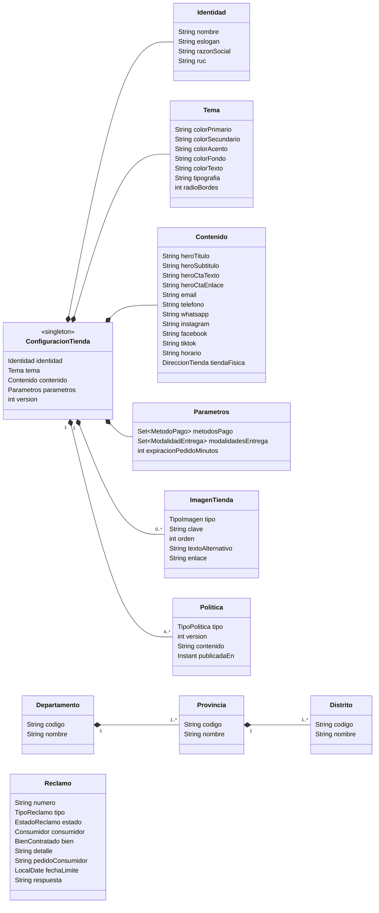
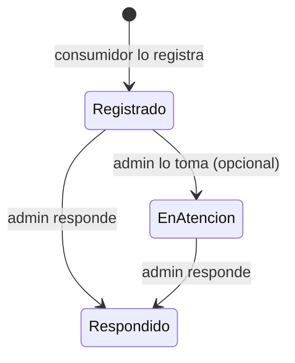
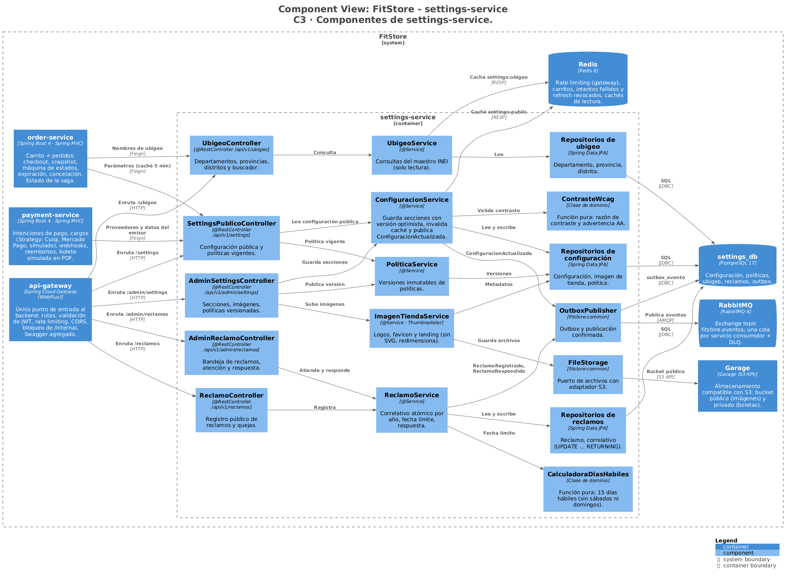
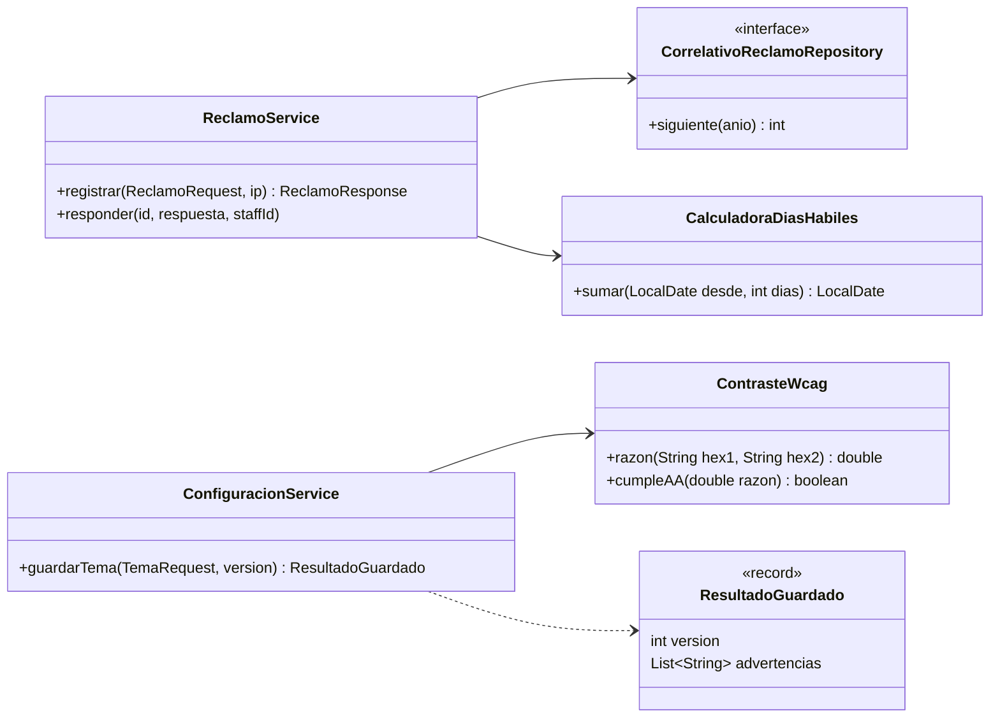

# FitStore — Análisis micro: `settings-service`

> Versión: **v6 (aprobado)** — 2026-10-16. Fuente: [`01-analisis-macro.md`](../01-analisis-macro.md) v12.
> Estados: ✅ decidido · 🟡 propuesto · ❓ abierto · 🕓 diferido

**Historial:**
- v6 (2026-10-18): sección 10 aprobada → **documento completo aprobado**.
- v5 (2026-10-18): sección 10 (diseño técnico) redactada: C3, código de las partes críticas, paquetes, dependencias, configuración e infraestructura.
- v4 (2026-10-16): nuevo parámetro **`correos_alertas`** (destinatarios de las alertas de la tienda; por defecto, el correo de contacto). No es público: viaja solo en `ConfiguracionActualizada`.
- v3 (2026-10-16): secciones 1, 3, 5 y 9 aprobadas → **documento aprobado**.
- v2 (2026-10-16): secciones 2, 4, 6, 7 y 8 aprobadas. Reclamos solo por correo (sin vista en "Mi cuenta"); feriados → alcance futuro. Ubigeo confirmado: el cliente elige departamento/provincia/distrito y el sistema guarda solo el código.
- v1 (2026-10-16): borrador inicial.

**Estado de revisión por sección:** 1 ✅ · 2 ✅ · 3 ✅ · 4 ✅ · 5 ✅ · 6 ✅ · 7 ✅ · 8 ✅ · 9 ✅ · 10 ✅

---

## 1. Responsabilidad y límites

**Contexto:** Administración de tienda (soporte). **Base de datos:** `settings_db` (PostgreSQL) + Redis (caché, prefijo `settings:`) + Garage (logos e imágenes de la landing).

Tres módulos internos, cada uno con sus paquetes y tablas:

| Módulo | Qué guarda |
|---|---|
| **Configuración de tienda** | Identidad (nombre, logos, datos legales), tema (colores, tipografía, bordes), contenido de la landing, contacto y redes, políticas, parámetros de negocio |
| **Ubigeo** | Maestro de departamentos, provincias y distritos (solo lectura) |
| **Libro de Reclamaciones** | Reclamos y quejas, su numeración correlativa y su respuesta |

**Hace:**
- Sirve la **configuración pública** que ambos frontends cargan al iniciar (white-label, ADR-004) y la que necesitan otros servicios.
- Permite al ADMIN editar todo desde la pantalla "Configuración de tienda" (CU-31, CU-32).
- Sirve el **maestro de ubigeo** para los selects de registro, direcciones, checkout y tarifas (RF-SET-08).
- Registra y atiende el **Libro de Reclamaciones virtual** (RF-LEG-01, CU-14, CU-34).

**No hace:**
- No guarda configuración técnica ni secretos (claves de Culqi, Mercado Pago, SES, BD): eso es de `config-server` y variables de entorno (ADR-004).
- No guarda el stock mínimo por defecto (lo guarda catalog, macro v12).
- No envía correos (publica eventos para notification).
- No valida que un pedido citado en un reclamo exista (solo su formato).

**Cubre:** CU-01 (datos), CU-14, CU-31, CU-32, CU-34 · RF-SET-01 a 08 · RF-LEG-01 · RNF-17, 19.

---

## 2. Modelo de dominio



### 2.1 Decisiones del modelo ✅

| # | Propuesta | Por qué | Alternativa |
|---|---|---|---|
| D1 | **Configuración como una sola fila** (`configuracion_tienda`, singleton) con columnas tipadas, agrupadas en el código como objetos embebidos (`@Embeddable`: identidad, tema, contenido, parámetros) | Es una sola tienda por instalación (ADR-003). Columnas tipadas = validación con Bean Validation, migraciones claras y pruebas simples | Un documento JSON libre (flexible, pero sin validación ni tipos) o una tabla clave/valor (todo es texto) |
| D2 | **Las políticas se versionan:** guardar una política crea una **versión nueva** (1, 2, 3…); las anteriores se conservan y no se editan | auth guarda qué versión de términos y privacidad aceptó cada cliente (Ley 29733); hay que poder mostrar exactamente ese texto después | Sobrescribir el texto (se pierde lo que el cliente aceptó) |
| D3 | **Agregar datos legales a la identidad:** razón social, **RUC** y dirección fiscal | Los exige el Libro de Reclamaciones y se imprimen en la boleta simulada (payment) | Dejarlos fuera (el Libro quedaría incompleto legalmente) |
| D4 | **Moneda fija en PEN**, mostrada como solo lectura | Todo el sistema (precios, pasarelas, boleta) está pensado en soles; hacerla editable no sirve de nada hoy (YAGNI) | Moneda editable |
| D5 | **Vista previa del tema solo en el frontend** (RF-SET-07): al mover los colores, el backoffice aplica las variables CSS en vivo sin guardar; "Guardar" publica | Cero lógica en el backend, sin estados borrador/publicado (KISS) | Guardar un borrador en el backend y publicarlo después |
| D6 | **Tipografía elegida de una lista cerrada** de Google Fonts (Inter, Poppins, Montserrat, Roboto, Nunito, Lato) | Evita fuentes que no carguen o rompan el diseño | Campo libre con cualquier nombre de fuente |
| D7 | **Ubigeo de solo lectura, cargado por migración** desde la codificación del **INEI** (no la de RENIEC, que usa otros códigos para los mismos lugares). El admin no lo edita. **El usuario nunca ve ni escribe el código:** elige Departamento / Provincia / Distrito en selects; la palabra "ubigeo" no aparece en la interfaz | Cambia rarísimas veces (creación de un distrito nuevo); se actualiza con una migración nueva (YAGNI) | CRUD de ubigeo en el backoffice |
| D8 | **Los reclamos nunca se eliminan** ni se editan después de registrados; solo cambian de estado y reciben respuesta | Es un registro legal: el INDECOPI puede pedirlo, y debe conservarse al menos 2 años | — |

### 2.2 Invariantes

1. Existe **exactamente una** fila de configuración (se crea en la migración inicial con valores de FitStore por defecto).
2. Colores en formato `#RRGGBB`; radio de bordes entre 0 y 24 px; RUC de 11 dígitos.
3. Al menos **un método de pago** y **una modalidad de entrega** habilitados.
4. `expiracionPedidoMinutos` entre **10 y 120** (por defecto 30).
5. Siempre existe una versión vigente de cada política (`TERMINOS`, `PRIVACIDAD`, `CAMBIOS_DEVOLUCIONES`, `ENVIOS`).
6. Una sola imagen por tipo para `LOGO_CLARO`, `LOGO_OSCURO` y `FAVICON`; hasta **5** imágenes `LANDING` (carrusel).
7. El número de reclamo es **correlativo por año, sin huecos ni repetidos**.
8. Un reclamo respondido no vuelve a cambiar.

---

## 3. Modelo de datos

### 3.1 PostgreSQL (`settings_db`) — migraciones `V1__esquema_inicial.sql`, `V2__ubigeo_inei.sql`, `V3__configuracion_semilla.sql`

**Módulo configuración**

| Tabla | Columnas principales | Restricciones |
|---|---|---|
| `configuracion_tienda` | `id` (siempre 1); identidad: `nombre`, `eslogan`, `razon_social`, `ruc`, `direccion_fiscal`; tema: `color_primario`, `color_secundario`, `color_acento`, `color_fondo`, `color_texto`, `tipografia`, `radio_bordes`; contenido: `hero_titulo`, `hero_subtitulo`, `hero_cta_texto`, `hero_cta_enlace`, `email`, `telefono`, `whatsapp`, `instagram_url`, `facebook_url`, `tiktok_url`, `horario`, `tienda_direccion`, `tienda_ubigeo`, `tienda_referencia`; parámetros: `metodos_pago` (`text[]`: `CULQI`, `YAPE`, `MERCADO_PAGO`), `modalidades_entrega` (`text[]`), `expiracion_pedido_minutos`, `correos_alertas` (`text[]`, 1 a 5 correos); `version`, `actualizado_en`, `actualizado_por` | `CHECK (id = 1)`; `CHECK` de formato en colores, RUC y rangos |
| `imagen_tienda` | `id`, `tipo`, `clave`, `orden`, `texto_alternativo`, `enlace`, `creado_en` | Único parcial `(tipo) WHERE tipo <> 'LANDING'` |
| `politica` | `id`, `tipo`, `version`, `contenido` (`text`, Markdown), `publicada_en`, `publicada_por` | Único `(tipo, version)` |

**Módulo ubigeo** (≈ 25 departamentos, 196 provincias, ~1 890 distritos)

| Tabla | Columnas | Restricciones |
|---|---|---|
| `departamento` | `codigo` (`char(2)`, PK), `nombre` | |
| `provincia` | `codigo` (`char(4)`, PK), `departamento_codigo` (FK), `nombre` | |
| `distrito` | `codigo` (`char(6)`, PK), `provincia_codigo` (FK), `nombre` | Índice trigram sobre `unaccent(nombre)` para el buscador |

**Módulo reclamaciones**

| Tabla | Columnas principales | Restricciones |
|---|---|---|
| `reclamo` | `id`, `numero` (`RC-2026-000001`), `anio`, `correlativo`, `tipo` (`RECLAMO`/`QUEJA`), `estado`; consumidor: `nombres`, `apellidos`, `tipo_documento` (`DNI`/`CE`), `numero_documento`, `domicilio`, `telefono`, `email`, `es_menor`, `apoderado_nombre`; bien: `bien_tipo` (`PRODUCTO`/`SERVICIO`), `bien_descripcion`, `monto_reclamado`, `pedido_codigo`; `detalle`, `pedido_consumidor`, `fecha_limite`, `respuesta`, `respondido_en`, `respondido_por`, `ip`, `creado_en` | Único `numero`; único `(anio, correlativo)`; sin `DELETE` (D8) |
| `correlativo_reclamo` | `anio` (PK), `ultimo` | Se incrementa con `UPDATE … SET ultimo = ultimo + 1 RETURNING ultimo` (atómico, sin huecos) |

**Comunes:** `outbox_evento` (ADR-009).

### 3.2 Redis (prefijo `settings:`)

| Clave | Contenido | TTL | Invalidación |
|---|---|---|---|
| `settings:public` | Configuración pública completa | 1 h | Al guardar cualquier sección o imagen |
| `settings:politica:{tipo}` | Versión vigente de la política | 1 h | Al publicar una versión |
| `settings:ubigeo:*` | Listas de departamentos / provincias / distritos | 24 h | Solo cambia por migración |

Además, las respuestas de ubigeo llevan cabeceras HTTP de caché (`Cache-Control: max-age=86400`), así el navegador tampoco las vuelve a pedir.

### 3.3 Almacenamiento (Garage)

Bucket `fitstore-media`, claves `tienda/{tipo}/{uuid}.{ext}`. Logos en PNG o WebP (con transparencia), favicon en PNG o ICO, landing en JPG o WebP redimensionado a 1600 px. **SVG no se permite**: puede contener scripts.

---

## 4. Casos de uso internos

### 4.1 Endpoints

**Públicos**

| Método | Ruta | Descripción |
|---|---|---|
| GET | `/api/v1/settings/public` | Configuración pública: identidad (con datos legales), tema, contenido, URLs de imágenes, parámetros públicos, versión vigente de cada política |
| GET | `/api/v1/settings/politicas/{tipo}` | Texto vigente de una política (`?version=N` para una anterior) |
| GET | `/api/v1/ubigeo/departamentos` | Lista de departamentos |
| GET | `/api/v1/ubigeo/departamentos/{codigo}/provincias` | Provincias de un departamento |
| GET | `/api/v1/ubigeo/provincias/{codigo}/distritos` | Distritos de una provincia |
| GET | `/api/v1/ubigeo/distritos?q=` | Buscador de distritos por nombre (sin tildes), con su provincia y departamento |
| GET | `/api/v1/ubigeo/{codigo}` | Nombre completo de un código ("Miraflores, Lima, Lima") |
| POST | `/api/v1/reclamos` | Registrar reclamo o queja (visitante o cliente) |

**Backoffice (ADMIN)**

| Método | Ruta | Descripción |
|---|---|---|
| GET | `/api/v1/admin/settings` | Configuración completa (incluye lo no público) |
| PUT | `/api/v1/admin/settings/identidad` · `/tema` · `/contenido` · `/parametros` | Guardar una sección (con `version` para evitar que dos admins se pisen) |
| POST | `/api/v1/admin/settings/imagenes` | Subir imagen (multipart + `tipo`); en los tipos únicos reemplaza la anterior |
| PUT / DELETE | `/api/v1/admin/settings/imagenes/{id}` | Orden, texto alternativo, enlace / eliminar |
| GET | `/api/v1/admin/settings/politicas/{tipo}/versiones` | Historial de versiones |
| POST | `/api/v1/admin/settings/politicas/{tipo}` | Publicar nueva versión |
| GET | `/api/v1/admin/reclamos` | Listar (filtros: estado, tipo, fechas, por vencer, vencidos) |
| GET | `/api/v1/admin/reclamos/{id}` | Detalle |
| PATCH | `/api/v1/admin/reclamos/{id}/en-atencion` | Marcar en atención |
| POST | `/api/v1/admin/reclamos/{id}/respuesta` | Responder (cierra el reclamo) |

### 4.2 Guardar configuración (CU-31, CU-32)

1. El admin edita una sección y guarda. Se valida (invariantes 2–4) → `400` si algo falla.
2. Si la `version` enviada no es la actual → `409 "Otro administrador modificó la configuración; recarga la página"`.
3. **Tema:** se calcula el **contraste WCAG** entre texto y fondo, y entre el color primario y el texto de los botones. Si no llega a AA (4.5:1) se guarda igual y la respuesta incluye una **advertencia** (RNF-19: advierte, no bloquea).
4. Se guarda, se incrementa `version`, se invalida `settings:public` y se publica `ConfiguracionActualizada`.
5. Los frontends ven el cambio **al recargar la página**, sin recompilar ni redesplegar (RNF-17).

### 4.3 Políticas (RF-SET-04)

- Publicar crea la versión `N+1` con fecha y autor; la vigente es siempre la más reciente.
- El endpoint público devuelve la vigente con su número de versión. El storefront muestra ese texto en el registro y **envía a auth la versión que mostró**; auth la guarda en el consentimiento. Así auth no necesita llamar a settings (se aclara en el micro de auth, 4.2).

### 4.4 Ubigeo (RF-SET-08)

- Selects encadenados: departamento → provincia → distrito.
- Buscador alternativo para escribir "Miraf…" y elegir "Miraflores (Lima, Lima)" o "Miraflores (Arequipa, Arequipa)".
- Los demás servicios **solo guardan el código** y usan `/ubigeo/{codigo}` si necesitan mostrar el nombre.

### 4.5 Libro de Reclamaciones (RF-LEG-01, CU-14, CU-34)

**Registro (público, sin cuenta):**
1. El formulario sigue la **Hoja de Reclamación** del Código de Protección y Defensa del Consumidor: datos del proveedor (se muestran automáticamente: razón social, RUC, dirección fiscal), datos del consumidor (padre o madre si es menor de edad), bien contratado (producto o servicio, monto reclamado, código de pedido opcional), tipo (**reclamo**: disconformidad con el producto o servicio; **queja**: malestar con la atención), detalle y pedido del consumidor.
2. Se valida y se obtiene el siguiente número correlativo del año (atómico).
3. Se calcula la **fecha límite de respuesta: 15 días hábiles** (lunes a viernes; los feriados no se descuentan en esta versión).
4. Se guarda en estado `REGISTRADO` y se publica `ReclamoRegistrado`. notification envía **copia al consumidor** (obligatorio) y aviso al admin.
5. La pantalla muestra el número de reclamo y la fecha límite.

**Atención (ADMIN):**
- Lista con indicador de **por vencer** (≤ 3 días hábiles) y **vencidos**; el contador aparece también en el dashboard.
- `en-atencion` (opcional) → `respuesta`: guarda la respuesta, fecha y autor, cambia a `RESPONDIDO` y publica `ReclamoRespondido` (notification la envía por correo al consumidor).

Protección contra abuso: el gateway limita los registros por IP (ADR-020).

---

## 5. Estados

**Reclamo:**



"Por vencer" y "vencido" no son estados: se calculan comparando `fecha_limite` con la fecha actual.

**Política:** cada versión es inmutable; la vigente es la de mayor número.

---

## 6. Eventos

Exchange `fitstore.eventos` (topic), sobre común, outbox (ADR-009).

**Publica:**

| Evento | Routing key | Payload | Consume |
|---|---|---|---|
| `ConfiguracionActualizada` | `settings.configuracion.actualizada` | `version`, `secciones[]` cambiadas, la **configuración pública completa** (es pequeña, ~2 KB) y `correosAlertas` (no público; el broker es interno) | notification (marca de los correos) y cualquier servicio que necesite parámetros |
| `ReclamoRegistrado` | `settings.reclamo.registrado` | `numero`, `tipo`, `consumidor` (nombre, email), `bien`, `detalle`, `pedidoConsumidor`, `fechaLimite`, `creadoEn` | notification (copia al consumidor y aviso al admin) |
| `ReclamoRespondido` | `settings.reclamo.respondido` | `numero`, `consumidor` (nombre, email), `respuesta`, `respondidoEn` | notification (respuesta al consumidor) |

Llevar la configuración completa en el evento permite que quien la recibe **no tenga que volver a llamar** a settings.

**Consume:** ninguno.

---

## 7. Dependencias síncronas

**Salientes:** ninguna.

**Entrantes:**

| Quién | Qué | Para qué |
|---|---|---|
| storefront y backoffice | `/settings/public`, políticas, ubigeo, reclamos | Arranque (`APP_INITIALIZER`), selects, formularios |
| order-service | `GET /settings/public` (parámetros: expiración del pedido, modalidades de entrega habilitadas) | Se decide en el micro de order (llamada con caché local o copia por evento) |
| payment-service | `GET /settings/public` (métodos de pago habilitados, datos legales para la boleta) | Se decide en el micro de payment |
| notification-service | Evento `ConfiguracionActualizada` | Marca de los correos |

settings ofrece **las dos formas** (endpoint público cacheable y evento con la configuración completa); cada consumidor elige la más simple en su micro. Si settings no responde, los frontends usan la última configuración que guardaron en el navegador o, en su defecto, el tema FitStore por defecto.

---

## 8. Seguridad

- Públicos: configuración pública, políticas, ubigeo y registro de reclamos.
- `/api/v1/admin/**`: solo `ADMIN` (el OPERADOR no configura la tienda). Excepción: el OPERADOR puede **ver** los reclamos (no responderlos).
- La configuración pública **nunca** incluye secretos ni datos internos (autor de cambios, IPs).
- Datos personales de los reclamos (documento, domicilio): solo staff; nunca en logs.
- Imágenes: tipo real validado, máximo 2 MB para logos y 5 MB para landing, sin SVG.
- Textos con Markdown (políticas, contenido): el frontend los muestra sanitizados (sin HTML ni scripts).

---

## 9. Pruebas

**Capa de datos (AP1)** — `@DataJpaTest` con PostgreSQL en Testcontainers:

| Repositorio | Insertar | Actualizar | Eliminar | Listar | Extra |
|---|---|---|---|---|---|
| `ConfiguracionTiendaRepository` | (semilla) | cada sección | — | — | `CHECK (id = 1)`, bloqueo optimista con `version` |
| `ImagenTiendaRepository` | ✔ | orden, texto | **físico** | por tipo | un solo logo por tipo |
| `PoliticaRepository` | nueva versión | — | — | historial | vigente = mayor versión; `(tipo, version)` único |
| `ReclamoRepository` | ✔ | estado, respuesta | — (D8) | filtros, por vencer | número único |
| `UbigeoRepository` | (migración) | — | — | provincias por departamento, distritos por provincia | búsqueda sin tildes; conteos del INEI |

**Unitarias:** calculadora de contraste WCAG (casos conocidos: negro/blanco = 21:1), cálculo de 15 días hábiles (cruzando fines de semana y fin de año), validaciones de parámetros.

**Concurrencia:** 20 reclamos simultáneos → correlativos 1 a 20 sin huecos ni repetidos.

**API (MockMvc):** permisos (ADMIN vs OPERADOR vs público), `409` por versión desactualizada, advertencia de contraste en la respuesta.

**Postman:** cambiar tema y logo → ver `/settings/public` actualizado; registrar reclamo → responderlo; recorrer ubigeo.

---

## 10. Diseño técnico ✅

Stack y versiones comunes: [`docs/arquitectura/stack-versiones.md`](../../arquitectura/stack-versiones.md). Modelo C4: [`docs/arquitectura/workspace.dsl`](../../arquitectura/workspace.dsl). Convenciones comunes a todos los servicios (ADR-015): interfaz + `Impl` en servicios, DTOs como `record`, mapeo con MapStruct, sin lógica en controladores, `ApiResponse` y manejo de errores de `fitstore-common`.

### 10.1 Componentes (C4 nivel 3)



| Capa | Configuración | Ubigeo | Reclamaciones |
|---|---|---|---|
| Controladores | `SettingsPublicoController`, `AdminSettingsController` | `UbigeoController` | `ReclamoController`, `AdminReclamoController` |
| Servicios | `ConfiguracionService`, `ContrasteWcag` (pura), `ImagenTiendaService`, `PoliticaService` | `UbigeoService` | `ReclamoService`, `CalculadoraDiasHabiles` (pura) |
| Repositorios | configuración, imagen de tienda, política | departamento, provincia, distrito | reclamo, correlativo |
| Común | `FileStorage`, `OutboxPublisher` | | |

### 10.2 Código (C4 nivel 4): correlativo de reclamos y contraste



- `siguiente(anio)`: `INSERT … ON CONFLICT (anio) DO UPDATE SET ultimo = correlativo_reclamo.ultimo + 1 RETURNING ultimo` en la misma transacción que el reclamo → sin huecos ni repetidos, incluso con registros simultáneos.
- `ContrasteWcag` usa la fórmula de luminancia relativa de WCAG 2.x; `guardarTema` nunca falla por contraste, solo agrega advertencias (RNF-19).

### 10.3 Paquetes y capas

```
com.fitstore.settings
├── SettingsServiceApplication
├── config            SecurityConfig, CacheConfig, StorageConfig, OpenApiConfig, PropiedadesSettings
├── configuracion     controller, dto, mapper, model (ConfiguracionTienda + @Embeddable Identidad/Tema/Contenido/Parametros,
│                     ImagenTienda, Politica), repository, service (+ dominio/ContrasteWcag)
├── ubigeo            controller, dto, model (Departamento, Provincia, Distrito), repository, service
├── reclamaciones     controller, dto, mapper, model (Reclamo), repository (+ CorrelativoReclamoRepository),
│                     service (+ dominio/CalculadoraDiasHabiles)
└── event             ConfiguracionActualizada, ReclamoRegistrado, ReclamoRespondido
```

### 10.4 Dependencias

| Grupo | Artefactos |
|---|---|
| Web y validación | `spring-boot-starter-webmvc`, `spring-boot-starter-validation` |
| Datos | `spring-boot-starter-data-jpa`, `postgresql`, `spring-boot-starter-flyway`, `flyway-database-postgresql` |
| Seguridad | `spring-boot-starter-security`, `spring-boot-starter-oauth2-resource-server` (validación de JWT, vía `fitstore-common`) |
| Mensajería | `spring-boot-starter-amqp` |
| Nube | `spring-cloud-starter-config`, `spring-cloud-starter-netflix-eureka-client` |
| Observabilidad | `spring-boot-starter-actuator`, `spring-boot-starter-opentelemetry` |
| Documentación | `springdoc-openapi-starter-webmvc-ui` |
| Propias y utilidades | `fitstore-common`, `lombok`, `mapstruct` (+ procesadores) |
| Pruebas | `spring-boot-starter-test`, `spring-boot-starter-data-jpa-test`, `spring-security-test`, `testcontainers-postgresql`, `testcontainers-junit-jupiter` |
| Caché | `spring-boot-starter-data-redis`, `spring-boot-starter-cache` |
| Archivos | `software.amazon.awssdk:s3` (vía `fitstore-common`), `thumbnailator` |

### 10.5 Configuración

**Puerto:** 8087. Archivos: `settings-service.yml`, `-dev.yml`, `-cloud.yml`.

```yaml
server.port: 8087
spring:
  datasource:
    url: jdbc:postgresql://${DB_HOST:postgres}:5432/settings_db
    username: ${SETTINGS_DB_USER}
    password: ${SETTINGS_DB_PASSWORD}
  jpa.hibernate.ddl-auto: validate        # el esquema lo maneja Flyway
  servlet.multipart: { max-file-size: 5MB, max-request-size: 6MB }
fitstore:
  storage: { endpoint: ${S3_ENDPOINT}, bucket-publico: ${S3_BUCKET_PUBLICO:fitstore-media}, media-base-url: ${MEDIA_BASE_URL} }
  settings:
    cache-ttl: { publica: 1h, ubigeo: 24h }
    imagenes: { logo-max: 2MB, landing-max: 5MB, landing-ancho: 1600, landing-max-cantidad: 5 }
    tipografias: [Inter, Poppins, Montserrat, Roboto, Nunito, Lato]
    reclamos: { plazo-dias-habiles: 15, por-vencer-dias: 3, serie: RC }
```

| Variable de entorno | Uso |
|---|---|
| `SETTINGS_DB_USER`, `SETTINGS_DB_PASSWORD` | Usuario propio de `settings_db` |
| `S3_ENDPOINT`, `S3_ACCESS_KEY`, `S3_SECRET_KEY`, `S3_BUCKET_PUBLICO`, `MEDIA_BASE_URL` | Garage |

### 10.6 Infraestructura

| Componente | Uso |
|---|---|
| PostgreSQL `settings_db` | Tablas de 3.1; ubigeo INEI en `V2__ubigeo_inei.sql` (generado desde el CSV oficial) |
| Redis (prefijo `settings:`) | Configuración pública, políticas y ubigeo |
| RabbitMQ | Publica `settings.configuracion.actualizada`, `settings.reclamo.registrado`, `settings.reclamo.respondido`. No consume |
| Garage | Bucket público `fitstore-media`, prefijo `tienda/` |

---

## Decisiones de alcance ✅

| # | Tema | Decisión |
|---|---|---|
| A1 | Ver reclamos en "Mi cuenta" | **No.** El consumidor recibe copia y respuesta solo por correo |
| A2 | Feriados en el plazo de 15 días hábiles | **Alcance futuro** (tabla de feriados). Por ahora solo se excluyen sábados y domingos |
