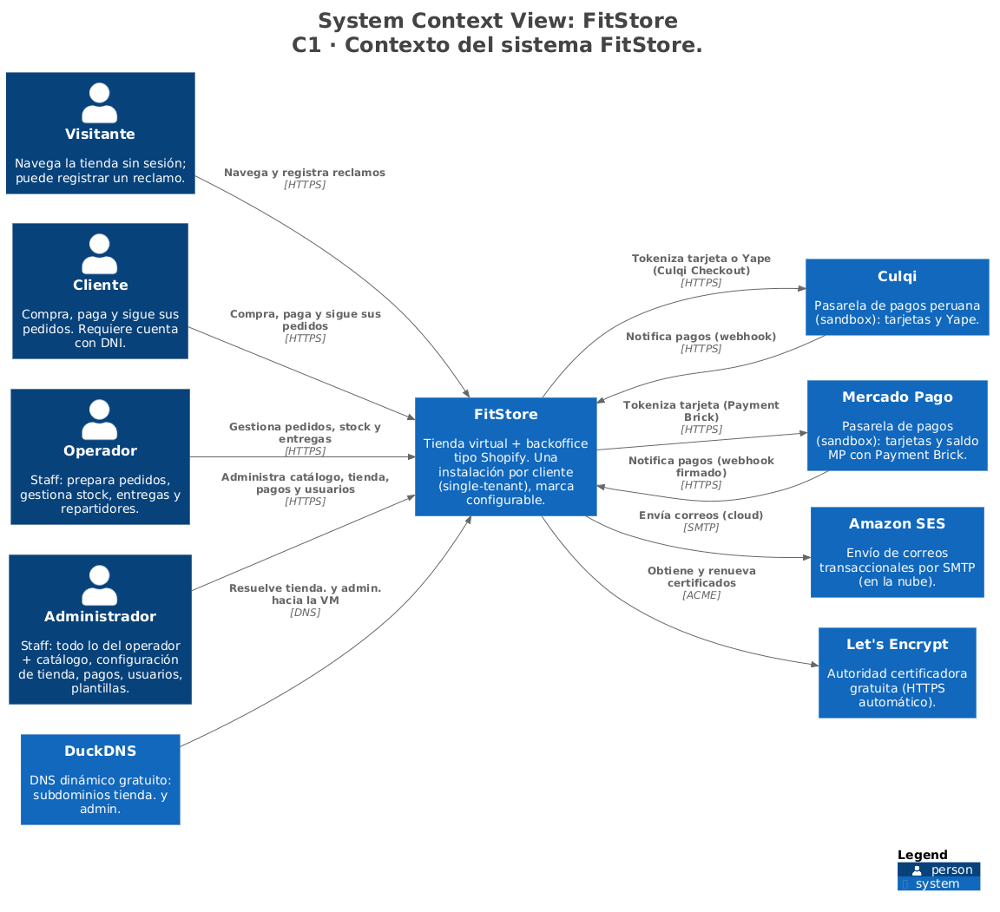
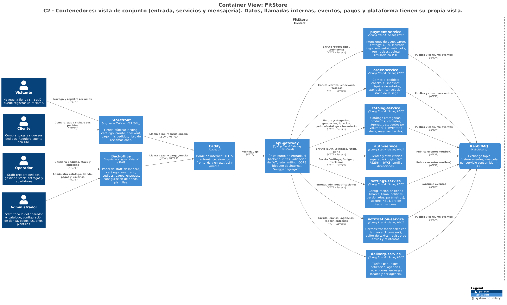
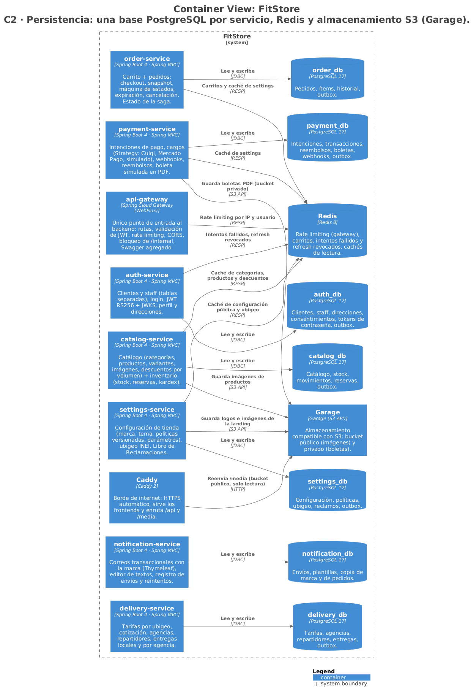
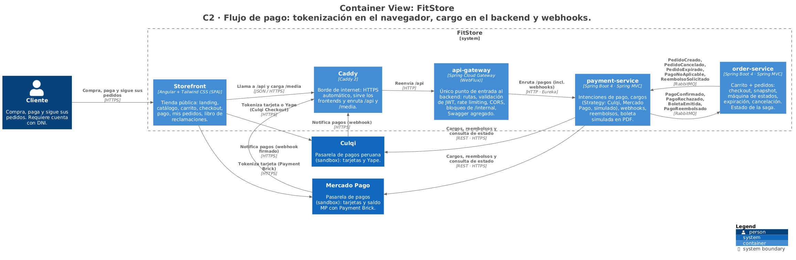
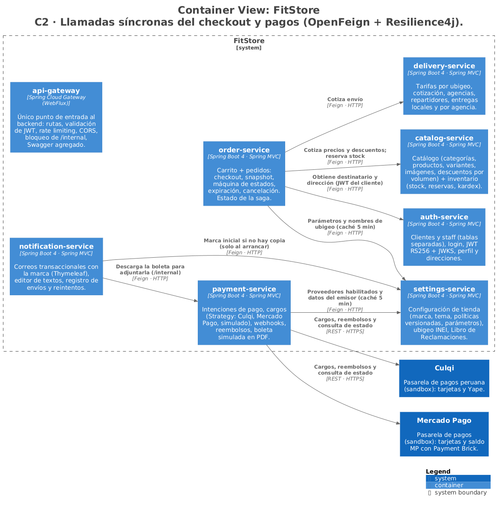
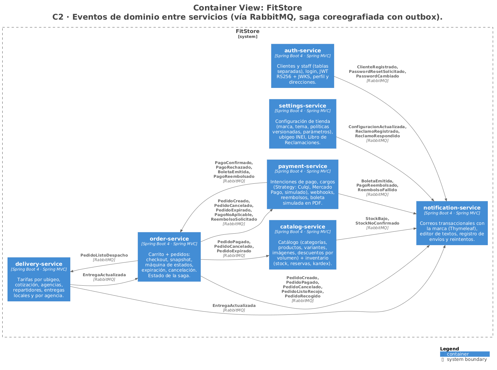
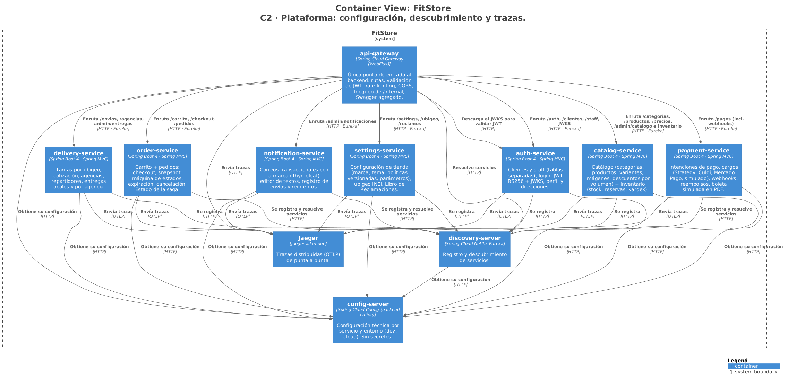
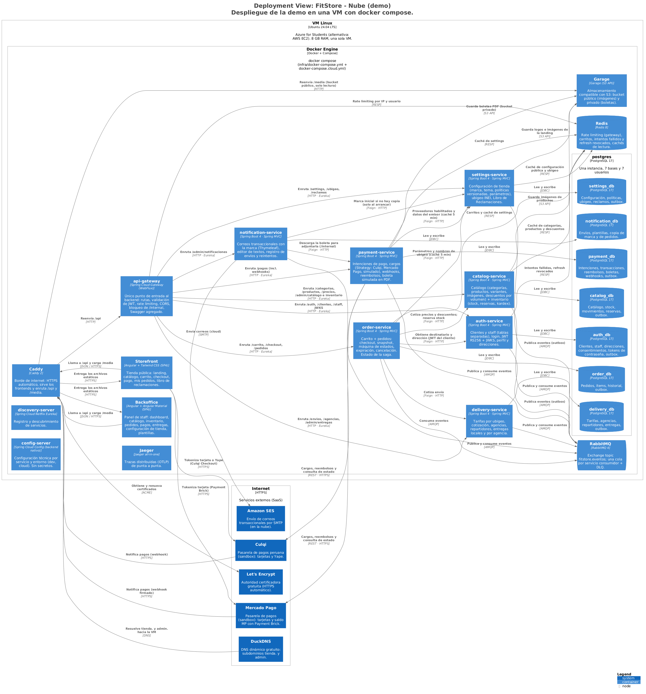
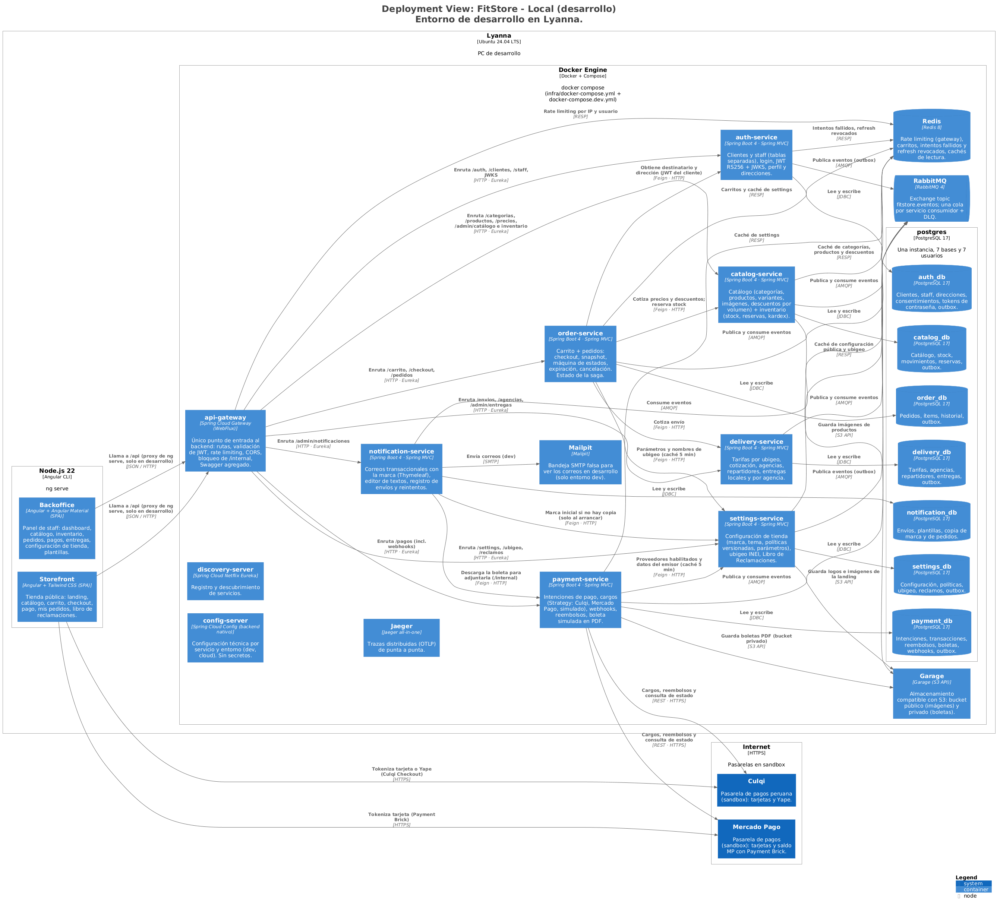

# FitStore — Arquitectura C4 del sistema (C1, C2 y C3)

> Versión: **v6 (aprobado)** — 2026-10-19. v6: C3-gateway con `CorrelacionFilter` primero en la cadena (micro de infraestructura v8, CA-0a-13). v5: eventos y componentes del reembolso postventa en order y payment (SPEC-5; imágenes C2-Eventos, C2-Pagos, C3-order y C3-payment regeneradas). v4: C3 de los 8 contenedores aprobados. v3: C1 y C2 aprobados. v2: el C2 general se aligera; nuevas vistas C2-Datos y C2-Pagos. Modelo fuente: [`workspace.dsl`](workspace.dsl) (Structurizr DSL).
> Las imágenes de `img/` se generan desde el modelo; **no se editan a mano**.

## Cómo ver y regenerar los diagramas

```bash
# Visor interactivo (con estilos, documentación y ADRs) en http://localhost:8095
docker run --rm -p 8095:8080 --user "$(id -u):$(id -g)" \
  -v "$PWD/docs/arquitectura":/usr/local/structurizr -v "$PWD/docs/adr":/usr/local/adr \
  structurizr/structurizr local

# Validar el modelo
docker run --rm -v "$PWD/docs":/w structurizr/structurizr validate -workspace /w/arquitectura/workspace.dsl

# Regenerar las imágenes PNG (C4-PlantUML) en docs/arquitectura/img
docker run --rm -v "$PWD/docs":/w structurizr/structurizr export -w /w/arquitectura/workspace.dsl -f plantuml/c4plantuml -o /w/arquitectura/puml
docker run --rm -v "$PWD/docs/arquitectura/puml":/data -w /data plantuml/plantuml -tpng "*.puml"
```

## C1 · Contexto



## C2 · Contenedores — vista de conjunto

Entrada (personas → frontends → Caddy → gateway), servicios y mensajería. El resto de relaciones está en las vistas temáticas.



## C2 · Persistencia (PostgreSQL por servicio, Redis, Garage)



## C2 · Flujo de pago (tokenización, cargo, webhooks)



## C2 · Llamadas síncronas (OpenFeign + Resilience4j)



## C2 · Eventos de dominio (RabbitMQ, saga coreografiada + outbox)



## C2 · Plataforma (configuración, descubrimiento, trazas)



## Despliegue





## C3 · Componentes por contenedor

Cada uno se explica en la sección 10 del micro correspondiente.

| Vista | Imagen |
|---|---|
| C3-auth | [img/C3-auth.png](img/C3-auth.png) |
| C3-catalog | [img/C3-catalog.png](img/C3-catalog.png) |
| C3-settings | [img/C3-settings.png](img/C3-settings.png) |
| C3-order | [img/C3-order.png](img/C3-order.png) |
| C3-payment | [img/C3-payment.png](img/C3-payment.png) |
| C3-delivery | [img/C3-delivery.png](img/C3-delivery.png) |
| C3-notification | [img/C3-notification.png](img/C3-notification.png) |
| C3-gateway | [img/C3-gateway.png](img/C3-gateway.png) |

## Decisiones

Las 20 ADRs pasaron a archivos individuales en [`docs/adr/`](../adr/) (formato adr-tools) y se muestran en la pestaña *Decisions* del visor.
