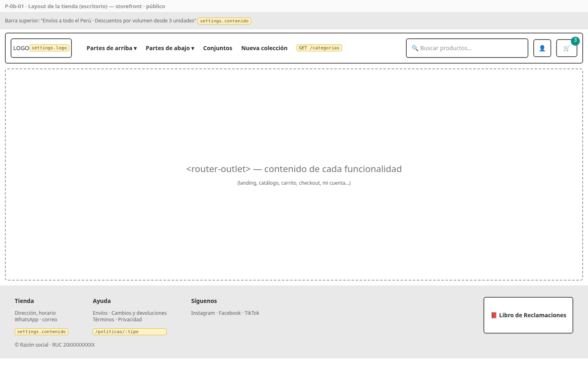
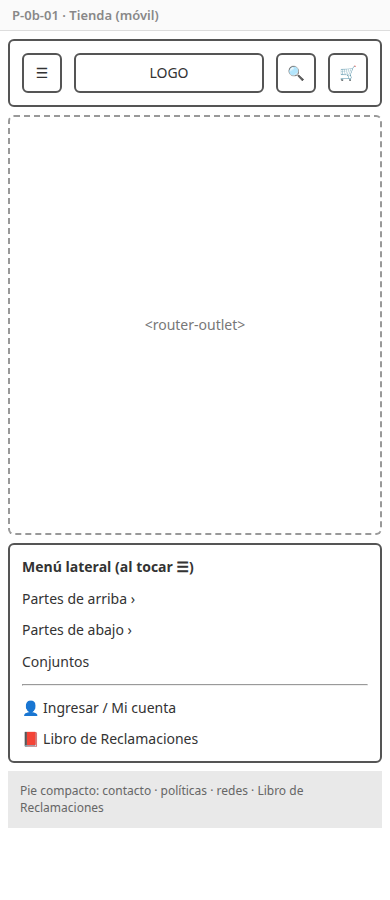
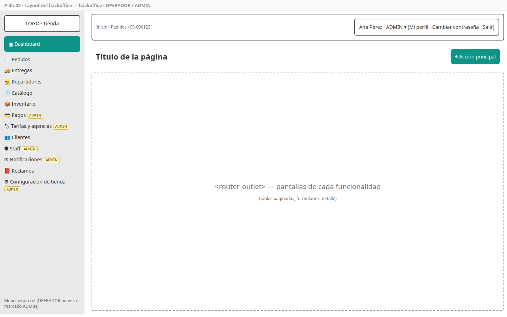
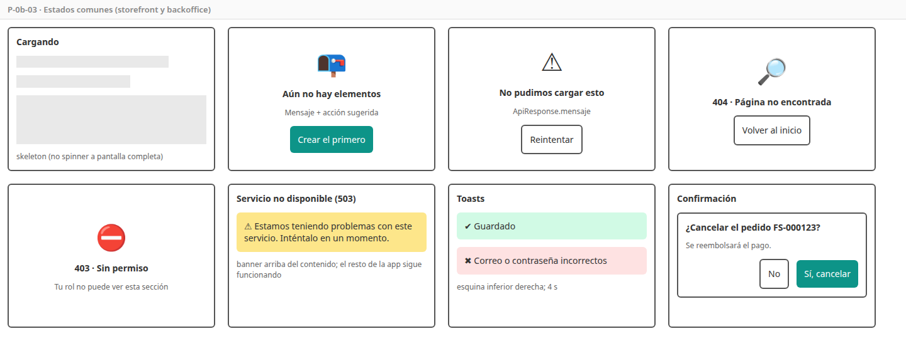
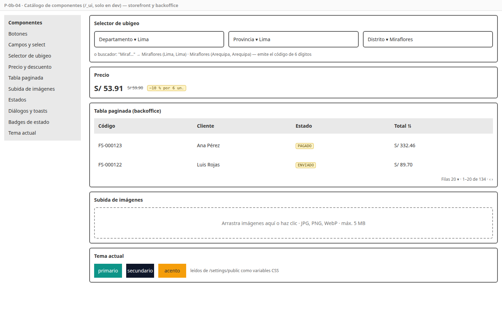

# SPEC-0b — Fundaciones del frontend

> Versión: **v1 (borrador)** — 2026-10-18 · Estados: ✅ decidido · 🟡 propuesto · ❓ abierto
> **Dueña de:** workspace Angular (`frontend/`), librería `shared`, *shells* (layouts) de storefront y backoffice, rutas y menús generales, tema white-label, carpetas `ui/` de cada app, job de frontend en CI.
> **Depende de:** 0a (gateway y CI) y la etapa de contratos (OpenAPI para generar los clientes). · **Habilita:** pantallas de las specs 1–8.

**Historial:**
- v1 (2026-10-18): borrador inicial.

**Estado de revisión por sección:** 1 ⏳ · 2 ⏳ · 3 ⏳ · 4 ⏳ · 5 ⏳ · 6 ⏳ · 7 ⏳ · 8 ⏳ · 9 ⏳

---

## 1. Objetivo y alcance

Al cerrar esta spec, **las dos aplicaciones arrancan** (`ng serve storefront` y `ng serve backoffice`) con la marca que viene de settings, su navegación completa (cada ruta muestra "Próximamente" hasta que su spec la implemente), la sesión y el manejo de errores resueltos, y un **catálogo de componentes** listo para que las specs 1–7 armen sus pantallas **sin tocar nada compartido**.

**Incluye:**
- Workspace Angular 22 en `frontend/` con dos aplicaciones (`storefront`, `backoffice`) y una librería (`shared`).
- `shared` (sin UI de una app concreta): clientes de API generados, sesión, interceptores, guards, tema white-label, modelos comunes (`ApiResponse`, página), pipes (`precio`, `fecha`), utilidades de ubigeo, contador del carrito.
- `ui/` de cada aplicación: componentes visuales reutilizables (P-0b-04).
- Layouts: tienda (P-0b-01) y backoffice (P-0b-02); páginas de estado (P-0b-03).
- **Todas las rutas registradas** (sección 5, R2), con carga diferida y página "Próximamente".
- Menú del backoffice por rol.
- Configuración `es-PE` (fechas, números, `S/`).
- Proxy de desarrollo al gateway, ESLint, Prettier, pruebas unitarias, presupuestos de tamaño.
- Job `frontend` en `.github/workflows/ci.yml`.

**No incluye (y dónde va):**
- Pantallas de login, registro y perfil → spec 1 (aquí solo la sesión y los guards).
- Contenido de la landing, menú de categorías con datos reales de prueba, carrito real → specs 3, 2 y 4 (aquí el *shell* los consume por contrato).
- Pruebas E2E (Playwright) y Lighthouse → spec 8.
- Imagen de Caddy con los frontends compilados → spec 8.

## 2. Referencias

- Macro: ADR-003, 004 (tema por variables CSS, `APP_INITIALIZER`), 011 (tokens), 015; RNF-17, 18, 19, 20.
- Micro: auth 4.4 (access token en memoria, refresh por cookie), settings 4.1–4.4 (configuración pública, ubigeo), infraestructura 4 y 5 (gateway, mismo dominio por app), order 4.2 (`X-Carrito-Id`).
- [`stack-versiones.md`](../arquitectura/stack-versiones.md): Angular 22.2, Tailwind 4.3, Angular Material 22.
- Reglas de convivencia: [`README.md`](README.md).

## 3. Historias de usuario y criterios de aceptación

### HU-0b-01 — Workspace listo para desarrollar

Como desarrollador, quiero un workspace con las dos aplicaciones y la librería compartida, para que cada spec agregue pantallas sin configurar nada. · Cubre: ADR-018 · Pantallas: no aplica

```gherkin
CA-0b-01  Dado el repositorio clonado
          Cuando ejecuto npm ci && npm run build en frontend/
          Entonces compilan storefront, backoffice y shared sin errores ni advertencias de presupuesto

CA-0b-02  Cuando ejecuto npm run lint y npm test
          Entonces pasan ESLint y todas las pruebas unitarias

CA-0b-03  Dado ng serve de una app con la plataforma 0a levantada
          Cuando la app llama a /api/...
          Entonces el proxy de desarrollo la envía al gateway (localhost:8080)

CA-0b-04  Dado un pull request que solo modifica frontend/
          Cuando corre GitHub Actions
          Entonces se ejecutan lint, pruebas y build del frontend (y no el backend), con caché de npm
```

### HU-0b-02 — La marca de la tienda sin recompilar

Como administrador, quiero que la tienda y el backoffice tomen el logo, los colores y la tipografía de la configuración, para cambiar la marca sin recompilar. · Cubre: RF-SET-01, 02, 06 · RNF-17 · Pantallas: [P-0b-01](#p-0b-01--layout-de-la-tienda), [P-0b-02](#p-0b-02--layout-del-backoffice), [P-0b-04](#p-0b-04--catálogo-de-componentes)

```gherkin
CA-0b-05  Dado que settings devuelve color primario #E11D48 y tipografía Poppins
          Cuando abro la tienda o el backoffice
          Entonces botones, enlaces y acentos usan #E11D48 y el texto usa Poppins,
               tanto en los componentes de Tailwind (tienda) como en los de Angular Material (backoffice)

CA-0b-06  Dado que el admin cambió el color en settings
          Cuando recargo la página
          Entonces veo el color nuevo, sin compilar ni desplegar

CA-0b-07  Dado que /settings/public no responde
          Cuando abro la app
          Entonces se usa la última configuración guardada en el navegador
          Y si no hay ninguna, el tema FitStore por defecto, sin bloquear la carga

CA-0b-08  Cuando la app arranca
          Entonces el título de la pestaña, el favicon y el logo son los de la tienda
```

### HU-0b-03 — Sesión y llamadas a la API resueltas

Como desarrollador de una funcionalidad, quiero que el token, el refresco de sesión y los errores se manejen solos, para solo llamar al cliente de API generado. · Cubre: RF-IAM-03, auth 4.4 · Pantallas: [P-0b-03](#p-0b-03--estados-comunes)

```gherkin
CA-0b-09  Dado una sesión iniciada
          Cuando la app llama a un endpoint protegido
          Entonces la petición lleva Authorization: Bearer <access token> y X-Request-Id

CA-0b-10  Dado un access token vencido
          Cuando tres peticiones reciben 401 al mismo tiempo
          Entonces se hace UN solo POST /auth/refresh (con la cookie)
          Y las tres peticiones se reintentan con el token nuevo

CA-0b-11  Dado que el refresco falla
          Cuando ocurre un 401
          Entonces se cierra la sesión y se navega al login, recordando la ruta para volver después

CA-0b-12  Dado que recargo la página con una sesión válida en la cookie
          Cuando la app arranca
          Entonces recupera la sesión (refresh) antes de mostrar rutas protegidas

CA-0b-13  Cuando un endpoint responde un error con formato ApiResponse
          Entonces se muestra su mensaje en un toast (o en el formulario si es un 400 con campos)
          Y un 503 muestra el banner "Servicio no disponible" sin romper el resto de la app

CA-0b-14  Dado la tienda sin sesión
          Cuando se llama a /api/v1/carrito/**
          Entonces la petición lleva X-Carrito-Id (UUID guardado en el navegador, creado si no existe)
```

### HU-0b-04 — Navegación completa y protegida

Como usuario, quiero navegar por toda la app y ver solo lo que mi rol permite, para no encontrar secciones rotas ni prohibidas. · Cubre: RF-IAM-04, RNF-05 · Pantallas: [P-0b-02](#p-0b-02--layout-del-backoffice), [P-0b-03](#p-0b-03--estados-comunes)

```gherkin
CA-0b-15  Cuando navego a cualquier ruta de la tabla R2
          Entonces carga de forma diferida y, si su spec aún no la implementó, muestra "Próximamente"

CA-0b-16  Dado que no inicié sesión
          Cuando entro a una ruta protegida (mi cuenta, checkout, cualquier ruta del backoffice)
          Entonces me lleva al login de esa app

CA-0b-17  Dado una sesión de OPERADOR en el backoffice
          Cuando veo el menú
          Entonces no aparecen Pagos, Tarifas y agencias, Staff, Notificaciones ni Configuración de tienda
          Y si entro por URL a una de ellas, veo la página 403

CA-0b-18  Dado una sesión de CLIENTE
          Cuando intento abrir el backoffice
          Entonces no puede iniciar sesión ahí (el login de staff es otro endpoint) y ve el login de staff

CA-0b-19  Cuando entro a una ruta que no existe
          Entonces veo la página 404 con "Volver al inicio"
```

### HU-0b-05 — Layouts de la tienda y del backoffice

Como visitante, quiero una cabecera y un pie claros en cualquier dispositivo; como staff, un panel con menú lateral. · Cubre: CU-01, RF-LEG-01 (enlace visible), RNF-18 · Pantallas: [P-0b-01](#p-0b-01--layout-de-la-tienda), [P-0b-02](#p-0b-02--layout-del-backoffice)

```gherkin
CA-0b-20  Cuando abro la tienda en escritorio
          Entonces veo logo, categorías (de GET /categorias), buscador, cuenta y carrito con contador
          Y en el pie, contacto, políticas, redes y el enlace "Libro de Reclamaciones"

CA-0b-21  Cuando abro la tienda en un celular (390 px)
          Entonces el menú de categorías y la cuenta pasan a un menú lateral (☰), sin scroll horizontal

CA-0b-22  Cuando escribo en el buscador y presiono Enter
          Entonces navego a /productos?q=<texto>

CA-0b-23  Cuando la spec del carrito actualiza el contador compartido
          Entonces el icono del carrito muestra la cantidad sin recargar

CA-0b-24  Cuando abro el backoffice
          Entonces veo menú lateral por rol, ruta de migas, título de página y menú de usuario (perfil, cambiar contraseña, salir)
```

### HU-0b-06 — Componentes compartidos documentados

Como desarrollador de una funcionalidad, quiero componentes listos y un catálogo para verlos, para armar pantallas coherentes sin crear los míos. · Cubre: RNF-11, 18, 20 · Pantallas: [P-0b-03](#p-0b-03--estados-comunes), [P-0b-04](#p-0b-04--catálogo-de-componentes)

```gherkin
CA-0b-25  Cuando abro /_ui en desarrollo (en cualquiera de las dos apps)
          Entonces veo cada componente de su ui/ con sus variantes y estados
          Y en producción la ruta /_ui no existe

CA-0b-26  Dado el selector de ubigeo
          Cuando elijo Lima › Lima › Miraflores (o lo busco por nombre)
          Entonces emite el código 150122
          Y las listas vienen de /ubigeo con caché en el navegador

CA-0b-27  Dado el pipe de precio
          Cuando formatea 332.456
          Entonces muestra "S/ 332.46" (es-PE, half-up)

CA-0b-28  Dado la tabla paginada del backoffice
          Cuando cambio de página, tamaño u orden
          Entonces emite page, size y sort en el formato de la API (ADR-015)
```

### HU-0b-07 — Clientes de API que no se desalinean

Como desarrollador, quiero clientes TypeScript generados desde los contratos, para no escribir llamadas a mano ni romper el frontend cuando cambia un endpoint. · Cubre: RNF-14 · Pantallas: no aplica

```gherkin
CA-0b-29  Cuando ejecuto npm run api:generate
          Entonces se generan en shared/api/ los clientes de los 7 servicios desde contracts/openapi/*.yaml

CA-0b-30  Dado que alguien cambió un contrato sin regenerar
          Cuando corre el CI
          Entonces falla indicando que shared/api está desactualizado
```

## 4. Pantallas

### P-0b-01 — Layout de la tienda

- **Proyecto / acceso:** storefront · público.
- **Boceto (escritorio):** 
- **Boceto (móvil):** 
- **Componentes:** `TiendaShell`, `Cabecera` (logo, `MenuCategorias`, `Buscador`, `IconoCuenta`, `IconoCarrito`), `MenuMovil`, `Pie`, `BarraAnuncio`.
- **Estados:** si `/categorias` falla, la cabecera se muestra sin categorías (no bloquea); el contador del carrito empieza en 0.
- **Endpoints:** `GET /settings/public`, `GET /categorias`.

### P-0b-02 — Layout del backoffice

- **Proyecto / acceso:** backoffice · OPERADOR y ADMIN.
- **Boceto:** 
- **Componentes:** `BackofficeShell` (Material `sidenav`), `MenuLateral` (ítems por rol, tabla R3), `BarraSuperior` (migas, menú de usuario), `EncabezadoPagina` (título + acción principal, usado por todas las pantallas).
- **Estados:** menú colapsable en tablet; ítem activo resaltado.
- **Endpoints:** `GET /settings/public`, `GET /staff/me`.

### P-0b-03 — Estados comunes

- **Proyecto:** ambos.
- **Boceto:** 
- **Componentes:** `EstadoCargando` (skeleton), `EstadoVacio`, `EstadoError` (con reintentar), `Pagina404`, `Pagina403`, `BannerServicioNoDisponible`, `Toast`, `DialogoConfirmacion`.
- **Regla:** toda pantalla de las specs 1–8 usa estos estados; ninguna crea los suyos.

### P-0b-04 — Catálogo de componentes

- **Ruta:** `/_ui` en ambas apps · solo en desarrollo.
- **Boceto:** 
- **Componentes de `ui/`:**

| Storefront (Tailwind) | Backoffice (Angular Material) |
|---|---|
| botón, campo, select, checkbox, selector de ubigeo, precio con descuento, tarjeta de producto vacía (esqueleto), badge, paginador simple, galería básica, estados, toast, diálogo | tabla paginada (`mat-table` + paginador + orden → `page/size/sort`), barra de filtros, selector de ubigeo, subida de imágenes (arrastrar, validar tipo y tamaño), badge de estado (pedido, pago, entrega), estados, toast, diálogo de confirmación |

## 5. Backend

No modifica el backend. Decisiones de implementación del frontend:

| # | Decisión | Detalle |
|---|---|---|
| R1 | **Estructura** 🟡 | `frontend/projects/{storefront,backoffice}/src/app/{core,layout,ui,features}` y `frontend/projects/shared/src/lib/{api,auth,http,theme,i18n,ubigeo,carrito,models,pipes}`. Componentes *standalone*, señales (`signal`, `computed`) para el estado y control de flujo nuevo (`@if`, `@for`). Sin NgRx (KISS) |
| R2 | **Rutas registradas** ✅ | Tabla de abajo; cada ruta carga `features/<carpeta>/<carpeta>.routes.ts`, que 0b crea con una página "Próximamente". La spec dueña solo reemplaza el contenido de su carpeta |
| R3 | **Menú por rol** | Definido en `layout/menu.ts` del backoffice con el rol mínimo de cada ítem (ver P-0b-02) |
| R4 | **Tema** 🟡 | `provideAppInitializer` carga `/settings/public` y escribe variables CSS en `:root` (`--fs-color-primario`, `--fs-color-secundario`, `--fs-color-acento`, `--fs-color-fondo`, `--fs-color-texto`, `--fs-fuente`, `--fs-radio`). Tailwind 4 las usa en su `@theme`; en Angular Material 3 se asignan a los tokens del sistema (`--mat-sys-primary`, …). La configuración se guarda en `localStorage` como respaldo (CA-0b-07). La fuente se carga de Google Fonts según `tipografia` |
| R5 | **Clientes de API** 🟡 | `openapi-generator` (`typescript-angular`) → `shared/api/<servicio>/`, **versionados en Git**; el CI regenera y falla si hay diferencias (CA-0b-30). Ninguna spec los edita a mano |
| R6 | **Sesión** | `SesionStore` en `shared/auth` (señales: cuenta, rol, tipo; el access token solo en memoria). `iniciarSesion()` y `cerrarSesion()` los llaman las pantallas de la spec 1. Guards `autenticadoGuard`, `rolGuard('ADMIN')` |
| R7 | **Interceptores** (en este orden) | `requestId` → `autenticacion` (Bearer) → `carritoId` (solo tienda, solo `/carrito`) → `refresco` (401 → un único refresh compartido → reintento) → `errores` (toast, banner 503, errores de campos) |
| R8 | **Contador del carrito** | `CarritoContador` (señal en `shared/carrito`): la cabecera lo muestra y la spec 4 lo actualiza. Así 0b no depende de la lógica del carrito |
| R9 | **Pruebas unitarias** 🟡 | El *runner* por defecto del CLI de Angular 22 (Vitest) con Angular Testing Library; se verifica al crear el workspace |
| R10 | **Accesibilidad** | Componentes de `ui/` con etiquetas, foco visible y contraste del tema (RNF-19 advierte en settings); objetivo Lighthouse ≥ 85 se mide en la spec 8 |

**Rutas registradas (R2):**

| App | Ruta | Carpeta (`features/`) | Spec dueña | Acceso |
|---|---|---|---|---|
| storefront | `/` | `inicio` | 3 | público |
| storefront | `/productos`, `/categoria/:slug`, `/producto/:slug` | `catalogo` | 2 | público |
| storefront | `/carrito` | `carrito` | 4 | público |
| storefront | `/checkout` | `checkout` | 4 | CLIENTE |
| storefront | `/pago/:codigo` | `pago` | 5 | CLIENTE |
| storefront | `/cuenta/pedidos`, `/cuenta/pedidos/:codigo` | `mis-pedidos` | 4 | CLIENTE |
| storefront | `/ingresar`, `/registro`, `/recuperar`, `/restablecer` | `acceso` | 1 | público |
| storefront | `/cuenta/perfil`, `/cuenta/direcciones` | `cuenta` | 1 | CLIENTE |
| storefront | `/libro-de-reclamaciones`, `/politicas/:tipo` | `legal` | 3 | público |
| backoffice | `/ingresar`, `/recuperar`, `/restablecer` | `acceso` | 1 | público |
| backoffice | `/` (dashboard) | `dashboard` | 8 | OPERADOR |
| backoffice | `/perfil` | `perfil` | 1 | OPERADOR |
| backoffice | `/staff`, `/clientes` | `usuarios` | 1 | ADMIN / OPERADOR |
| backoffice | `/catalogo/**`, `/inventario/**` | `catalogo`, `inventario` | 2 | ADMIN / OPERADOR |
| backoffice | `/configuracion/**`, `/reclamos/**` | `configuracion`, `reclamos` | 3 | ADMIN / OPERADOR |
| backoffice | `/pedidos/**` | `pedidos` | 4 | OPERADOR |
| backoffice | `/pagos/**`, `/reembolsos` | `pagos` | 5 | ADMIN |
| backoffice | `/entregas/**`, `/repartidores`, `/tarifas`, `/agencias` | `entregas`, `maestros-envio` | 6 | OPERADOR / ADMIN |
| backoffice | `/notificaciones/**` | `notificaciones` | 7 | ADMIN |

## 6. Datos

No aplica (no hay base de datos). En el navegador: `localStorage` solo para la copia de respaldo de la configuración pública y el `carritoId`; nunca tokens.

## 7. Pruebas

| CA | Tipo | Dónde |
|---|---|---|
| 01, 02, 04, 30 | Build / CI | `npm run build`, `npm run lint`, `npm test`, job `frontend` en `ci.yml` |
| 03 | Manual | `ng serve` + plataforma 0a |
| 05–08 | Unitaria + manual | `shared/theme/*.spec.ts` (variables escritas, respaldo, valores por defecto) |
| 09–14 | Unitaria | `shared/http/*.spec.ts` con `HttpTestingController` (refresh único con 3 peticiones simultáneas, logout al fallar, mapeo de errores, `X-Carrito-Id`) |
| 15–19 | Unitaria | pruebas de rutas y guards por app |
| 20–24 | Componente | pruebas de `TiendaShell` y `BackofficeShell` (incluye ancho 390 px) |
| 25–28 | Componente | pruebas de cada componente de `ui/` y de los pipes |
| 29 | Script | `npm run api:generate` en CI |

## 8. Archivos y carpetas que toca

| Ruta | Acción | Después de cerrar 0b |
|---|---|---|
| `frontend/` (workspace: `angular.json`, `package.json`, `tsconfig*`, ESLint, Prettier, `proxy.conf.json`) | crea | congelado |
| `frontend/projects/shared/` | crea | **congelado** (salvo `shared/api/`, que solo se regenera) |
| `frontend/projects/*/src/app/{core,layout,ui}/` y `app.routes.ts`, `app.config.ts` | crea | **congelados** |
| `frontend/projects/*/src/app/features/<carpeta>/` | crea el marcador "Próximamente" | pasa a su spec dueña (tabla R2) |
| `.github/workflows/ci.yml` | modifica (agrega el job `frontend`) | congelado |
| `docs/specs/img/P-0b-*` | crea | |
| `backend/`, `infra/`, `contracts/` | solo lectura | |

## 9. Definición de terminado

- [ ] CA-0b-01 a CA-0b-30 cumplidos.
- [ ] Las dos apps arrancan contra la plataforma 0a y muestran la marca de settings (con los datos semilla).
- [ ] `/_ui` muestra todos los componentes de `ui/` en ambas apps.
- [ ] Sin tokens en `localStorage`; sin atribución de IA en commits.
- [ ] Revisado y aprobado por el autor.

## Preguntas abiertas ❓

1. **Landing (`/`):** propuesta, que sea de la **spec 3** (settings), porque su contenido es la marca y los textos de la tienda; los "destacados" los obtiene de catalog por contrato. ¿De acuerdo?
2. **Clientes de API versionados en Git** (R5) en vez de generarlos en cada build: más fácil de revisar y para los agentes, a cambio de archivos generados en el repo. ¿De acuerdo?
