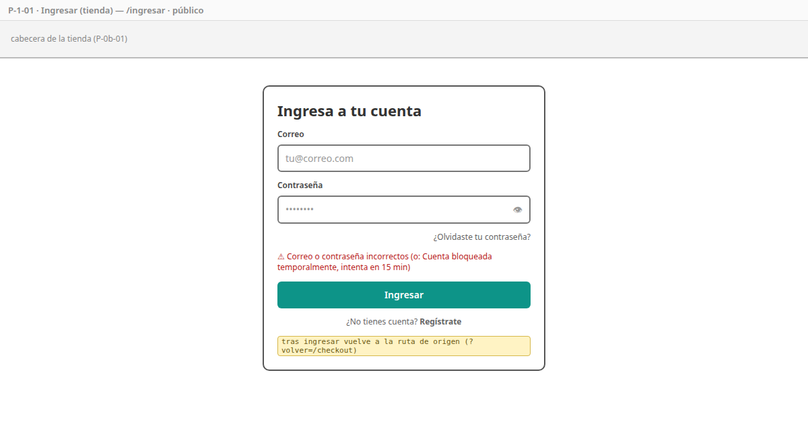
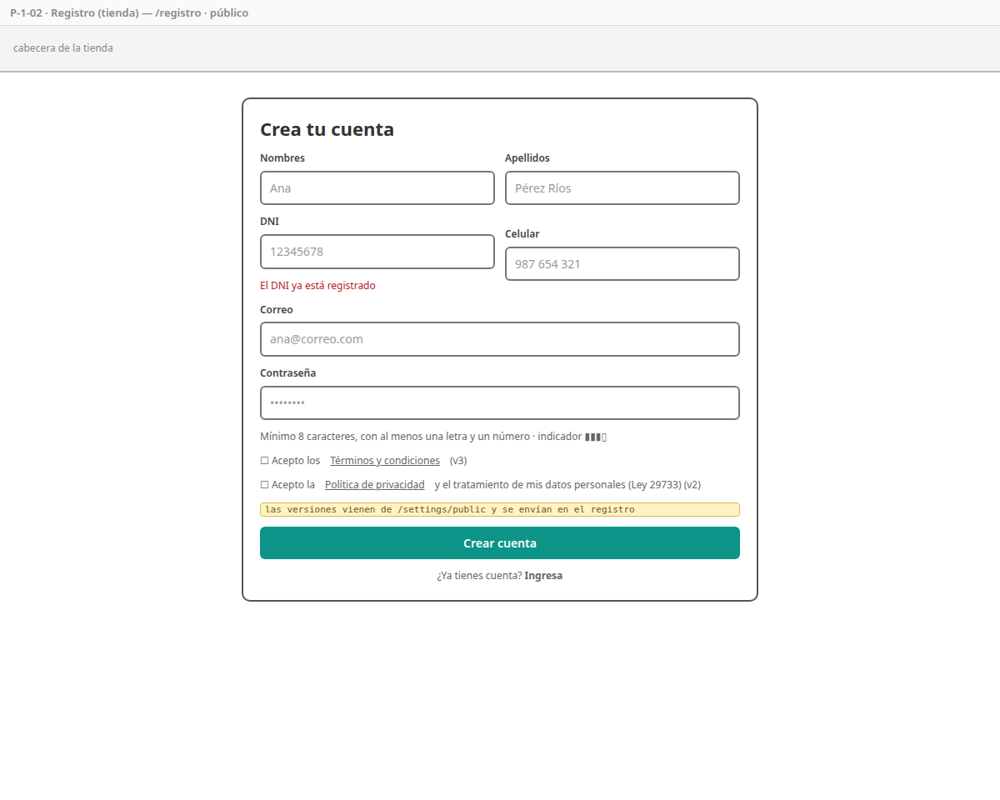
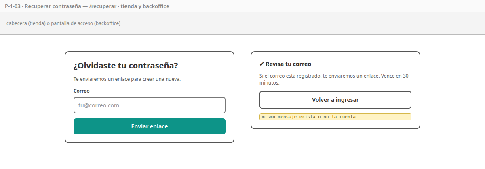
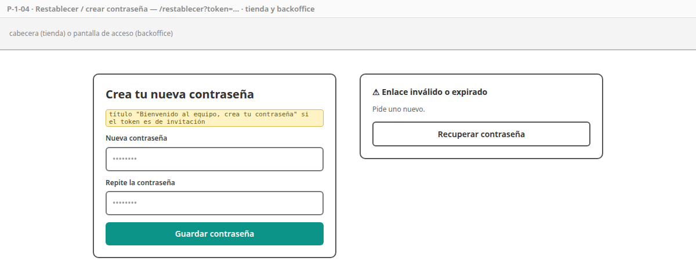
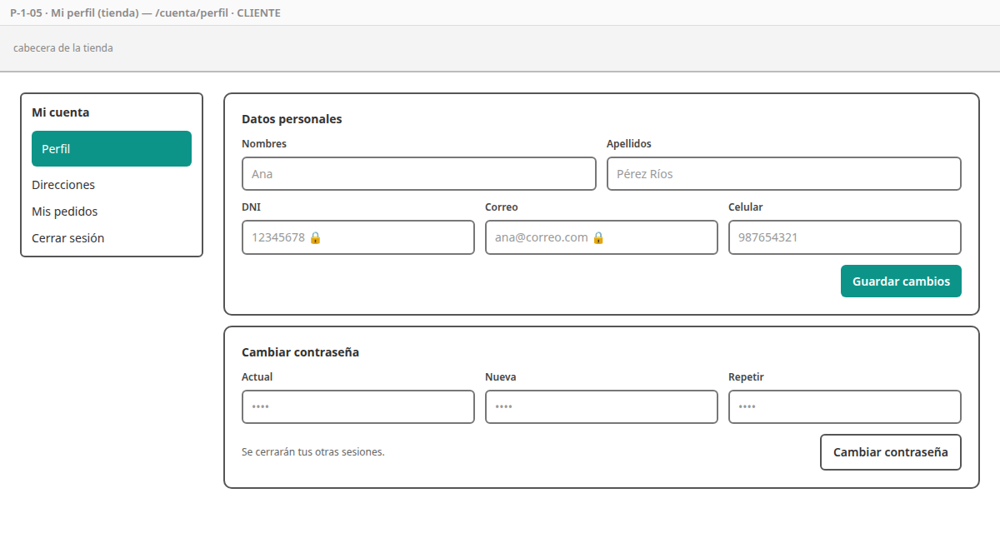
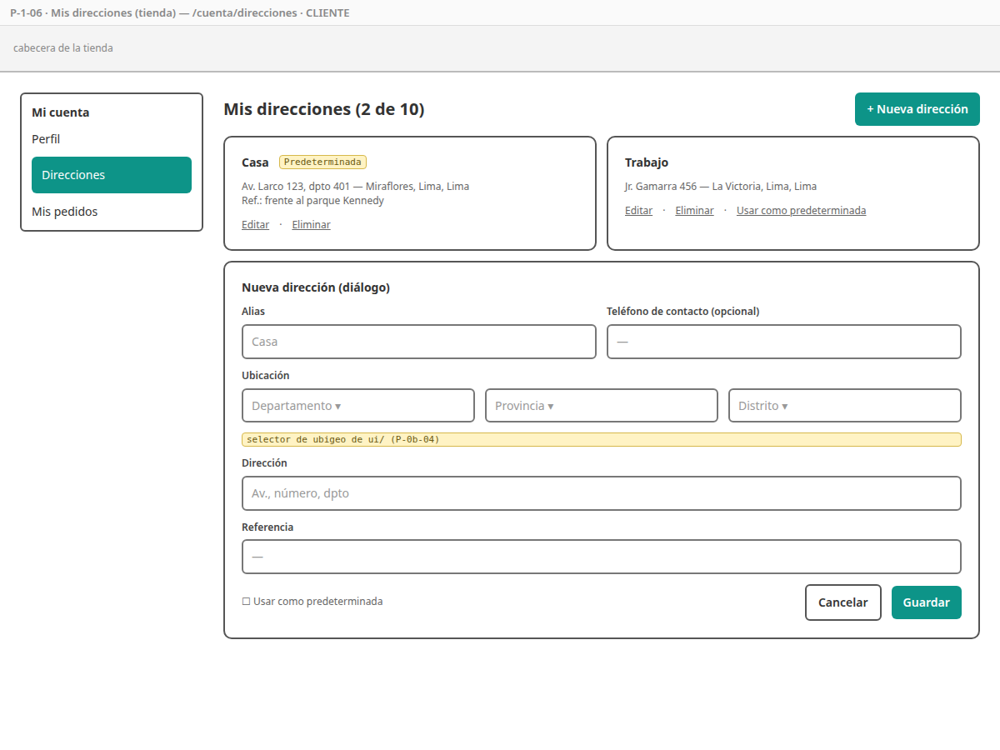
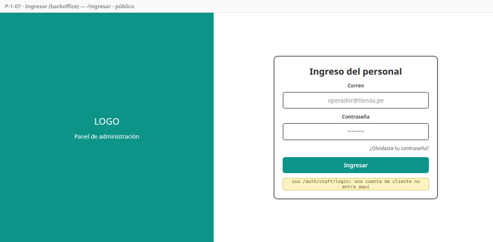
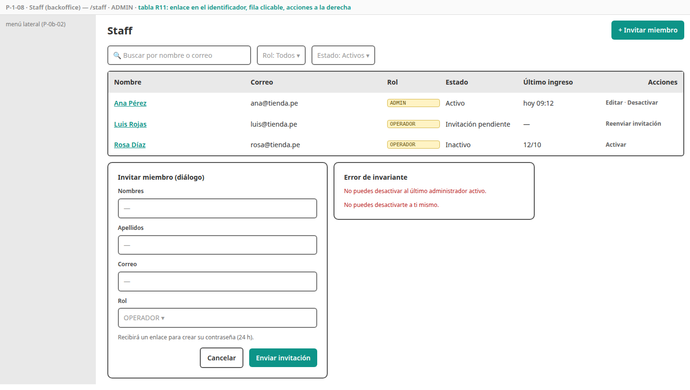
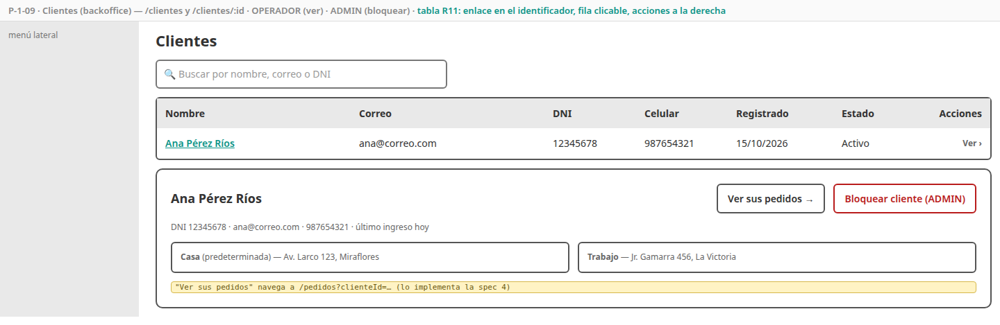
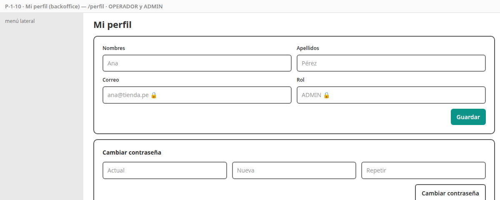

# SPEC-1 — Identidad

> Versión: **v5 (aprobado)** — 2026-10-19 · Estados: ✅ decidido · 🟡 propuesto · ❓ abierto
> **Dueña de:** `backend/auth-service` (lógica, controladores, emisión de JWT) · tienda: `features/acceso`, `features/cuenta` · backoffice: `features/acceso`, `features/perfil`, `features/usuarios`.
> **Depende de:** 0a, 0b · **Habilita:** todas las pantallas protegidas; spec 4 (datos del destinatario en el checkout).
> **Contratos:** `contracts/openapi/auth-service.yaml`; eventos `ClienteRegistrado`, `PasswordResetSolicitado`, `PasswordCambiado`.

**Historial:**
- v5 (2026-10-19): por la SPEC-8 (I7), los datos de demostración también se cargan en la nube (perfil `demo`) con contraseña secreta (A7, CA-1-39); 4 clientes demo con UUID fijos (antes 2; la spec 4 necesitaba 4).
- v4 (2026-10-18): P-1-08 y P-1-09 indican qué abre el enlace de cada fila y sus acciones, según la convención de tablas de la SPEC-0b (R11). Bocetos actualizados.
- v3 (2026-10-18): por la SPEC-4 (O2), `DialogoDireccion` queda **reutilizable** (A6): el checkout lo abre para agregar una dirección sin salir de la página.
- v2 (2026-10-18): spec aprobada. A2: al borrar la predeterminada pasa a serlo la dirección creada más recientemente. Datos de demostración en dev aprobados.
- v1 (2026-10-18): borrador inicial.

**Estado de revisión por sección:** 1 ✅ · 2 ✅ · 3 ✅ · 4 ✅ · 5 ✅ · 6 ✅ · 7 ✅ · 8 ✅ · 9 ✅

---

## 1. Objetivo y alcance

Al cerrar esta spec, un cliente puede **registrarse, iniciar sesión, mantener su sesión, recuperar su contraseña, editar su perfil y administrar sus direcciones**; el staff puede **ingresar al backoffice** y el ADMIN **invitar y administrar** al personal y **consultar clientes**. Todos los servicios validan los tokens que emite auth. Es el **login de la AP1 (6 pts)**.

**Incluye:**
- Toda la lógica de [`auth-service`](../analisis/micro/auth-service.md) (secciones 4 y 5): registro, dos logins, tokens (emisión, refresco con rotación, revocación, invalidación de sesiones), recuperación e invitación, perfil, direcciones, staff, consulta y bloqueo de clientes, bloqueo por intentos, admin inicial, JWKS.
- Publicación de `ClienteRegistrado`, `PasswordResetSolicitado` y `PasswordCambiado` (los correos los envía la spec 7).
- Pantallas P-1-01 a P-1-10.
- Retiro del JWKS de prueba de la 0a (I2): desde aquí todos validan con el JWKS real.
- Datos de demostración para el perfil `dev` y la nube (perfil `demo`, SPEC-8 I7).
- Colección Postman `auth`.

**No incluye (y dónde va):**
- Envío de los correos → spec 7 (aquí solo se publican los eventos).
- Fusión del carrito anónimo al iniciar sesión → spec 4 (la hace el carrito al detectar la sesión).
- Historial de pedidos del cliente en el backoffice → spec 4 (desde P-1-09 se navega a `/pedidos?clienteId=…`).
- Verificación de correo (M1) y eliminación de cuenta (M2) → mejoras futuras.

## 2. Referencias

- Micro [`auth-service.md`](../analisis/micro/auth-service.md): todo (modelo D1–D6, invariantes, datos, endpoints 4.1, flujos 4.2–4.7, estados, eventos, seguridad, pruebas, diseño técnico).
- Macro: CU-05, 06, 07, 08, 29, 30 · RF-IAM-01 a 08 · RF-LEG-02 · RNF-04, 05, 07 · ADR-011, 020.
- SPEC-0b: `SesionStore`, interceptores (R6, R7), rutas (R2), selector de ubigeo, estados.

## 3. Historias de usuario y criterios de aceptación

### HU-1-01 — Registrarme como cliente

Como visitante, quiero crear mi cuenta con mis datos y DNI, para poder comprar y seguir mis pedidos. · Cubre: CU-05, RF-IAM-01, RF-LEG-02 · Pantallas: [P-1-02](#p-1-02--registro)

```gherkin
CA-1-01  Dado el formulario de registro completo y válido, con términos y privacidad aceptados
         Cuando envío el registro
         Entonces se crea mi cuenta de cliente, quedo con la sesión iniciada y vuelvo a la página de origen
         Y se guardan dos consentimientos con la versión de cada política que vi, la fecha y mi IP
         Y se publica ClienteRegistrado

CA-1-02  Dado un correo (sin importar mayúsculas) o un DNI ya registrados
         Cuando envío el registro
         Entonces veo el error junto al campo correspondiente ("El correo ya está registrado" / "El DNI ya está registrado")

CA-1-03  Dado un DNI que no tiene 8 dígitos, un celular que no empieza con 9 o no tiene 9 dígitos,
         una contraseña que no cumple la política, o los consentimientos sin marcar
         Cuando intento registrarme
         Entonces el formulario lo indica antes de enviar, y el backend responde 400 con los campos si llega igual
```

### HU-1-02 — Iniciar sesión en la tienda

Como cliente, quiero iniciar sesión con mi correo y contraseña, para comprar con mi cuenta. · Cubre: CU-06, RF-IAM-02, 03, 08 · Pantallas: [P-1-01](#p-1-01--ingresar-tienda)

```gherkin
CA-1-04  Dado credenciales correctas de un cliente activo
         Cuando ingreso
         Entonces recibo el access token (en memoria) y la cookie de refresh, y vuelvo a la ruta de origen (?volver=)

CA-1-05  Dado un correo inexistente, una contraseña errada o una cuenta desactivada
         Cuando ingreso
         Entonces veo "Correo o contraseña incorrectos" (mismo mensaje y tiempo de respuesta similar en los tres casos)

CA-1-06  Dado 5 intentos fallidos seguidos con el mismo correo
         Cuando intento por sexta vez, incluso con la contraseña correcta
         Entonces veo "Cuenta bloqueada temporalmente" (423) durante 15 minutos

CA-1-07  Dado credenciales de un miembro del staff
         Cuando intento ingresar en la tienda
         Entonces no puedo (son cuentas separadas): veo "Correo o contraseña incorrectos"
```

### HU-1-03 — Mantener y cerrar mi sesión

Como usuario, quiero que mi sesión se mantenga al recargar y que al salir se cierre de verdad, para comprar cómodo y seguro. · Cubre: RF-IAM-03, auth 4.4 · Pantallas: menú de cuenta de [P-0b-01](SPEC-0b-fundaciones-frontend.md#p-0b-01--layout-de-la-tienda) y [P-0b-02](SPEC-0b-fundaciones-frontend.md#p-0b-02--layout-del-backoffice)

```gherkin
CA-1-08  Dado una sesión iniciada
         Cuando recargo la página
         Entonces sigo con la sesión (refresh con la cookie) sin volver a ingresar

CA-1-09  Dado un refresh token ya usado (rotado)
         Cuando alguien intenta usarlo de nuevo
         Entonces recibe 401 y queda registrado como posible robo

CA-1-10  Cuando cierro sesión
         Entonces el refresh se revoca, la cookie se borra y al recargar ya no tengo sesión

CA-1-11  Dado que cambié o restablecí mi contraseña
         Cuando otro dispositivo intenta refrescar su sesión iniciada antes del cambio
         Entonces recibe 401 y debe ingresar de nuevo
```

### HU-1-04 — Recuperar mi contraseña

Como cliente o miembro del staff, quiero recibir un enlace para crear una nueva contraseña, para recuperar mi acceso. · Cubre: CU-07, RF-IAM-06 · Pantallas: [P-1-03](#p-1-03--recuperar-contraseña), [P-1-04](#p-1-04--restablecer--crear-contraseña)

```gherkin
CA-1-12  Cuando pido recuperar la contraseña con cualquier correo
         Entonces veo siempre "Si el correo está registrado, te enviaremos un enlace"
         Y solo si la cuenta existe y está activa se publica PasswordResetSolicitado con el enlace a la app correcta

CA-1-13  Dado un enlace válido (menos de 30 minutos, no usado)
         Cuando creo mi nueva contraseña
         Entonces se guarda, el enlace queda usado, mis sesiones se cierran y se publica PasswordCambiado

CA-1-14  Dado un enlace vencido, ya usado o reemplazado por uno más nuevo
         Cuando lo abro y envío
         Entonces veo "Enlace inválido o expirado" con la opción de pedir otro
```

### HU-1-05 — Editar mi perfil

Como cliente, quiero actualizar mis datos y mi contraseña, para mantener mi cuenta al día. · Cubre: CU-08, RF-IAM-06, 07 · Pantallas: [P-1-05](#p-1-05--mi-perfil-tienda)

```gherkin
CA-1-15  Cuando edito nombres, apellidos o celular y guardo
         Entonces se actualizan y veo "Guardado"
         Y el correo y el DNI se muestran pero no se pueden editar

CA-1-16  Dado mi contraseña actual correcta y una nueva válida
         Cuando cambio mi contraseña
         Entonces se actualiza, se cierran mis otras sesiones y se publica PasswordCambiado
         Y si la contraseña actual es incorrecta, veo el error en ese campo
```

### HU-1-06 — Administrar mis direcciones

Como cliente, quiero guardar mis direcciones de envío, para elegirlas rápido en el checkout. · Cubre: CU-08, RF-IAM-07 · Pantallas: [P-1-06](#p-1-06--mis-direcciones)

```gherkin
CA-1-17  Dado que no tengo direcciones
         Cuando creo la primera (alias, departamento/provincia/distrito, dirección)
         Entonces se guarda con el código de ubigeo de 6 dígitos y queda como predeterminada

CA-1-18  Cuando marco otra dirección como predeterminada
         Entonces la anterior deja de serlo (siempre hay una sola)

CA-1-19  Cuando edito o elimino una dirección
         Entonces se actualiza o se borra (DELETE físico); si borro la predeterminada, pasa a serlo la creada más recientemente

CA-1-20  Dado que ya tengo 10 direcciones
         Cuando intento crear otra
         Entonces el botón está deshabilitado y el backend respondería 409

CA-1-21  Dado el id de una dirección de otro cliente
         Cuando intento verla, editarla o borrarla
         Entonces recibo 404
```

### HU-1-07 — Ingresar al backoffice

Como miembro del staff, quiero ingresar al backoffice con mi cuenta de staff, para trabajar en la tienda. · Cubre: CU-06, RF-IAM-02 · Pantallas: [P-1-07](#p-1-07--ingresar-backoffice), [P-1-03](#p-1-03--recuperar-contraseña), [P-1-04](#p-1-04--restablecer--crear-contraseña)

```gherkin
CA-1-22  Dado credenciales correctas de staff activo
         Cuando ingreso en el backoffice
         Entonces entro al dashboard con el menú de mi rol

CA-1-23  Dado credenciales de un cliente, o de staff con invitación pendiente
         Cuando intento ingresar al backoffice
         Entonces veo "Correo o contraseña incorrectos"

CA-1-24  Dado el bloqueo por intentos
         Entonces aplica igual que en la tienda pero de forma independiente (cliente y staff con el mismo correo no se bloquean entre sí)
```

### HU-1-08 — Administrar al personal

Como administrador, quiero invitar, editar, activar y desactivar al personal, para controlar quién accede al backoffice. · Cubre: CU-30, RF-IAM-05 · Pantallas: [P-1-08](#p-1-08--staff), [P-1-04](#p-1-04--restablecer--crear-contraseña)

```gherkin
CA-1-25  Cuando invito a un miembro con nombres, apellidos, correo y rol
         Entonces se crea sin contraseña, aparece como "Invitación pendiente"
         Y se publica PasswordResetSolicitado con motivo INVITACION (enlace al backoffice, 24 h)

CA-1-26  Dado el enlace de invitación
         Cuando el invitado crea su contraseña
         Entonces su cuenta queda activa y puede ingresar

CA-1-27  Cuando edito el nombre o el rol de un miembro
         Entonces se actualiza (el correo no se edita)

CA-1-28  Dado que es el último ADMIN activo, o que soy yo mismo
         Cuando intento desactivarlo (o degradar al último ADMIN a OPERADOR)
         Entonces recibo 409 con el motivo y nada cambia

CA-1-29  Cuando desactivo a un miembro
         Entonces no puede ingresar ni refrescar su sesión (sus access tokens vencen en ≤ 15 min)
         Y al reactivarlo puede volver a ingresar

CA-1-30  Cuando reenvío una invitación pendiente
         Entonces el enlace anterior deja de servir y se publica uno nuevo

CA-1-31  Dado una sesión de OPERADOR
         Cuando intento usar cualquier endpoint /staff de administración
         Entonces recibo 403
```

### HU-1-09 — Consultar clientes

Como operador o administrador, quiero buscar clientes y ver sus datos, para atender consultas; como administrador, bloquear a un cliente por fraude o abuso. · Cubre: CU-29 · Pantallas: [P-1-09](#p-1-09--clientes)

```gherkin
CA-1-32  Cuando busco por nombre, correo o DNI
         Entonces veo la lista paginada de clientes que coinciden

CA-1-33  Cuando abro un cliente
         Entonces veo sus datos, sus direcciones y el enlace "Ver sus pedidos" (a /pedidos?clienteId=…)

CA-1-34  Dado una sesión de ADMIN
         Cuando bloqueo a un cliente
         Entonces no puede ingresar ni refrescar su sesión; un OPERADOR no ve el botón y la API le responde 403
```

### HU-1-10 — Mi perfil de staff

Como miembro del staff, quiero editar mi nombre y cambiar mi contraseña. · Cubre: CU-30 · Pantallas: [P-1-10](#p-1-10--mi-perfil-backoffice)

```gherkin
CA-1-35  Cuando edito mi nombre o cambio mi contraseña (con la actual)
         Entonces se actualiza; el correo y el rol no son editables por mí
```

### HU-1-11 — Tokens válidos en todo el sistema

Como sistema, quiero que todos los servicios confíen en los tokens de auth sin consultarlo en cada petición. · Cubre: ADR-011, RNF-04, 05 · Pantallas: no aplica

```gherkin
CA-1-36  Dado un access token emitido por auth
         Cuando llega al gateway o a cualquier servicio
         Entonces se valida con el JWKS de auth (en caché) y se respetan rol y tipo

CA-1-37  Dado el cierre de esta spec
         Entonces el JWKS de prueba de la 0a (infra/dev/) ya no existe y nadie lo usa

CA-1-38  Cuando arranca auth sin ningún ADMIN y con FITSTORE_ADMIN_EMAIL y FITSTORE_ADMIN_PASSWORD definidos
         Entonces crea ese ADMIN; si ya existe uno, no hace nada

CA-1-39  Cuando arranca auth con el perfil demo (nube)
         Entonces reemplaza la contraseña de las cuentas de demostración por la de DEMO_PASSWORD;
              si DEMO_PASSWORD no está definida, desactiva esas cuentas (la contraseña de desarrollo nunca sirve en la nube)
```

## 4. Pantallas

### P-1-01 — Ingresar (tienda)

- **Ruta / proyecto:** `/ingresar` · storefront · público (si ya hay sesión, redirige a `/cuenta/perfil`).
- **Boceto (baja fidelidad):** 
- **Diseño de alta fidelidad:** 🕓 deriva del sistema de diseño.
- **Componentes:** `IngresarPage`, `FormularioIngreso`; de `ui/`: campo, botón, toast.
- **Estados:** enviando (botón deshabilitado), error genérico, bloqueada (423).
- **Endpoints:** `POST /auth/login`.

### P-1-02 — Registro

- **Ruta / proyecto:** `/registro` · storefront · público.
- **Boceto:** 
- **Diseño de alta fidelidad:** 🕓 deriva del sistema de diseño.
- **Componentes:** `RegistroPage`, `FormularioRegistro`, `IndicadorFortaleza`; enlaces a `/politicas/terminos` y `/politicas/privacidad` (abren en otra pestaña).
- **Validaciones:** las de auth 4.2 y 4.7 en el cliente; errores de duplicado del backend junto al campo.
- **Endpoints:** `GET /settings/public` (versiones de las políticas), `POST /auth/registro`.

### P-1-03 — Recuperar contraseña

- **Ruta / proyecto:** `/recuperar` · storefront y backoffice (cada app llama a su endpoint).
- **Boceto:** 
- **Diseño de alta fidelidad:** 🕓 deriva del sistema de diseño.
- **Endpoints:** `POST /auth/password/olvido` (tienda) · `POST /auth/staff/password/olvido` (backoffice).

### P-1-04 — Restablecer / crear contraseña

- **Ruta / proyecto:** `/restablecer?token=…` · storefront y backoffice · público. En el backoffice, si el token es de invitación, el título cambia a "Bienvenido al equipo".
- **Boceto:** 
- **Diseño de alta fidelidad:** 🕓 deriva del sistema de diseño.
- **Endpoints:** `POST /auth/password/restablecer`.

### P-1-05 — Mi perfil (tienda)

- **Ruta / proyecto:** `/cuenta/perfil` · storefront · CLIENTE.
- **Boceto:** 
- **Diseño de alta fidelidad:** 🕓 deriva del sistema de diseño.
- **Componentes:** `CuentaLayout` (menú lateral de la cuenta: Perfil, Direcciones, Mis pedidos, Cerrar sesión), `PerfilPage`, `CambioPassword`.
- **Endpoints:** `GET/PUT /clientes/me`, `PUT /clientes/me/password`.

### P-1-06 — Mis direcciones

- **Ruta / proyecto:** `/cuenta/direcciones` · storefront · CLIENTE.
- **Boceto:** 
- **Diseño de alta fidelidad:** 🕓 deriva del sistema de diseño.
- **Componentes:** `DireccionesPage`, `TarjetaDireccion`, `DialogoDireccion` (con el selector de ubigeo de `ui/`; reutilizable, ver A6).
- **Estados:** vacío ("Aún no tienes direcciones"), límite de 10 alcanzado.
- **Endpoints:** `GET/POST /clientes/me/direcciones`, `PUT/DELETE /clientes/me/direcciones/{id}`, `PATCH …/{id}/predeterminada`, `/ubigeo/*`.

### P-1-07 — Ingresar (backoffice)

- **Ruta / proyecto:** `/ingresar` · backoffice · público (fuera del *shell*).
- **Boceto:** 
- **Diseño de alta fidelidad:** 🕓 deriva del sistema de diseño.
- **Endpoints:** `POST /auth/staff/login`.

### P-1-08 — Staff

- **Ruta / proyecto:** `/staff` · backoffice · ADMIN.
- **Boceto:** 
- **Diseño de alta fidelidad:** 🕓 deriva del sistema de diseño (patrón "tabla" de la lista de pedidos).
- **Componentes:** `StaffPage` (tabla paginada de `ui/`, filtros por rol y estado), `DialogoStaff` (invitar / editar), confirmación al desactivar.
- **Tabla (0b R11):** el **nombre** abre el diálogo de edición (`DialogoStaff`; no hay página de detalle); acciones según el estado, como máximo 2: "Editar" y "Desactivar" (activo), "Reenviar invitación" (invitación pendiente), "Activar" (inactivo).
- **Endpoints:** `GET/POST /staff`, `GET/PUT /staff/{id}`, `PATCH /staff/{id}/desactivar|activar`, `POST /staff/{id}/reenviar-invitacion`.

### P-1-09 — Clientes

- **Ruta / proyecto:** `/clientes` y `/clientes/:id` · backoffice · OPERADOR (ver), ADMIN (bloquear).
- **Tabla (0b R11):** el **nombre** abre `/clientes/:id`; acción "Ver ›". "Bloquear" y "Ver sus pedidos" están en el detalle.
- **Boceto:** 
- **Diseño de alta fidelidad:** 🕓 deriva del sistema de diseño.
- **Endpoints:** `GET /clientes`, `GET /clientes/{id}`, `PATCH /clientes/{id}/desactivar|activar`.

### P-1-10 — Mi perfil (backoffice)

- **Ruta / proyecto:** `/perfil` · backoffice · OPERADOR y ADMIN.
- **Boceto:** 
- **Diseño de alta fidelidad:** 🕓 deriva del sistema de diseño.
- **Endpoints:** `GET/PUT /staff/me`, `PUT /staff/me/password`.

## 5. Backend

Todo según el micro de auth. Decisiones de implementación de esta spec:

| # | Decisión | Detalle |
|---|---|---|
| A1 | **Propiedad de las direcciones** | La consulta siempre filtra por `cliente_id` del token (`findByIdAndClienteId`); si no existe → `404` (auth 8) |
| A2 | **Borrar la dirección predeterminada** ✅ | Pasa a predeterminada la **creada más recientemente** entre las que quedan (CA-1-19). El micro no lo definía |
| A3 | **Enlaces de los correos** | Recuperación de cliente: `{STOREFRONT_URL}/restablecer?token=…` · de staff e invitación: `{BACKOFFICE_URL}/restablecer?token=…` |
| A4 | **Cookie de refresh** | Una por app (cada app en su subdominio, auth 4.4); `HttpOnly`, `SameSite=Strict`, `Path=/api/v1/auth`. `POST /auth/refresh` y `/auth/logout` solo aceptan la cookie (sin cuerpo) |
| A5 | **Retiro del JWKS de prueba** | Se borra `infra/dev/jwks-prueba.json` y su clave; el gateway y los servicios apuntan a `http://auth-service/.well-known/jwks.json` (excepción acordada a la regla de "0a congelada") |
| A6 | **`DialogoDireccion` reutilizable** ✅ | Componente *standalone* exportado desde `features/cuenta/direcciones/` con el `DialogoDireccionService.abrir(direccion?)`, que devuelve la dirección guardada (o nada si se cancela). Él mismo llama a `POST`/`PUT /clientes/me/direcciones` y respeta el límite de 10. Lo usa el checkout (SPEC-4); como es solo de la tienda, no va a `shared` |
| A7 | **Cuentas demo en la nube** ✅ | Con el perfil `demo`, `DatosDemoNube` (al arrancar) reemplaza el hash de las cuentas de demostración por BCrypt de `DEMO_PASSWORD`, o las desactiva si falta. Así la nube tiene datos de demo sin exponer una contraseña pública (SPEC-8 I7) |

## 6. Datos

- **Sin migraciones nuevas:** el esquema completo ya está en `V1` (0a).
- **Datos de demostración (perfil `dev` y, en la nube, perfil `demo`; SPEC-8 I7):** migración repetible `R__datos_demo.sql` en `db/dev/` (Flyway la incluye solo con esos perfiles) con:
  - 4 clientes con UUID fijos (`docs/demo/ids-demo.md`), con direcciones en Lima, Callao y Arequipa (son los dueños de los pedidos de demostración de la spec 4), y 1 OPERADOR;
  - en `dev`, contraseña común de demostración documentada en el `README` de desarrollo (no es un secreto real); en la nube, la de `DEMO_PASSWORD` (A7, CA-1-39).
- El ADMIN no se siembra: lo crea `AdminInicial` desde variables de entorno (CA-1-38).

## 7. Pruebas

| CA | Tipo | Dónde |
|---|---|---|
| 01–03 | API (MockMvc) + componente | `RegistroControllerTest`, `formulario-registro.spec.ts` |
| 04–07, 22–24 | API + unitaria | `AutenticacionServiceTest` (incluye bloqueo con Redis en Testcontainers), `AuthControllerTest` |
| 08–11 | Unitaria + integración | `TokenServiceTest` (rotación, reutilización, invalidación por fecha) |
| 12–14 | Unitaria + API | `PasswordServiceTest`, verificación del evento en el outbox |
| 15–16, 35 | API | `ClienteControllerTest`, `StaffControllerTest` |
| 17–21 | API + datos | `DireccionServiceTest`, propiedad (404 ajeno) |
| 25–31 | API | `StaffServiceTest` (invariante del último ADMIN, auto-desactivación, reenvío) |
| 32–34 | API | `ClienteAdminControllerTest` (OPERADOR 403 al bloquear) |
| 36–37 | Integración | Gateway + un servicio validando un token real de auth |
| 38 | Unitaria | `AdminInicialTest` |
| 39 | Unitaria | `DatosDemoNubeTest` (hash reemplazado; cuentas desactivadas sin `DEMO_PASSWORD`) |
| Todas | Postman | `postman/auth.postman_collection.json` (flujo cliente y flujo staff) |

## 8. Archivos y carpetas que toca

| Ruta | Acción |
|---|---|
| `backend/auth-service/**` | modifica (es su dueña) |
| `infra/config-repo/auth-service*.yml` | modifica |
| `infra/dev/jwks-prueba.json` y su clave | **elimina** (A5) |
| `frontend/projects/storefront/src/app/features/{acceso,cuenta}/` | modifica (reemplaza "Próximamente") |
| `frontend/projects/backoffice/src/app/features/{acceso,perfil,usuarios}/` | modifica |
| `postman/auth.postman_collection.json` | crea |
| `docs/specs/img/P-1-*` | crea |
| `backend/fitstore-common`, `backend/api-gateway`, `frontend/projects/shared`, `ui/`, `layout/` | solo lectura (congelados) |

## 9. Definición de terminado

- [ ] CA-1-01 a CA-1-39 cumplidos en CI.
- [ ] Postman `auth` en verde contra la plataforma levantada.
- [ ] El OpenAPI de auth coincide con lo implementado.
- [ ] Demostración de la AP1: registro → login → perfil → direcciones → logout, y login de staff, en las pantallas reales.
- [ ] Revisado y aprobado por el autor.

## Decisiones ✅

1. **A2:** al borrar la dirección predeterminada, pasa a serlo la creada más recientemente entre las que quedan.
2. **Datos de demostración (dev y demo en la nube):** 4 clientes y 1 OPERADOR; contraseña común documentada en `dev`, secreta (`DEMO_PASSWORD`) en la nube (A7, decidido en la SPEC-8).
