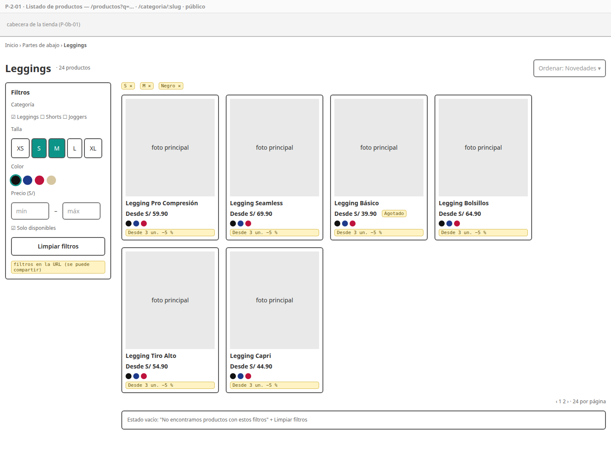
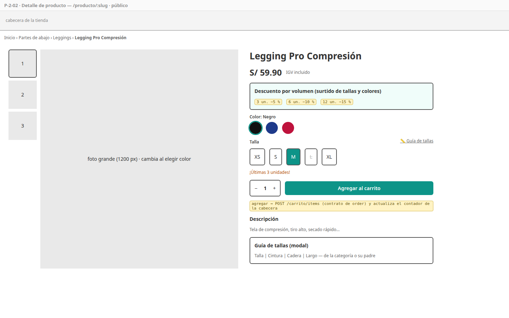
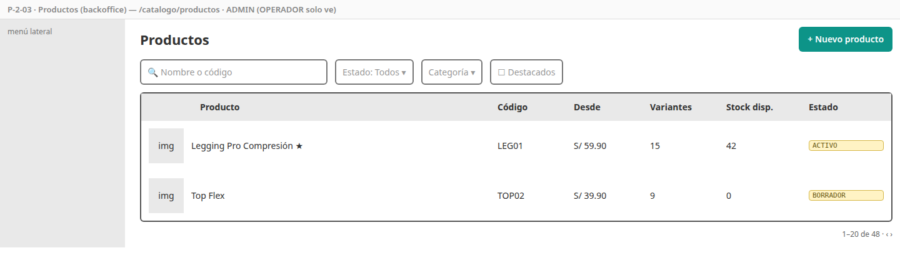
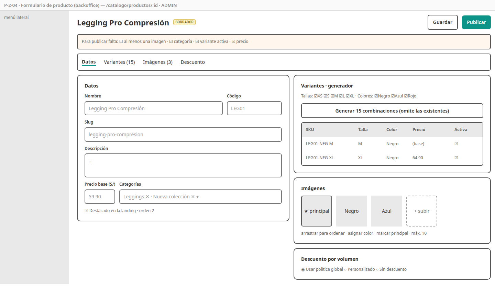
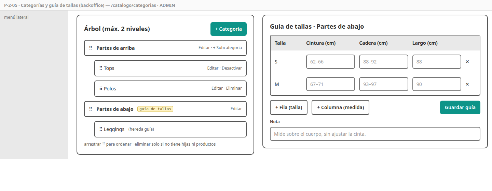
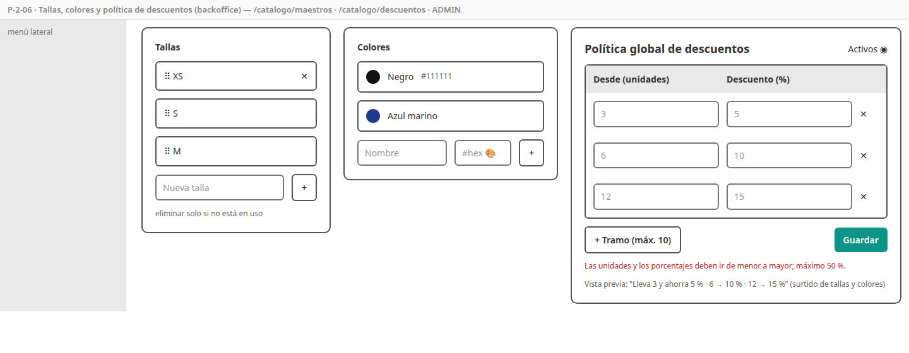
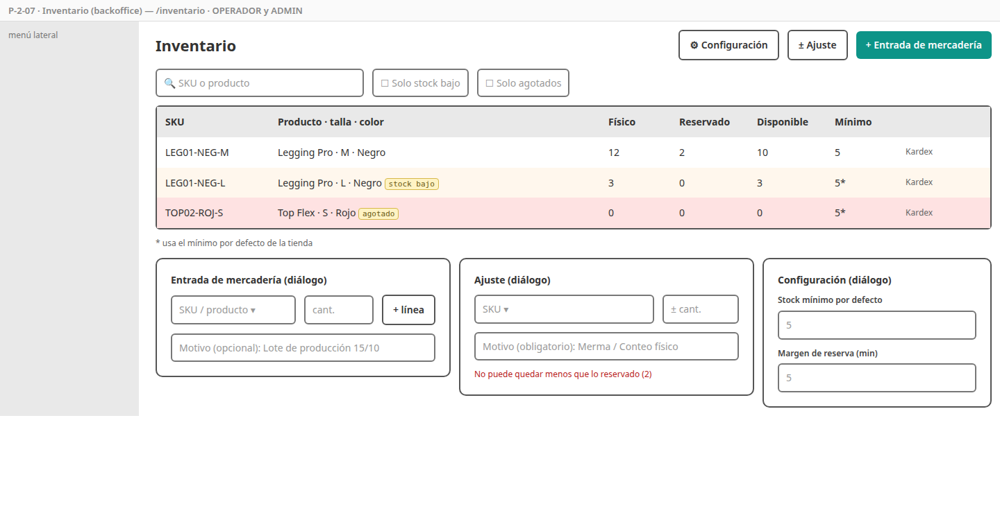
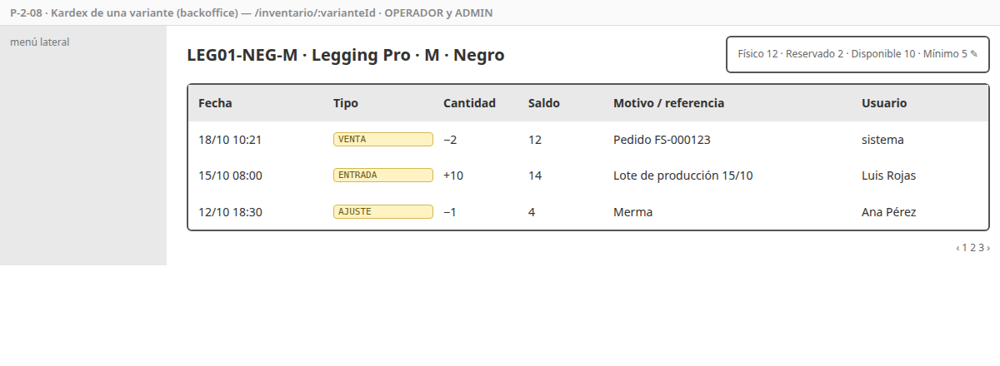

# SPEC-2 — Catálogo e inventario

> Versión: **v1 (borrador)** — 2026-10-18 · Estados: ✅ decidido · 🟡 propuesto · ❓ abierto
> **Dueña de:** `backend/catalog-service` (módulos catálogo e inventario) · tienda: `features/catalogo` · backoffice: `features/catalogo`, `features/inventario`.
> **Depende de:** 0a, 0b, 1 (sesión de staff) · **Habilita:** 3 (destacados de la landing), 4 (cotización y reserva), 8.
> **Contratos:** `contracts/openapi/catalog-service.yaml` (incluye `/internal/v1/inventario/reservas`); usa el contrato de order (`POST /carrito/items`); eventos `StockBajo`, `StockNoConfirmado` (publica) y `PedidoPagado`, `PedidoCancelado`, `PedidoExpirado` (consume).

**Historial:**
- v1 (2026-10-18): borrador inicial.

**Estado de revisión por sección:** 1 ⏳ · 2 ⏳ · 3 ⏳ · 4 ⏳ · 5 ⏳ · 6 ⏳ · 7 ⏳ · 8 ⏳ · 9 ⏳

---

## 1. Objetivo y alcance

Al cerrar esta spec, el admin **arma el catálogo completo** (categorías con guía de tallas, productos con variantes e imágenes, descuentos por volumen) y **controla el stock**; el cliente **explora, filtra y ve el detalle** de los productos con su disponibilidad y descuentos, y puede **agregarlos al carrito**. Para el resto del sistema quedan listas la **cotización** y la **reserva atómica de stock**. Es el **CRUD principal de la AP1**.

**Incluye:**
- Toda la lógica de [`catalog-service`](../analisis/micro/catalog-service.md) (secciones 4 y 5): catálogo, búsqueda y filtros, imágenes con redimensionado, maestros, guía de tallas, descuentos, cotización, inventario, kardex, reservas (crear, confirmar, liberar, reingresar, liberar vencidas), alerta de stock bajo, `StockNoConfirmado`, cachés.
- Pantallas P-2-01 a P-2-08.
- Botón "Agregar al carrito" del detalle (llama al contrato de order).
- Datos de demostración del catálogo para `dev`.
- Prueba de carga k6 del catálogo (RNF-01).
- Colección Postman `catalog`.

**No incluye (y dónde va):**
- Landing y su sección de destacados → spec 3 (usa `GET /productos/destacados`).
- Carrito, checkout y la llamada a la reserva → spec 4 (aquí se implementa el endpoint de reserva; order lo llama).
- Correos de las alertas de stock → spec 7 (aquí solo se publican los eventos).
- Menú de categorías de la cabecera → ya está en 0b (consume `GET /categorias`).

## 2. Referencias

- Micro [`catalog-service.md`](../analisis/micro/catalog-service.md): todo (D1–D8, invariantes, datos, endpoints 4.1, flujos 4.2–4.9, estados, eventos, dependencias, seguridad, pruebas, diseño técnico con `CalculadoraDescuentos`, `ReservaService` y `DisponibilidadPort`).
- Macro: CU-02, 03, 21, 22, 23, 35, 40, 43 · RF-CAT-01 a 08 · RF-INV-01 a 05 · RNF-01, 12, 18 · ADR-009, 013, 020.
- SPEC-0b: tabla paginada, subida de imágenes, precio, estados, `CarritoContador` (R8).

## 3. Historias de usuario y criterios de aceptación

### HU-2-01 — Explorar el catálogo

Como visitante, quiero navegar por categorías, buscar y filtrar productos, para encontrar rápido lo que busco. · Cubre: CU-02, RF-CAT-05 · Pantallas: [P-2-01](#p-2-01--listado-de-productos)

```gherkin
CA-2-01  Cuando entro a una categoría padre (p. ej. "Partes de abajo")
         Entonces veo los productos ACTIVO de esa categoría y de sus hijas, cada uno UNA sola vez,
              aunque esté asignado al padre y a una hija

CA-2-02  Cuando busco "polo algodon"
         Entonces encuentro "Polo Algodón" (sin importar tildes ni mayúsculas)

CA-2-03  Cuando filtro por talla M, color Negro, precio entre 40 y 60 y "solo disponibles"
         Entonces solo aparecen productos con alguna variante activa que cumpla talla y color, cuyo "desde" esté en el rango
              y con stock disponible > 0
         Y los filtros quedan en la URL (al recargar o compartir el enlace se mantienen)

CA-2-04  Cuando ordeno por precio (ascendente o descendente), novedad o nombre
         Entonces el orden se aplica sobre el resultado filtrado, con 24 productos por página (máximo 48)

CA-2-05  Cada tarjeta muestra foto principal (400 px), nombre, "Desde S/ X", muestras de colores disponibles,
         la etiqueta de descuento por volumen si aplica y "Agotado" si no hay stock en ninguna variante

CA-2-06  Dado filtros sin resultados
         Entonces veo "No encontramos productos con estos filtros" y el botón "Limpiar filtros"

CA-2-07  Dado un producto en BORRADOR o INACTIVO
         Entonces no aparece en listados ni en búsquedas, y su URL responde 404
```

### HU-2-02 — Ver un producto y agregarlo al carrito

Como visitante, quiero ver el detalle, elegir color y talla y saber si hay stock, para agregarlo al carrito con confianza. · Cubre: CU-03, CU-04 (inicio), RF-CAT-03, 04, 06, 08, RF-INV-04 · Pantallas: [P-2-02](#p-2-02--detalle-de-producto)

```gherkin
CA-2-08  Cuando elijo un color
         Entonces la galería muestra primero las fotos asociadas a ese color (y después las generales)

CA-2-09  Cuando elijo color y talla
         Entonces veo la disponibilidad: "Agotado" (0, botón deshabilitado), "¡Últimas N unidades!" (1 a 5) o "Disponible" (más de 5)
         Y las tallas sin stock en ese color se ven tachadas y no se pueden elegir
         Y el precio mostrado es el de esa variante (o el base)

CA-2-10  Cuando abro "Guía de tallas"
         Entonces veo la tabla de la categoría del producto o, si no tiene, la de su categoría padre
         Y si ninguna tiene guía, el enlace no aparece

CA-2-11  Dado un producto con descuento por volumen
         Entonces veo sus tramos ("3 un. −5 % · 6 un. −10 % · 12 un. −15 %"), con la aclaración de que se combinan tallas y colores

CA-2-12  Cuando agrego al carrito una cantidad válida
         Entonces se llama a POST /carrito/items (contrato de order), veo la confirmación y el contador de la cabecera se actualiza
         Y la cantidad no puede superar el disponible de la variante
```

### HU-2-03 — Cotizar para el carrito y el checkout

Como order-service, quiero cotizar un conjunto de líneas, para mostrar precios, descuentos y disponibilidad siempre actualizados. · Cubre: RF-CAT-08, RF-CRT-02 · Pantallas: no aplica (la usan las pantallas de la spec 4)

```gherkin
CA-2-13  Dado el carrito del ejemplo de catalog 4.5 (6 leggings surtidos y 1 top)
         Cuando se cotiza
         Entonces el legging lleva 10 % (−36.94) y el top no lleva descuento, con redondeo half-up por línea

CA-2-14  Dado un producto que alcanzó un tramo
         Entonces la cotización indica cuánto falta para el siguiente ("Agrega 2 más y ahorra 15 %")

CA-2-15  Dado una variante inactiva o un producto que ya no está ACTIVO
         Entonces su línea vuelve como NO_DISPONIBLE (sin error para las demás líneas)

CA-2-16  Dado más de 50 líneas
         Entonces la cotización responde 400
```

### HU-2-04 — Administrar categorías y guía de tallas

Como administrador, quiero organizar las categorías por tipo de prenda y su guía de tallas, para que la tienda se navegue bien. · Cubre: CU-21, RF-CAT-01, 06 · Pantallas: [P-2-05](#p-2-05--categorías-y-guía-de-tallas)

```gherkin
CA-2-17  Cuando creo una categoría raíz o una hija
         Entonces se guarda con slug único; una hija no puede tener hijas (máximo 2 niveles)
         Y no pueden existir dos hermanas con el mismo nombre

CA-2-18  Cuando reordeno categorías arrastrándolas
         Entonces el orden se guarda y el menú de la tienda lo refleja (caché invalidada)

CA-2-19  Cuando elimino una categoría con hijas o con productos
         Entonces recibo 409 y se sugiere desactivarla; sin hijas ni productos, se elimina (DELETE físico)

CA-2-20  Cuando edito la guía de tallas de una categoría (agrego o quito filas y columnas)
         Entonces se guarda y la ven sus productos y los de sus hijas sin guía propia
```

### HU-2-05 — Administrar productos y variantes

Como administrador, quiero crear productos con todas sus combinaciones de talla y color, para cargar el catálogo de Gamarra sin tedio. · Cubre: CU-22, RF-CAT-02, 03, 07 · Pantallas: [P-2-03](#p-2-03--productos-backoffice), [P-2-04](#p-2-04--formulario-de-producto)

```gherkin
CA-2-21  Cuando creo un producto
         Entonces queda en BORRADOR con slug generado (editable) y código único

CA-2-22  Cuando genero la matriz con 5 tallas y 3 colores
         Entonces se crean las 15 variantes con SKU {código}-{COL}-{TALLA}, omitiendo las que ya existían,
              y cada una nace con stock físico 0

CA-2-23  Cuando pongo un precio propio a una variante o cambio el precio base
         Entonces "desde" se recalcula con el menor precio de las variantes activas

CA-2-24  Cuando intento publicar sin imagen, sin categoría, sin variante activa o con precio 0
         Entonces recibo 409 con la lista de lo que falta, que se muestra en el aviso del formulario

CA-2-25  Cuando publico un producto completo
         Entonces pasa a ACTIVO y aparece en la tienda; al desactivarlo deja de aparecer

CA-2-26  Cuando elimino un producto en BORRADOR sin movimientos ni reservas
         Entonces se elimina; si no cumple, recibo 409 y uso "Desactivar". Lo mismo para una variante

CA-2-27  Cuando marco un producto como destacado con un orden
         Entonces aparece en GET /productos/destacados en ese orden (si está ACTIVO)

CA-2-28  Dado una sesión de OPERADOR
         Entonces ve productos y variantes pero no puede crear, editar, publicar ni borrar (403)
```

### HU-2-06 — Subir imágenes de producto

Como administrador, quiero subir fotos tomadas con el celular, para mostrar cada color sin preocuparme por el tamaño. · Cubre: RF-CAT-04, RNF-18 · Pantallas: [P-2-04](#p-2-04--formulario-de-producto)

```gherkin
CA-2-29  Cuando subo un JPG, PNG o WebP de hasta 5 MB
         Entonces se guardan dos versiones (1200 px y 400 px, JPG) en el bucket público y se muestran de inmediato

CA-2-30  Cuando subo un archivo de otro tipo (aunque tenga extensión .jpg) o de más de 5 MB
         Entonces recibo 400 con el motivo

CA-2-31  Dado 10 imágenes
         Entonces no se puede subir otra

CA-2-32  Cuando reordeno, asigno un color o marco la principal
         Entonces se guarda; siempre hay exactamente una principal
         Y si borro la principal, pasa a serlo la siguiente en orden, y se borran sus archivos
```

### HU-2-07 — Administrar tallas y colores

Como administrador, quiero listas únicas de tallas y colores, para que los filtros de la tienda funcionen bien. · Cubre: RF-CAT-03 (D1) · Pantallas: [P-2-06](#p-2-06--tallas-colores-y-política-de-descuentos)

```gherkin
CA-2-33  Cuando creo una talla o un color
         Entonces no se permiten duplicados (sin importar mayúsculas) y el color exige un hex válido (#RRGGBB)

CA-2-34  Cuando elimino una talla o un color usados por alguna variante
         Entonces recibo 409; si no se usan, se eliminan

CA-2-35  Cuando reordeno las tallas
         Entonces la tienda las muestra en ese orden (XS < S < M…)
```

### HU-2-08 — Configurar descuentos por volumen

Como administrador, quiero definir los tramos de descuento global y excepciones por producto, para vender por mayor al estilo de Gamarra. · Cubre: CU-35, RF-CAT-08 · Pantallas: [P-2-06](#p-2-06--tallas-colores-y-política-de-descuentos), [P-2-04](#p-2-04--formulario-de-producto)

```gherkin
CA-2-36  Cuando agrego, edito o quito tramos de la política global (hasta 10)
         Entonces se guardan si las unidades y los porcentajes son crecientes y el porcentaje está entre 0 y 50;
              si no, recibo 400 con el motivo

CA-2-37  Cuando apago el interruptor global
         Entonces ninguna cotización aplica descuentos y la tienda deja de mostrar las etiquetas

CA-2-38  Cuando pongo un producto en modo PERSONALIZADO con sus tramos, o SIN_DESCUENTO
         Entonces sus cotizaciones usan sus tramos o ninguno, sin afectar a los demás productos
```

### HU-2-09 — Controlar el stock

Como operador, quiero registrar entradas y ajustes y ver el historial de cada SKU, para saber siempre por qué hay cada unidad. · Cubre: CU-23, CU-43, RF-INV-01, 02, 05 · Pantallas: [P-2-07](#p-2-07--inventario), [P-2-08](#p-2-08--kardex)

```gherkin
CA-2-39  Cuando registro una entrada de varias líneas
         Entonces sube el stock físico de cada SKU y queda un movimiento ENTRADA por línea con mi usuario y el motivo

CA-2-40  Cuando registro un ajuste negativo sin motivo, o que dejaría el físico por debajo de lo reservado
         Entonces recibo 400 o 409 y no cambia nada

CA-2-41  Cuando abro el kardex de un SKU
         Entonces veo sus movimientos paginados (fecha, tipo, cantidad, saldo, motivo o pedido, usuario o "sistema")

CA-2-42  Dado un SKU con mínimo 5 (propio o el de la tienda)
         Cuando su disponible baja de 6 a 4
         Entonces se publica StockBajo una vez; si sigue bajando, no se repite hasta que vuelva a superar el mínimo

CA-2-43  Cuando cambio el mínimo de un SKU o el mínimo por defecto y el margen de reserva de la tienda (ADMIN)
         Entonces se guardan y se usan desde ese momento

CA-2-44  Cuando filtro por "solo stock bajo" o "solo agotados"
         Entonces veo solo esos SKU
```

### HU-2-10 — Reservar stock sin sobreventa

Como order-service, quiero reservar el stock de un pedido de forma atómica, para que nunca se venda lo que no hay. · Cubre: CU-40, RF-INV-03, ADR-009 (T1, T5 y compensaciones) · Pantallas: no aplica

```gherkin
CA-2-45  Dado stock suficiente para todas las líneas
         Cuando order reserva un pedido
         Entonces se reservan todas las líneas en una sola transacción y la reserva vence en (vencimiento del pedido + margen)

CA-2-46  Dado que una línea no alcanza
         Cuando order reserva
         Entonces no se reserva ninguna (todo o nada) y responde 409 con la lista de faltantes

CA-2-47  Dado 20 reservas simultáneas de 1 unidad sobre una variante con 5 disponibles
         Entonces exactamente 5 tienen éxito y el reservado queda en 5 (nunca negativo ni de más)

CA-2-48  Dado que order repite la misma reserva (mismo pedidoId)
         Entonces se devuelve la reserva existente sin reservar dos veces

CA-2-49  Cuando llega PedidoPagado con la reserva activa
         Entonces el físico y el reservado bajan, la reserva queda CONFIRMADA y se registra un movimiento VENTA

CA-2-50  Cuando llega PedidoCancelado o PedidoExpirado con la reserva activa
         Entonces se libera lo reservado; si el pedido ya estaba pagado (reserva CONFIRMADA), el stock vuelve al físico con un movimiento REINGRESO

CA-2-51  Dado una reserva vencida cuyo evento nunca llegó (huérfana o evento perdido)
         Cuando corre LiberadorReservasVencidas
         Entonces la libera y queda EXPIRADA

CA-2-52  Dado PedidoPagado con la reserva ya vencida y sin stock suficiente
         Entonces no se descuenta en negativo y se publica StockNoConfirmado con los faltantes

CA-2-53  Dado cualquier evento repetido
         Entonces no tiene efecto la segunda vez

CA-2-54  Cuando el navegador intenta llamar a /internal/v1/inventario/reservas
         Entonces el gateway responde 404
```

### HU-2-11 — Catálogo rápido

Como visitante, quiero que el catálogo cargue rápido incluso con muchos usuarios. · Cubre: RNF-01, ADR-020 · Pantallas: no aplica

```gherkin
CA-2-55  Con 50 usuarios virtuales (k6) sobre listado y detalle
         Entonces el p95 es menor a 500 ms (se mide con y sin caché para la exposición)

CA-2-56  Cuando el admin edita un producto, sus variantes, imágenes o descuentos
         Entonces la tienda ve el cambio en la siguiente carga (caché invalidada)
         Y el stock nunca sale de la caché

CA-2-57  Dado Redis caído
         Entonces el catálogo sigue funcionando leyendo de la base de datos
```

## 4. Pantallas

### P-2-01 — Listado de productos

- **Ruta / proyecto:** `/productos?q=&talla=&color=&min=&max=&disponible=&orden=&pagina=` y `/categoria/:slug` · storefront · público.
- **Boceto (baja fidelidad):** 
- **Diseño de alta fidelidad:** 🕓 **pantalla clave** (escritorio y móvil; en móvil los filtros van en un panel deslizable).
- **Componentes:** `ListadoPage`, `PanelFiltros`, `ChipsFiltrosActivos`, `TarjetaProducto`, `Orden`, paginador de `ui/`.
- **Estados:** cargando (tarjetas esqueleto), vacío, error con reintentar.
- **Endpoints:** `GET /productos`, `GET /categorias`, `GET /tallas`, `GET /colores`.

### P-2-02 — Detalle de producto

- **Ruta / proyecto:** `/producto/:slug` · storefront · público.
- **Boceto:** 
- **Diseño de alta fidelidad:** 🕓 **pantalla clave** (escritorio y móvil).
- **Componentes:** `DetallePage`, `Galeria`, `SelectorColor`, `SelectorTalla`, `IndicadorStock`, `TramosDescuento`, `GuiaTallasModal`, `SelectorCantidad`, `BotonAgregarCarrito`.
- **Estados:** cargando, 404 (producto inexistente o no activo), agotado.
- **Endpoints:** `GET /productos/{slug}`, `GET /categorias/{slug}/guia-tallas`, `POST /carrito/items` (contrato de order).

### P-2-03 — Productos (backoffice)

- **Ruta / proyecto:** `/catalogo/productos` · backoffice · ADMIN (OPERADOR solo lectura).
- **Boceto:** 
- **Diseño de alta fidelidad:** 🕓 deriva del sistema de diseño (patrón "tabla").
- **Endpoints:** `GET /admin/productos`.

### P-2-04 — Formulario de producto

- **Ruta / proyecto:** `/catalogo/productos/nuevo` y `/catalogo/productos/:id` · backoffice · ADMIN.
- **Boceto:** 
- **Diseño de alta fidelidad:** 🕓 **pantalla clave** (patrón "formulario").
- **Componentes:** `ProductoFormPage` con pestañas Datos, Variantes (`GeneradorMatriz`, `TablaVariantes`), Imágenes (subida de `ui/` + orden arrastrable + color + principal), Descuento (`EditorTramos` en modo personalizado); `AvisoPublicacion` con la lista de faltantes.
- **Endpoints:** `/admin/productos/**`, `/admin/variantes/**`, `/admin/imagenes/**`, `PUT /admin/productos/{id}/descuento`, `PUT /admin/productos/{id}/categorias`, `PATCH …/publicar|desactivar|destacado`.

### P-2-05 — Categorías y guía de tallas

- **Ruta / proyecto:** `/catalogo/categorias` · backoffice · ADMIN.
- **Boceto:** 
- **Diseño de alta fidelidad:** 🕓 deriva del sistema de diseño.
- **Componentes:** `ArbolCategorias` (arrastrable, 2 niveles), `DialogoCategoria`, `EditorGuiaTallas` (tabla editable).
- **Endpoints:** `/admin/categorias/**`, `PUT /admin/categorias/{id}/guia-tallas`.

### P-2-06 — Tallas, colores y política de descuentos

- **Ruta / proyecto:** `/catalogo/maestros` y `/catalogo/descuentos` · backoffice · ADMIN.
- **Boceto:** 
- **Diseño de alta fidelidad:** 🕓 deriva del sistema de diseño.
- **Componentes:** `ListaTallas` (arrastrable), `ListaColores` (con selector de color), `EditorTramos` (reutilizado en P-2-04), vista previa del texto de la tienda.
- **Endpoints:** `/admin/tallas/**`, `/admin/colores/**`, `GET/PUT /admin/descuentos`.

### P-2-07 — Inventario

- **Ruta / proyecto:** `/inventario` · backoffice · OPERADOR y ADMIN (configuración: solo ADMIN).
- **Boceto:** 
- **Diseño de alta fidelidad:** 🕓 deriva del sistema de diseño (patrón "tabla").
- **Componentes:** `InventarioPage` (tabla con filas resaltadas por stock bajo y agotado), `DialogoEntrada` (varias líneas), `DialogoAjuste`, `DialogoConfiguracionInventario`.
- **Endpoints:** `GET /admin/inventario`, `POST /admin/inventario/entradas|ajustes`, `PATCH /admin/inventario/{varianteId}/minimo`, `GET/PUT /admin/inventario/configuracion`.

### P-2-08 — Kardex

- **Ruta / proyecto:** `/inventario/:varianteId` · backoffice · OPERADOR y ADMIN.
- **Boceto:** 
- **Diseño de alta fidelidad:** 🕓 deriva del sistema de diseño.
- **Endpoints:** `GET /admin/inventario/{varianteId}/movimientos`.

## 5. Backend

Todo según el micro de catalog. Decisiones de implementación de esta spec:

| # | Decisión | Detalle |
|---|---|---|
| C1 | **"Agregar al carrito" contra el contrato de order** | El detalle llama a `POST /carrito/items` con el cliente generado; mientras la spec 4 no esté integrada, se prueba con el mock del contrato. Al responder, actualiza `CarritoContador` (0b R8) |
| C2 | **Formato del SKU** 🟡 | `{CODIGO}-{COL}-{TALLA}`: `COL` = 3 primeras letras del color en mayúsculas y sin tildes (`NEG`, `AZU`, `ROJ`); si choca con otro color, se agrega un dígito (`AZU2`). Editable |
| C3 | **Filtros en la URL** | El listado lee y escribe sus filtros como *query params* (enlace compartible; el botón atrás funciona) |
| C4 | **Página por defecto** | 24 productos (máximo 48, catalog 4.3); en el backoffice, 20 filas |
| C5 | **Arrastrar para ordenar** | Angular CDK *drag and drop* en categorías, tallas e imágenes |

## 6. Datos

- **Sin migraciones nuevas** (esquema y semillas en `V1`/`V2` de la 0a: tallas, colores, política de descuentos, configuración de inventario).
- **Datos de demostración (solo `dev`)**, `R__catalogo_demo.sql` en `db/dev/`:
  - árbol: Partes de arriba (Tops, Polos), Partes de abajo (Leggings, Shorts, Joggers), Conjuntos, Nueva colección; guía de tallas en "Partes de abajo" y "Partes de arriba";
  - unos 15 productos ACTIVO con 6–15 variantes cada uno, stock variado (incluye casos agotado y "últimas unidades") y 2 en BORRADOR;
  - imágenes de demostración subidas a Garage por un script de semilla (`infra/scripts/semilla-imagenes`) ❓ (ver pregunta 1).

## 7. Pruebas

| CA | Tipo | Dónde |
|---|---|---|
| 01–07 | Datos + API | `ProductoRepositoryTest` (filtros, `EXISTS`, `unaccent`), `CatalogoPublicoControllerTest` |
| 08–12 | Componente | `detalle.page.spec.ts`, `selector-talla.spec.ts` (tachado por stock) |
| 13–16 | Unitaria + API | `CalculadoraDescuentosTest` (casos de catalog 9), `CotizacionControllerTest` |
| 17–20 | Datos + API | `CategoriaRepositoryTest`, `CategoriaServiceTest` (2 niveles, borrado) |
| 21–28 | API | `ProductoServiceTest` (matriz, `precioDesde`, invariante 4), permisos OPERADOR |
| 29–32 | Integración | `ImagenServiceTest` con Garage en Testcontainers (tipo real, tamaños, principal) |
| 33–35 | API | `MaestrosControllerTest` |
| 36–38 | Unitaria + API | `DescuentoServiceTest` (validaciones, interruptor, modos) |
| 39–44 | Datos + API | `InventarioServiceTest`, `MovimientoStockRepositoryTest`, cruce de umbral |
| 45–53 | Datos + integración | `StockRepositoryTest` (incluye la prueba de concurrencia de 20 hilos), `ReservaServiceTest`, consumidores con RabbitMQ en Testcontainers |
| 54 | Integración | gateway (`/internal` → 404) |
| 55 | Carga | `k6/catalogo.js` |
| 56–57 | Integración | invalidación de caché y Redis caído |
| Todas | Postman | `postman/catalog.postman_collection.json` (flujo admin y flujo tienda) |

## 8. Archivos y carpetas que toca

| Ruta | Acción |
|---|---|
| `backend/catalog-service/**` | modifica (es su dueña) |
| `infra/config-repo/catalog-service*.yml` | modifica |
| `infra/scripts/semilla-imagenes/` | crea |
| `frontend/projects/storefront/src/app/features/catalogo/` | modifica |
| `frontend/projects/backoffice/src/app/features/{catalogo,inventario}/` | modifica |
| `k6/catalogo.js`, `postman/catalog.postman_collection.json` | crea |
| `docs/specs/img/P-2-*` | crea |
| Congelados (`fitstore-common`, gateway, `shared`, `ui/`, `layout/`) | solo lectura |

## 9. Definición de terminado

- [ ] CA-2-01 a CA-2-57 cumplidos en CI (k6 en Lyanna).
- [ ] Postman `catalog` en verde.
- [ ] El OpenAPI de catalog coincide con lo implementado.
- [ ] Demostración: cargar un producto completo desde el backoffice (matriz, fotos, publicar) y verlo en la tienda con filtros, detalle y descuento.
- [ ] Revisado y aprobado por el autor.

## Preguntas abiertas ❓

1. **Fotos de demostración:** ¿usamos fotos reales de la MYPE (si tienes acceso), fotos libres de uso (por ejemplo, Unsplash o Pexels, que permiten uso gratuito) o imágenes generadas simples? Para el video y la sustentación conviene que se vean reales.
2. **C2, formato del SKU** (`LEG01-NEG-M`): ¿te parece bien?
