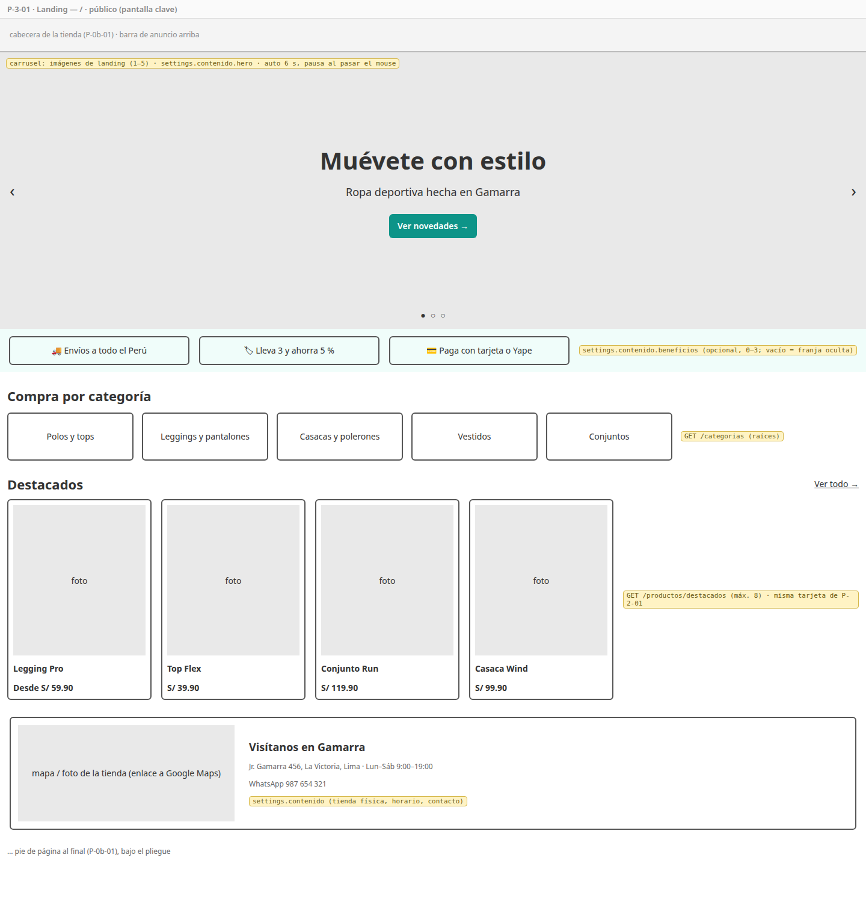
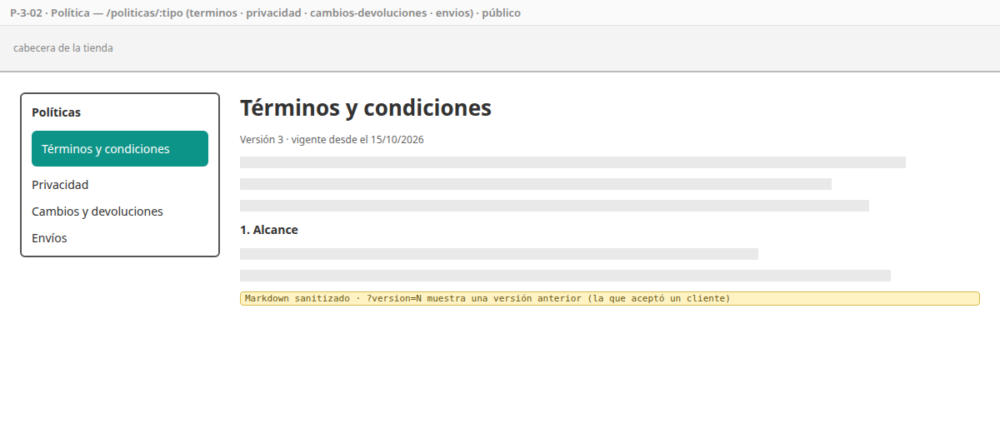
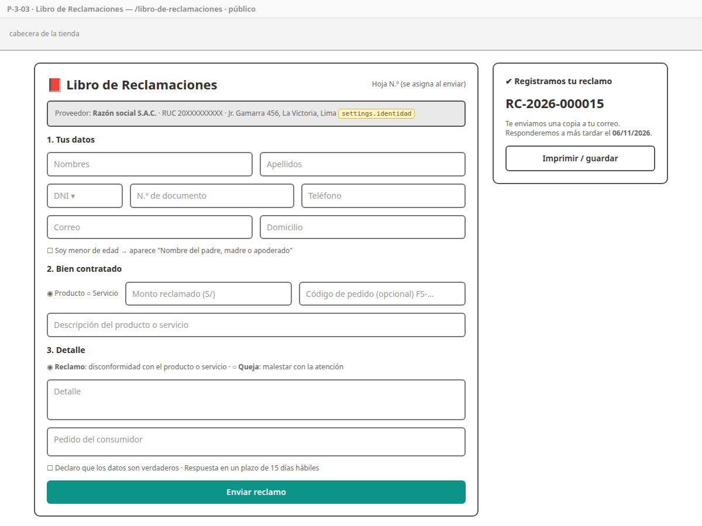
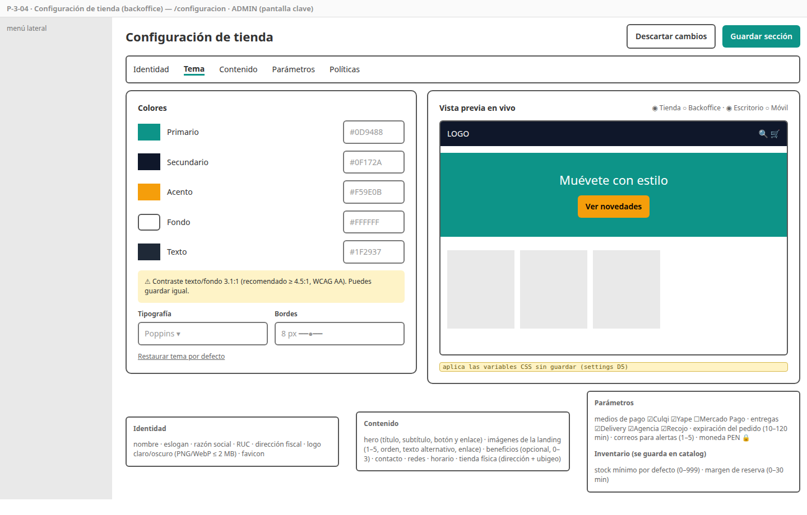
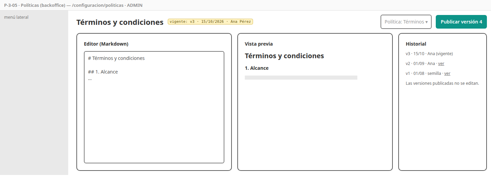
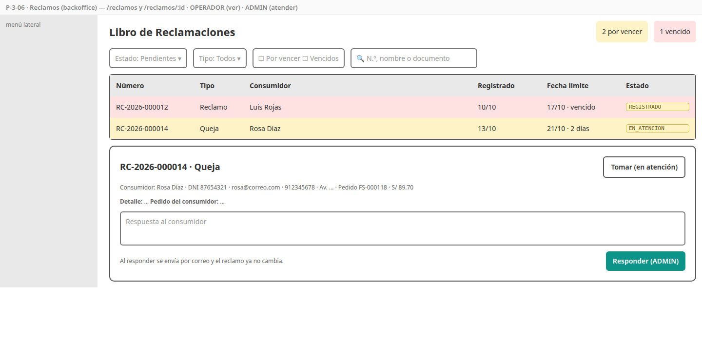

# SPEC-3 — Tienda y reclamos

> Versión: **v3 (aprobado)** — 2026-10-18 · Estados: ✅ decidido · 🟡 propuesto · ❓ abierto
> **Dueña de:** `backend/settings-service` (configuración, ubigeo, Libro de Reclamaciones) · tienda: `features/inicio`, `features/legal` · backoffice: `features/configuracion`, `features/reclamos`.
> **Depende de:** 0a, 0b, 1 (sesión de staff) · usa el contrato de catalog (destacados y categorías) · **Habilita:** la marca real en todas las pantallas (0b ya la consume), versiones de políticas para el registro (spec 1), parámetros para order y payment (specs 4 y 5).
> **Contratos:** `contracts/openapi/settings-service.yaml`; eventos `ConfiguracionActualizada`, `ReclamoRegistrado`, `ReclamoRespondido`.

**Historial:**
- v3 (2026-10-18): revisada por el autor → **spec aprobada**.
- v2 (2026-10-18): S1 ✅ franja de beneficios **opcional** (sin beneficios, la franja no se muestra); S2 ✅ el stock mínimo por defecto y el margen de reserva se editan en la pestaña Parámetros (API de catalog), y se quita el diálogo de P-2-07 (SPEC-2 v4). Nuevo CA-3-38.
- v1 (2026-10-18): borrador inicial.

**Estado de revisión por sección:** 1 ✅ · 2 ✅ · 3 ✅ · 4 ✅ · 5 ✅ · 6 ✅ · 7 ✅ · 8 ✅ · 9 ✅

---

## 1. Objetivo y alcance

Al cerrar esta spec, el admin **personaliza la tienda desde el backoffice** (identidad, tema con vista previa, contenido de la landing, parámetros de negocio y políticas versionadas) y el visitante ve una **landing con esa marca**. Además funciona el **Libro de Reclamaciones** exigido por ley: el consumidor registra su reclamo y la tienda lo atiende dentro del plazo. Es la demostración del **white-label** (RNF-17).

**Incluye:**
- Toda la lógica de [`settings-service`](../analisis/micro/settings-service.md): configuración por secciones con versión, contraste WCAG, imágenes de tienda, políticas versionadas, ubigeo (consultas y buscador), Libro de Reclamaciones (correlativo, plazo, atención, respuesta), cachés y eventos.
- Pantallas P-3-01 a P-3-06.
- Textos modelo de las cuatro políticas (versión 1).
- Datos de demostración para `dev`.
- Colección Postman `settings`.

**No incluye (y dónde va):**
- Correos del reclamo (copia, respuesta y aviso a la tienda) → spec 7 (aquí se publican los eventos).
- Contador de reclamos por vencer en el dashboard → spec 8.
- Feriados en el plazo de 15 días hábiles → alcance futuro (settings A2).

## 2. Referencias

- Micro [`settings-service.md`](../analisis/micro/settings-service.md): todo (D1–D8, invariantes, datos, endpoints 4.1, flujos 4.2–4.5, estados, eventos, seguridad, pruebas, diseño técnico con `ContrasteWcag` y el correlativo atómico).
- Macro: CU-01, 14, 31, 32, 34 · RF-SET-01 a 08 · RF-LEG-01, 02 · RNF-17, 19 · ADR-003, 004.
- SPEC-0b: tema por variables CSS (R4), selector de ubigeo, subida de imágenes, estados. SPEC-2: tarjeta de producto y `GET /productos/destacados`.

## 3. Historias de usuario y criterios de aceptación

### HU-3-01 — Ver la landing de la tienda

Como visitante, quiero una página de inicio atractiva con la marca de la tienda, sus novedades y cómo comprar, para animarme a explorar. · Cubre: CU-01, RF-SET-01, 03, RF-CAT-07 · Pantallas: [P-3-01](#p-3-01--landing)

```gherkin
CA-3-01  Cuando abro la tienda en "/"
         Entonces veo el carrusel con las imágenes de la landing (1 a 5, en su orden, con su texto alternativo y enlace),
              el título, el subtítulo y el botón del hero, la franja de beneficios (si hay), las categorías raíz, los destacados y la tienda física

CA-3-02  El carrusel avanza solo cada 6 s, se pausa al pasar el mouse o al enfocarlo, y se maneja con flechas y puntos (accesible por teclado)

CA-3-03  Dado que no hay imágenes de landing
         Entonces el hero se muestra con el color primario de fondo y los textos, sin carrusel

CA-3-04  Los destacados son los de GET /productos/destacados (máximo 8, en su orden) con la misma tarjeta del listado
         Y si no hay destacados, la sección no se muestra

CA-3-05  Dado que el admin cambió textos, imágenes o colores
         Cuando recargo la landing
         Entonces veo los cambios sin recompilar (RNF-17)
```

### HU-3-02 — Configurar la identidad de la tienda

Como administrador, quiero registrar el nombre, los datos legales y los logos de la tienda, para que aparezcan en la tienda, en la boleta y en el Libro de Reclamaciones. · Cubre: CU-31, RF-SET-01 · Pantallas: [P-3-04](#p-3-04--configuración-de-tienda)

```gherkin
CA-3-06  Cuando guardo nombre, eslogan, razón social, RUC (11 dígitos) y dirección fiscal
         Entonces se guardan; un RUC inválido responde 400 en ese campo

CA-3-07  Cuando subo el logo claro, el logo oscuro o el favicon
         Entonces se aceptan PNG o WebP (favicon también ICO) de hasta 2 MB y reemplazan al anterior
         Y un SVG o un archivo de otro tipo se rechaza

CA-3-08  Dado que otro admin guardó la misma sección después de que yo la abrí
         Cuando guardo
         Entonces recibo 409 "Otro administrador modificó la configuración; recarga la página" y no se pisa su cambio
```

### HU-3-03 — Cambiar el tema con vista previa

Como administrador, quiero ajustar colores, tipografía y bordes viendo el resultado al instante, para elegir una marca coherente sin arriesgar la tienda. · Cubre: CU-31, RF-SET-02, 07, RNF-19 · Pantallas: [P-3-04](#p-3-04--configuración-de-tienda)

```gherkin
CA-3-09  Cuando cambio un color, la tipografía o el radio de los bordes
         Entonces la vista previa (tienda o backoffice, escritorio o móvil) se actualiza al instante, sin guardar

CA-3-10  Dado un contraste texto/fondo o texto/primario menor a 4.5:1
         Entonces veo la advertencia con la razón calculada, y puedo guardar igual (no bloquea)

CA-3-11  Cuando guardo el tema
         Entonces se publica ConfiguracionActualizada y la tienda y el backoffice lo muestran al recargar

CA-3-12  Cuando uso "Restaurar tema por defecto"
         Entonces el formulario vuelve a los valores de FitStore (sin guardar hasta que lo confirme)
```

### HU-3-04 — Editar el contenido de la tienda

Como administrador, quiero editar los textos e imágenes de la landing y los datos de contacto, para mantener la tienda al día. · Cubre: CU-31, RF-SET-01, 03 · Pantallas: [P-3-04](#p-3-04--configuración-de-tienda)

```gherkin
CA-3-13  Cuando edito el hero (título, subtítulo, texto y enlace del botón)
         Entonces se guarda; el enlace debe ser una ruta de la tienda ("/productos?…") o una URL https

CA-3-14  Cuando subo hasta 5 imágenes de landing (JPG o WebP, hasta 5 MB) con texto alternativo y enlace opcional
         Entonces se redimensionan a 1600 px y puedo reordenarlas o eliminarlas; la sexta se rechaza

CA-3-15  Cuando edito los beneficios (opcionales, de 0 a 3: icono y texto corto de hasta 60 caracteres)
         Entonces aparecen en la franja de la landing en su orden
         Y si no hay ninguno, la franja no se muestra (sin espacio vacío)

CA-3-16  Cuando edito contacto (correo, teléfono, WhatsApp), redes (URLs de Instagram, Facebook, TikTok), horario
              y la tienda física (dirección con departamento, provincia y distrito)
         Entonces se validan los formatos y se muestran en la landing y en el pie
```

### HU-3-05 — Configurar los parámetros del negocio

Como administrador, quiero elegir los medios de pago y de entrega y otros parámetros, para que la tienda funcione como mi negocio. · Cubre: CU-32, RF-SET-05 · Pantallas: [P-3-04](#p-3-04--configuración-de-tienda)

Los parámetros de inventario los guarda catalog, que es quien los usa (micro de catalog, sección 3); esta pantalla solo los edita, para que toda la configuración esté en un lugar.

```gherkin
CA-3-17  Cuando guardo los parámetros
         Entonces debe haber al menos un medio de pago (Culqi, Yape, Mercado Pago) y una modalidad de entrega
              (delivery local, agencia, recojo); la expiración del pedido debe estar entre 10 y 120 minutos;
              los correos para alertas, entre 1 y 5 y válidos
         Y la moneda se muestra como PEN, sin poder cambiarla

CA-3-18  Dado que el admin deshabilita un medio de pago o una modalidad
         Entonces se refleja en /settings/public y lo toman order y payment (en a lo más 5 minutos, por su caché)

CA-3-19  Los correos para alertas viajan en ConfiguracionActualizada pero nunca aparecen en /settings/public

CA-3-38  Cuando edito en Parámetros el stock mínimo por defecto (0 a 999) y el margen de reserva (0 a 30 minutos)
         Entonces se guardan en catalog (PUT /admin/inventario/configuracion) y se usan desde ese momento
         Y si catalog no responde, esa parte muestra el error y los parámetros de settings sí se guardan
```

### HU-3-06 — Publicar políticas con versiones

Como administrador, quiero publicar los términos, la privacidad, los cambios y devoluciones y los envíos, conservando cada versión, para cumplir la Ley 29733 y saber qué aceptó cada cliente. · Cubre: RF-SET-04, RF-LEG-02 · Pantallas: [P-3-05](#p-3-05--políticas-backoffice), [P-3-02](#p-3-02--política)

```gherkin
CA-3-20  Cuando publico una política editada en Markdown (con vista previa)
         Entonces se crea la versión siguiente con fecha y autor, pasa a ser la vigente, y las anteriores no se pueden editar

CA-3-21  Cuando un visitante abre /politicas/terminos
         Entonces ve la versión vigente con su número y fecha (Markdown sanitizado, sin HTML ni scripts)
         Y con ?version=N ve una versión anterior

CA-3-22  /settings/public expone el número de la versión vigente de cada política (lo usa el registro de la spec 1)
```

### HU-3-07 — Registrar un reclamo o una queja

Como consumidor (con o sin cuenta), quiero dejar mi reclamo o queja en el Libro de Reclamaciones virtual, para que la tienda lo atienda dentro del plazo legal. · Cubre: CU-14, RF-LEG-01 · Pantallas: [P-3-03](#p-3-03--libro-de-reclamaciones)

```gherkin
CA-3-23  Cuando abro el Libro de Reclamaciones (enlace en el pie de todas las páginas)
         Entonces veo los datos del proveedor (razón social, RUC, dirección fiscal) y el formulario de la Hoja de Reclamación

CA-3-24  Dado que marco "soy menor de edad"
         Entonces se exige el nombre del padre, madre o apoderado

CA-3-25  Cuando envío un reclamo válido
         Entonces recibe el siguiente número del año (RC-2026-000015) y una fecha límite de 15 días hábiles (sin sábados ni domingos)
         Y veo el número y la fecha límite en pantalla
         Y se publica ReclamoRegistrado

CA-3-26  Dado 20 reclamos enviados al mismo tiempo
         Entonces reciben números consecutivos, sin huecos ni repetidos

CA-3-27  Dado más de 3 envíos por minuto desde la misma IP
         Entonces el gateway responde 429
```

### HU-3-08 — Atender los reclamos

Como administrador, quiero ver los reclamos con su plazo y responderlos, para no incumplir la norma; como operador, consultarlos. · Cubre: CU-34, RF-LEG-01 · Pantallas: [P-3-06](#p-3-06--reclamos-backoffice)

```gherkin
CA-3-28  Cuando abro la bandeja
         Entonces veo los reclamos con filtros por estado y tipo, y los indicadores "por vencer" (3 días hábiles o menos) y "vencidos"

CA-3-29  Cuando tomo un reclamo
         Entonces pasa a EN_ATENCION (paso opcional)

CA-3-30  Cuando respondo un reclamo (ADMIN)
         Entonces pasa a RESPONDIDO con la respuesta, la fecha y mi usuario, se publica ReclamoRespondido
         Y ya no se puede modificar ni eliminar

CA-3-31  Dado una sesión de OPERADOR
         Entonces ve la bandeja y el detalle, pero no puede tomar ni responder (403)
```

### HU-3-09 — Consultar el ubigeo

Como cualquier pantalla con direcciones, quiero los departamentos, provincias y distritos del INEI, para que el usuario elija su ubicación sin escribir códigos. · Cubre: RF-SET-08 · Pantallas: selector de ubigeo de [P-0b-04](SPEC-0b-fundaciones-frontend.md#p-0b-04--catálogo-de-componentes)

```gherkin
CA-3-32  Cuando pido las provincias de un departamento o los distritos de una provincia
         Entonces recibo la lista ordenada por nombre, con cabecera de caché de 24 h

CA-3-33  Cuando busco "miraf"
         Entonces recibo Miraflores (Lima, Lima) y Miraflores (Arequipa, Arequipa), sin importar tildes

CA-3-34  Cuando pido /ubigeo/150122
         Entonces recibo "Miraflores, Lima, Lima"; un código inexistente responde 404
```

### HU-3-10 — Configuración pública rápida y segura

Como sistema, quiero servir la configuración pública rápido y sin datos internos. · Cubre: RF-SET-06, ADR-004, 020 · Pantallas: no aplica

```gherkin
CA-3-35  /settings/public responde desde la caché de Redis y se invalida al guardar cualquier sección o imagen

CA-3-36  /settings/public nunca incluye correos para alertas, autores de cambios, IPs ni secretos

CA-3-37  Dado Redis caído
         Entonces la configuración se lee de la base de datos
```

## 4. Pantallas

### P-3-01 — Landing

- **Ruta / proyecto:** `/` · storefront · público.
- **Boceto (baja fidelidad):** 
- **Diseño de alta fidelidad:** 🕓 **pantalla clave** (escritorio y móvil, en dos marcas).
- **Componentes:** `InicioPage`, `CarruselHero`, `FranjaBeneficios`, `CategoriasRaiz`, `Destacados` (usa la tarjeta de producto de la spec 2 por contrato visual: misma estructura, componente propio en `inicio/`), `TiendaFisica`.
- **Estados:** sin imágenes (hero de color), sin beneficios (franja oculta), sin destacados (sección oculta), catálogo caído (destacados ocultos; el resto se ve).
- **Endpoints:** `GET /settings/public`, `GET /categorias`, `GET /productos/destacados`.

### P-3-02 — Política

- **Ruta / proyecto:** `/politicas/:tipo` (`terminos`, `privacidad`, `cambios-devoluciones`, `envios`) · storefront · público.
- **Boceto:** 
- **Diseño de alta fidelidad:** 🕓 deriva del sistema de diseño.
- **Endpoints:** `GET /settings/politicas/{tipo}[?version=N]`.

### P-3-03 — Libro de Reclamaciones

- **Ruta / proyecto:** `/libro-de-reclamaciones` · storefront · público.
- **Boceto:** 
- **Diseño de alta fidelidad:** 🕓 deriva del sistema de diseño.
- **Componentes:** `LibroReclamacionesPage`, `FormularioHojaReclamacion`, `ConfirmacionReclamo` (imprimible).
- **Validaciones:** documento DNI (8 dígitos) o CE; correo; monto ≥ 0; código de pedido con formato `FS-` opcional; campos obligatorios de la hoja.
- **Endpoints:** `GET /settings/public` (datos del proveedor), `POST /reclamos`.

### P-3-04 — Configuración de tienda

- **Ruta / proyecto:** `/configuracion` · backoffice · ADMIN.
- **Boceto:** 
- **Diseño de alta fidelidad:** 🕓 **pantalla clave**.
- **Componentes:** `ConfiguracionPage` con pestañas Identidad, Tema (`EditorTema` + `VistaPreviaTema`), Contenido (`EditorHero`, `ImagenesLanding` arrastrables, `EditorBeneficios` de 0 a 3, contacto, redes, tienda física con selector de ubigeo), Parámetros (de settings + bloque Inventario de catalog), Políticas (enlace a P-3-05). Cada pestaña guarda su sección.
- **Estados:** cambios sin guardar (aviso al salir), conflicto de versión (409), advertencia de contraste.
- **Endpoints:** `GET /admin/settings`, `PUT /admin/settings/{identidad|tema|contenido|parametros}`, `/admin/settings/imagenes/**` · catalog: `GET/PUT /admin/inventario/configuracion` (contrato de la SPEC-2).

### P-3-05 — Políticas (backoffice)

- **Ruta / proyecto:** `/configuracion/politicas` · backoffice · ADMIN.
- **Boceto:** 
- **Diseño de alta fidelidad:** 🕓 deriva del sistema de diseño.
- **Componentes:** `PoliticasPage`, `EditorMarkdown` con vista previa, `HistorialVersiones`.
- **Endpoints:** `GET /admin/settings/politicas/{tipo}/versiones`, `POST /admin/settings/politicas/{tipo}`.

### P-3-06 — Reclamos (backoffice)

- **Ruta / proyecto:** `/reclamos` y `/reclamos/:id` · backoffice · OPERADOR (ver), ADMIN (atender).
- **Boceto:** 
- **Diseño de alta fidelidad:** 🕓 deriva del sistema de diseño (patrón "tabla").
- **Endpoints:** `GET /admin/reclamos`, `GET /admin/reclamos/{id}`, `PATCH /admin/reclamos/{id}/en-atencion`, `POST /admin/reclamos/{id}/respuesta`.

## 5. Backend

Todo según el micro de settings. Decisiones de implementación de esta spec:

| # | Decisión | Detalle |
|---|---|---|
| S1 | **Beneficios opcionales en el contenido** ✅ | Nuevo campo `beneficios` (`jsonb`, de 0 a 3 `{icono, texto}`) en la sección contenido. Lista vacía = la landing oculta la franja. Micro de settings v7 |
| S2 | **Configuración de inventario en la pestaña Parámetros** ✅ | El stock mínimo por defecto y el margen de reserva se editan aquí, como dice el micro de catalog; el dato y el endpoint siguen en catalog (SPEC-2). Se quita el diálogo de P-2-07. El frontend guarda las dos partes por separado |
| S3 | **Markdown seguro** | En el frontend con `marked` + `DOMPurify`; el backend guarda el texto tal cual y nunca lo renderiza |
| S4 | **Carrusel accesible** | Pausa al pasar el mouse o al enfocar; respeta `prefers-reduced-motion` (sin autoavance) |
| S5 | **Enlaces del hero** | Rutas internas que empiezan con `/` o URLs `https://`; nada de `javascript:` |

## 6. Datos

- **Sin migraciones nuevas** salvo S1: `VAAAAMMDD_HHMM__beneficios.sql` (columna `beneficios jsonb NOT NULL DEFAULT '[]'`; la franja empieza oculta).
- **Políticas versión 1:** textos modelo para una tienda en línea peruana (términos, privacidad con Ley 29733, cambios y devoluciones, envíos), claramente marcados como **plantilla a revisar por la tienda** (no son asesoría legal).
- **Datos de demostración (solo `dev`):** 3 imágenes de landing (licencia libre), beneficios, contacto y tienda física en Gamarra; 3 reclamos (uno vencido, uno por vencer, uno respondido) para mostrar la bandeja.

## 7. Pruebas

| CA | Tipo | Dónde |
|---|---|---|
| 01–05 | Componente | `inicio.page.spec.ts`, `carrusel-hero.spec.ts` (autoavance, pausa, teclado, sin imágenes) |
| 06–08 | API | `ConfiguracionServiceTest` (RUC, versión optimista 409), `ImagenTiendaServiceTest` (tipos, SVG rechazado) |
| 09–12 | Unitaria + componente | `ContrasteWcagTest`, `editor-tema.spec.ts` (vista previa sin guardar) |
| 13–16 | API + componente | validaciones de contenido, landing (máx. 5) |
| 17–19 | API | parámetros (rangos, al menos uno), `correosAlertas` fuera de `/settings/public` |
| 38 | Componente | `parametros.spec.ts` (guarda en catalog con WireMock/HTTP de prueba; catalog caído no bloquea settings) |
| 20–22 | Datos + API | `PoliticaRepositoryTest`, inmutabilidad, `?version` |
| 23–27 | Datos + API + integración | `ReclamoServiceTest`, `CalculadoraDiasHabilesTest`, concurrencia de 20, gateway 429 |
| 28–31 | API | bandeja, transiciones, permisos OPERADOR |
| 32–34 | Datos + API | `UbigeoRepositoryTest`, cabecera `Cache-Control` |
| 35–37 | Integración | caché e invalidación, Redis caído |
| Todas | Postman | `postman/settings.postman_collection.json` |

## 8. Archivos y carpetas que toca

| Ruta | Acción |
|---|---|
| `backend/settings-service/**` | modifica (es su dueña) |
| `infra/config-repo/settings-service*.yml` | modifica |
| `frontend/projects/storefront/src/app/features/{inicio,legal}/` | modifica |
| `frontend/projects/backoffice/src/app/features/{configuracion,reclamos}/` | modifica |
| `postman/settings.postman_collection.json` | crea |
| `docs/specs/img/P-3-*`, `docs/analisis/micro/settings-service.md` (S1) | crea / modifica |
| `backend/catalog-service/**` (`/admin/inventario/configuracion`) | solo lectura: lo implementa la SPEC-2 |
| Congelados (`fitstore-common`, gateway, `shared`, `ui/`, `layout/`) | solo lectura |

## 9. Definición de terminado

- [ ] CA-3-01 a CA-3-38 cumplidos en CI.
- [ ] Postman `settings` en verde.
- [ ] El OpenAPI de settings coincide con lo implementado.
- [ ] Demostración white-label: cambiar logo, colores y textos en el backoffice y ver la tienda con otra marca al recargar.
- [ ] Revisado y aprobado por el autor.
