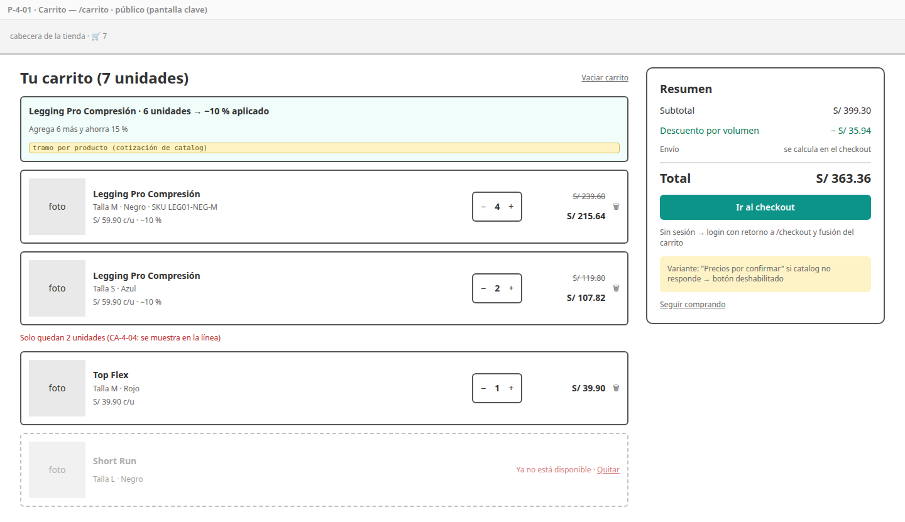
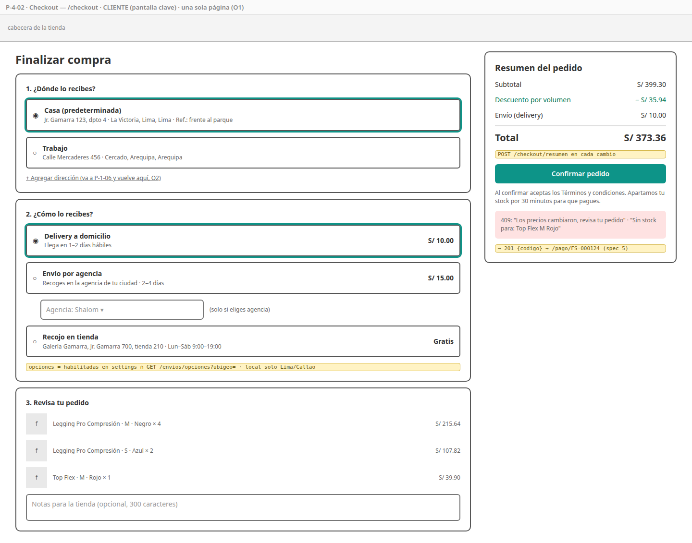
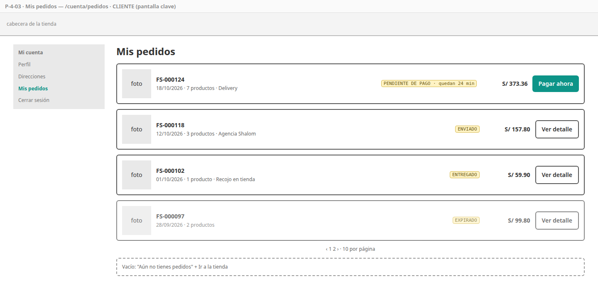
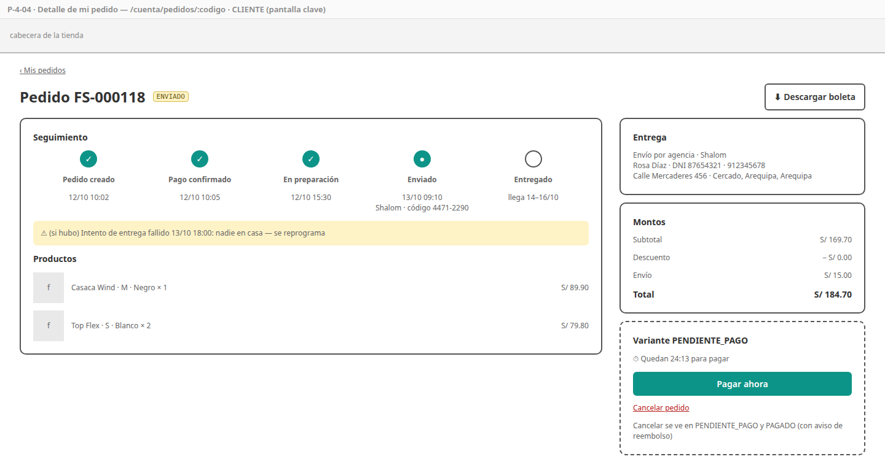
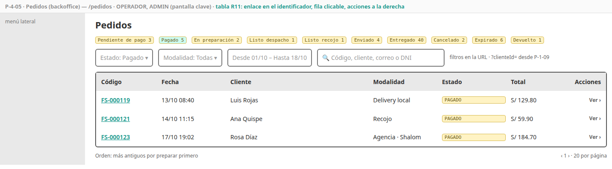
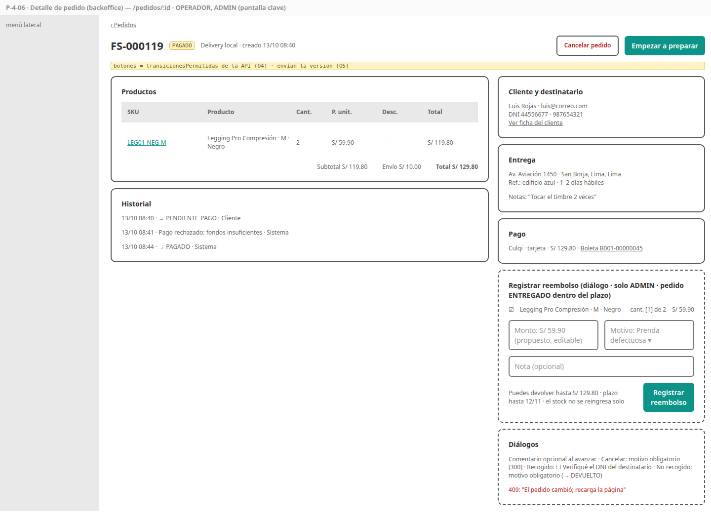

# SPEC-4 — Pedidos

> Versión: **v6 (aprobado)** — 2026-10-19 · Estados: ✅ decidido · 🟡 propuesto · ❓ abierto
> **Dueña de:** `backend/order-service` (carrito, checkout, pedidos, saga) · tienda: `features/carrito`, `features/checkout`, `features/mis-pedidos` · backoffice: `features/pedidos`.
> **Depende de:** 0a, 0b, 1 (sesión y direcciones) · usa los contratos de catalog (cotizar, reservar), auth (cliente y dirección), delivery (opciones y cotización de envío) y settings (parámetros y ubigeo) · **Habilita:** 5 (pago del pedido), 6 (entrega desde `PedidoListoDespacho`), 7 (correos del pedido), 8 (dashboard y E2E).
> **Contratos:** `contracts/openapi/order-service.yaml`; eventos que publica `PedidoCreado`, `PedidoPagado`, `PedidoCancelado`, `PedidoExpirado`, `PagoNoAplicable`, `PedidoListoDespacho`, `PedidoListoRecojo`, `PedidoRecogido`, `ReembolsoSolicitado`; consume `PagoConfirmado`, `PagoRechazado`, `BoletaEmitida`, `PagoReembolsado`, `EntregaActualizada`.

**Historial:**
- v6 (2026-10-19): por la SPEC-6, estado final **DEVUELTO**: desde ENVIADO cuando delivery devuelve la entrega a la tienda (CA-4-45) o desde LISTO_RECOJO cuando nadie recoge el pedido (CA-4-60); el reembolso postventa se permite en DEVUELTO sin plazo (CA-4-54, 57); etapa "Devuelto a la tienda" en el seguimiento (O9). Micro de order v7.
- v5 (2026-10-18): P-4-05 y P-4-06 indican qué abre el enlace de cada fila y sus acciones, según la convención de tablas de la SPEC-0b (R11). Boceto P-4-05 actualizado.
- v4 (2026-10-18): nueva **HU-4-12 Reembolso postventa** (CA-4-54 a 59) decidida en la SPEC-5 (también en el alcance, los eventos del encabezado, Postman y la demostración): total o parcial desde un pedido entregado, solo ADMIN, plazo configurable (0 = sin límite); las ventas restan lo reembolsado (CA-4-52). Micro de order v6.
- v3 (2026-10-18): O3 y O6 aprobados (micro de order v5) → **spec aprobada**.
- v2 (2026-10-18): O1 ✅ checkout en una sola página; O2 ✅ la nueva dirección se agrega en un diálogo sobre el checkout (reutiliza `DialogoDireccion` de la SPEC-1, A6); cada etapa del seguimiento lleva una breve descripción debajo de su nombre (O9).
- v1 (2026-10-18): borrador inicial.

**Estado de revisión por sección:** 1 ✅ · 2 ✅ · 3 ✅ · 4 ✅ · 5 ✅ · 6 ✅ · 7 ✅ · 8 ✅ · 9 ✅

---

## 1. Objetivo y alcance

Al cerrar esta spec, el cliente **arma su carrito** (con o sin sesión), ve sus descuentos por volumen, **elige cómo recibir su compra** y **confirma el pedido** con stock reservado y montos congelados; luego **sigue su pedido** hasta la entrega o lo cancela si aún puede. El operador **gestiona los pedidos** en el backoffice y los avanza hasta el despacho o el recojo; el administrador puede **reembolsar total o parcialmente** un pedido ya entregado o devuelto a la tienda. Es el **corazón de la saga** (ADR-009): el estado del pedido es el estado de la saga.

**Incluye:**
- Toda la lógica de [`order-service`](../analisis/micro/order-service.md): carrito en Redis (anónimo, de cliente, fusión, última cotización), resumen y confirmación del checkout con idempotencia, copia congelada del pedido, máquina de estados con historial, expiración, consumo de los eventos de pago y de entrega, cancelación con compensaciones, reembolso postventa (micro 4.8), consultas del cliente y del backoffice, y el resumen de ventas para el dashboard.
- Pantallas P-4-01 a P-4-06.
- Datos de demostración para `dev`.
- Colección Postman `order` y prueba de carga k6 del checkout.

**No incluye (y dónde va):**
- Página de pago, cobro, reembolso y boleta → spec 5 (aquí se publica `PedidoCreado`, se consumen sus eventos y se muestra el enlace a la boleta).
- Crear y avanzar la entrega (repartidor, agencia, intentos) → spec 6 (aquí se publica `PedidoListoDespacho` y se consume `EntregaActualizada`).
- Correos del pedido → spec 7.
- Pantalla del dashboard → spec 8 (aquí solo su endpoint de ventas).
- Cotización y reserva de stock → spec 2 (aquí se llaman por contrato). Formulario de direcciones → spec 1.

## 2. Referencias

- Micro [`order-service.md`](../analisis/micro/order-service.md): todo (D1–D8, invariantes, datos, endpoints 4.1, flujos 4.2–4.7, estados, eventos, dependencias, seguridad, pruebas, diseño técnico).
- Micro de catalog 4.5 (cotización y "precios por confirmar") y 4.6 (reserva); micro de delivery 4.1 (`/envios/opciones`, `/envios/cotizar`, `/agencias`); micro de infraestructura 4.4 (rate limiting del checkout: 10 por minuto por usuario).
- Macro: CU-04, 09, 11, 12, 13, 24, 29, 44 · RF-CRT-01 a 04 · RF-ORD-01 a 10 · RF-BO-01 · RNF-02, 10 · ADR-009, 010, 012, 020.
- SPEC-0b: `CarritoContador` (R8), interceptor `carritoId` (R7), rutas `carrito`, `checkout`, `mis-pedidos` y `pedidos` (R2), tabla paginada, estados, precio. SPEC-1: sesión, direcciones (P-1-06), clientes (P-1-09 enlaza a `/pedidos?clienteId=…`). SPEC-2: tarjeta y detalle de producto ("Agregar al carrito" usa `POST /carrito/items`).

## 3. Historias de usuario y criterios de aceptación

### HU-4-01 — Gestionar mi carrito

Como visitante o cliente, quiero agregar, cambiar y quitar productos de mi carrito viendo precios y descuentos al día, para decidir cuánto comprar. · Cubre: CU-04, RF-CRT-01, 02 · Pantallas: [P-4-01](#p-4-01--carrito)

```gherkin
CA-4-01  Cuando agrego una variante desde el detalle (POST /carrito/items)
         Entonces se suma a la línea si ya existía, recibo el carrito y el contador de la cabecera muestra el total de unidades

CA-4-02  Cuando abro /carrito
         Entonces veo cada línea con foto, nombre, talla, color, precio unitario, descuento y total,
              el subtotal, el descuento total y el total (sin envío: "el envío se calcula en el checkout")
         Y por producto, el tramo alcanzado y cuánto falta para el siguiente ("Agrega 2 más y ahorra 15 %")

CA-4-03  Cuando cambio la cantidad o quito una línea
         Entonces los montos se recalculan con una nueva cotización; con "Vaciar carrito" (con confirmación) queda vacío

CA-4-04  Dado una variante con 3 disponibles
         Cuando pido 5
         Entonces recibo 409 "Solo quedan 3 unidades" y la línea conserva su cantidad anterior

CA-4-05  El carrito acepta como máximo 50 líneas y 100 unidades por línea; superar un límite responde 400 con el límite en el mensaje

CA-4-06  Dado una línea cuyo producto ya no está disponible (NO_DISPONIBLE en la cotización)
         Entonces la línea se ve atenuada con "Ya no está disponible · Quitar" y no puedo ir al checkout hasta quitarla

CA-4-07  Dado que catalog no responde
         Entonces veo la última cotización con el aviso "Precios por confirmar" y el botón de checkout deshabilitado

CA-4-08  Dado un carrito vacío
         Entonces veo "Tu carrito está vacío" con un enlace a la tienda (y el pie al fondo, CA-0b-20b)
```

### HU-4-02 — Conservar mi carrito al iniciar sesión

Como visitante, quiero que lo que agregué sin cuenta se mantenga al iniciar sesión, para no armar el carrito otra vez. · Cubre: RF-CRT-03, 04 · Pantallas: [P-4-01](#p-4-01--carrito)

```gherkin
CA-4-09  Dado que no tengo sesión
         Cuando agrego el primer producto
         Entonces el navegador genera un carritoId (UUID) en localStorage y lo envía en X-Carrito-Id (interceptor de 0b)

CA-4-10  Dado un carrito anónimo con 2 leggings M negro y mi carrito de cliente con 1 del mismo
         Cuando inicio sesión
         Entonces se llama una sola vez a POST /carrito/fusionar, mi carrito queda con 3, el anónimo se borra
              y el carritoId se elimina del navegador
         Y si una suma supera 100 unidades, queda en 100 y veo un aviso

CA-4-11  Dado un carrito anónimo sin cambios por 7 días (o uno de cliente por 30)
         Entonces ya no existe (TTL de Redis) y veo el carrito vacío, sin error

CA-4-12  Cuando pulso "Ir al checkout" sin sesión
         Entonces voy al login con retorno a /checkout y, al volver, el carrito ya está fusionado
```

### HU-4-03 — Elegir la entrega y revisar el resumen

Como cliente, quiero elegir cómo y dónde recibo mi compra y ver el costo final antes de confirmar, para no llevarme sorpresas. · Cubre: CU-09, RF-ORD-02, 10, RF-CRT-02 · Pantallas: [P-4-02](#p-4-02--checkout)

```gherkin
CA-4-13  Cuando abro /checkout
         Entonces veo mis direcciones (la predeterminada elegida) y las modalidades disponibles:
              las habilitadas en la tienda y, para delivery local y agencia, las que tienen tarifa en el distrito
              de la dirección (GET /envios/opciones?ubigeo=)
         Y recojo en tienda muestra la dirección y el horario de la tienda física, sin costo

CA-4-14  Dado una dirección fuera de Lima Metropolitana y Callao
         Entonces delivery local no aparece; si la API lo recibe igual, responde 400

CA-4-15  Cuando elijo agencia
         Entonces debo elegir una de las agencias activas (GET /agencias) y veo su costo y plazo

CA-4-16  Cada vez que cambio dirección, modalidad o agencia
         Entonces POST /checkout/resumen devuelve ítems, descuentos, costo y plazo de envío y total, sin reservar ni guardar nada

CA-4-17  Cuando pulso "Agregar dirección" en el checkout
         Entonces se abre el diálogo de nueva dirección sobre la misma página (sin salir del checkout)
         Y al guardarla aparece en la lista, queda elegida y el resumen se recalcula; si cancelo, nada cambia
         Y si ya tengo 10 direcciones, el botón está deshabilitado con el aviso del límite
         Y sin direcciones, solo puedo elegir recojo hasta que agregue una

CA-4-18  Dado que delivery, auth o settings no responden
         Entonces el resumen muestra "No pudimos calcular el envío, inténtalo en un momento" y no se puede confirmar
```

### HU-4-04 — Confirmar mi pedido

Como cliente, quiero confirmar mi pedido con el monto que vi, para pasar a pagarlo con la seguridad de que el stock está apartado. · Cubre: CU-09, RF-ORD-01, 09, 10, RNF-02 · Pantallas: [P-4-02](#p-4-02--checkout)

```gherkin
CA-4-19  Cuando confirmo (POST /pedidos con Idempotency-Key y totalEsperado)
         Entonces se crea el pedido FS-000124 en PENDIENTE_PAGO con expiraEn = ahora + la expiración de la tienda,
              se reserva el stock, se publica PedidoCreado, se vacía el carrito y voy a /pago/FS-000124

CA-4-20  Dado que pulso "Confirmar" dos veces o se corta la red y reintento con la misma clave
         Entonces existe un solo pedido y ambas respuestas traen el mismo código

CA-4-21  Dado que un precio cambió desde el resumen
         Entonces recibo 409 "Los precios cambiaron, revisa tu pedido", no se crea nada y el resumen se actualiza

CA-4-22  Dado que una variante se agotó desde el resumen
         Entonces recibo 409 "Sin stock para…" con las líneas afectadas, no se crea nada y el carrito se actualiza

CA-4-23  El pedido guarda una copia de productos (nombre, talla, color, imagen, precio), descuentos, destinatario,
         dirección con los nombres del ubigeo, agencia y envío
         Y si después cambian el producto, el precio o mi dirección, el pedido sigue mostrando lo que compré

CA-4-24  Dado que una dependencia no responde durante la confirmación
         Entonces recibo 503 "Inténtalo en un momento" y no queda ningún pedido creado

CA-4-25  total = subtotal − descuentoTotal + costoEnvio, y cada ítem cuadra igual (redondeo half-up, 2 decimales)

CA-4-26  El checkout completo responde con p95 < 2 s (k6, 20 usuarios simultáneos, dependencias reales en compose)
```

### HU-4-05 — Mantener el pedido al día con el pago

Como sistema, quiero que el pedido refleje el resultado del pago y expire si no se paga, para liberar el stock y no cobrar pedidos vencidos. · Cubre: CU-44, RF-ORD-03, 04, 08 · Pantallas: no aplica (se ve en P-4-04 y P-4-06)

```gherkin
CA-4-27  Dado un pedido PENDIENTE_PAGO
         Cuando llega PagoConfirmado
         Entonces pasa a PAGADO, se registra en el historial (actor SISTEMA) y se publica PedidoPagado

CA-4-28  Cuando llega PagoRechazado
         Entonces el estado no cambia y el historial anota "Pago rechazado: <motivo>"; el cliente puede reintentar

CA-4-29  Dado un pedido PENDIENTE_PAGO cuyo expiraEn ya pasó
         Cuando corre el expirador (cada minuto)
         Entonces pasa a EXPIRADO y se publica PedidoExpirado

CA-4-30  Dado que PagoConfirmado y la expiración ocurren a la vez
         Entonces gana solo una transición; si ganó la expiración, se publica PagoNoAplicable (payment reembolsa)

CA-4-31  Cuando llega BoletaEmitida
         Entonces se guarda boletaUrl en el pedido

CA-4-32  Dado que el mismo evento llega dos veces
         Entonces se procesa una sola vez (evento_procesado)
```

### HU-4-06 — Ver y seguir mis pedidos

Como cliente, quiero ver mis pedidos y en qué paso está cada uno, para saber cuándo me llega. · Cubre: CU-11, CU-12, RF-ORD-05 · Pantallas: [P-4-03](#p-4-03--mis-pedidos), [P-4-04](#p-4-04--detalle-de-mi-pedido)

```gherkin
CA-4-33  Cuando abro /cuenta/pedidos
         Entonces veo mis pedidos del más reciente al más antiguo (10 por página) con código, fecha, estado,
              total y miniatura del primer producto

CA-4-34  Cuando abro un pedido
         Entonces veo la línea de tiempo (creado → pagado → en preparación → enviado con agencia y código de
              seguimiento → entregado; en recojo: … → listo para recoger → recogido) con fecha y hora de cada paso,
              los intentos fallidos como avisos, los productos, la entrega y los montos;
              un pedido devuelto termina en "Devuelto a la tienda" con el motivo
         Y debajo del nombre de cada etapa, una breve descripción de lo que significa (tabla de O9),
              según la modalidad; las etapas futuras también la muestran, atenuadas

CA-4-35  Dado un pedido PENDIENTE_PAGO
         Entonces veo cuánto tiempo queda y el botón "Pagar ahora" (a /pago/:codigo)

CA-4-36  Dado que el pedido tiene boleta
         Entonces veo "Descargar boleta"

CA-4-37  Cuando pido el código de un pedido ajeno
         Entonces recibo 404 (no 403, para no revelar que existe)
```

### HU-4-07 — Cancelar mi pedido

Como cliente, quiero cancelar un pedido que aún no se prepara, para no recibir algo que ya no quiero. · Cubre: CU-13, RF-ORD-07 · Pantallas: [P-4-04](#p-4-04--detalle-de-mi-pedido)

```gherkin
CA-4-38  Dado un pedido PENDIENTE_PAGO o PAGADO
         Cuando lo cancelo (con confirmación)
         Entonces pasa a CANCELADO, se publica PedidoCancelado {fuePagado} y, si estaba pagado,
              veo "Te devolveremos S/ X al mismo medio de pago"

CA-4-39  Dado un pedido en EN_PREPARACION o un estado posterior
         Entonces no veo el botón de cancelar, y la API responde 409 "El pedido ya está en preparación"
```

### HU-4-08 — Buscar pedidos en el backoffice

Como operador, quiero listar y filtrar los pedidos, para saber qué preparar primero. · Cubre: CU-24, CU-29, RF-ORD-06 · Pantallas: [P-4-05](#p-4-05--pedidos-backoffice)

```gherkin
CA-4-40  Cuando abro /pedidos
         Entonces veo la tabla paginada (código, fecha, cliente, modalidad, estado, total) con los más antiguos
              por preparar primero, y un contador por estado

CA-4-41  Cuando filtro por estado, modalidad, rango de fechas, código o cliente (nombre, correo o DNI)
         Entonces veo solo los pedidos que cumplen todos los filtros, y los filtros quedan en la URL

CA-4-42  Cuando llego desde la ficha de un cliente (/pedidos?clienteId=…)
         Entonces veo solo sus pedidos, con su nombre en el filtro
```

### HU-4-09 — Preparar y despachar pedidos

Como operador, quiero avanzar el pedido por sus estados, para que delivery lo lleve o el cliente lo recoja. · Cubre: CU-24, RF-ORD-03, 04, 06 · Pantallas: [P-4-06](#p-4-06--detalle-de-pedido-backoffice)

```gherkin
CA-4-43  Cuando abro un pedido
         Entonces veo cliente, destinatario, entrega, productos con SKU, montos, pago y boleta, el historial completo
              y solo los botones de las transiciones permitidas para su estado y modalidad

CA-4-44  Dado un pedido PAGADO de delivery local o agencia
         Cuando lo paso a EN_PREPARACION y luego a LISTO_DESPACHO (con comentario opcional)
         Entonces cada paso queda en el historial con mi usuario, y al llegar a LISTO_DESPACHO se publica PedidoListoDespacho

CA-4-45  Cuando llega EntregaActualizada "en ruta" o "enviado a agencia"
         Entonces el pedido pasa a ENVIADO (con agencia y código de seguimiento si vienen); con "entregada", a ENTREGADO;
              con "fallida", sigue ENVIADO y el historial anota el intento;
              con "devuelta", pasa a DEVUELTO (final) y el historial guarda el motivo

CA-4-46  Dado un pedido de recojo en EN_PREPARACION
         Cuando lo marco LISTO_RECOJO
         Entonces se publica PedidoListoRecojo
         Y cuando marco "Recogido" debo confirmar que verifiqué el DNI del destinatario; pasa a ENTREGADO y se publica PedidoRecogido

CA-4-60  Dado un pedido LISTO_RECOJO que nadie recogió
         Cuando marco "No recogido" con un motivo (obligatorio)
         Entonces pasa a DEVUELTO, el historial guarda el motivo y mi usuario, y queda disponible el reembolso (HU-4-12)

CA-4-47  Cuando intento una transición no permitida (p. ej. PAGADO → ENVIADO, o LISTO_RECOJO en un pedido con agencia)
         Entonces recibo 409 con el estado actual y nada cambia

CA-4-48  Dado que otro operador cambió el pedido después de que lo abrí
         Cuando intento avanzarlo
         Entonces recibo 409 "El pedido cambió; recarga la página"
```

### HU-4-10 — Cancelar un pedido desde el backoffice

Como operador, quiero cancelar un pedido antes del despacho indicando el motivo, para resolver casos como un error de stock o un pedido duplicado. · Cubre: CU-24, RF-ORD-07 · Pantallas: [P-4-06](#p-4-06--detalle-de-pedido-backoffice)

```gherkin
CA-4-49  Dado un pedido PENDIENTE_PAGO, PAGADO o EN_PREPARACION
         Cuando lo cancelo con un motivo (obligatorio, hasta 300 caracteres)
         Entonces pasa a CANCELADO, el historial guarda el motivo y mi usuario, y se publica PedidoCancelado
              (catalog libera o reingresa el stock; payment reembolsa si fue pagado)

CA-4-50  Dado un pedido en LISTO_DESPACHO o posterior
         Entonces no puedo cancelarlo (botón oculto, API 409)
```

### HU-4-11 — Datos de ventas para el dashboard

Como administrador, quiero ver las ventas y los pedidos por estado, para saber cómo va la tienda. · Cubre: RF-BO-01 · Pantallas: no aplica (la pantalla es de la spec 8)

```gherkin
CA-4-51  Cuando llamo GET /admin/pedidos/resumen?desde=&hasta=
         Entonces recibo ventas del día, de la semana y del mes (monto y cantidad), pedidos por estado
              y el top 5 de productos por unidades

CA-4-52  Las ventas cuentan los pedidos pagados según la fecha en que pasaron a PAGADO,
         sin los cancelados después del pago (fueron reembolsados) ni los expirados,
         y restando lo devuelto en reembolsos postventa completados (monto neto)

CA-4-53  Un OPERADOR recibe 403 en el resumen; solo ADMIN
```

### HU-4-12 — Reembolsar un pedido entregado o devuelto

Como administrador, quiero devolver todo o parte de lo pagado por un pedido ya entregado o devuelto a la tienda, para resolver una prenda defectuosa, una talla o modelo equivocado, una clienta no conforme o un pedido que no se pudo entregar. · Cubre: CU-25, RF-ORD-11, RF-PAY-06 · Pantallas: [P-4-06](#p-4-06--detalle-de-pedido-backoffice), [P-4-04](#p-4-04--detalle-de-mi-pedido)

```gherkin
CA-4-54  Dado un pedido ENTREGADO hace 10 días y un plazo de reembolso de 30 días
         Cuando pulso "Registrar reembolso"
         Entonces elijo prendas y cantidades, el sistema propone el monto (precio pagado por unidad, con su descuento),
              puedo ajustarlo, y debo elegir el motivo (defectuoso, talla o modelo equivocado, no conforme, no entregado, otro)
              y puedo escribir una nota
         Y en un pedido DEVUELTO no hay plazo, el motivo propuesto es "no entregado" y el monto propuesto es el total

CA-4-55  Cuando lo confirmo
         Entonces se guarda la solicitud, el historial anota "Reembolso postventa solicitado: S/ X, motivo",
              el estado no cambia (sigue ENTREGADO o DEVUELTO) y se publica ReembolsoSolicitado

CA-4-56  Dado reembolsos previos del pedido (solicitados o completados)
         Cuando el nuevo monto haría que la suma supere el total cobrado
         Entonces recibo 409 "Supera lo cobrado: puedes devolver hasta S/ Y" y no se registra nada

CA-4-57  Dado un pedido entregado hace 40 días con plazo 30, o un pedido que no está ENTREGADO ni DEVUELTO
         Entonces el botón no aparece y la API responde 409; con plazo 0 no hay límite de días

CA-4-58  Cuando llega PagoReembolsado de esa solicitud
         Entonces la solicitud queda COMPLETADA, el pedido suma el monto reembolsado y muestra
              "Reembolso parcial: S/ X" o "Reembolsado", tanto en el backoffice como en el detalle del cliente

CA-4-59  Un OPERADOR no ve el botón y la API le responde 403
         Y el stock no se reingresa automáticamente (si la prenda vuelve en buen estado, se hace un ajuste de inventario)
```

## 4. Pantallas

### P-4-01 — Carrito

- **Ruta / proyecto:** `/carrito` · storefront · público.
- **Boceto (baja fidelidad):** 
- **Diseño de alta fidelidad:** 🕓 **pantalla clave** (escritorio y móvil, en dos marcas).
- **Componentes:** `CarritoPage`, `LineaCarrito` (selector de cantidad con espera de 400 ms antes de llamar), `AvisoTramo`, `ResumenCarrito` (columna fija en escritorio, barra inferior en móvil), `CarritoService` (señales; actualiza `CarritoContador`).
- **Estados:** cargando, vacío, precios por confirmar (catalog caído), línea no disponible, error de stock en una línea.
- **Endpoints:** `GET /carrito`, `PUT|DELETE /carrito/items/{varianteId}`, `DELETE /carrito`, `POST /carrito/fusionar` (al detectar la sesión).

### P-4-02 — Checkout

- **Ruta / proyecto:** `/checkout` · storefront · CLIENTE.
- **Boceto:** 
- **Diseño de alta fidelidad:** 🕓 **pantalla clave**.
- **Componentes:** `CheckoutPage` en **una sola página** (O1) con las secciones 1 Dirección (`SelectorDireccion`), 2 Entrega (`SelectorModalidad` con costo y plazo de cada opción, `SelectorAgencia`, datos de la tienda física para recojo), 3 Revisa tu pedido (ítems compactos), y la columna `ResumenPedido` con notas opcionales (hasta 300 caracteres), aceptación implícita de términos y el botón "Confirmar pedido" (deshabilitado mientras envía).
- **Estados:** sin direcciones, recalculando resumen, envío no disponible, precios cambiados (409), sin stock (409), servicio no disponible (503), demasiados intentos (429).
- **Validaciones:** dirección obligatoria salvo recojo; agencia obligatoria en agencia.
- **Diálogo de nueva dirección:** `DialogoDireccion` de la SPEC-1 (A6), abierto sobre el checkout.
- **Endpoints:** `GET/POST /clientes/me/direcciones` (auth, el POST lo hace el diálogo), `GET /envios/opciones?ubigeo=`, `GET /agencias` (delivery), `GET /settings/public`, `POST /checkout/resumen`, `POST /pedidos`.

### P-4-03 — Mis pedidos

- **Ruta / proyecto:** `/cuenta/pedidos` · storefront · CLIENTE (dentro del menú "Mi cuenta" de la spec 1).
- **Boceto:** 
- **Diseño de alta fidelidad:** 🕓 **pantalla clave** (junto con P-4-04).
- **Componentes:** `MisPedidosPage`, `TarjetaPedido`, `EtiquetaEstado` (color y texto por estado, compartida con el backoffice por contrato visual).
- **Estados:** vacío ("Aún no tienes pedidos" + enlace a la tienda), cargando, error.
- **Endpoints:** `GET /pedidos?page=`.

### P-4-04 — Detalle de mi pedido

- **Ruta / proyecto:** `/cuenta/pedidos/:codigo` · storefront · CLIENTE.
- **Boceto:** 
- **Diseño de alta fidelidad:** 🕓 **pantalla clave**.
- **Componentes:** `DetallePedidoPage`, `LineaTiempo` (nombre, descripción de O9, fecha y hora por etapa), `CuentaRegresiva` (pendiente de pago), `ResumenMontos`, `DialogoCancelar`.
- **Estados:** pendiente de pago (cuenta regresiva y "Pagar ahora"), en curso, entregado, cancelado, expirado o devuelto (línea de tiempo cortada con el motivo), no encontrado (404).
- **Endpoints:** `GET /pedidos/{codigo}`, `PATCH /pedidos/{codigo}/cancelar`.

### P-4-05 — Pedidos (backoffice)

- **Ruta / proyecto:** `/pedidos` · backoffice · OPERADOR, ADMIN.
- **Boceto:** 
- **Diseño de alta fidelidad:** 🕓 **pantalla clave** (lista de pedidos).
- **Componentes:** `PedidosPage` con chips de contador por estado, `FiltrosPedidos` (sincronizados con la URL), tabla paginada de 0b.
- **Tabla (0b R11):** el **código del pedido** abre `/pedidos/:id`; acción "Ver ›". Avanzar, cancelar y reembolsar están en el detalle.
- **Endpoints:** `GET /admin/pedidos?estado=&modalidad=&desde=&hasta=&codigo=&cliente=&clienteId=&page=` (devuelve también los contadores por estado).

### P-4-06 — Detalle de pedido (backoffice)

- **Ruta / proyecto:** `/pedidos/:id` · backoffice · OPERADOR, ADMIN.
- **Boceto:** 
- **Diseño de alta fidelidad:** 🕓 **pantalla clave**.
- **Componentes:** `DetallePedidoAdminPage`, `AccionesEstado` (botones según `transicionesPermitidas` que envía la API), `DialogoComentario`, `DialogoRecogido` (casilla "verifiqué el DNI"), `DialogoNoRecogido` (motivo obligatorio), `DialogoCancelarStaff` (motivo), `DialogoReembolsoPostventa` (solo ADMIN, en pedidos ENTREGADO dentro del plazo o DEVUELTO: prendas y cantidades, monto propuesto editable, motivo, nota, máximo a devolver), `HistorialPedido`, etiqueta "Reembolso parcial" / "Reembolsado".
- **Tabla (0b R11):** la tabla de productos del pedido no tiene detalle (filas no clicables); el SKU es un enlace a su kardex (`/inventario/:varianteId`).
- **Estados:** conflicto (409), acción en curso, pedido final (sin acciones).
- **Endpoints:** `GET /admin/pedidos/{id}` (incluye `reembolsoPostventa: {permitido, maximo, venceEl}`), `PATCH /admin/pedidos/{id}/estado`, `PATCH /admin/pedidos/{id}/cancelar`, `POST /admin/pedidos/{id}/reembolsos`.

## 5. Backend

Todo según el micro de order. Decisiones de implementación de esta spec:

| # | Decisión | Detalle |
|---|---|---|
| O1 | **Checkout en una sola página** ✅ | Dirección, entrega y revisión en una página con el resumen al costado (abajo en móvil), en lugar de un asistente de pasos. Más compacto, menos clics; cada cambio recalcula el resumen |
| O2 | **Nueva dirección en un diálogo sobre el checkout** ✅ | El checkout abre `DialogoDireccion` de la SPEC-1 (A6) con `DialogoDireccionService.abrir()`; la dirección devuelta se agrega a la lista y queda elegida. No se toca `shared`: el diálogo es solo de la tienda y sigue siendo de la spec 1; el checkout solo lo importa |
| O3 | **Pedidos de un cliente con el mismo listado** ✅ | `GET /admin/pedidos?clienteId=` reemplaza a `GET /admin/clientes/{clienteId}/pedidos` del micro: un endpoint menos y la misma pantalla P-4-05. Cambio menor al micro de order |
| O4 | **Transiciones permitidas en la respuesta** ✅ | El detalle del backoffice incluye `transicionesPermitidas` (calculadas por `MaquinaEstadosPedido`), y el frontend solo dibuja esos botones. Las reglas viven en un solo lugar |
| O5 | **Conflictos con `version`** ✅ | `PATCH …/estado` y `…/cancelar` llevan la `version` del pedido que vio el operador → 409 si cambió (CA-4-48). Los eventos internos usan la actualización condicional del micro (4.4) |
| O6 | **Ventas por fecha de pago** ✅ | El resumen toma la fecha del historial `→ PAGADO` (índice `(estado_nuevo, creado_en)` en `pedido_historial`, por migración) y excluye los pedidos que terminaron `CANCELADO`; resta `monto_reembolsado` (postventa) |
| O7 | **Contador del carrito = unidades** ✅ | La respuesta del carrito incluye `cantidadTotal`; el frontend actualiza `CarritoContador` (0b R8) tras cada cambio, al iniciar la tienda y después de la fusión |
| O8 | **Sin actualización en vivo** ✅ | Mis pedidos y el backoffice se actualizan al recargar o al volver a la pestaña (KISS); sin WebSocket ni sondeo |
| O9 | **Descripción de cada etapa del seguimiento** ✅ | Textos fijos del frontend en `mis-pedidos/etapas.ts` (no editables en settings, KISS), debajo del nombre de cada etapa. Ver la tabla siguiente |

**Etapas del seguimiento (O9)**

| Etapa | Descripción |
|---|---|
| Pedido recibido | Apartamos tus prendas mientras completas el pago. |
| Pago confirmado | Recibimos tu pago y emitimos tu boleta. |
| En preparación | Estamos alistando y empacando tus prendas. |
| Enviado (delivery local) | Tu pedido va en camino con nuestro repartidor. |
| Enviado (agencia) | Lo dejamos en la agencia {agencia}; síguelo con el código {código}. |
| Listo para recoger (recojo) | Ya puedes recogerlo en la tienda; lleva tu DNI. |
| Entregado | ¡Lo recibiste! Gracias por tu compra. (Recojo: "Recogiste tu pedido en la tienda.") |
| Cancelado | Cancelado: {motivo}. Si pagaste, te devolvemos el dinero. |
| Expirado | No recibimos el pago a tiempo y liberamos las prendas. |
| Devuelto a la tienda | No pudimos entregarte el pedido y regresó a la tienda: {motivo}. Te contactaremos para devolverte tu dinero. (Recojo: "No recogiste tu pedido a tiempo y regresó al almacén.") |

## 6. Datos

- **Migración** `VAAAAMMDD_HHMM__indice_historial_estado.sql`: índice `pedido_historial (estado_nuevo, creado_en)` para el resumen de ventas (O6).
- **Sin datos semilla** en producción (los pedidos los crean los clientes).
- **Migración** `VAAAAMMDD_HHMM__reembolso_postventa.sql`: tabla `pedido_reembolso` y columna `pedido.monto_reembolsado` (micro de order v6), si la `V1` de la 0a no las incluye ya.
- **Datos de demostración (solo `dev`):** 10 pedidos del cliente demo de la spec 1 y de 3 clientes más, en todos los estados (uno por expirar en 10 minutos, uno de recojo `LISTO_RECOJO`, uno por agencia `ENVIADO` con código de seguimiento, dos `ENTREGADO` del mes, uno de ellos con un reembolso postventa parcial, y uno `CANCELADO` con reembolso), con sus historiales. Se insertan sin eventos ni reservas (son solo para ver las pantallas).

## 7. Pruebas

| CA | Tipo | Dónde |
|---|---|---|
| 01–08 | API + componente | `CarritoServiceTest` (límites, stock, cotización caída), `CarritoRepositoryTest` (Redis), `carrito.page.spec.ts` |
| 09–12 | Unitaria + API + componente | `FusionCarritoTest`, TTL en Redis Testcontainers, `carrito-sesion.spec.ts` (una sola fusión, retorno a checkout) |
| 13–18 | API + componente | `CheckoutServiceTest` con clientes Feign en WireMock (opciones, Lima/Callao, dependencia caída), `checkout.page.spec.ts` |
| 19–25 | Unitaria + datos + API | `CheckoutServiceTest` (camino feliz, idempotencia, precio cambiado, sin stock, 503 sin pedido), `PedidoRepositoryTest` (cascada, clave única, secuencia), `MontosPedidoTest` |
| 26 | Carga | `k6/checkout.js` |
| 27–32 | Integración | `SagaPedidoIT` (RabbitMQ Testcontainers: pago confirmado, rechazado, expiración, carrera, boleta, duplicado) |
| 33–37 | API + componente | `PedidoControllerTest` (paginado, 404 ajeno), `detalle-pedido.page.spec.ts` (línea de tiempo, cuenta regresiva) |
| 38–39, 49–50 | Unitaria + API | `MaquinaEstadosPedidoTest` (tabla parametrizada de todas las transiciones y actores, incluida DEVUELTO), `CancelacionTest` |
| 40–42 | Datos + API | `PedidoSpecificationsTest` (cada filtro y combinados), contadores por estado |
| 43–48, 60 | API + integración | `AdminPedidoControllerTest` (permisos, transiciones, 409 por versión), `SagaPedidoIT` (`EntregaActualizada`) |
| 51–53 | Datos + API | `ResumenVentasQueriesTest` (fecha de pago, sin cancelados, neto de reembolsos), 403 a OPERADOR |
| 54–59 | Unitaria + API + integración | `ReembolsoPostventaServiceTest` (plazo dentro, fuera y 0, DEVUELTO sin plazo, suma ≤ total, monto propuesto), `AdminPedidoControllerTest` (403 a OPERADOR), `SagaPedidoIT` (`PagoReembolsado` actualiza el pedido), `dialogo-reembolso.spec.ts` |
| Todas | Postman | `postman/order.postman_collection.json`: carrito anónimo → login y fusión → resumen → confirmar → pago simulado (evento publicado a mano) → seguimiento; flujo del operador hasta entregado y recojo; reembolso postventa parcial con `PagoReembolsado` publicado a mano |

## 8. Archivos y carpetas que toca

| Ruta | Acción |
|---|---|
| `backend/order-service/**` | modifica (es su dueña) |
| `infra/config-repo/order-service*.yml` | modifica |
| `frontend/projects/storefront/src/app/features/{carrito,checkout,mis-pedidos}/` | modifica |
| `frontend/projects/backoffice/src/app/features/pedidos/` | modifica |
| `postman/order.postman_collection.json`, `k6/checkout.js` | crea |
| `docs/specs/img/P-4-*`, `docs/analisis/micro/order-service.md` (O3, O6) | crea / modifica |
| `frontend/projects/storefront/src/app/features/cuenta/direcciones/` (`DialogoDireccion`, A6 de la SPEC-1) | solo lectura (lo importa el checkout) |
| Congelados (`fitstore-common`, gateway, `shared`, `ui/`, `layout/`) | solo lectura |

## 9. Definición de terminado

- [ ] CA-4-01 a CA-4-60 cumplidos en CI (el 26 en `stage`).
- [ ] Postman `order` en verde y k6 con p95 < 2 s.
- [ ] El OpenAPI de order coincide con lo implementado; los eventos coinciden con el AsyncAPI.
- [ ] Demostración: carrito anónimo → login → checkout → pedido en PENDIENTE_PAGO → (pago simulado) → el operador lo prepara y despacha → el cliente ve la línea de tiempo → el admin registra un reembolso postventa parcial.
- [ ] Revisado y aprobado por el autor.
