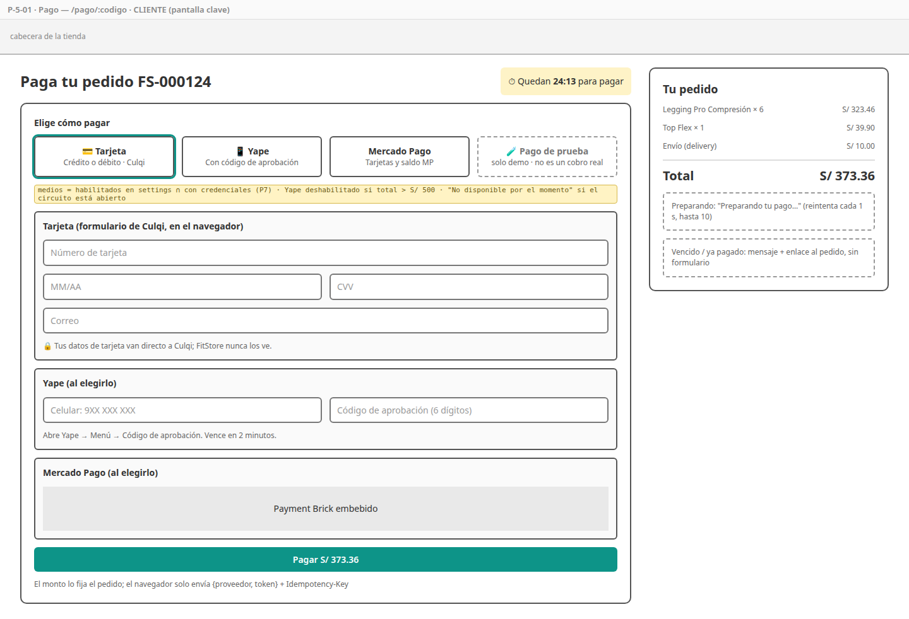
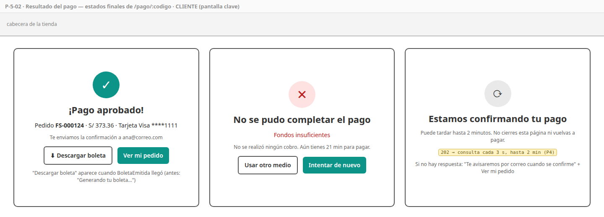
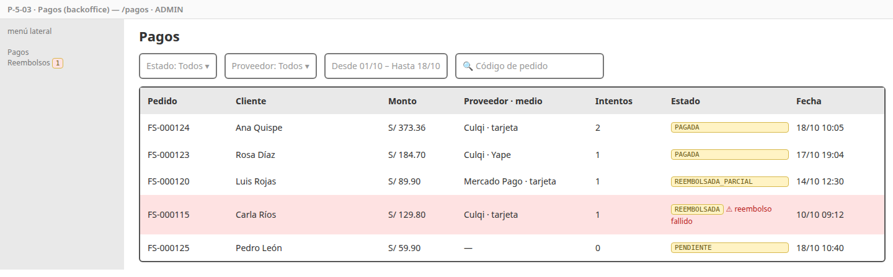
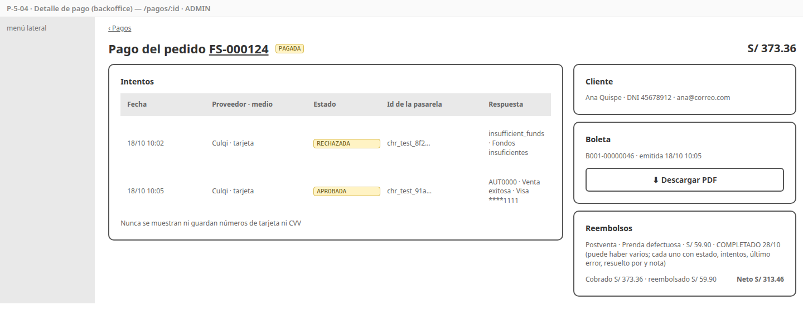
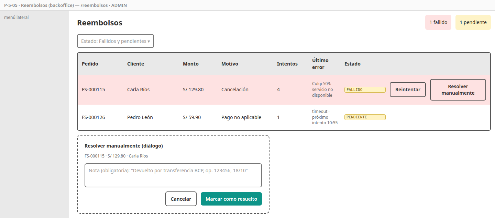
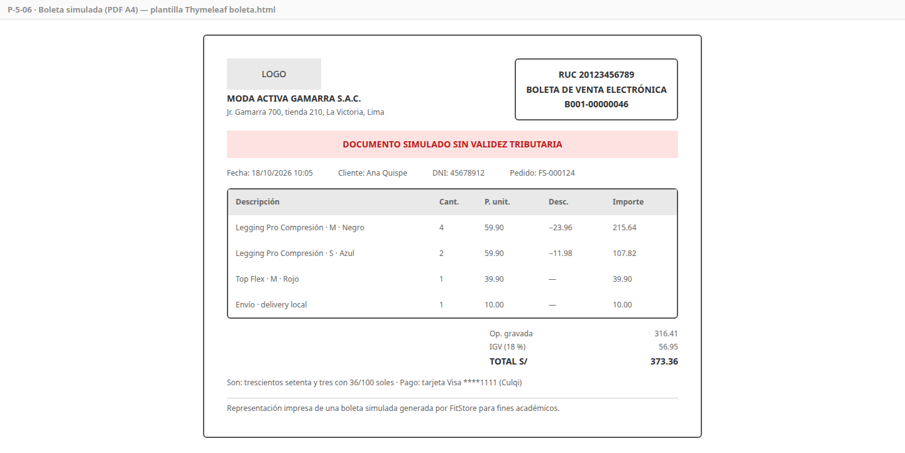

# SPEC-5 — Pagos

> Versión: **v3 (borrador)** — 2026-10-18 · Estados: ✅ decidido · 🟡 propuesto · ❓ abierto
> **Dueña de:** `backend/payment-service` (intención, cobros, webhooks, reembolsos, boleta) · tienda: `features/pago` · backoffice: `features/pagos`.
> **Depende de:** 0a, 0b, 1 (sesión) · usa el contrato de eventos de order (`PedidoCreado`, `PedidoCancelado`, `PedidoExpirado`, `PagoNoAplicable`, `ReembolsoSolicitado`) y `GET /settings/public` · **Habilita:** 4 (el pedido pasa a `PAGADO`, guarda la boleta y registra lo reembolsado), 7 (correos de pago, reembolso y alerta con la boleta adjunta), 8 (demo de punta a punta).
> **Contratos:** `contracts/openapi/payment-service.yaml`; eventos que publica `PagoConfirmado`, `PagoRechazado`, `BoletaEmitida`, `PagoReembolsado`, `ReembolsoFallido`.

**Historial:**
- v3 (2026-10-18): **reembolso postventa**: además de la cancelación, un pedido entregado puede reembolsarse total o parcialmente desde el pedido (SPEC-4 HU-4-12); varios reembolsos por pago; la intención pasa a `REEMBOLSADA_PARCIAL` / `REEMBOLSADA` y el estado fallido vive en cada reembolso (P8). Micros de payment v6, order v6, settings v8, notification v6; macro v20; SPEC-3 v4 y SPEC-4 v4. Revisión completa de las menciones de reembolso (alcance, resolución manual con `PagoReembolsado`, datos, Postman, demo).
- v2 (2026-10-18): P1 ✅ la prueba de concepto del sandbox es la primera tarea de la implementación; P2 ✅ se mantiene el proveedor simulado (respaldo de la demo y pruebas sin internet).
- v1 (2026-10-18): borrador inicial.

**Estado de revisión por sección:** 1 ⏳ · 2 ⏳ · 3 ⏳ · 4 ⏳ · 5 ⏳ · 6 ⏳ · 7 ⏳ · 8 ⏳ · 9 ⏳

---

## 1. Objetivo y alcance

Al cerrar esta spec, el cliente **paga su pedido** con tarjeta o Yape (Culqi), con Mercado Pago o, en la demo, con el proveedor simulado, **sin que el backend vea nunca su tarjeta** y **sin que se le cobre dos veces**. Recibe su **boleta simulada** en PDF. Si el pedido se cancela después del pago, o si la tienda registra un **reembolso postventa** (total o parcial) de un pedido entregado, el **reembolso se ejecuta automáticamente**; el admin ve todos los pagos y atiende los reembolsos que fallen.

**Incluye:**
- **Primero, la prueba de concepto del sandbox** (R16, P1): Culqi con tarjeta y Yape, Mercado Pago con Payment Brick y si alguno exige 3-D Secure.
- Toda la lógica de [`payment-service`](../analisis/micro/payment-service.md): intención por pedido, cobro con bloqueo e idempotencia, adaptadores `CulqiProvider`, `MercadoPagoProvider` y `SimuladoProvider`, webhooks verificados, verificador de pagos en curso, ejecución de reembolsos totales (cancelación, `PagoNoAplicable`) y postventa totales o parciales con reintentos, boleta en PDF privada, backoffice de pagos y reembolsos.
- Pantallas P-5-01 a P-5-05 y el diseño de la boleta (P-5-06).
- Colección Postman `payment`.

**No incluye (y dónde va):**
- Cambiar el estado del pedido → spec 4 (consume los eventos de esta spec).
- Correos de pago confirmado (con la boleta adjunta), pago rechazado, reembolso y alerta de reembolso fallido → spec 7 (aquí se publican los eventos y se expone `/internal/v1/boletas/{numero}`).
- **Registrar** un reembolso postventa (elegir prendas, monto, motivo y validar el plazo) → spec 4 (HU-4-12, desde el detalle del pedido). Esta spec solo lo **ejecuta** al recibir `ReembolsoSolicitado`.
- 3-D Secure → solo si la prueba de concepto muestra que el sandbox lo exige (micro 4.3.2); entonces se agrega a esta spec.
- Política de seguridad de contenido (CSP) que permita los scripts de Culqi y Mercado Pago → spec 8 (Caddy); aquí se documentan los dominios necesarios.

## 2. Referencias

- Micro [`payment-service.md`](../analisis/micro/payment-service.md) v6: todo (D1–D7, con D4 ampliada al reembolso postventa, invariantes, datos, endpoints 4.1, intención 4.2, cobro 4.3, Yape 4.3.1, 3-D Secure 4.3.2, webhooks 4.4, reembolsos 4.5, boleta 4.6, estados, eventos, dependencias, seguridad, pruebas, diseño técnico).
- Micro de infraestructura 4.4 (rate limiting: `POST /pagos/*/cargos`, 10 por minuto por usuario).
- Macro: CU-10, 25, 41 · RF-PAY-00 a 09 · RNF-06 · ADR-009, 016 · riesgo R16.
- SPEC-0b: ruta `/pago/:codigo` (storefront) y `/pagos/**`, `/reembolsos` (backoffice, solo ADMIN), badge de estado de pago, tabla paginada, diálogo. SPEC-4: P-4-02 lleva a `/pago/:codigo`; P-4-04 y P-4-06 muestran la boleta.

## 3. Historias de usuario y criterios de aceptación

### HU-5-01 — Preparar el pago de cada pedido

Como sistema, quiero crear una intención de pago con el monto del pedido apenas se crea, para cobrar siempre ese monto y nunca uno enviado por el navegador. · Cubre: RF-PAY-00 · Pantallas: no aplica

```gherkin
CA-5-01  Cuando llega PedidoCreado
         Entonces se crea una intención PENDIENTE con el monto, los ítems, los datos del cliente y el vencimiento del pedido
         Y si el mismo evento llega dos veces, sigue habiendo una sola intención

CA-5-02  Cuando llega PedidoExpirado, o PedidoCancelado sin pago
         Entonces la intención pasa a ANULADA y ya no se puede cobrar
```

### HU-5-02 — Ver la página de pago

Como cliente, quiero ver cuánto debo pagar, cuánto tiempo me queda y con qué puedo pagar, para elegir el medio que me acomode. · Cubre: CU-10, RF-PAY-03, 09 · Pantallas: [P-5-01](#p-5-01--pago)

```gherkin
CA-5-03  Cuando abro /pago/FS-000124
         Entonces veo el código, el resumen de productos, el total, la cuenta regresiva hasta el vencimiento
              y los medios disponibles: los habilitados en la tienda que además tienen credenciales
              (más "Pago de prueba" si el proveedor simulado está habilitado)

CA-5-04  Dado que llego antes de que exista la intención
         Entonces veo "Preparando tu pago…" y la página reintenta cada segundo, hasta 10 veces, antes de mostrar un error

CA-5-05  Dado un pedido con total mayor a S/ 500
         Entonces Yape aparece deshabilitado con el aviso "Yape permite hasta S/ 500 por día"

CA-5-06  Dado que el pedido ya está pagado, venció o fue cancelado
         Entonces no veo el formulario sino el estado ("Ya pagaste este pedido", "El plazo para pagar venció")
              y el enlace al detalle del pedido

CA-5-07  Cuando abro el pago de un pedido ajeno
         Entonces recibo 404

CA-5-08  Dado que la cuenta regresiva llega a cero mientras estoy en la página
         Entonces el formulario se bloquea y veo "El plazo para pagar venció"
```

### HU-5-03 — Pagar con tarjeta

Como cliente, quiero pagar con mi tarjeta de crédito o débito sin salir de la tienda, para terminar mi compra. · Cubre: CU-10, RF-PAY-01, 05, RNF-06 · Pantallas: [P-5-01](#p-5-01--pago), [P-5-02](#p-5-02--resultado-del-pago)

```gherkin
CA-5-09  Cuando ingreso la tarjeta en el formulario de Culqi y pago
         Entonces el navegador obtiene un token de Culqi y envía al backend solo {proveedor, token} con Idempotency-Key
         Y el backend cobra el monto de la intención (en céntimos), nunca un monto del navegador

CA-5-10  Dado un cargo aprobado
         Entonces la transacción queda APROBADA, la intención PAGADA, se publica PagoConfirmado
              y veo "¡Pago aprobado!" con el código del pedido

CA-5-11  Dado un cargo rechazado (tarjeta de prueba de fondos insuficientes)
         Entonces recibo 402 con un motivo legible ("Fondos insuficientes"), se publica PagoRechazado
              y puedo reintentar con otra tarjeta u otro medio mientras el pedido no venza

CA-5-12  Ningún número de tarjeta ni CVV llega al backend ni a los logs (solo el token de un solo uso, que tampoco se registra)
```

### HU-5-04 — Pagar con Yape

Como cliente, quiero pagar con Yape usando el código de aprobación de mi app, para pagar desde el celular sin tarjeta. · Cubre: RF-PAY-09 · Pantallas: [P-5-01](#p-5-01--pago)

```gherkin
CA-5-13  Cuando elijo Yape, ingreso mi celular (9 dígitos, empieza con 9) y el código de aprobación (6 dígitos)
         Entonces Culqi devuelve un token y el cobro sigue el mismo flujo que la tarjeta (medio = YAPE)

CA-5-14  Dado un código de aprobación vencido o incorrecto
         Entonces veo "El código de Yape no es válido o venció; genera uno nuevo en tu app"
```

### HU-5-05 — Pagar con Mercado Pago

Como cliente, quiero pagar con Mercado Pago dentro de la tienda, para usar mis tarjetas guardadas allí. · Cubre: RF-PAY-02 · Pantallas: [P-5-01](#p-5-01--pago)

```gherkin
CA-5-15  Cuando elijo Mercado Pago
         Entonces se muestra el Payment Brick embebido; al enviarlo, el backend cobra con el token y la misma
              Idempotency-Key (X-Idempotency-Key), y el resultado se muestra igual que con Culqi
```

### HU-5-06 — No cobrar dos veces

Como cliente, quiero la seguridad de que nunca se me cobrará dos veces el mismo pedido, aunque haga doble clic o se corte la red. · Cubre: RF-PAY-04, 05 · Pantallas: [P-5-02](#p-5-02--resultado-del-pago)

```gherkin
CA-5-16  Dado dos cobros simultáneos del mismo pedido (dos pestañas)
         Entonces uno se aprueba y el otro recibe 409 "Este pedido ya fue pagado"; nunca hay dos transacciones APROBADA

CA-5-17  Dado que reintento con la misma Idempotency-Key
         Entonces recibo el resultado del intento original sin un nuevo cargo

CA-5-18  Dado que la pasarela no responde en 10 s
         Entonces recibo 202 "Estamos confirmando tu pago", el cargo NO se reintenta solo,
              y la página consulta el estado cada 3 s hasta tener el resultado (P4)

CA-5-19  Dado que hago más de 10 intentos de cobro en un minuto
         Entonces el gateway responde 429 "Demasiados intentos, espera un momento"
```

### HU-5-07 — Confirmar pagos con webhooks y el verificador

Como sistema, quiero confirmar cada pago con la pasarela, para no depender de que llegue la respuesta al navegador ni confiar en mensajes falsos. · Cubre: RF-PAY-04 · Pantallas: no aplica

```gherkin
CA-5-20  Cuando llega un webhook de Culqi o Mercado Pago
         Entonces se guarda, se responde 200 de inmediato y el estado se confirma consultando la API de la pasarela
         Y un webhook repetido (mismo id) no se procesa dos veces

CA-5-21  Dado un webhook de Mercado Pago con firma x-signature inválida
         Entonces responde 401 y no se procesa

CA-5-22  Dado una transacción PROCESANDO con más de 2 minutos
         Cuando corre el verificador (cada 2 min)
         Entonces consulta la pasarela y la aprueba o rechaza (cubre los webhooks que no llegan en local)

CA-5-23  Dado que Culqi falla repetidamente (circuito abierto)
         Entonces la página de pago lo muestra como "No disponible por el momento" y sugiere otro medio
```

### HU-5-08 — Pagar con el proveedor simulado en la demo

Como autor del proyecto, quiero un medio de pago simulado, para demostrar todo el flujo aunque el sandbox falle el día de la demo. · Cubre: RF-PAY-03, R16 · Pantallas: [P-5-01](#p-5-01--pago)

```gherkin
CA-5-24  Dado PAGOS_SIMULADO_HABILITADO=true (dev y demo)
         Entonces aparece "Pago de prueba" con un aviso visible de que no es un cobro real
         Y con false (valor por defecto) no aparece y la API lo rechaza con 400

CA-5-25  Con el proveedor simulado, la tarjeta 4111 1111 1111 1111 se aprueba, la 4000 0000 0000 0002 se rechaza
         por fondos insuficientes y la 4000 0000 0000 0119 queda en PROCESANDO y se aprueba en la siguiente
         pasada del verificador (P2)
```

### HU-5-09 — Recibir mi boleta

Como cliente, quiero una boleta en PDF de mi compra, para tener el detalle de lo que pagué. · Cubre: RF-PAY-08 · Pantallas: [P-5-02](#p-5-02--resultado-del-pago), [P-5-06](#p-5-06--boleta-pdf)

```gherkin
CA-5-26  Dado un pago confirmado
         Entonces se genera de forma asíncrona la boleta B001-00000046 con emisor (razón social, RUC, dirección, logo),
              cliente (nombre y DNI), ítems con talla y color, descuentos, envío, total con IGV incluido, medio de pago,
              código del pedido y la leyenda "Documento simulado sin validez tributaria"
         Y se guarda en el bucket privado y se publica BoletaEmitida

CA-5-27  Dado 20 pagos confirmados a la vez
         Entonces reciben correlativos consecutivos sin huecos ni repetidos

CA-5-28  Dado que la generación falla (Garage caído)
         Entonces el pago sigue confirmado y la boleta se reintenta hasta generarse

CA-5-29  Cuando descargo mi boleta (GET /pagos/{codigo}/boleta)
         Entonces recibo el PDF; la de otro cliente responde 404; no existe ninguna URL pública del archivo
```

### HU-5-10 — Devolver el dinero automáticamente

Como cliente, quiero que me devuelvan el dinero si mi pedido pagado se cancela o si la tienda aprueba un reembolso de mi pedido entregado, sin trámites extra. · Cubre: RF-PAY-06, CU-25, CU-41 · Pantallas: no aplica (se ve en P-5-04 y P-5-05)

```gherkin
CA-5-30  Cuando llega PedidoCancelado con fuePagado = true, o PagoNoAplicable
         Entonces se crea un reembolso PENDIENTE por el monto total, se ejecuta con la pasarela del cargo
              y, si sale bien, queda COMPLETADO, la intención REEMBOLSADA y se publica PagoReembolsado

CA-5-31  Dado que la pasarela falla al reembolsar
         Entonces se reintenta a los 1, 5, 15 y 60 minutos; tras el cuarto fallo el reembolso queda FALLIDO
              y se publica ReembolsoFallido (la intención no cambia)

CA-5-32  Nunca se crean dos reembolsos totales (cancelación o PagoNoAplicable) para la misma intención

CA-5-39  Cuando llega ReembolsoSolicitado (postventa) por S/ 59.90 de un pago de S/ 373.36
         Entonces se crea un reembolso POSTVENTA PENDIENTE, se ejecuta como reembolso parcial en la pasarela
              y, al completarse, la intención queda REEMBOLSADA_PARCIAL y PagoReembolsado lleva solicitudId y parcial = true
         Y si el mismo evento llega dos veces, se crea un solo reembolso

CA-5-40  Dado varios reembolsos de un mismo pago
         Entonces su suma nunca supera lo cobrado (validado con la intención bloqueada);
              cuando la suma completada alcanza el monto, la intención pasa a REEMBOLSADA
```

### HU-5-11 — Revisar los pagos en el backoffice

Como administrador, quiero ver todos los pagos con sus intentos, para responder consultas y cuadrar la caja. · Cubre: CU-25, RF-PAY-05 · Pantallas: [P-5-03](#p-5-03--pagos-backoffice), [P-5-04](#p-5-04--detalle-de-pago-backoffice)

```gherkin
CA-5-33  Cuando abro /pagos
         Entonces veo las intenciones paginadas (código de pedido, cliente, monto, proveedor y medio, estado, fecha)
              y puedo filtrar por estado, proveedor, fechas y código de pedido

CA-5-34  Cuando abro un pago
         Entonces veo cada intento (proveedor, medio, estado, código y mensaje de la pasarela, fecha), los reembolsos
              (motivo, monto, estado; puede haber varios parciales), lo cobrado, lo reembolsado y lo neto, la boleta para descargar y el enlace al pedido; nunca datos de tarjeta

CA-5-35  Un OPERADOR no ve el menú Pagos y la API le responde 403
```

### HU-5-12 — Atender reembolsos fallidos

Como administrador, quiero reintentar o cerrar los reembolsos que fallaron, para que ningún cliente se quede sin su dinero. · Cubre: CU-41, RF-PAY-06 · Pantallas: [P-5-05](#p-5-05--reembolsos-backoffice)

```gherkin
CA-5-36  Cuando abro /reembolsos
         Entonces veo los reembolsos FALLIDO y PENDIENTE con pedido, cliente, motivo (cancelación, pago no aplicable, postventa), monto, intentos y último error,
              y el menú muestra cuántos fallidos hay

CA-5-37  Cuando reintento un reembolso FALLIDO
         Entonces vuelve a PENDIENTE y se ejecuta de inmediato

CA-5-38  Cuando lo marco como resuelto manualmente (p. ej. devolví por transferencia) con una nota obligatoria
         Entonces queda RESUELTO_MANUAL con mi usuario y la nota, cuenta como reembolsado (la intención pasa a
              REEMBOLSADA o REEMBOLSADA_PARCIAL según la suma) y se publica PagoReembolsado con manual = true,
              para que el pedido se actualice y la clienta reciba el aviso
```

## 4. Pantallas

### P-5-01 — Pago

- **Ruta / proyecto:** `/pago/:codigo` · storefront · CLIENTE.
- **Boceto (baja fidelidad):** 
- **Diseño de alta fidelidad:** 🕓 **pantalla clave** (escritorio y móvil, en dos marcas).
- **Componentes:** `PagoPage`, `ResumenPago` (código, productos, total, `CuentaRegresiva` de la spec 4 por contrato visual), `SelectorMedio` (Tarjeta, Yape, Mercado Pago, Pago de prueba), `FormularioCulqi` (tarjeta y Yape, con la librería de Culqi cargada solo en esta ruta), `BrickMercadoPago`, `FormularioSimulado`, `BotonPagar` (deshabilitado mientras procesa; genera la `Idempotency-Key` al montar el formulario y la reutiliza en los reintentos de red).
- **Estados:** preparando (404 con reintentos), listo, procesando, rechazado (mensaje y reintento), confirmando (202 con consulta cada 3 s), vencido, ya pagado, medio no disponible (circuito abierto).
- **Validaciones:** las de cada librería de pasarela; Yape: celular de 9 dígitos que empieza con 9 y código de 6 dígitos.
- **Endpoints:** `GET /pagos/{codigo}`, `POST /pagos/{codigo}/cargos`. Scripts externos: `checkout.culqi.com`, `sdk.mercadopago.com` (dominios que la spec 8 permite en la CSP).

### P-5-02 — Resultado del pago

- **Ruta / proyecto:** la misma `/pago/:codigo` (estado final de la página, P3) · storefront · CLIENTE.
- **Boceto:** 
- **Diseño de alta fidelidad:** 🕓 **pantalla clave** (junto con P-5-01).
- **Componentes:** `ResultadoPago`: aprobado (código del pedido, "Te enviamos la confirmación a tu correo", botones "Ver mi pedido" y "Descargar boleta" que aparece cuando la boleta está lista), rechazado (motivo y "Intentar de nuevo"), confirmando (indicador y texto "Puede tardar hasta 2 minutos; no cierres ni vuelvas a pagar").
- **Endpoints:** `GET /pagos/{codigo}` (consulta del estado y de la boleta), `GET /pagos/{codigo}/boleta`.

### P-5-03 — Pagos (backoffice)

- **Ruta / proyecto:** `/pagos` · backoffice · ADMIN.
- **Boceto:** 
- **Diseño de alta fidelidad:** 🕓 deriva del sistema de diseño (patrón "tabla").
- **Componentes:** `PagosPage`, `FiltrosPagos` (en la URL), tabla paginada, badge de estado de pago de 0b.
- **Endpoints:** `GET /admin/pagos?estado=&proveedor=&desde=&hasta=&codigo=&page=`.

### P-5-04 — Detalle de pago (backoffice)

- **Ruta / proyecto:** `/pagos/:id` · backoffice · ADMIN.
- **Boceto:** 
- **Diseño de alta fidelidad:** 🕓 deriva del sistema de diseño.
- **Componentes:** `DetallePagoPage`, `TablaIntentos`, `ListaReembolsos` (cada uno con motivo, monto, estado, intentos y nota), `TarjetaBoleta`.
- **Endpoints:** `GET /admin/pagos/{id}`, `GET /admin/pagos/{id}/boleta`.

### P-5-05 — Reembolsos (backoffice)

- **Ruta / proyecto:** `/reembolsos` · backoffice · ADMIN.
- **Boceto:** 
- **Diseño de alta fidelidad:** 🕓 deriva del sistema de diseño.
- **Componentes:** `ReembolsosPage`, `DialogoResolverManual` (nota obligatoria, hasta 500 caracteres), contador de fallidos en el menú (lo consulta el *shell* con `GET /admin/reembolsos?estado=FALLIDO&size=0`).
- **Endpoints:** `GET /admin/reembolsos`, `POST /admin/reembolsos/{id}/reintentar`, `PATCH /admin/reembolsos/{id}/resuelto-manual`.

### P-5-06 — Boleta (PDF)

- **No es una ruta:** es la plantilla Thymeleaf `boleta.html` que se convierte a PDF (A4).
- **Boceto:** 
- **Diseño de alta fidelidad:** 🕓 deriva del sistema de diseño (logo y color primario de la tienda; legible en blanco y negro).

## 5. Backend

Todo según el micro de payment. Decisiones de implementación de esta spec:

| # | Decisión | Detalle |
|---|---|---|
| P1 | **Prueba de concepto antes que nada** ✅ | Primera tarea de la spec (1–2 días): con las llaves de prueba, cobrar con tarjeta y con Yape en Culqi y con el Brick de Mercado Pago, desde una página HTML mínima y `curl`. Se anota en `docs/pruebas/poc-pagos.md`: tarjetas y datos de prueba que funcionan, si Yape se activa en el sandbox, si se exige 3-D Secure y cómo llegan los webhooks. Según el resultado se ajusta esta spec antes de seguir (R16) |
| P2 | **Reglas del proveedor simulado** ✅ | El `FormularioSimulado` pide un número de tarjeta de prueba y genera un token `sim_<últimos 4>`; el `SimuladoProvider` decide por esos dígitos: `1111` aprueba, `0002` rechaza (fondos insuficientes), `0119` deja la transacción en `PROCESANDO` y el verificador la aprueba. Cualquier otro número se aprueba |
| P3 | **Una sola ruta para pagar y ver el resultado** ✅ | El resultado es un estado de `/pago/:codigo` (como registra la 0b); al recargar, la página muestra el estado real que devuelve la API |
| P4 | **Consulta tras el 202** ✅ | La página consulta `GET /pagos/{codigo}` cada 3 s hasta 2 minutos; si sigue sin resultado, muestra "Te avisaremos por correo cuando se confirme" y el enlace al pedido |
| P5 | **Webhooks en local** ✅ | En local las pasarelas no llegan al servidor y no se usa un túnel: el verificador (CA-5-22) resuelve los pagos. Los webhooks reales se prueban en la nube (spec 8) y con WireMock en CI |
| P6 | **Tope de Yape configurable** ✅ | `fitstore.pagos.yape.tope-diario` (500.00) se envía en `GET /pagos/{codigo}` para que la página deshabilite Yape; el backend también lo valida |
| P7 | **Medios en la respuesta** ✅ | `GET /pagos/{codigo}` devuelve cada medio con `{proveedor, medio, clavePublica, disponible, motivoNoDisponible}`; la página no decide nada por su cuenta |
| P8 | **Reembolsos parciales y postventa** ✅ | Nacen siempre del pedido (D4 ampliada): cancelación y `PagoNoAplicable` (total) o `ReembolsoSolicitado` (postventa, total o parcial). Culqi y Mercado Pago aceptan reembolsos parciales por monto. La intención solo refleja lo completado (`REEMBOLSADA_PARCIAL`, `REEMBOLSADA`); el estado en curso o fallido se ve en cada reembolso. Se confirma en la prueba de concepto (P1) que el sandbox acepte parciales |

## 6. Datos

- **Sin migraciones nuevas:** el esquema completo y la fila de la serie `B001` en `correlativo_boleta` vienen en `V1` (spec 0a). Si la 0a no la sembró, esta spec agrega `VAAAAMMDD_HHMM__serie_boleta.sql`.
- **Datos de demostración (solo `dev`):** las intenciones, transacciones (un pago aprobado tras un rechazo), un reembolso `COMPLETADO` por cancelación, uno postventa parcial `COMPLETADO` (el de la spec 4), uno `FALLIDO` y las boletas de los pedidos de demostración de la spec 4, con PDF generados al iniciar.
- **Llaves de prueba:** en `.env` (fuera del repo) y en los *secrets* de GitHub para la nube; `.env.example` documenta los nombres.

## 7. Pruebas

| CA | Tipo | Dónde |
|---|---|---|
| 01–02 | Integración | `IntencionPagoConsumidorIT` (RabbitMQ Testcontainers, evento duplicado) |
| 03–08 | API + componente | `PagoControllerTest` (medios disponibles, 404 ajeno, estados), `pago.page.spec.ts` (preparando con reintentos, cuenta regresiva, Yape deshabilitado) |
| 09–15 | Unitaria + integración | `CulqiProviderTest`, `MercadoPagoProviderTest` (WireMock: aprobado, rechazos, conversión de montos), `CobroServiceTest`, `LogSinDatosSensiblesTest` |
| 16–19 | Integración | `DobleCobroIT` (2 hilos), `IdempotenciaCobroTest`, timeout con WireMock (202 sin reintento); 429 en la colección Postman |
| 20–23 | API + integración | `WebhookControllerTest` (firma válida e inválida, duplicado), `VerificadorPagosTest`, circuito abierto |
| 24–25 | Unitaria + API | `SimuladoProviderTest`, configuración habilitada y deshabilitada |
| 26–29 | Datos + integración | `BoletaServiceTest` (contenido del PDF con PDFBox), `CorrelativoBoletaIT` (20 concurrentes), Garage caído (Testcontainers), descarga ajena 404 |
| 30–32, 39–40 | Integración | `ReembolsoServiceTest` (esperas 1-5-15-60 con reloj simulado, total único por intención, parciales con suma ≤ monto y concurrencia, `ReembolsoSolicitado` duplicado), WireMock de reembolso parcial en Culqi y Mercado Pago |
| 33–38 | API + componente | `AdminPagoControllerTest` (filtros, 403 a OPERADOR), `reembolsos.page.spec.ts` |
| Manual | Sandbox real | Guion de `docs/pruebas/poc-pagos.md` repetido al cerrar la spec (para el video) |
| Todas | Postman | `postman/payment.postman_collection.json`: pago simulado aprobado, rechazado y en curso, descarga de boleta, webhook simulado, reembolso tras cancelación, reembolso postventa parcial (evento publicado a mano) y resolución manual |

## 8. Archivos y carpetas que toca

| Ruta | Acción |
|---|---|
| `backend/payment-service/**` | modifica (es su dueña) |
| `infra/config-repo/payment-service*.yml` | modifica |
| `frontend/projects/storefront/src/app/features/pago/` | modifica |
| `frontend/projects/backoffice/src/app/features/pagos/` | modifica |
| `postman/payment.postman_collection.json`, `docs/pruebas/poc-pagos.md` | crea |
| `.env.example` (sección de pagos) | modifica |
| `docs/specs/img/P-5-*` | crea |
| Congelados (`fitstore-common`, gateway, `shared`, `ui/`, `layout/`) | solo lectura |

## 9. Definición de terminado

- [ ] Prueba de concepto documentada y spec ajustada a su resultado.
- [ ] CA-5-01 a CA-5-40 cumplidos en CI.
- [ ] Postman `payment` en verde.
- [ ] El OpenAPI de payment coincide con lo implementado; los eventos coinciden con el AsyncAPI.
- [ ] Demostración en sandbox: pago con tarjeta de Culqi, con Yape (o con el simulado si el sandbox no lo permite, documentado), con Mercado Pago, un rechazo con reintento, un reembolso tras cancelar y un reembolso postventa parcial.
- [ ] Revisado y aprobado por el autor.
