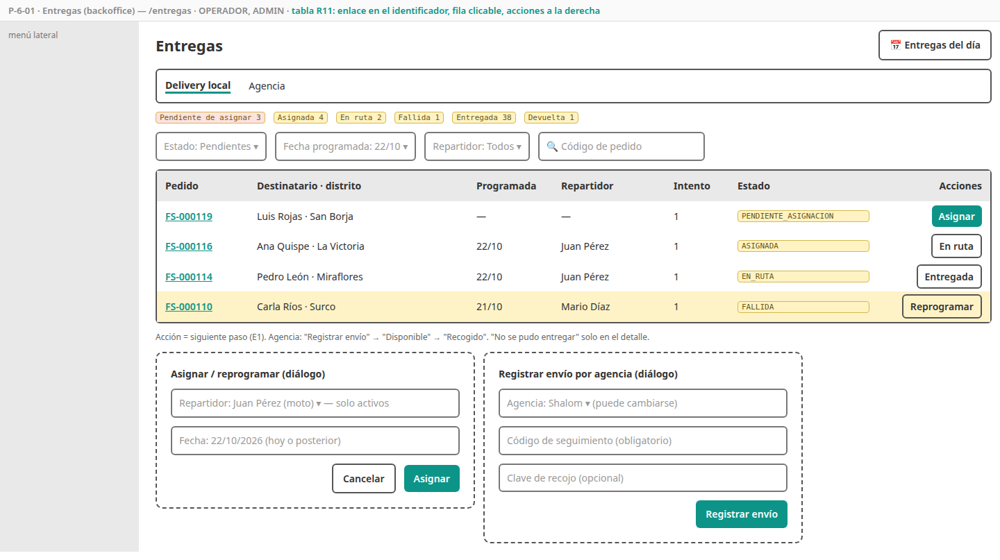
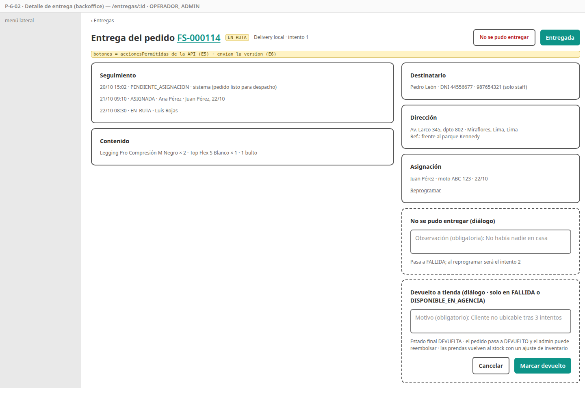
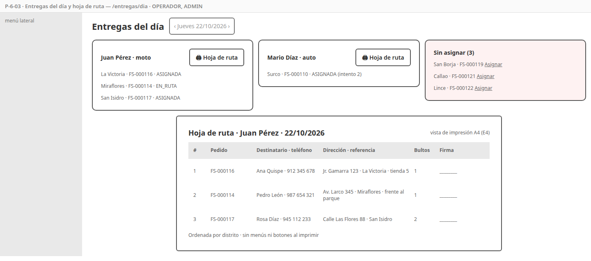
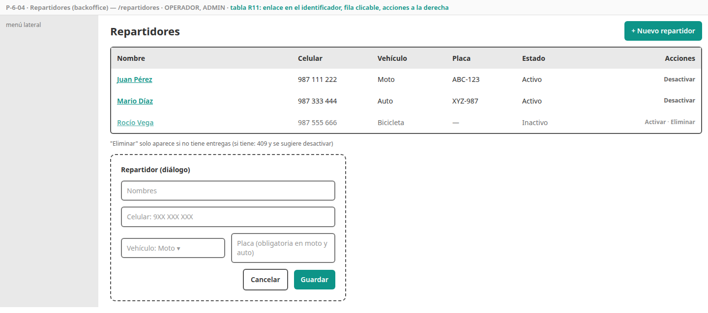
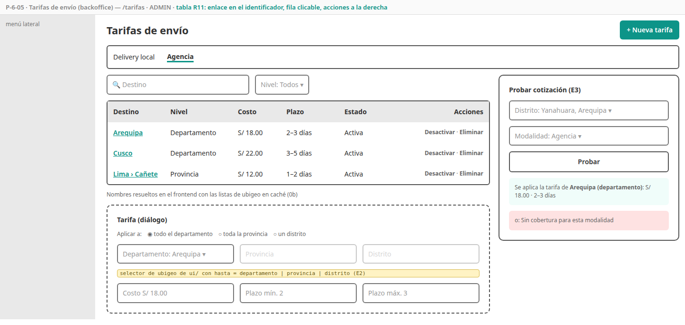
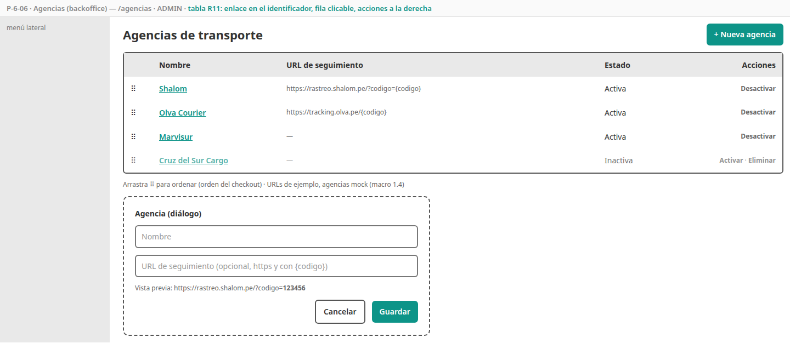

# SPEC-6 — Envíos

> Versión: **v2 (borrador)** — 2026-10-19 · Estados: ✅ decidido · 🟡 propuesto · ❓ abierto
> **Dueña de:** `backend/delivery-service` (tarifas, cotización, agencias, repartidores, entregas) · backoffice: `features/entregas`, `features/maestros-envio`.
> **Depende de:** 0a, 0b, 1 (sesión de staff) · usa el evento `PedidoListoDespacho` de order y `/ubigeo` de settings (en el frontend) · **Habilita:** 4 (cotización y opciones de envío en el checkout; el pedido pasa a `ENVIADO` y `ENTREGADO`), 7 (correos de la entrega), 8 (entregas del día en el dashboard).
> **Contratos:** `contracts/openapi/delivery-service.yaml`; evento que publica `EntregaActualizada`; consume `PedidoListoDespacho`.

**Historial:**
- v2 (2026-10-19): **devolución a tienda** (estado final `DEVUELTA`, CA-6-33 y 34; order pasa el pedido a `DEVUELTO` y permite reembolsar); E2 ✅ selector de ubigeo con nivel agregado a la SPEC-0b (v5). Cambios propagados: macro v21, micros de delivery v6, order v7, payment v7 y notification v7 (correo C14), SPEC-4 v6, SPEC-5 v5.
- v1 (2026-10-18): borrador inicial.

**Estado de revisión por sección:** 1 ⏳ · 2 ⏳ · 3 ⏳ · 4 ⏳ · 5 ⏳ · 6 ⏳ · 7 ⏳ · 8 ⏳ · 9 ⏳

---

## 1. Objetivo y alcance

Al cerrar esta spec, el checkout **cotiza el envío** a cualquier distrito con las tarifas que configura el admin, y cada pedido listo para despacho **se convierte en una entrega** que el operador lleva hasta el final: con **repartidor propio** en Lima y Callao (asignar, en ruta, entregada, intento fallido y reprogramación) o por **agencia** a provincias (código de seguimiento, disponible en agencia, recogido). Si una entrega no se puede concretar, el operador la marca **devuelta a la tienda** y el pedido queda listo para reembolsar. El operador imprime la **hoja de ruta** de cada repartidor y el cliente ve cada avance en "Mis pedidos".

**Incluye:**
- Toda la lógica de [`delivery-service`](../analisis/micro/delivery-service.md): tarifas por ubigeo con búsqueda jerárquica, opciones y cotización, agencias, repartidores, entregas desde `PedidoListoDespacho`, máquinas de estado local y agencia (con la devolución a tienda), seguimiento, entregas del día y hoja de ruta, resumen para el dashboard.
- Pantallas P-6-01 a P-6-06.
- Semilla de agencias y tarifas (`V2`) y datos de demostración para `dev`.
- Colección Postman `delivery`.

**No incluye (y dónde va):**
- Recojo en tienda → spec 4 (lo gestiona order, sin entrega).
- Estado del pedido y línea de tiempo del cliente → spec 4 (consume `EntregaActualizada`).
- Correos "en camino", "intento fallido", "disponible en agencia", "entregado" y "pedido devuelto a la tienda" (C14) → spec 7.
- Reembolso de un pedido devuelto → spec 4 (HU-4-12) y spec 5 (lo ejecuta).
- Pantalla del dashboard → spec 8 (aquí solo su endpoint).
- Integración con APIs de agencias y cálculo de rutas → fuera de alcance (macro 1.4).

## 2. Referencias

- Micro [`delivery-service.md`](../analisis/micro/delivery-service.md) v6: todo (D1–D6, con D5 actualizada por la devolución a tienda, invariantes, datos y semilla, endpoints 4.1, cotización 4.2, creación 4.3, local 4.4, agencia 4.5, estados, eventos, seguridad, pruebas, diseño técnico).
- Macro: CU-26, 26b, 27, 28 · RF-DEL-01 a 08 · ADR-009, 015.
- SPEC-0b: rutas `/entregas/**`, `/repartidores`, `/tarifas`, `/agencias` (R2), tabla con la convención de filas (R11), selector de ubigeo, badge de estado de entrega, diálogo. SPEC-4: CA-4-13 a 16 (opciones y cotización en el checkout), CA-4-45 (`EntregaActualizada` cambia el pedido, incluida la devolución), HU-4-12 (reembolso de un pedido devuelto).

## 3. Historias de usuario y criterios de aceptación

### HU-6-01 — Cotizar el envío

Como order-service y como checkout, quiero saber qué modalidades llegan a un distrito y cuánto cuestan, para ofrecer al cliente solo lo posible con el precio correcto. · Cubre: RF-DEL-04, 05 · Pantallas: no aplica (la usa P-4-02 de la spec 4)

```gherkin
CA-6-01  Dado tarifas de agencia solo para el departamento 04 (Arequipa)
         Cuando cotizo AGENCIA para 040101
         Entonces se usa la tarifa de 04 (S/ 18.00, 2–3 días): primero se busca el distrito, luego la provincia, luego el departamento

CA-6-02  Dado una tarifa de La Victoria (150115) y otra de Lima provincia (1501)
         Cuando cotizo DELIVERY_LOCAL para 150115
         Entonces gana la del distrito; para Miraflores (150122), sin tarifa propia, se usa la de 1501

CA-6-03  Cuando cotizo con un ubigeo que no tiene 6 dígitos
         Entonces recibo 400 "Elige el distrito de destino"

CA-6-04  Dado un destino sin tarifa para esa modalidad (o solo con tarifas inactivas)
         Entonces recibo 422 "No realizamos envíos por esta modalidad a este distrito"

CA-6-05  Cuando cotizo DELIVERY_LOCAL fuera de Lima Metropolitana y Callao, o con una agencia inexistente o inactiva
         Entonces recibo 400

CA-6-06  Cuando pido GET /envios/opciones?ubigeo=150122
         Entonces recibo las modalidades con tarifa para ese distrito, cada una con costo y plazo (sin el recojo, que agrega el checkout)
         Y GET /agencias devuelve solo las agencias activas, en su orden
```

### HU-6-02 — Configurar las tarifas de envío

Como administrador, quiero definir cuánto cuesta y cuánto demora enviar a cada zona, para cobrar el envío correcto sin cargar distrito por distrito. · Cubre: CU-28, RF-DEL-04 · Pantallas: [P-6-05](#p-6-05--tarifas)

```gherkin
CA-6-07  Cuando creo una tarifa eligiendo la modalidad, el destino (un departamento, una provincia o un distrito), el costo y el plazo
         Entonces se guarda con el código de 2, 4 o 6 dígitos según el nivel elegido
         Y la lista la muestra con los nombres ("Arequipa (departamento)", "Lima › Lima › Miraflores")

CA-6-08  Cuando intento repetir modalidad y destino
         Entonces recibo 409 "Ya existe una tarifa para ese destino"

CA-6-09  Cuando creo una tarifa de delivery local fuera de Lima Metropolitana o Callao, con costo negativo
         o con plazo mínimo mayor que el máximo
         Entonces recibo 400 con el error en el campo

CA-6-10  Cuando desactivo o elimino una tarifa
         Entonces deja de usarse en las cotizaciones nuevas; los pedidos ya creados conservan su costo

CA-6-11  Cuando uso "Probar cotización" con un distrito y una modalidad
         Entonces veo qué tarifa se aplicaría (nivel, costo y plazo) o "Sin cobertura" (E3)

CA-6-12  Un OPERADOR no ve el menú Tarifas y la API le responde 403
```

### HU-6-03 — Administrar las agencias

Como administrador, quiero mantener la lista de agencias de transporte, para que el cliente elija la que prefiera y reciba su enlace de rastreo. · Cubre: CU-28, RF-DEL-08 · Pantallas: [P-6-06](#p-6-06--agencias)

```gherkin
CA-6-13  Cuando creo o edito una agencia con nombre único y, opcionalmente, una URL de seguimiento https con {codigo}
         Entonces se guarda; una URL sin {codigo} o sin https se rechaza con 400

CA-6-14  Cuando reordeno las agencias o desactivo una
         Entonces el checkout las muestra en ese orden y sin las inactivas

CA-6-15  Cuando elimino una agencia con entregas
         Entonces recibo 409 y se sugiere desactivarla; sin entregas, se elimina
```

### HU-6-04 — Administrar los repartidores

Como operador, quiero registrar a los repartidores de la tienda, para asignarles las entregas. · Cubre: CU-27, RF-DEL-03 · Pantallas: [P-6-04](#p-6-04--repartidores)

```gherkin
CA-6-16  Cuando registro un repartidor con nombres, celular (9 dígitos, empieza con 9), vehículo y placa
         Entonces se guarda; la placa es obligatoria para moto y auto, no para bicicleta

CA-6-17  Cuando desactivo un repartidor
         Entonces ya no aparece para asignar, pero sus entregas anteriores lo conservan

CA-6-18  Cuando elimino un repartidor con entregas
         Entonces recibo 409 y se sugiere desactivarlo; sin entregas, se elimina
```

### HU-6-05 — Recibir los pedidos listos para despacho

Como sistema, quiero crear una entrega por cada pedido listo para despacho, para que el operador la gestione sin volver a escribir los datos. · Cubre: RF-DEL-01 · Pantallas: no aplica (se ve en P-6-01)

```gherkin
CA-6-19  Cuando llega PedidoListoDespacho
         Entonces se crea la entrega con copia del destinatario, la dirección con nombres y el resumen de ítems,
              en PENDIENTE_ASIGNACION (delivery local) o PENDIENTE_ENVIO (agencia, con la agencia elegida),
              y se publica EntregaActualizada
         Y si el mismo evento llega dos veces, sigue habiendo una sola entrega
```

### HU-6-06 — Llevar una entrega local

Como operador, quiero asignar cada entrega a un repartidor y registrar cómo le fue, para que el cliente sepa cuándo llega su pedido. · Cubre: CU-26, RF-DEL-02, 06 · Pantallas: [P-6-01](#p-6-01--entregas), [P-6-02](#p-6-02--detalle-de-entrega)

```gherkin
CA-6-20  Cuando asigno un repartidor activo y una fecha (hoy o posterior)
         Entonces la entrega pasa a ASIGNADA; si ya estaba asignada, se reprograma (nuevo repartidor o fecha)

CA-6-21  Cuando marco "En ruta" y luego "Entregada"
         Entonces cada paso queda en el seguimiento con mi usuario y se publica EntregaActualizada
              (order pasa el pedido a ENVIADO y luego a ENTREGADO)

CA-6-22  Cuando marco "No se pudo entregar"
         Entonces la observación es obligatoria ("No había nadie", "Dirección incorrecta"), la entrega pasa a FALLIDA
         Y al reprogramarla vuelve a ASIGNADA con el intento 2 (sin límite de intentos)

CA-6-23  Cuando intento una transición no permitida (p. ej. ENTREGADA → EN_RUTA, o una acción de agencia en una entrega local)
         Entonces recibo 409 con el estado actual y nada cambia

CA-6-24  Dado que otro operador cambió la entrega después de que la abrí
         Cuando intento un avance
         Entonces recibo 409 "La entrega cambió; recarga la página"

CA-6-25  EntregaActualizada lleva el nombre del repartidor y la fecha programada, nunca su teléfono (D6)
```

### HU-6-07 — Despachar un envío por agencia

Como operador, quiero registrar el envío por agencia con su código de seguimiento, para que el cliente pueda rastrearlo y recogerlo. · Cubre: CU-26b, RF-DEL-02, 06, 08 · Pantallas: [P-6-01](#p-6-01--entregas), [P-6-02](#p-6-02--detalle-de-entrega)

```gherkin
CA-6-26  Cuando registro el envío con el código de seguimiento (obligatorio), la clave de recojo (opcional)
         y, si hace falta, otra agencia activa
         Entonces pasa a ENVIADO_AGENCIA y EntregaActualizada lleva la agencia, el código
              y la URL de rastreo armada con la plantilla de la agencia (si tiene)

CA-6-27  Cuando marco "Disponible en agencia" y luego "Recogido por el cliente"
         Entonces pasa a DISPONIBLE_EN_AGENCIA y luego a ENTREGADA, con su evento en cada paso
```

### HU-6-08 — Planificar el día y la hoja de ruta

Como operador, quiero ver las entregas de un día por repartidor e imprimir su hoja de ruta, para organizar la salida de los pedidos. · Cubre: RF-DEL-07 · Pantallas: [P-6-03](#p-6-03--entregas-del-día-y-hoja-de-ruta)

```gherkin
CA-6-28  Cuando abro /entregas/dia (por defecto hoy)
         Entonces veo, por repartidor, sus entregas de esa fecha con estado, y las pendientes de asignar de ese día

CA-6-29  Cuando imprimo la hoja de ruta de un repartidor
         Entonces sale una página A4 sin menús, con fecha, repartidor y sus entregas ordenadas por distrito:
              código de pedido, destinatario, teléfono, dirección, referencia y bultos, con un espacio para firma

CA-6-30  Cuando llamo GET /admin/entregas/resumen?fecha=
         Entonces recibo las entregas de ese día por estado (lo usa el dashboard de la spec 8)
```

### HU-6-09 — Buscar entregas

Como operador, quiero listar las entregas pendientes y filtrarlas, para no olvidar ninguna. · Cubre: CU-26, CU-26b · Pantallas: [P-6-01](#p-6-01--entregas)

```gherkin
CA-6-31  Cuando abro /entregas
         Entonces veo las pestañas Delivery local y Agencia con un contador por estado,
              las pendientes primero y la tabla según la convención R11

CA-6-32  Cuando filtro por estado, fecha programada, repartidor o código de pedido
         Entonces veo solo las que cumplen todos los filtros, y los filtros quedan en la URL
```

### HU-6-10 — Devolver a la tienda una entrega que no se concretó

Como operador, quiero cerrar una entrega que ya no se puede completar, para que el pedido no quede trabado y la tienda pueda devolver el dinero. · Cubre: RF-DEL-02, RF-ORD-11 · Pantallas: [P-6-02](#p-6-02--detalle-de-entrega)

```gherkin
CA-6-33  Dado una entrega local FALLIDA, o una por agencia DISPONIBLE_EN_AGENCIA que nadie recogió
         Cuando marco "Devuelto a tienda" con un motivo (obligatorio: "Cliente no ubicable tras 3 intentos", "No recogido en la agencia")
         Entonces pasa a DEVUELTA (final), el seguimiento guarda el motivo y mi usuario,
              y se publica EntregaActualizada con estado DEVUELTA y el motivo
              (order pasa el pedido a DEVUELTO y notification envía el correo C14)

CA-6-34  Cuando intento devolver una entrega en otro estado (p. ej. ASIGNADA, EN_RUTA o ENTREGADA), o sin motivo
         Entonces recibo 409 o 400 y nada cambia
```

## 4. Pantallas

### P-6-01 — Entregas

- **Ruta / proyecto:** `/entregas` · backoffice · OPERADOR, ADMIN.
- **Boceto (baja fidelidad):** 
- **Diseño de alta fidelidad:** 🕓 deriva del sistema de diseño (patrón "tabla").
- **Componentes:** `EntregasPage` con pestañas Delivery local y Agencia, chips de contador por estado, `FiltrosEntregas` (en la URL), tabla paginada de 0b, `DialogoAsignar`, `DialogoEnvioAgencia`.
- **Tabla (0b R11):** el **código del pedido** abre `/entregas/:id`; acción: el **siguiente paso** como un botón (E1): "Asignar" (pendiente de asignación), "En ruta" (asignada), "Entregada" (en ruta), "Reprogramar" (fallida), "Registrar envío" (pendiente de envío), "Disponible" (enviado a agencia), "Recogido" (disponible); "No se pudo entregar" y "Devuelto a tienda" están solo en el detalle.
- **Estados:** vacío por pestaña, conflicto (409).
- **Endpoints:** `GET /admin/entregas?modalidad=&estado=&fecha=&repartidorId=&codigo=&page=` (con contadores), `PATCH /admin/entregas/{id}/…`, `GET /admin/repartidores?activo=true`, `GET /agencias`.

### P-6-02 — Detalle de entrega

- **Ruta / proyecto:** `/entregas/:id` · backoffice · OPERADOR, ADMIN.
- **Boceto:** 
- **Diseño de alta fidelidad:** 🕓 deriva del sistema de diseño.
- **Componentes:** `DetalleEntregaPage` con destinatario (DNI y teléfono visibles solo para staff), dirección, ítems, `AccionesEntrega` (según `accionesPermitidas` de la API, como en la spec 4), `DialogoAsignar`, `DialogoFallida` (observación obligatoria), `DialogoEnvioAgencia`, `DialogoDevuelta` (motivo obligatorio; solo en FALLIDA o DISPONIBLE_EN_AGENCIA), `SeguimientoEntrega` (eventos con fecha, actor, observación e intento) y el enlace al pedido.
- **Endpoints:** `GET /admin/entregas/{id}`, `PATCH /admin/entregas/{id}/asignar|en-ruta|entregada|fallida|enviada-agencia|disponible-agencia|devuelta`.

### P-6-03 — Entregas del día y hoja de ruta

- **Ruta / proyecto:** `/entregas/dia` · backoffice · OPERADOR, ADMIN.
- **Boceto:** 
- **Diseño de alta fidelidad:** 🕓 deriva del sistema de diseño.
- **Componentes:** `EntregasDiaPage` (selector de fecha, una columna por repartidor más "Sin asignar"), `HojaRuta` (vista de impresión con `@media print`, E4).
- **Endpoints:** `GET /admin/entregas/dia?fecha=&repartidorId=`.

### P-6-04 — Repartidores

- **Ruta / proyecto:** `/repartidores` · backoffice · OPERADOR, ADMIN.
- **Boceto:** 
- **Diseño de alta fidelidad:** 🕓 deriva del sistema de diseño (patrón "tabla").
- **Componentes:** `RepartidoresPage`, `DialogoRepartidor`.
- **Tabla (0b R11):** el **nombre** abre el diálogo de edición (sin página de detalle); acciones: "Desactivar" o "Activar" y "Eliminar" (solo sin entregas).
- **Endpoints:** `/admin/repartidores/**`.

### P-6-05 — Tarifas

- **Ruta / proyecto:** `/tarifas` · backoffice · ADMIN.
- **Boceto:** 
- **Diseño de alta fidelidad:** 🕓 deriva del sistema de diseño (patrón "tabla").
- **Componentes:** `TarifasPage` con pestañas Delivery local y Agencia, `DialogoTarifa` (selector de ubigeo con nivel, E2), `ProbarCotizacion` (E3). Los nombres de los destinos los resuelve el frontend con las listas de ubigeo en caché (0b), sin llamadas extra a delivery.
- **Tabla (0b R11):** el **destino** abre el diálogo de edición; acciones: "Desactivar" o "Activar" y "Eliminar".
- **Endpoints:** `/admin/tarifas/**`, `POST /envios/cotizar` (prueba), `/ubigeo/*` (settings).

### P-6-06 — Agencias

- **Ruta / proyecto:** `/agencias` · backoffice · ADMIN.
- **Boceto:** 
- **Diseño de alta fidelidad:** 🕓 deriva del sistema de diseño (patrón "tabla").
- **Componentes:** `AgenciasPage` (filas arrastrables para el orden), `DialogoAgencia` (con vista previa del enlace de rastreo con un código de ejemplo).
- **Tabla (0b R11):** el **nombre** abre el diálogo de edición; acciones: "Desactivar" o "Activar" y "Eliminar" (solo sin entregas).
- **Endpoints:** `/admin/agencias/**`.

## 5. Backend

Todo según el micro de delivery. Decisiones de implementación de esta spec:

| # | Decisión | Detalle |
|---|---|---|
| E1 | **Siguiente paso en la fila** ✅ | En el listado, cada entrega muestra como acción el siguiente paso de su máquina de estados (R11 permite hasta 2 botones), para avanzar sin abrir el detalle. El intento fallido, que exige observación y es menos frecuente, queda en el detalle |
| E2 | **Selector de ubigeo con nivel** ✅ | El selector de ubigeo de `ui/` (0b) recibe la opción `hasta = 'departamento' \| 'provincia' \| 'distrito'` (por defecto `distrito`); en tarifas se usa con un interruptor "Aplicar a todo el departamento / toda la provincia / un distrito". Se agregó a la SPEC-0b v5 (CA-0b-26), antes de implementarla |
| E3 | **Probar cotización** ✅ | Usa el mismo `POST /envios/cotizar` con un distrito y la modalidad, y muestra el nivel de la tarifa aplicada (la respuesta agrega `nivelTarifa` y `ubigeoTarifa`). Sirve para que el admin compruebe su configuración |
| E4 | **Hoja de ruta impresa desde el navegador** ✅ | Vista con `@media print` (A4, sin menús); sin PDF en el backend (KISS, micro 4.4) |
| E5 | **Acciones permitidas en la respuesta** ✅ | El detalle incluye `accionesPermitidas` (de `MaquinaEstadosEntrega`), igual que el pedido en la spec 4 (O4) |
| E6 | **Conflictos con `version`** ✅ | Los `PATCH` de avance llevan la `version` que vio el operador → 409 si cambió (CA-6-24) |
| E7 | **Fecha programada sin franja horaria** ✅ | Solo fecha (hoy o posterior); sin horarios ni ventanas de entrega (KISS) |
| E8 | **Devolución a tienda** ✅ | Estado final `DEVUELTA` desde `FALLIDA` o `DISPONIBLE_EN_AGENCIA`, con motivo obligatorio (micro de delivery v6, D5). El stock de las prendas devueltas vuelve con un ajuste de inventario (spec 2); la devolución no lo hace sola, porque el operador revisa el estado de las prendas |

## 6. Datos

- **Semilla (`V2`, todos los entornos):** agencias Shalom, Olva Courier, Marvisur y Cruz del Sur Cargo (con plantilla de rastreo de ejemplo); tarifas de delivery local para `1501` y `07` más Cercado y La Victoria; tarifas de agencia para los 23 departamentos distintos de Lima y Callao y las provincias de Lima fuera de Lima Metropolitana (micro 3.1).
- **Datos de demostración (solo `dev`):** 3 repartidores (uno inactivo) y las entregas de los pedidos de demostración de la spec 4: una pendiente de asignar, una asignada para hoy, una en ruta, una con un intento fallido, una por agencia enviada con código, una disponible en agencia y una devuelta a la tienda.

## 7. Pruebas

| CA | Tipo | Dónde |
|---|---|---|
| 01–06 | Datos + API | `TarifaEnvioRepositoryTest` (búsqueda jerárquica en una sentencia, inactivas ignoradas), `CotizacionEnvioServiceTest`, `EnvioControllerTest` (400, 422) |
| 07–12 | API + componente | `TarifaServiceTest` (único, Lima/Callao, plazos), `AdminTarifaControllerTest` (403 a OPERADOR), `tarifas.page.spec.ts` (selector con nivel, probar cotización) |
| 13–15 | Datos + API | `AgenciaRepositoryTest`, `AgenciaServiceTest` (plantilla de URL, borrado) |
| 16–18 | Datos + API | `RepartidorRepositoryTest`, `RepartidorServiceTest` |
| 19 | Integración | `ConsumidorPedidosIT` (RabbitMQ Testcontainers, duplicado) |
| 20–27, 33–34 | Unitaria + API | `MaquinaEstadosEntregaTest` (tabla parametrizada local y agencia), `EntregaServiceTest` (fallida con observación, intentos, código obligatorio, URL de rastreo, devuelta con motivo solo desde FALLIDA o DISPONIBLE_EN_AGENCIA, 409 por versión), contenido del evento (sin teléfono del repartidor) |
| 28–30 | API + componente | `EntregasDiaControllerTest` (orden por distrito), `hoja-ruta.spec.ts` |
| 31–32 | Datos + API | `EntregaSpecificationsTest` (filtros y contadores) |
| Todas | Postman | `postman/delivery.postman_collection.json`: cotizar (distrito propio, provincia, departamento, sin cobertura), flujo local con un intento fallido, flujo por agencia, devolución a tienda |

## 8. Archivos y carpetas que toca

| Ruta | Acción |
|---|---|
| `backend/delivery-service/**` | modifica (es su dueña) |
| `infra/config-repo/delivery-service*.yml` | modifica |
| `frontend/projects/backoffice/src/app/features/{entregas,maestros-envio}/` | modifica |
| `postman/delivery.postman_collection.json` | crea |
| `docs/specs/img/P-6-*` | crea |
| `ui/` selector de ubigeo (opción `hasta`, E2) | lo implementa la 0b (CA-0b-26, SPEC-0b v5) |
| Congelados (`fitstore-common`, gateway, `shared`, `ui/`, `layout/`) | solo lectura |

## 9. Definición de terminado

- [ ] CA-6-01 a CA-6-34 cumplidos en CI.
- [ ] Postman `delivery` en verde.
- [ ] El OpenAPI de delivery coincide con lo implementado; el evento coincide con el AsyncAPI.
- [ ] Demostración: configurar una tarifa y probarla; un pedido listo para despacho aparece como entrega, se asigna, sale en la hoja de ruta, falla una vez, se reprograma y se entrega; un envío por agencia con código y enlace de rastreo; una entrega devuelta a la tienda y su reembolso; el cliente ve cada paso en "Mis pedidos".
- [ ] Revisado y aprobado por el autor.
