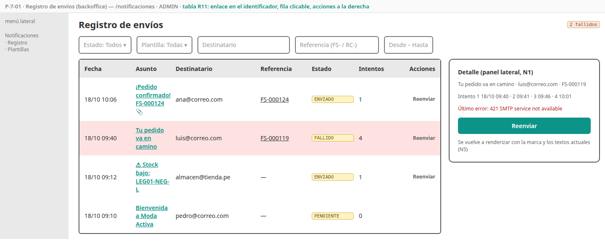
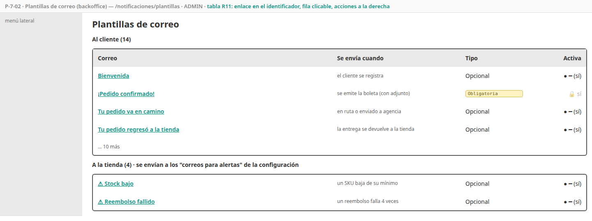
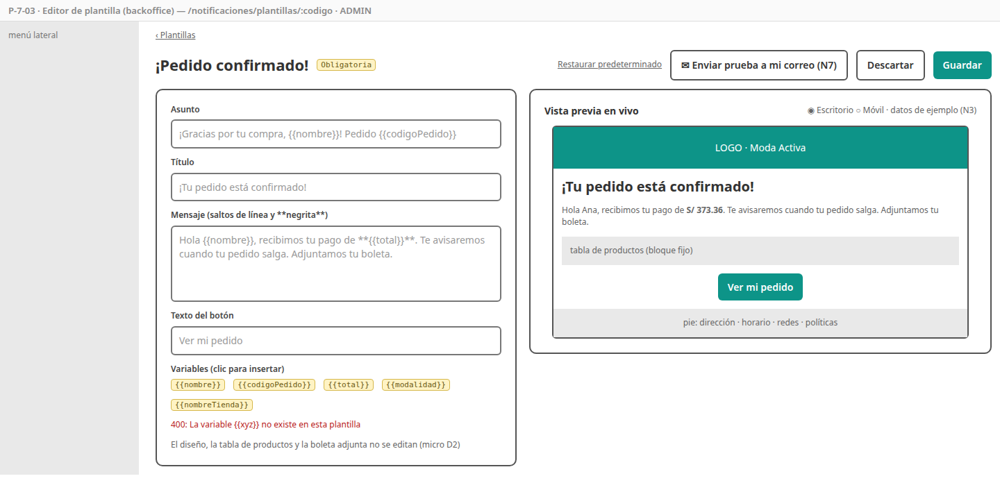
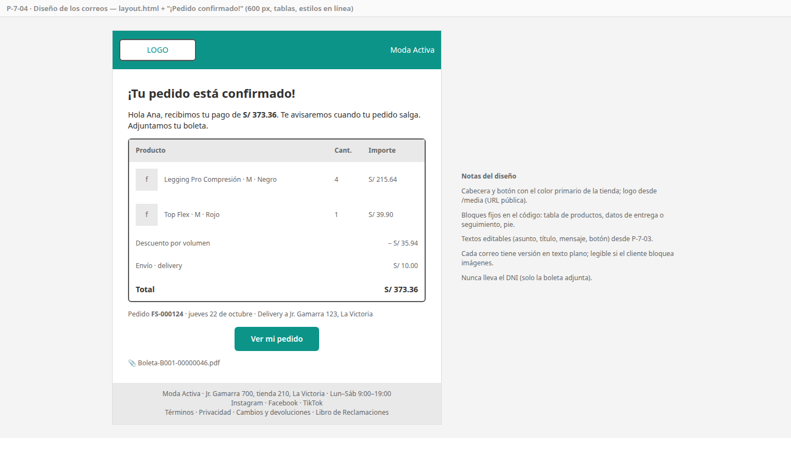

# SPEC-7 — Notificaciones

> Versión: **v4 (aprobado)** — 2026-10-19 · Estados: ✅ decidido · 🟡 propuesto · ❓ abierto
> **Dueña de:** `backend/notification-service` (enrutamiento de eventos, plantillas, envío, registro) · backoffice: `features/notificaciones`.
> **Depende de:** 0a, 0b, 1 (sesión de staff) · consume los eventos de auth, order, payment, delivery, catalog y settings (AsyncAPI) y usa `/internal/v1/boletas/{numero}` de payment · **Habilita:** 8 (demo con todos los correos en Mailpit y SES).
> **Contratos:** `contracts/openapi/notification-service.yaml`; no publica eventos; consume los de la sección 6 del micro.

**Historial:**
- v4 (2026-10-19): revisión de coherencia: CA-7-03 aclara que `PedidoExpirado` y `PagoRechazado` no se escuchan (micro v10).
- v3 (2026-10-19): los datos de demostración también se cargan en la nube con el perfil `demo` (SPEC-8 I7), con UUID fijos compartidos entre servicios (`docs/demo/ids-demo.md`).
- v2 (2026-10-19): N7 ✅ "Enviar prueba a mi correo" (CA-7-30; micro v9) → **spec aprobada**.
- v1 (2026-10-19): borrador inicial.

**Estado de revisión por sección:** 1 ✅ · 2 ✅ · 3 ✅ · 4 ✅ · 5 ✅ · 6 ✅ · 7 ✅ · 8 ✅ · 9 ✅

---

## 1. Objetivo y alcance

Al cerrar esta spec, cada cosa importante que le pasa a un cliente o a la tienda **llega por correo**, con la **marca de la tienda**: la bienvenida, la confirmación del pedido **con la boleta adjunta**, cada paso de la entrega, cancelaciones, reembolsos, devoluciones, reclamos y las alertas internas. Si el correo falla, **se reintenta** sin frenar al resto del sistema. El admin ve el **registro de envíos**, reenvía los que fallaron y **edita los textos** de cada correo con vista previa, sin tocar el diseño.

**Incluye:**
- Toda la lógica de [`notification-service`](../analisis/micro/notification-service.md): enrutamiento de los eventos a los **14 correos al cliente y 4 alertas a la tienda**, copia local de la marca y de los pedidos, render con Thymeleaf (HTML y texto plano), despachador con ritmo y reintentos, boleta adjunta con respaldo, editor de textos con variables, vista previa, registro y reenvío, limpieza a los 180 días.
- Pantallas P-7-01 a P-7-03 y el diseño base de los correos (P-7-04).
- Textos predeterminados de las 18 plantillas (`V2__plantillas.sql`).
- Colección Postman `notification`.

**No incluye (y dónde va):**
- Decidir cuándo ocurre cada evento → cada spec dueña (1 a 6) publica sus eventos; esta spec solo los escucha.
- Configurar Amazon SES en la nube (dominio, verificación, credenciales) → spec 8. Aquí se usa Mailpit y se deja la configuración `cloud` lista.
- SMS, WhatsApp, notificaciones push y correos de marketing → fuera de alcance (micro 1).

## 2. Referencias

- Micro [`notification-service.md`](../analisis/micro/notification-service.md) v7: todo (D1–D7, invariantes, datos, catálogo 4.1, flujo 4.2, boleta 4.3, marca 4.4, endpoints 4.5, editor 4.6, estados, eventos, dependencias, seguridad, pruebas, diseño técnico).
- Macro: CU-33, CU-42 · RF-NOT-01 a 05, RF-PAY-08 · ADR-009, 014 · riesgo R14 (SES en sandbox).
- SPEC-0b: ruta `/notificaciones/**` (R2, ADMIN), tabla con la convención de filas (R11), badge de estado, diálogo. SPEC-3: `ConfiguracionActualizada` con los "correos para alertas" (CA-3-19). SPEC-5: `BoletaEmitida` y `/internal/v1/boletas/{numero}`. SPEC-6: `EntregaActualizada` (incluida `DEVUELTA`).

## 3. Historias de usuario y criterios de aceptación

### HU-7-01 — Elegir qué correo enviar por cada evento

Como sistema, quiero convertir cada evento en el correo que corresponde, para que el cliente y la tienda se enteren de lo importante sin que los demás servicios sepan de correos. · Cubre: CU-42, RF-NOT-01, 05 · Pantallas: no aplica

```gherkin
CA-7-01  Cuando llega cada evento de la tabla 4.1 del micro
         Entonces se crea el envío de su correo (C1 a C14 o T1 a T4) para el destinatario que corresponde,
              en estado PENDIENTE, en la misma transacción que marca el evento como procesado
         Y las alertas T1 a T4 van a cada "correo para alertas" de la tienda (de la copia de la configuración)

CA-7-02  Dado que el mismo evento llega dos veces
         Entonces se crea un solo envío

CA-7-03  Cuando llegan PedidoCreado, PedidoPagado o EntregaActualizada en PENDIENTE_* o ASIGNADA
         Entonces no se envía ningún correo (PedidoCreado guarda la copia del pedido; PedidoPagado inicia el respaldo de la boleta)
         Y PedidoExpirado y PagoRechazado ni siquiera se escuchan (la cola no se enlaza a sus routing keys)

CA-7-04  Dado que el admin desactivó una plantilla opcional (p. ej. la bienvenida)
         Entonces su evento no genera envío

CA-7-05  Dado EntregaActualizada por agencia en ENVIADO_AGENCIA
         Entonces el correo "Tu pedido va en camino" lleva la agencia, el código de seguimiento y el enlace de rastreo;
              en delivery local lleva la fecha y el nombre del repartidor (nunca su teléfono)

CA-7-06  Dado PagoReembolsado parcial (postventa) o manual
         Entonces el correo de reembolso dice "reembolso parcial de tu pedido" con el monto y el motivo

CA-7-07  Dado EntregaActualizada en DEVUELTA
         Entonces se envía "Tu pedido regresó a la tienda" (C14) con el motivo y los datos de contacto de la tienda
```

### HU-7-02 — Enviar con reintentos sin frenar al sistema

Como tienda, quiero que un correo que falla se reintente solo, para que ningún cliente se quede sin su aviso y la caída del correo no afecte a las compras. · Cubre: RF-NOT-03 · Pantallas: no aplica (se ve en P-7-01)

```gherkin
CA-7-08  Cuando el despachador (cada 5 s) toma los envíos PENDIENTE
         Entonces los envía a un ritmo máximo configurable (1 por segundo por defecto, N6) y los marca ENVIADO

CA-7-09  Dado que el servidor SMTP falla
         Entonces el envío se reintenta a los 1, 5, 15 y 60 minutos; tras el cuarto error queda FALLIDO con el último error

CA-7-10  Dado que el SMTP está caído
         Entonces los eventos se siguen consumiendo y guardando (la cola de RabbitMQ no se acumula)

CA-7-11  Un envío ENVIADO nunca se vuelve a enviar solo
```

### HU-7-03 — Confirmar el pedido con la boleta adjunta

Como cliente, quiero recibir la confirmación de mi compra con la boleta en PDF, para tener todo en mi correo. · Cubre: RF-NOT-01, RF-PAY-08 · Pantallas: [P-7-04](#p-7-04--diseño-de-los-correos)

```gherkin
CA-7-12  Cuando llega BoletaEmitida
         Entonces se envía "¡Pedido confirmado!" con el resumen del pedido (de la copia local), la modalidad de entrega
              y la boleta PDF adjunta, descargada de payment al momento de enviar

CA-7-13  Dado que payment no responde al descargar la boleta
         Entonces el envío se reintenta como cualquier fallo

CA-7-14  Dado que 10 minutos después de PedidoPagado no llegó BoletaEmitida
         Entonces se envía la confirmación sin adjunto ("tu boleta estará disponible en Mis pedidos")
         Y si la boleta llega después, no se envía una segunda confirmación
```

### HU-7-04 — Correos con la marca de la tienda

Como tienda, quiero que todos mis correos lleven mi logo, mis colores y mis datos, para que el cliente los reconozca. · Cubre: RF-NOT-02, RNF-17 · Pantallas: [P-7-04](#p-7-04--diseño-de-los-correos)

```gherkin
CA-7-15  Cada correo usa el diseño común: logo, color primario en la cabecera y los botones, nombre de la tienda,
         y un pie con dirección, horario, redes y enlaces a las políticas; además lleva su versión en texto plano

CA-7-16  Cuando llega ConfiguracionActualizada
         Entonces la copia de la marca se actualiza y los correos siguientes usan los nuevos colores, logo y datos

CA-7-17  Dado que al arrancar no hay copia de la marca
         Entonces se pide una vez GET /settings/public; si falla, se usa la marca FitStore por defecto

CA-7-18  Las fechas y montos salen en formato es-PE ("jueves 22 de octubre", "S/ 332.46")
         Y ningún correo lleva el DNI en el cuerpo (solo en la boleta adjunta)
```

### HU-7-05 — Revisar el registro de envíos

Como administrador, quiero ver qué correos se enviaron y cuáles fallaron, para responder "no me llegó el correo" y reenviarlo. · Cubre: CU-33, RF-NOT-03 · Pantallas: [P-7-01](#p-7-01--registro-de-envíos)

```gherkin
CA-7-19  Cuando abro /notificaciones
         Entonces veo los envíos del más reciente al más antiguo (fecha, plantilla, destinatario, referencia, estado, intentos)
              y puedo filtrar por estado, plantilla, destinatario, referencia (código de pedido o reclamo) y fechas

CA-7-20  Cuando abro un envío
         Entonces veo el asunto, el destinatario, la referencia, cada intento y el último error

CA-7-21  Cuando reenvío un envío FALLIDO o ENVIADO (con confirmación)
         Entonces vuelve a PENDIENTE y el despachador lo envía con la marca y los textos actuales

CA-7-22  Un OPERADOR no ve el menú Notificaciones y la API le responde 403
```

### HU-7-06 — Editar los textos de los correos

Como administrador, quiero cambiar el asunto y los textos de cada correo viendo cómo quedan, para hablarle a mis clientes con el tono de mi tienda. · Cubre: CU-33, RF-NOT-04 · Pantallas: [P-7-02](#p-7-02--plantillas), [P-7-03](#p-7-03--editor-de-plantilla)

```gherkin
CA-7-23  Cuando abro /notificaciones/plantillas
         Entonces veo las 18 plantillas agrupadas en "Al cliente" y "A la tienda", con su evento, si es obligatoria y si está activa

CA-7-24  Cuando edito el asunto, el título, el mensaje (saltos de línea y **negrita**) y el texto del botón
         Entonces la vista previa se actualiza al instante con la marca actual y datos de ejemplo, sin guardar

CA-7-25  Cuando guardo con una variable que no existe en esa plantilla
         Entonces recibo 400 "La variable {{xyz}} no existe en esta plantilla"; el editor muestra las variables permitidas
              y las inserta con un clic

CA-7-26  Dado que escribo HTML o expresiones de plantilla en un texto (p. ej. <script> o ${…})
         Entonces se muestra tal cual, escapado; nunca se ejecuta (sin SSTI)

CA-7-27  Cuando desactivo una plantilla opcional, la activo o uso "Restaurar predeterminado"
         Entonces se guarda; las obligatorias (recuperación, invitación, pedido confirmado y las del Libro de Reclamaciones)
              no se pueden desactivar (interruptor bloqueado y 409 en la API)

CA-7-30  Cuando uso "Enviar prueba a mi correo"
         Entonces se envía el correo con los textos del editor (aunque no estén guardados), la marca actual y datos de ejemplo
              al correo del admin conectado, con "[Prueba]" al inicio del asunto, respetando el ritmo de envío
         Y queda en el registro con referencia PRUEBA; como máximo 5 pruebas por minuto por admin
```

### HU-7-07 — No guardar datos personales más de lo necesario

Como tienda, quiero que el registro de correos se borre solo después de un tiempo, para cumplir la Ley 29733. · Cubre: RNF de privacidad, Ley 29733 · Pantallas: no aplica

```gherkin
CA-7-28  Cuando corre la limpieza diaria
         Entonces se eliminan los envíos y las copias de pedidos con más de 180 días (configurable)
```

### HU-7-08 — Ver todos los correos en la demo

Como autor del proyecto, quiero ver todos los correos de una compra en un buzón de prueba, para mostrarlos en la exposición. · Cubre: RF-NOT-01 · Pantallas: no aplica

```gherkin
CA-7-29  Dado el compose de desarrollo
         Cuando hago una compra completa (registro, pago, entrega) y una devolución
         Entonces veo en Mailpit (http://localhost:8025) cada correo con la marca, en HTML y texto plano, y la boleta adjunta
```

## 4. Pantallas

### P-7-01 — Registro de envíos

- **Ruta / proyecto:** `/notificaciones` · backoffice · ADMIN.
- **Boceto (baja fidelidad):** 
- **Diseño de alta fidelidad:** 🕓 deriva del sistema de diseño (patrón "tabla").
- **Componentes:** `RegistroEnviosPage`, `FiltrosEnvios` (en la URL), tabla paginada de 0b, `PanelDetalleEnvio` (panel lateral, N1), confirmación de reenvío.
- **Tabla (0b R11):** el **asunto** abre el panel de detalle del envío; acción: "Reenviar" (en FALLIDO y ENVIADO). La **referencia** (código de pedido o reclamo) enlaza a su pantalla (`/pedidos?codigo=…` o `/reclamos/:id`).
- **Estados:** vacío, cargando, error.
- **Endpoints:** `GET /admin/notificaciones?estado=&plantilla=&destinatario=&referencia=&desde=&hasta=&page=`, `GET /admin/notificaciones/{id}`, `POST /admin/notificaciones/{id}/reenviar`.

### P-7-02 — Plantillas

- **Ruta / proyecto:** `/notificaciones/plantillas` · backoffice · ADMIN.
- **Boceto:** 
- **Diseño de alta fidelidad:** 🕓 deriva del sistema de diseño.
- **Componentes:** `PlantillasPage` con dos grupos (Al cliente, A la tienda).
- **Tabla (0b R11):** el **nombre** abre el editor (`/notificaciones/plantillas/:codigo`); acción: interruptor "Activa" (bloqueado en las obligatorias, con el texto "Obligatoria").
- **Endpoints:** `GET /admin/notificaciones/plantillas`, `PUT /admin/notificaciones/plantillas/{codigo}` (solo `activa`).

### P-7-03 — Editor de plantilla

- **Ruta / proyecto:** `/notificaciones/plantillas/:codigo` · backoffice · ADMIN.
- **Boceto:** 
- **Diseño de alta fidelidad:** 🕓 deriva del sistema de diseño (reutiliza el patrón "edición con vista previa" de la configuración de tienda, P-3-04).
- **Componentes:** `EditorPlantillaPage` con campos asunto, título, mensaje y texto del botón, `ChipsVariables` (insertar con un clic), `VistaPreviaCorreo` (iframe aislado con `sandbox`, escritorio o móvil, N3), botones Guardar, Descartar, Restaurar predeterminado y Enviar prueba a mi correo (N7).
- **Estados:** cambios sin guardar (aviso al salir), variable inválida (400), plantilla obligatoria (interruptor bloqueado).
- **Endpoints:** `GET/PUT /admin/notificaciones/plantillas/{codigo}`, `POST …/{codigo}/vista-previa`, `POST …/{codigo}/restaurar`, `POST …/{codigo}/prueba`.

### P-7-04 — Diseño de los correos

- **No es una ruta:** es el layout Thymeleaf común (`layout.html`) y su uso en "¡Pedido confirmado!", como referencia del resto.
- **Boceto:** 
- **Diseño de alta fidelidad:** 🕓 deriva del sistema de diseño (HTML de correo: tablas, estilos en línea, 600 px de ancho, legible sin imágenes).

## 5. Backend

Todo según el micro de notification. Decisiones de implementación de esta spec:

| # | Decisión | Detalle |
|---|---|---|
| N1 | **Detalle de envío en un panel lateral** ✅ | El registro no tiene página de detalle: el asunto abre un panel con los datos del envío (R11 lo permite: "si la entidad no tiene página de detalle, el enlace abre su diálogo") |
| N2 | **Un manejador por tipo de evento** ✅ | `EnrutadorEventos` delega en un manejador por evento (regla 5 de convivencia del README), cada uno en su archivo; así agregar un correo no toca a los demás |
| N3 | **Datos de ejemplo fijos por plantilla** ✅ | `EjemplosPlantilla` define datos realistas por plantilla (cliente "Ana Quispe", pedido FS-000124 con 3 productos, Shalom con código, etc.) para la vista previa y las pruebas de render |
| N4 | **Formato del mensaje** ✅ | Solo saltos de línea y `**negrita**` (micro 4.6); el resto se escapa. Se convierte a HTML en el servidor después de escapar |
| N5 | **Reenvío con textos actuales** ✅ | Reenviar vuelve a renderizar con la marca y los textos vigentes (no se guarda el HTML enviado, para no almacenar datos personales de más) |
| N6 | **Ritmo por entorno** ✅ | `ritmo-por-segundo`: 1 en `cloud` (límite de SES en sandbox) y 10 en `dev` (Mailpit no tiene límite), para que la demo local sea ágil |
| N7 | **Enviar prueba a mi correo** ✅ | Botón en el editor que envía el correo con los textos actuales y datos de ejemplo al correo del admin conectado (lo toma del token), con "[Prueba]" en el asunto; respeta el ritmo y queda en el registro con referencia `PRUEBA`. Endpoint `POST /admin/notificaciones/plantillas/{codigo}/prueba` (micro v9). En la nube, con SES en sandbox, el correo del admin debe estar verificado (R14) |
| N8 | **Corrección del micro** ✅ | El micro decía "definición de las 17" plantillas en 10.1; con C14 son **18**. Corregido en el micro v8 |

## 6. Datos

- **Semilla `V2__plantillas.sql` (todos los entornos):** las 18 plantillas con sus textos predeterminados en español, tono cercano y formal a la vez (tuteo), y `activa = true`.
- **Fila inicial de `marca_tienda`:** marca FitStore por defecto (se reemplaza con el primer `ConfiguracionActualizada`).
- **Datos de demostración (perfil `dev` y, en la nube, perfil `demo` (SPEC-8 I7)):** el registro de los correos de los pedidos de demostración de las specs 4 a 6 (enviados, uno fallido y uno pendiente), para que la pantalla no esté vacía.

## 7. Pruebas

| CA | Tipo | Dónde |
|---|---|---|
| 01–07 | Integración | `EnrutadorEventosIT` (RabbitMQ Testcontainers: cada evento → su plantilla y destinatario, duplicado, sin correo, plantilla desactivada, contenido de C8, C7 parcial y C14) |
| 08–11 | Unitaria + integración | `DespachadorCorreosTest` (ritmo con reloj simulado, reintentos 1-5-15-60, FALLIDO, `SKIP LOCKED`), SMTP caído con GreenMail detenido |
| 12–14 | Integración | `ConfirmacionConBoletaIT` (adjunto PDF con GreenMail, payment caído con WireMock, respaldo de 10 min sin segunda confirmación) |
| 15–18 | Unitaria | `RenderizadorCorreoTest`: las 18 plantillas renderizan con sus ejemplos, con logo y color primario, versión texto, formato es-PE y sin DNI; `MarcaTiendaTest` (actualización y arranque sin copia) |
| 19–22 | Datos + API | `EnvioCorreoRepositoryTest` (filtros), `AdminNotificacionControllerTest` (reenvío, 403 a OPERADOR) |
| 23–27, 30 | API + componente | `PlantillaServiceTest` (variables, escape, SSTI, obligatorias, restaurar), `editor-plantilla.spec.ts` (vista previa en vivo, chips); `PruebaPlantillaTest` (destinatario del token, asunto con [Prueba], límite de 5 por minuto) |
| 28 | Datos | `LimpiezaRetencionTest` |
| 29 | Manual | Guion de demo en Mailpit |
| Todas | Postman | `postman/notification.postman_collection.json`: registro, filtros, reenvío, editar, vista previa, restaurar, enviar prueba |

## 8. Archivos y carpetas que toca

| Ruta | Acción |
|---|---|
| `backend/notification-service/**` | modifica (es su dueña) |
| `infra/config-repo/notification-service*.yml` | modifica |
| `frontend/projects/backoffice/src/app/features/notificaciones/` | modifica |
| `postman/notification.postman_collection.json` | crea |
| `docs/specs/img/P-7-*`, `docs/analisis/micro/notification-service.md` (N8) | crea / modifica |
| Congelados (`fitstore-common`, gateway, `shared`, `ui/`, `layout/`) | solo lectura |

## 9. Definición de terminado

- [ ] CA-7-01 a CA-7-30 cumplidos en CI.
- [ ] Postman `notification` en verde.
- [ ] El OpenAPI de notification coincide con lo implementado; los eventos consumidos coinciden con el AsyncAPI.
- [ ] Demostración: una compra completa con todos sus correos en Mailpit, un correo fallido reenviado y un texto editado con vista previa.
- [ ] Revisado y aprobado por el autor.
