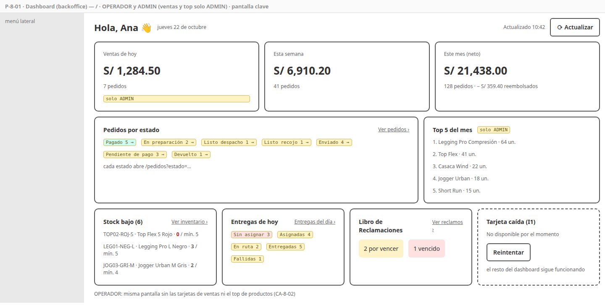

# SPEC-8 — Integración, nube y demo

> Versión: **v5 (aprobado)** — 2026-10-20 · Estados: ✅ decidido · 🟡 propuesto · ❓ abierto
> **Dueña de:** dashboard del backoffice (`features/dashboard`), pruebas de punta a punta (`frontend/e2e/`), despliegue en la nube (`infra/docker-compose.cloud.yml`, `infra/caddy/`, `infra/scripts/`, `.github/workflows/deploy.yml`), guion de la demo (`docs/demo/`).
> **Depende de:** 1 a 7 (todas integradas en `dev`) · usa los endpoints de resumen de order, catalog, delivery y settings · **Habilita:** la entrega final (demo en la nube, video y exposición).
> **Contratos:** no crea endpoints; consume los ya definidos (sección 4).

**Historial:**
- v5 (2026-10-20): `docs/demo/ids-demo.md` lo crea el lead en la ola 2a (las specs 1–7 necesitan los UUID antes que esta); aquí se completa.
- v4 (2026-10-19): etapa de diseño cerrada: diseños de alta fidelidad enlazados (P-8-01).
- v3 (2026-10-19): revisión de coherencia: Mailpit corre en la nube sin publicar como respaldo de SES (CA-8-15, CA-8-30; micro de infraestructura v6 con `duckdns` y Mailpit en la tabla de memoria).
- v2 (2026-10-19): I6 ✅ Garage en la VM (adaptador Azure Blob diferido); I7 ✅ la nube carga **todos** los datos de demostración, incluidos clientes y pedidos, con la contraseña de las cuentas demo desde un secreto (CA-8-31) → **spec aprobada**. Ajustes propagados: SPEC-0a v5, SPEC-1 v5, SPEC-2 a SPEC-7 (nota del perfil `demo`), micro de infraestructura v5, stack v3, macro v22 y ADR-013.
- v1 (2026-10-19): borrador inicial.

**Estado de revisión por sección:** 1 ✅ · 2 ✅ · 3 ✅ · 4 ✅ · 5 ✅ · 6 ✅ · 7 ✅ · 8 ✅ · 9 ✅

---

## 1. Objetivo y alcance

Al cerrar esta spec, **FitStore está publicada en la nube** con HTTPS en `tienda.<sub>.duckdns.org` y `admin.<sub>.duckdns.org`, se **despliega sola** al integrar en `main`, y está **probada de punta a punta**: una compra completa, con pago, correos, despacho, entrega y devolución, corre automáticamente en cada PR a `stage`. El backoffice abre con un **dashboard** del negocio, y existe un **guion de demo** para el video y la exposición, que incluye el cambio de marca en vivo (white-label).

**Incluye:**
- **Dashboard** del backoffice (P-8-01).
- **Pruebas E2E con Playwright** de los flujos críticos y **Lighthouse CI** en `stage.yml`.
- **Despliegue en la nube:** `docker-compose.cloud.yml`, imagen de Caddy con los dos frontends, `Caddyfile` (dominios, HTTPS, cabeceras de seguridad y CSP), actualización de DuckDNS, SES, Swagger con contraseña, `deploy.yml` (imágenes en GHCR y despliegue por SSH), respaldo diario de la base.
- **Pasarelas y correo reales en la nube:** webhooks de Culqi y Mercado Pago a la URL pública, SES con correos verificados.
- **Operación mínima:** guía de despliegue y operación (`docs/despliegue.md`): túneles SSH, respaldo, encendido y apagado de la VM, presupuesto.
- **Postman contra la nube** (entorno `cloud`) y **guion de demo** (`docs/demo/guion.md`).

**No incluye (y dónde va):**
- Lógica de negocio nueva: los resúmenes que usa el dashboard ya los exponen las specs 2, 3, 4 y 6.
- Adaptador Azure Blob → diferido: en la nube se usa Garage en la VM (I6).
- Alta disponibilidad, varias VMs, Kubernetes, CDN → fuera de alcance (ADR-002).

## 2. Referencias

- Micro [`infraestructura.md`](../analisis/micro/infraestructura.md): borde con Caddy (5), compose y memoria (6), imágenes (10.6), configuración y `.env.example` (10.5).
- ADR-002 (una VM con docker-compose), 005 (portabilidad y costo), 013 (almacenamiento), 014 (SES), 017 (observabilidad), 018 (CI), 021 (`dev → stage → main`, `stage.yml` y `deploy.yml`).
- Macro: CU-20 · RF-BO-01 · RNF-01 a 03, 08, 13 a 18, 21 · riesgos R14 (SES en sandbox) y R16 (sandbox de pagos).
- Pendientes que otras specs dejaron aquí: SPEC-0a (`docker-compose.cloud.yml`, Caddy, DuckDNS, SES, `deploy.yml`), SPEC-0b (E2E, Lighthouse, imagen de Caddy con los frontends), SPEC-3 (contador de reclamos por vencer), SPEC-4 y SPEC-6 (pantalla del dashboard), SPEC-5 (CSP para Culqi y Mercado Pago; webhooks reales), SPEC-7 (configurar SES).

## 3. Historias de usuario y criterios de aceptación

### HU-8-01 — Ver cómo va la tienda al entrar al backoffice

Como operador o administrador, quiero ver de un vistazo las ventas, los pedidos por atender, el stock bajo, las entregas del día y los reclamos por vencer, para saber qué hacer primero. · Cubre: CU-20, RF-BO-01 · Pantallas: [P-8-01](#p-8-01--dashboard)

```gherkin
CA-8-01  Dado que soy ADMIN
         Cuando abro el backoffice en "/"
         Entonces veo: ventas de hoy, de la semana y del mes (monto neto y cantidad), pedidos por estado,
              top 5 productos del mes, stock bajo, entregas de hoy por estado y reclamos por vencer y vencidos

CA-8-02  Dado que soy OPERADOR
         Entonces veo lo mismo sin las ventas ni el top de productos (información de negocio solo para ADMIN, SPEC-4 CA-4-53)

CA-8-03  Cada tarjeta lleva a su pantalla con el filtro aplicado: un estado de pedido → /pedidos?estado=…,
         stock bajo → /inventario?soloStockBajo=true, entregas → /entregas/dia, reclamos → /reclamos?porVencer=true

CA-8-04  Dado que un servicio no responde (p. ej. delivery caído)
         Entonces solo su tarjeta muestra "No disponible" con "Reintentar"; el resto del dashboard se ve normal

CA-8-05  Los datos se cargan al abrir y con el botón "Actualizar" (sin actualización automática, como en la SPEC-4 O8),
         y la tarjeta de ventas muestra la hora de la última carga
```

### HU-8-02 — Probar los flujos críticos de punta a punta

Como autor del proyecto, quiero que los flujos principales se prueben solos en un navegador real contra el sistema completo, para no romper la demo sin darme cuenta. · Cubre: RNF-13, ADR-021 · Pantallas: no aplica

```gherkin
CA-8-06  Compra completa: un visitante arma su carrito, se registra (se fusiona el carrito), elige delivery,
         confirma, paga con el proveedor simulado (tarjeta 4111…1111) y ve "¡Pago aprobado!";
         el correo "¡Pedido confirmado!" con boleta adjunta llega a Mailpit (verificado por su API)

CA-8-07  Despacho: el operador prepara el pedido y lo deja listo para despacho; asigna repartidor, marca en ruta y entregada;
         el cliente ve "Entregado" en su línea de tiempo y recibe los correos "en camino" y "entregado"

CA-8-08  Postventa y devolución: el admin registra un reembolso parcial de un pedido entregado y el pedido muestra
         "Reembolso parcial"; una entrega fallida se devuelve a la tienda y el pedido pasa a DEVUELTO

CA-8-09  White-label: el admin cambia el color primario y el nombre de la tienda; al recargar la tienda, se ven los cambios

CA-8-10  Libro de Reclamaciones: un visitante registra un reclamo, recibe su número y la copia por correo;
         el admin lo responde

CA-8-11  Las pruebas E2E corren en stage.yml contra el compose completo levantado en el runner, con datos de demostración,
         y guardan capturas y video de cada fallo como artefacto del workflow
```

### HU-8-03 — Una tienda rápida y accesible en el celular

Como cliente, quiero que la tienda cargue rápido y se pueda usar bien en mi celular, para comprar sin frustrarme. · Cubre: RNF-18, 19 · Pantallas: no aplica (mide las de las specs 2 a 5)

```gherkin
CA-8-12  Lighthouse CI en modo móvil sobre la landing, el listado y el detalle de producto
         obtiene al menos 85 en rendimiento y en accesibilidad; por debajo, stage.yml falla

CA-8-13  Las pruebas de carga k6 de las specs 2 (catálogo, p95 < 500 ms con 50 usuarios) y 4 (checkout, p95 < 2 s)
         se ejecutan contra el compose en Lyanna antes de cada promoción a main, y su resultado queda en el PR
```

### HU-8-04 — Publicar FitStore en la nube con HTTPS

Como autor del proyecto, quiero la tienda y el backoffice publicados en internet con su dominio y HTTPS, para la demo y la evaluación. · Cubre: ADR-002, RNF-03, 04, 08, 14, 16 · Pantallas: no aplica

```gherkin
CA-8-14  Cuando levanto docker-compose.cloud.yml en la VM
         Entonces https://tienda.<sub>.duckdns.org muestra el storefront y https://admin.<sub>.duckdns.org el backoffice,
              ambos con certificado válido de Let's Encrypt gestionado por Caddy, y /api de cada dominio llega al gateway

CA-8-15  Solo Caddy publica puertos (80 y 443); Eureka, RabbitMQ, Jaeger, Mailpit, Garage-admin y las bases no son accesibles
         desde internet (verificado con un escaneo de puertos desde fuera)

CA-8-16  La suma de mem_limit de los contenedores es ≤ 6,5 GB y todo queda "healthy" en la VM de 8 GB;
         tras reiniciar la VM, los contenedores vuelven solos (restart: unless-stopped)

CA-8-17  Las respuestas llevan HSTS, X-Content-Type-Options, Referrer-Policy y una Content-Security-Policy que solo permite
         la tienda, sus imágenes (/media), las fuentes de Google y los scripts de Culqi (checkout.culqi.com)
         y Mercado Pago (sdk.mercadopago.com); el pago con ambas pasarelas funciona con esa CSP

CA-8-18  https://admin.<sub>.duckdns.org/swagger-ui pide usuario y contraseña y muestra el OpenAPI de los 7 servicios

CA-8-19  El contenedor de DuckDNS mantiene actualizada la IP pública cada 5 minutos (si la VM cambia de IP al encenderse)
```

### HU-8-05 — Desplegar automáticamente al integrar en main

Como autor del proyecto, quiero que cada integración en main se publique sola, para no desplegar a mano el día de la demo. · Cubre: ADR-018, ADR-021 · Pantallas: no aplica

```gherkin
CA-8-20  Cuando se integra un PR de stage a main
         Entonces deploy.yml construye las imágenes, las publica en GitHub Container Registry con la etiqueta del commit,
              entra a la VM por SSH, hace docker compose pull && up -d y espera a que todo esté healthy

CA-8-21  Después del despliegue, deploy.yml corre smoke.sh y la colección Postman con el entorno cloud (Newman);
         si fallan, el workflow queda en rojo y la guía explica cómo volver a la etiqueta anterior

CA-8-22  También se puede lanzar a mano (workflow_dispatch) eligiendo la etiqueta a desplegar
         Y ningún secreto vive en el repositorio: la clave SSH, las credenciales y el .env de la VM están en GitHub Secrets
              y en la VM (gitleaks sigue en verde)
```

### HU-8-06 — Pagos y correos reales en la nube

Como autor del proyecto, quiero demostrar las pasarelas en sandbox y los correos reales en la nube, para que la demo sea creíble. · Cubre: RF-PAY-01, 02, 04, 09, RF-NOT-01, ADR-014 · Pantallas: no aplica

```gherkin
CA-8-23  Los webhooks de Culqi y Mercado Pago apuntan a https://tienda.<sub>.duckdns.org/api/v1/pagos/webhooks/{culqi|mercadopago}
         y un pago de prueba se confirma por webhook (no solo por el verificador)

CA-8-24  En la nube los correos salen por la interfaz SMTP de Amazon SES con el remitente verificado;
         con SES en sandbox, llegan a los correos de prueba verificados (los del guion de demo)

CA-8-25  El proveedor simulado sigue disponible en la nube como respaldo (PAGOS_SIMULADO_HABILITADO=true, SPEC-5 CA-5-24)
```

### HU-8-07 — Operar la VM sin sorpresas

Como autor del proyecto, quiero respaldos, acceso a las herramientas internas y control del costo, para no perder datos ni crédito. · Cubre: RNF-15, 21 · Pantallas: no aplica

```gherkin
CA-8-26  Un respaldo diario (pg_dump de las 7 bases, comprimido) se guarda en el disco de la VM y se conservan los últimos 7;
         la guía explica cómo restaurarlo

CA-8-27  La guía documenta los túneles SSH a Jaeger, RabbitMQ, Eureka y Mailpit, cómo ver los logs y cómo
         seguir un pedido de punta a punta por su X-Request-Id en Jaeger

CA-8-28  La VM tiene una alerta de presupuesto en Azure y se desasigna (deallocate) fuera de las pruebas y la demo;
         al encenderla, el sistema vuelve solo (CA-8-16) y DuckDNS actualiza la IP (CA-8-19)
```

### HU-8-08 — Contar FitStore en la demo

Como autor del proyecto, quiero un guion de demo probado, para mostrar todo lo importante en el tiempo de la exposición y en el video. · Cubre: RNF-17, rúbricas DAW II y DSW II · Pantallas: no aplica

```gherkin
CA-8-29  docs/demo/guion.md lista, con tiempos, el recorrido: landing y catálogo con filtros, compra con descuento por volumen,
         pago con Culqi (tarjeta y Yape o el simulado), correos, backoffice (dashboard, despacho, entrega),
         reembolso postventa, Libro de Reclamaciones, cambio de marca en vivo (dos marcas) y la parte técnica
         (Swagger con contraseña, Postman contra la nube, Jaeger, GitHub Actions)

CA-8-30  El guion incluye la lista de verificación previa (VM encendida, certificados, correos verificados, datos de demo,
         saldo de la tarjeta de prueba) y un plan B por cada dependencia externa (sandbox caído → simulado; SES caído → SMTP_HOST=mailpit y los correos se ven por túnel)

CA-8-31  Dado el perfil demo en la nube
         Entonces existen los datos de demostración de todos los servicios (clientes, pedidos, pagos, entregas, correos),
              con los mismos identificadores entre servicios (un pedido de demo se ve igual en order, payment, delivery y notification)
         Y las cuentas de demostración (clientes y OPERADOR) solo entran con la contraseña de DEMO_PASSWORD;
              la contraseña de desarrollo documentada en el README no funciona en la nube
```

## 4. Pantallas

### P-8-01 — Dashboard

- **Ruta / proyecto:** `/` · backoffice · OPERADOR, ADMIN (ventas y top solo ADMIN).
- **Boceto (baja fidelidad):** 
- **Diseño de alta fidelidad:** ✅ [canvas "FitStore Tienda"](https://claude.ai/artifact/1iacKddHAquNYuQcFPBZLg), `Dashboard` (FitStore escritorio) y `DashboardKallpa` (Kallpa escritorio). Copia en [`docs/diseno/`](../diseno/).
- **Componentes:** `DashboardPage` con tarjetas independientes (I1): `TarjetaVentas` y `TopProductos` (solo ADMIN), `PedidosPorEstado`, `StockBajo` (5 SKU más críticos), `EntregasHoy`, `ReclamosPorVencer`; botón "Actualizar".
- **Estados:** cargando por tarjeta, "No disponible" por tarjeta con "Reintentar", sin datos (p. ej. "Sin stock bajo 🎉").
- **Endpoints:** `GET /admin/pedidos/resumen` (order, ADMIN), `GET /admin/pedidos?size=1` (contadores por estado, order), `GET /admin/inventario?soloStockBajo=true&size=5` (catalog), `GET /admin/entregas/resumen?fecha=hoy` (delivery), `GET /admin/reclamos?porVencer=true&size=1` y `?vencidos=true&size=1` (settings).

## 5. Backend

No agrega lógica de negocio. Decisiones de esta spec:

| # | Decisión | Detalle |
|---|---|---|
| I1 | **Dashboard por tarjetas independientes** ✅ | Cada tarjeta llama a su servicio por su cuenta; si una falla, las demás se ven (RNF-09). Sin servicio agregador (decidido en el micro de order 4.1) |
| I2 | **Contadores desde los listados** ✅ | Los contadores se piden a los listados existentes con `size=1` y se lee el total de la página (Spring Data no acepta `size=0`), para no crear endpoints solo para el dashboard. Los filtros ya existen en los micros: reclamos por vencer y vencidos (settings), stock bajo (catalog), contadores por estado (order) |
| I3 | **Playwright con el proveedor simulado y la API de Mailpit** ✅ | Las E2E no dependen de internet: pagan con el simulado y verifican los correos con `GET /api/v1/messages` de Mailpit. Las pasarelas reales se prueban a mano en la nube (CA-8-23) |
| I4 | **Lighthouse CI en `stage.yml`** ✅ | `@lhci/cli` contra el storefront del compose del runner, perfil móvil, umbral 85 en rendimiento y accesibilidad |
| I5 | **Imágenes en GHCR con la etiqueta del commit** ✅ | `ghcr.io/cazabacheg/fitstore-<servicio>:<sha>` (paquetes privados). `deploy.yml` escribe la etiqueta en el `.env` de la VM; volver atrás es desplegar la etiqueta anterior |
| I6 | **Almacenamiento en la nube: Garage en la VM** ✅ | El mismo Garage de local, en el disco de la VM: cero cambios de código y US$0 (ADR-013, opción a; RNF-16). El adaptador `AzureBlobFileStorage` queda **diferido** (no se implementa en el MVP; el puerto `FileStorage` permite agregarlo después sin tocar los servicios) |
| I7 | **Datos de demostración en la nube** ✅ | Perfil `demo` en la nube que carga **todos** los datos de demostración de las specs 1 a 7 (catálogo, landing, repartidores, clientes, pedidos en todos los estados, pagos, entregas y registro de correos), para que el dashboard y los listados se vean con datos desde el primer minuto; el flujo principal se demuestra en vivo encima. Las cuentas de demostración usan en la nube una contraseña **secreta** (`DEMO_PASSWORD`), no la de desarrollo (CA-8-31) |
| I8 | **VM** ✅ | Azure for Students, `B2ms` (2 vCPU, 8 GB), Ubuntu 24.04 LTS, Docker con el plugin compose; IP pública dinámica con DuckDNS; desasignada fuera de uso (consolidado, sección 7) |
| I9 | **Respaldo simple** ✅ | `infra/scripts/respaldo.sh` por cron en la VM (no un contenedor más). Sin respaldo fuera de la VM: es una demo académica (si se pierde, se vuelve a desplegar con datos de demo) |
| I10 | **Corrección del micro de infraestructura** ✅ | La tabla de rutas del gateway (4.2) todavía enruta `/api/v1/admin/clientes/*/pedidos`, que se quitó en la SPEC-4 (O3). Se corrige (micro v5). También se corrigió el contador del menú de reembolsos de la SPEC-5 (`size=0` → `size=1`, SPEC-5 v6) |

## 6. Datos

- **Sin migraciones nuevas.**
- **Perfil `demo` (nube, I7):** activa en Flyway las mismas migraciones repetibles de demostración de `dev` (`db/dev/`) en **los 7 servicios**. Los datos usan **UUID fijos compartidos** entre servicios (`docs/demo/ids-demo.md`) para que un mismo pedido de demo cuadre en order, payment, delivery y notification. Las fechas se calculan relativas al momento de la carga (p. ej. "hace 3 días").
- **Contraseñas de las cuentas demo en la nube:** al arrancar con el perfil `demo`, auth reemplaza el hash de las cuentas de demostración por el de `DEMO_PASSWORD` (variable secreta); si falta, las desactiva (SPEC-1 A7).
- **Respaldos:** `/srv/fitstore/respaldos/AAAA-MM-DD.sql.gz`, rotación de 7.

## 7. Pruebas

| CA | Tipo | Dónde |
|---|---|---|
| 01–05 | Componente + E2E | `dashboard.page.spec.ts` (ADMIN y OPERADOR, tarjeta caída, enlaces), `e2e/dashboard.spec.ts` |
| 06–11 | E2E | `frontend/e2e/{compra,despacho,postventa,white-label,reclamo}.spec.ts` (Playwright), en `stage.yml` |
| 12 | Calidad | `lighthouserc.json` (LHCI) en `stage.yml` |
| 13 | Carga | `k6/catalogo.js`, `k6/checkout.js` en Lyanna, resultado adjunto al PR a `main` |
| 14–19 | Despliegue | `infra/smoke.sh` en la VM, verificación de puertos desde fuera (`nmap` documentado), cabeceras con `curl -I`, prueba manual de CSP pagando con Culqi y Mercado Pago |
| 20–22 | CI/CD | `deploy.yml` (ejecución real en el primer despliegue), gitleaks |
| 23–25 | Manual en la nube | Guion de `docs/demo/guion.md` (webhooks, SES, simulado) |
| 26–28 | Operación | Restaurar un respaldo en una base de prueba; túnel a Jaeger; encender y apagar la VM |
| 29–30 | Revisión | Ensayo cronometrado de la demo |
| 31 | Integración + despliegue | `DatosDemoNubeTest` en auth (SPEC-1, CA-1-39) (hash reemplazado o cuentas desactivadas sin `DEMO_PASSWORD`); verificación en la VM con la contraseña de dev (debe fallar) |
| Todas | Postman | Las 7 colecciones con el entorno `postman/entornos/cloud.json` (Newman en `deploy.yml`) |

## 8. Archivos y carpetas que toca

| Ruta | Acción |
|---|---|
| `frontend/projects/backoffice/src/app/features/dashboard/` | modifica (reemplaza "Próximamente") |
| `frontend/e2e/`, `frontend/lighthouserc.json` | crea |
| `infra/docker-compose.cloud.yml`, `infra/caddy/` (`Caddyfile`, `Dockerfile` con los frontends), `infra/scripts/respaldo.sh` | crea |
| `infra/config-repo/*-cloud.yml` (perfil `cloud` y `demo`) | modifica (cada valor `cloud` de los servicios; coordinado, uno por PR) |
| `.github/workflows/deploy.yml` | crea |
| `.github/workflows/stage.yml` | modifica (agrega E2E y Lighthouse; ADR-021) |
| `postman/entornos/cloud.json` | crea |
| `docs/despliegue.md`, `docs/demo/guion.md` | crea |
| `docs/demo/ids-demo.md` | completa (lo crea el lead en la ola 2a y lo amplía con lo que reporta cada spec) |
| `docs/analisis/micro/infraestructura.md` (I10) | modifica |
| Servicios de negocio, `fitstore-common`, gateway, `shared` | solo lectura |

## 9. Definición de terminado

- [ ] CA-8-01 a CA-8-31 cumplidos (los de nube, verificados en la VM).
- [ ] `stage.yml` en verde con E2E y Lighthouse; `deploy.yml` en verde con smoke y Newman contra la nube.
- [ ] Tienda y backoffice accesibles por HTTPS durante la evaluación; Swagger con contraseña.
- [ ] Demo ensayada con el guion y video grabado.
- [ ] Revisado y aprobado por el autor.
